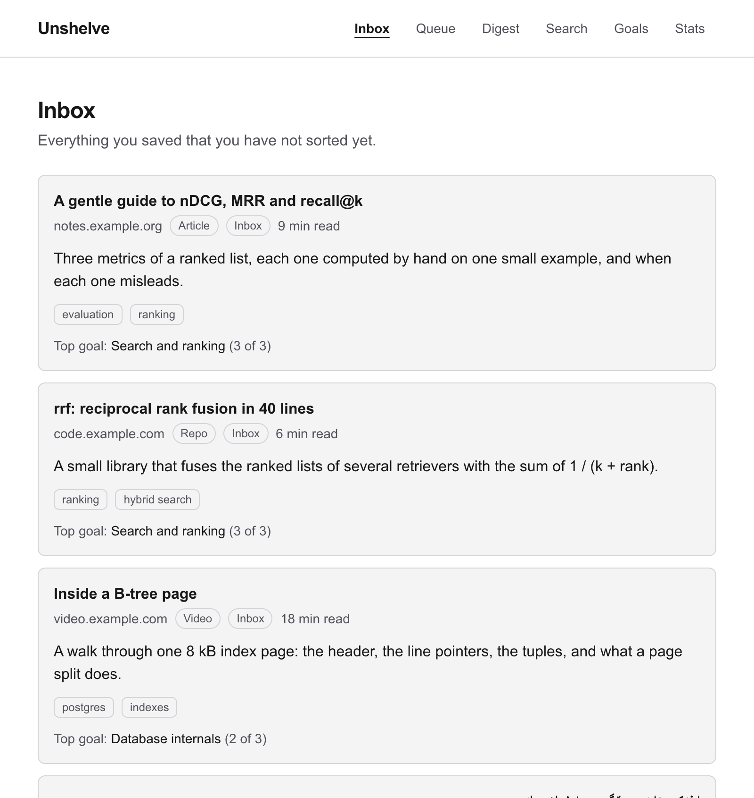
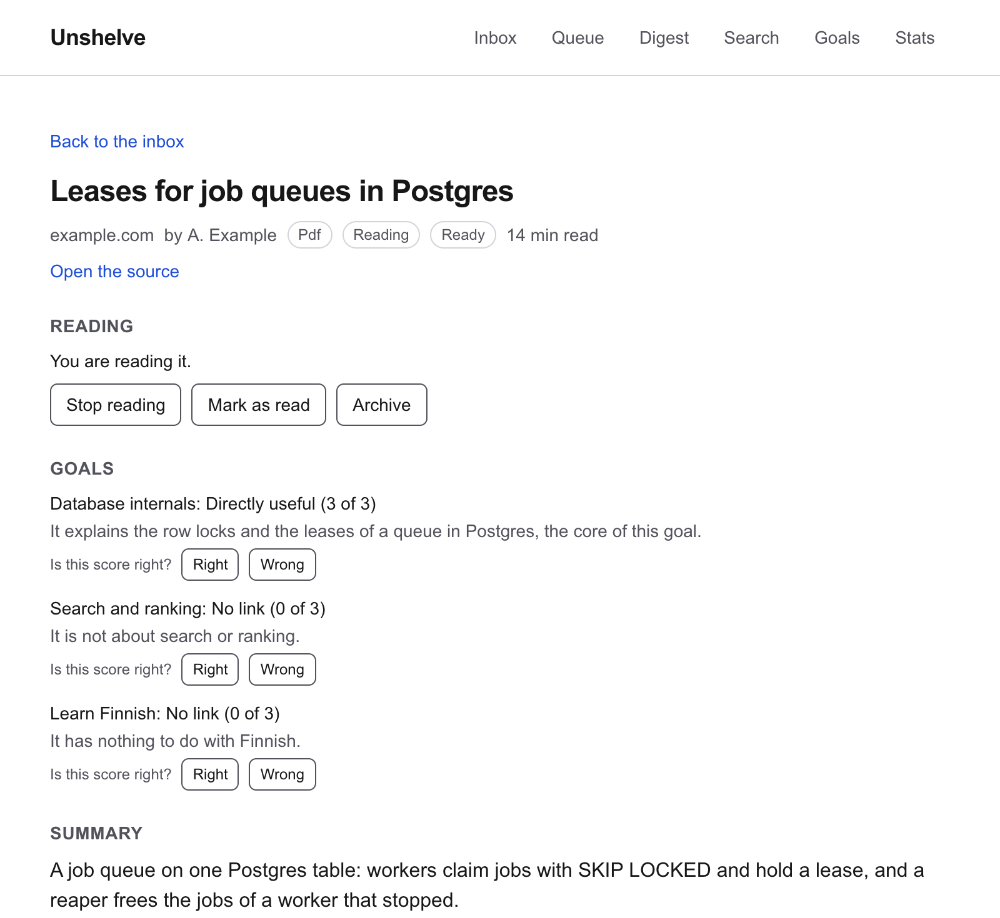
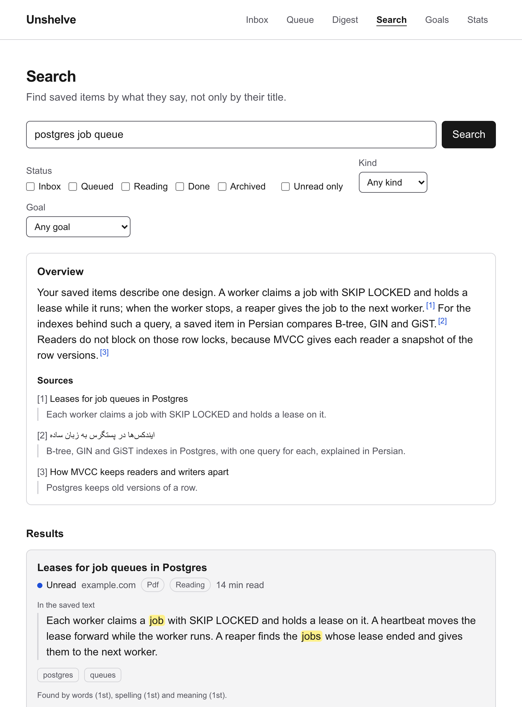
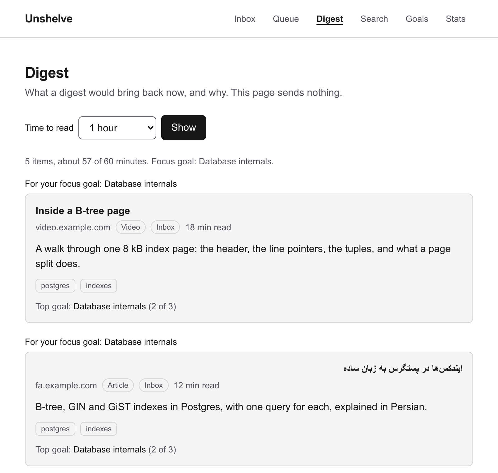
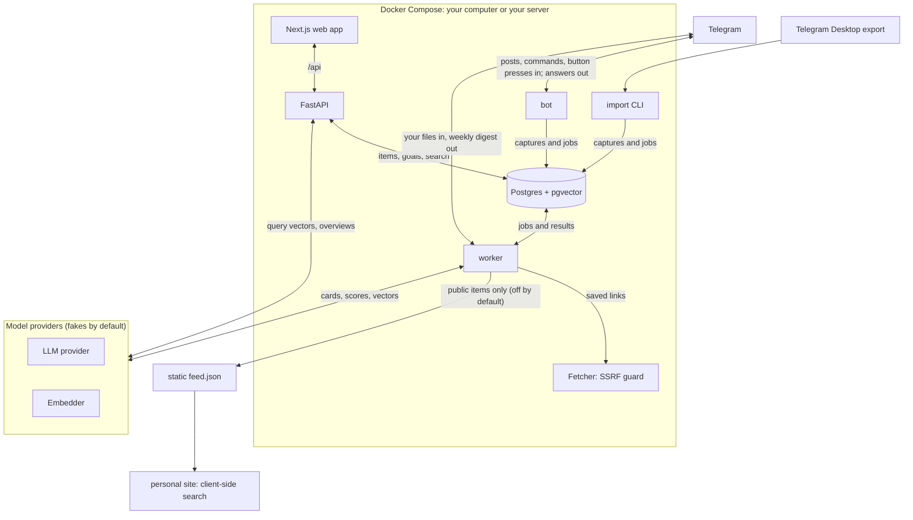

# Unshelve

**A goal-aware reading inbox.** Save things where you already save them. Unshelve tells you which ones matter for your plan, and brings them back until you read them.

You send links, posts and screenshots to your own private Telegram channel. A bot captures each one. Unshelve reads it, writes a short card, and scores it from 0 to 3 against each of your goals. A weekly digest brings back a few items, first for your focus goal: the one goal that you mark as your work now. You can search everything that you saved, and publish a chosen part on your own site.

Unshelve is self-hosted and has one owner. You run it with Docker on your computer or on a server. The bot and the sign-in answer one Telegram user only: you.

> **Status:** milestones M0 to M5 are done, and M6 (Ship) is open. It runs for one person every day. There is no hosted version. [Status and limits](#status-and-limits) lists what is not done.



<sub>All screenshots show made-up demo data. They come from the production build of the web app with a copy of the pretend API of its end-to-end tests ([`apps/web/e2e/fixture-api.mjs`](apps/web/e2e/fixture-api.mjs)) that holds other made-up items. No model wrote these cards.</sub>

## Why

Most "read it later" tools solve storage. Storage is not the problem. The problem is that you never go back.

Unshelve is built around that:

- **No new habit.** You keep sending links, posts and screenshots to your private Telegram channel. A bot picks them up.
- **Goal-aware.** You describe what you are working towards. Each saved item gets a relevance score and a reason for each goal.
- **It pushes.** A weekly digest brings back a few items, first for your focus goal, sized to a time budget.
- **It remembers.** Items move from inbox to done. Nothing is deleted.
- **Private by default, public by choice.** You pick which items appear on your own site. The public feed is built from a separate, restricted view of the database, so a private field cannot reach it.

## What it looks like

**One item.** The card, a score and a reason for each goal, and buttons to say if a score is right. Your "Right" and "Wrong" verdicts become a test set for the scores.



**Search.** Search finds an item by its words, by its spelling, and by its meaning, and it tells you why it found each one. "Write an overview" answers from your saved items, with numbered citations to the passages that support it.



**The digest.** What a digest would bring back now, for the reading time that you choose, and why each item is in it.



**In Telegram.** The weekly digest arrives as a message from the bot. This is the text that the bot's code (`apps/api/src/unshelve/bot/cards.py`) makes from three made-up items, without the HTML marks (bold and italic):

```text
Your digest
3 things, about 30 minutes.

Your focus goal:
Database internals

Inside a B-tree page
#1 · video.example.com · 18 min
A walk through one 8 kB index page: the header, the line pointers, the tuples, and what a page split does.
For your focus goal. Score: 2 of 3.

A gentle guide to nDCG, MRR and recall@k
#2 · notes.example.org · 9 min
Three metrics of a ranked list, each one computed by hand on one small example, and when each one misleads.
For your goal:
Search and ranking
Score: 3 of 3.

A thread on chunk sizes for retrieval
#3 · social.example.com · 3 min
Small chunks find exact facts and large chunks keep context.
New in your inbox: saved 3 days ago.

Right or Wrong: is the score of the goal right?

[Open #1] [Done #1]
[Right #1] [Wrong #1]
[Open #2] [Done #2]
[Right #2] [Wrong #2]
[Open #3] [Done #3]
```

## Try it on your computer

You need:

- git, and Docker Engine 25 or newer with Compose 2.24 or newer (`docker version` and `docker compose version` show them).

You need no API key: by default, the stack uses fake model providers and reads no web page.

1. Get the code:

   ```bash
   git clone https://github.com/herman72/unshelve.git
   cd unshelve
   ```

2. Make the settings and start the stack. The owner id is the Telegram user id of the owner; for a trial, any number works. `mkdir -p backups` makes the folder of the backups yours: without it, Docker on Linux makes the folder for root. The first start builds the images and takes a few minutes.

   ```bash
   cp .env.example .env
   echo "UNSHELVE_OWNER_TELEGRAM_ID=1" >> .env
   mkdir -p backups
   docker compose up -d --build --wait
   ```

3. Get a sign-in link, and open it in your browser:

   ```bash
   docker compose exec -T api unshelve auth link
   ```

   It prints `http://localhost:3000/login#token=…`. A link works once, for 5 minutes. To sign in again later, run the same command again. When a bot is connected, `/login` in the private chat with the bot gives the same kind of link.

4. Check the stack, if you want. The script gets a second sign-in link itself, signs in with it, and prints `ok:` or `not ok:` for each check:

   ```bash
   deploy/check-instance.sh http://localhost:3000
   ```

[The quickstart](docs/quickstart.md) has the same steps, and the steps for a server with your domain and HTTPS. CI runs its marked steps on a fresh clone. To stop the stack, run `docker compose down`. Your data stays in Docker volumes until you remove them.

### Your first item

Without Telegram, you can save an item through the API. Sign in, open the browser console on the Unshelve page, and paste this line (Chrome can ask you to type `allow pasting` first):

```js
fetch("/api/v1/items", {method: "POST", headers: {"content-type": "application/json"}, body: JSON.stringify({url: "https://example.com/how-pgvector-works", text: "A short guide to vector search in Postgres with pgvector"})})
```

Load the inbox again after a few seconds. The worker made a card for the item. With the fake providers, the card is made from the words of your text: a title in lowercase, three tags, and the mark "Partial", because the fake fetcher reads no page.

Then try the rest:

1. Open **Goals** and add a goal, for example "Database internals". Make it the focus.
2. Save a second item, with another link and another text:

   ```js
   fetch("/api/v1/items", {method: "POST", headers: {"content-type": "application/json"}, body: JSON.stringify({url: "https://example.com/btree-pages", text: "How a B-tree page stores rows in a database"})})
   ```

   A new item gets a score against each goal. With the fake providers, the score is 0. Its reason is a sentence such as "The card is far from each goal: the closest is at 0.00.", or a short list of words when the card and the goal share a word. Real scores need Claude and Voyage ([Connect real services](#connect-real-services)).

   The same link again does not make a new item: it counts as one more save of the first item. The first item was saved before the goal existed, so it has no score yet. `docker compose exec api unshelve goals rescore` scores it.
3. Open the item. Click "Add to the queue", then "Start reading", then "Mark as read". The section **History** shows each move.
4. Open **Search** and search for "vector".
5. Open **Digest** and choose a reading time.

## How it works

```text
Capture → Enrich → Triage → Resurface → Track → Retrieve → Publish
```

| Stage | What happens |
|---|---|
| Capture | A Telegram bot receives each post in your channel. A one-time import loads the old history from an export. |
| Enrich | The worker reads the page or the file, and finds its kind and its reading time. The model writes a card: title, summary, key points, tags, language. Vectors of the card and of each piece of a long text are made for search. |
| Triage | Each item is scored from 0 to 3 against each goal, with a reason that you can confirm or reject. |
| Resurface | A weekly digest proposes what to read next, in a reading time that you choose. |
| Track | `inbox → queued → reading → done`, or `archived`. The queue has 5 slots. Each move is kept as an event. |
| Retrieve | Hybrid search (full text, trigram and vector, fused) and an overview answer with citations. |
| Publish | A static feed of the items that you made public, with client-side search for your site. |

### Architecture



- **One Python image** runs the API (FastAPI), the worker and the Telegram bot as three services, and a fourth service, `migrate`, sets up the database before they start. **A second image** runs the Next.js web app. The web app sends each `/api` request on to the API.
- **Postgres is also the job queue.** A step of the pipeline is a job. A worker claims a job with `SKIP LOCKED` and holds a lease on it, so a job of a stopped worker goes to the next one ([ADR 0002](docs/adr/0002-postgres-job-queue-with-leases.md)).
- **The bot uses long polling.** It asks Telegram for new posts, so capture needs no open port on your computer ([ADR 0008](docs/adr/0008-long-polling-and-bot-issued-login-links.md)).
- **The worker is the only part that opens a saved link.** The fetcher refuses each address inside your network, also after a redirect ([ADR 0010](docs/adr/0010-one-guarded-way-to-the-internet.md)).
- **The LLM provider is Claude** (Anthropic), and **the embedder is Voyage AI**. Both are fakes by default. The ledger table `llm_calls` keeps each answer, so the same question is paid one time.
- **Two more services** keep your data: `backup` makes a backup each day into the `backups` folder, and `restore` brings one back ([note 50](docs/learn/50-backup-and-restore.md)). On a server, Caddy adds HTTPS.

[docs/architecture.md](docs/architecture.md) gives more detail. [docs/architecture-explorer.html](docs/architecture-explorer.html) plays each flow through the system step by step: open it in a browser.

## Quality

Search is measured on a golden set of 39 made-up items and 38 queries, with recorded Voyage vectors. CI fails when a change moves recall@10 or nDCG@10 of the fused list, down or up: a better number goes into the baseline on purpose.

Search asks three retrievers. Full text finds your words, trigram finds a title with a near spelling (from pieces of three letters), and vector finds the meaning. Reciprocal rank fusion joins the three ranked lists into the one list that you see.

| List | recall@10 | nDCG@10 | MRR |
|---|---|---|---|
| Full text | 0.349 | 0.475 | 0.553 |
| Trigram | 0.294 | 0.402 | 0.474 |
| Vector | 1.000 | 0.963 | 0.987 |
| **Fused (what you see)** | **1.000** | **0.974** | **1.000** |

The golden set is small and easy: recall@10 is at its ceiling, and the items are made up. The relevance scores, the overview, the cards and the readers of pages are **not measured yet**. [The evaluation report](docs/evaluation.md) gives the method, the limits, the measured costs of the model, and what each missing measurement needs.

## Connect real services

Each service is optional. Set its lines in `.env`, then run `docker compose up -d --wait` again, so that the services read the new settings.

| Service | Settings in `.env` | What it adds | Cost | Check |
|---|---|---|---|---|
| Telegram bot | `UNSHELVE_TELEGRAM_BOT_TOKEN`, `UNSHELVE_CAPTURE_CHAT_IDS`, and your real `UNSHELVE_OWNER_TELEGRAM_ID` | Capture from your channel, `/login`, `/digest`, `/label`, the weekly digest | Free | Post a link in the channel; it appears in the inbox |
| Live pages | `UNSHELVE_FETCHER=live` | The worker reads the page of each saved link | Free | `docker compose exec worker unshelve fetch https://example.com/` shows that the worker can reach the web. Then post a link: its item gets the text of the page |
| Claude | `UNSHELVE_PROVIDERS=live`, `ANTHROPIC_API_KEY` | Real cards, scores, image reading and overviews | Paid. The default model is Claude Opus 5.5 (`UNSHELVE_LLM_MODEL`). In a comparison on 16 real saved items, a card cost $0.034 with Opus 5.5 and $0.00086 with Haiku 5.5 (`claude-haiku-5-5`), on average | `docker compose exec api unshelve llm check` makes one real call |
| Voyage AI | `UNSHELVE_EMBEDDER=voyage`, `VOYAGE_API_KEY` | Real vectors: search by meaning, and a useful prefilter of the scores | The first 200 million tokens of an account are free | `docker compose exec api unshelve embeddings check` |

- **The daily budget.** `UNSHELVE_LLM_DAILY_BUDGET_USD` ($1.00 by default) stops new calls for the day. With Opus 5.5, that is about 29 cards a day, and the scores cost extra. A card that meets the limit waits until the next day and tries again. After 5 attempts, the item goes on without a card; "Process again" on its page makes the card later.
- **The prefilter of the scores.** Before Claude scores an item, Unshelve compares the vector of its card with the vector of each goal. If no goal is closer than `UNSHELVE_SCORE_PREFILTER` (0.3), each goal gets 0, and Claude is not asked. The fake vectors match only equal words, so with Claude but without Voyage, many items get 0 in this way. `UNSHELVE_SCORE_PREFILTER=-1` turns the prefilter off.
- **`unshelve llm check` makes a real call to Claude**, also with `UNSHELVE_PROVIDERS=fake`, unless the daily budget is used. It costs a fraction of a cent, and it needs `ANTHROPIC_API_KEY`.
- **Voyage can keep the texts that it gets and use them for training.** Opt out in its dashboard before you embed private texts. The opt-out needs a payment method ([note 18](docs/learn/18-vectors-for-search.md)).
- **When you turn on Voyage, or change `UNSHELVE_EMBED_MODEL`** (`voyage-4-large` by default), search uses no vectors until the new set is active. Run `docker compose exec api unshelve embeddings backfill`. When `unshelve embeddings status` shows each item, run `unshelve embeddings activate <set>` with the number of the set that backfill printed ([note 18](docs/learn/18-vectors-for-search.md)).
- **The items of the trial keep the cards and the scores of the fakes.** For a clean start, run `docker compose down -v` before you connect the real services. This deletes all data in the Docker volumes; the `backups` folder stays. To keep an item, click "Process again" on its page, and run `unshelve goals rescore --every-item` for the scores.

### Connect the Telegram bot

1. Send `/newbot` to @BotFather in Telegram. Put the token that it gives into `UNSHELVE_TELEGRAM_BOT_TOKEN`.
2. Make the bot an administrator of your private channel.
3. Put your numeric Telegram user id into the last line of `.env`, in place of `UNSHELVE_OWNER_TELEGRAM_ID=1`. Do not add a second line: the last line of a name counts. Unshelve has no command that shows your id; a Telegram bot that shows user ids gives it. A new owner id is a new user, so the items of the trial stay with the trial owner, and you do not see them.
4. Run `docker compose up -d --wait`, post one message in the channel, and run `docker compose logs bot --tail 20`. The line `capture.chat_not_allowed chat_id=-100…` gives the id of the channel ([note 10](docs/learn/10-bot-capture.md), part 8).
5. Put the id into `UNSHELVE_CAPTURE_CHAT_IDS` as a JSON list, for example `UNSHELVE_CAPTURE_CHAT_IDS=[-1001234567890]`. Run `docker compose up -d --wait` again, and post a link: it appears in the inbox.

### Bring in the old posts of a channel

The bot gets only new posts. To bring in the old posts, export the chat in Telegram Desktop ("Export chat history", HTML format). Turn on the media that you want to keep, for example photos and files: the import copies each file of 50 MB or less that is in the folder. Move the folder of the export into `exports/` of the repository. That folder is `/imports` in the `api` service. Give the time zone of the computer that made the export:

```bash
docker compose exec api unshelve import /imports/ChatExport_2026-10-13 --timezone Europe/Helsinki --dry-run
```

The dry run shows what the import would store. Run the command again without `--dry-run` to store the posts. It is safe to run two times.

For a large export, set `UNSHELVE_CARDS=batch` and run `docker compose up -d --wait` before the import. The cards then wait. Send them with `docker compose exec api unshelve llm batch send`: it shows the price, which is half the normal price, and asks for your yes. Most batches end within one hour. A batch that you accept does not count against the daily budget. Set `UNSHELVE_CARDS=live` again after the import, or the cards of new posts also wait ([note 29](docs/learn/29-cards-in-a-batch.md)). [Note 11](docs/learn/11-export-importer.md) explains the import.

## Run it on a server

[The quickstart, part B](docs/quickstart.md#b-on-a-server) starts the stack on a Linux server with your domain. Caddy gets and renews the certificate. The stack makes a backup of the database and of your files each day, into a folder outside Docker, and `deploy/backup/drill.sh` shows that a backup comes back ([note 50](docs/learn/50-backup-and-restore.md)).

## Everything it does

Each row links the note that explains it. Run the commands in the folder of the repository. `make help` lists the `make` targets.

| Area | What you can do | Where | Note |
|---|---|---|---|
| Sign in | A one-time link, a session of 30 days | `unshelve auth link`, or `/login` to the bot | [08](docs/learn/08-login.md) |
| Capture | Each post of your channel becomes one item; an edit updates it; an album is one item | the bot | [10](docs/learn/10-bot-capture.md) |
| Capture | The old posts of a channel, and their files | `unshelve import` (api) | [11](docs/learn/11-export-importer.md), [27](docs/learn/27-export-files.md) |
| Capture | A thing that you save again counts as one more save of the same item | automatic; `unshelve rekey` after a change of the rules | [12](docs/learn/12-resolver.md) |
| Enrich | Readers for articles, YouTube, X, GitHub, arXiv, Telegram posts, PDF files, images and other files | the worker; `unshelve fetch` and `unshelve extract` (worker) show one link | [14](docs/learn/14-fetcher-and-guard.md) to [16](docs/learn/16-fetch-step.md), [19](docs/learn/19-youtube-video.md) to [25](docs/learn/25-files-you-send.md), [28](docs/learn/28-image.md) |
| Enrich | A card from the model, now or in a batch at half the price | the worker; `unshelve llm costs`, `unshelve llm batch send` | [17](docs/learn/17-model-card.md), [29](docs/learn/29-cards-in-a-batch.md) |
| Enrich | Vectors for the card and for each piece of a long text | the worker; `unshelve embeddings status` | [18](docs/learn/18-vectors-for-search.md) |
| Enrich | Send an item back to the start of the pipeline | item page, "Process again" | [26](docs/learn/26-item-page.md) |
| Triage | Goals: add, change, archive, and one focus | page "Goals" | [31](docs/learn/31-goals.md) |
| Triage | A score from 0 to 3 and a reason for each goal | item page; `unshelve goals rescore` for old items | [32](docs/learn/32-scores-against-goals.md) |
| Triage | Say "Right" or "Wrong" to a score, and export your verdicts | item page, `/label` to the bot; `unshelve labels export` | [33](docs/learn/33-labels-and-golden-set.md) |
| Resurface | See what a digest would bring back now, and why | page "Digest", `/digest` to the bot | [34](docs/learn/34-choosing-a-digest.md), [simulator](docs/digest-simulator.html) |
| Resurface | A weekly digest, then "archive or keep?" for up to 5 old inbox items | the worker sends it through the bot: `UNSHELVE_DIGEST_DAY` (Sunday), `UNSHELVE_DIGEST_HOUR` (9) in `UNSHELVE_TIMEZONE` (UTC), for `UNSHELVE_DIGEST_MINUTES` (60) of reading | [13](docs/learn/13-cards-and-digest.md), [35](docs/learn/35-sending-the-digest.md) |
| Track | Move an item through inbox, queue, reading, done, archived; see its history | item page, page "Queue" | [30](docs/learn/30-reading-status.md) |
| Retrieve | Hybrid search with a snippet that tells why each item was found | page "Search", `GET /api/v1/search`, `unshelve search retrievers` | [36](docs/learn/36-three-retrievers.md) to [38](docs/learn/38-search-api.md), [41](docs/learn/41-search-page.md) |
| Retrieve | Filters: status, kind, goal, unread only, tags | page "Search" | [41](docs/learn/41-search-page.md), [48](docs/learn/48-unread-only.md), [49](docs/learn/49-tag-filters.md) |
| Retrieve | An overview answer with citations | page "Search", `unshelve search overview` | [39](docs/learn/39-overview-with-citations.md) |
| Publish | Preview the exact public record of an item, then publish it | item page, section "Public" | [45](docs/learn/45-publishing-an-item.md) |
| Publish | Write the feed to a file, a git repository or an S3 bucket. Nothing is published by default. In the stack, `s3` works as it is; `file` and `git` need a folder or a key that you mount into the `worker` service yourself | `UNSHELVE_PUBLISH_TARGET` (`none`); `unshelve publish show`, and `unshelve publish run` (worker) | [42](docs/learn/42-public-feed.md) to [44](docs/learn/44-object-storage-target.md) |
| Publish | Search the feed in the browser of your site | `packages/site-search`, example in `examples/site` | [46](docs/learn/46-site-search.md) |
| Operate | The job queue, the cost of each task of the model, your items by state | page "Stats", JSON logs | [51](docs/learn/51-logs-and-stats.md), [52](docs/learn/52-stats-page.md) |
| Operate | Daily backups and a tested restore | services `backup` and `restore`, `deploy/backup/drill.sh` | [50](docs/learn/50-backup-and-restore.md) |

Write each `unshelve` command after `docker compose exec <service>`. The service is `api`, unless the row says `worker`. For example: `docker compose exec api unshelve goals rescore`.

## Status and limits

| Milestone | Result | Status |
|---|---|---|
| M0 Foundations | Repository, schema, contracts, job queue, walking skeleton | Done |
| M1 Capture | Every channel post lands in the database once; first digest | Done |
| M2 Enrich | Summaries, tags and embeddings for each item | Done |
| M3 Track, Triage, Resurface | Statuses, goals, relevance scores, weekly digest | Done |
| M4 Search | Hybrid search, overview answers, evaluation harness | Done |
| M5 Publish | Public feed and site search | Done |
| M6 Ship | Deployment, backups, observability, documentation | Open: the decision records for the server of the owner's own instance and for an approximate vector index ([#42](https://github.com/herman72/unshelve/issues/42)), the JSON export ([#58](https://github.com/herman72/unshelve/issues/58)) |

What is not done, or has limits:

- **One owner for each instance.** Each table of your data has an `owner_id`, but there is no sign-up and no second user ([ADR 0005](docs/adr/0005-single-tenant-first-owner-id-everywhere.md)).
- **No form to save an item.** The web app has none. Save through Telegram, the import, or `POST /api/v1/items` ([Your first item](#your-first-item)).
- **The importer reads the HTML export only.** The JSON export of Telegram Desktop is issue #58.
- **Vector search is exact.** There is no approximate index ([ADR 0007](docs/adr/0007-embedding-sets-and-exact-search-first.md)). An index comes only after a benchmark shows that search is too slow. Search time is not measured yet.
- **No sign-out button.** The web app has none. To end a session, open the browser console on a page of the app and run `fetch("/api/v1/auth/logout", {method: "POST"})`.
- **Some parts of the API contract answer 501**: the tag list, the job admin, similar items, a change of an item, the list of digests, and the filters `tag`, `goal_id` and `min_score` and the sort `relevance` of `GET /api/v1/items`.
- **No measurement** of the relevance scores, the overview, the cards or the readers of pages yet ([the evaluation report](docs/evaluation.md#3-not-measured-yet)).

## Development

You need Docker, [uv](https://docs.astral.sh/uv/), Node.js 22.18 or newer and pnpm 10. The web app alone runs on Node.js 20.9, but the tests of `packages/site-search` need 22.18.

```bash
make setup   # install Python and Node dependencies
make up      # build and start the stack: web on :3000, API on :8000
make check   # lint, type check, the Python tests, the site-search tests and the API contract check
make eval    # measure search on the golden set
```

- New to the code? Start with the [learning notes](docs/learn/README.md): one short note for each part of the system, each with examples and an exercise.
- The decisions and their reasons are in [the decision records](docs/adr/README.md). The product is in [docs/product.md](docs/product.md).
- CI runs only the groups of jobs whose files a change touches ([note 53](docs/learn/53-fewer-minutes-of-ci.md)).

## Contributing

See [CONTRIBUTING.md](CONTRIBUTING.md).

## License

[MIT](LICENSE)
