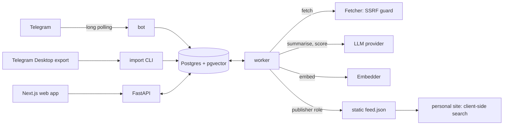

# Architecture

This document describes the shape of the system. The reasons behind each choice are in the [decision records](adr/README.md).

## Diagrams

| File | What it shows | How to open it |
|---|---|---|
| [architecture-explorer.html](architecture-explorer.html) | An interactive map of the system. Play five flows step by step (save an item, weekly digest, search, publish, a worker dies), or open one service to see what it does, what it never does and what happens when it stops. | Download or clone, then open the file in a browser. |
| [architecture.drawio](architecture.drawio) | Five editable pages: system overview, pipeline of one item, job lifecycle, item states, data model. | [draw.io](https://www.drawio.com/) desktop, app.diagrams.net, or the draw.io extension of your editor. |

The explorer, the draw.io overview page and the diagram below use the same components and the same names. When the system changes, change all three.

For a slower explanation of each part, with examples and exercises, read the [learning notes](learn/README.md).

## Components



One Python image runs four commands:

| Command | Role |
|---|---|
| `api` | HTTP API for the web app |
| `worker` | Runs jobs from the queue: ingest, fetch, enrich, embed, score, digest, publish |
| `bot` | Telegram long polling: captures channel posts, serves the private chat |
| `migrate` | One-shot schema migration |

Postgres holds everything, including the job queue. There is no Redis and no message broker.

## Repository layout

```
apps/api/            Python package, migrations, tests, evals, openapi.json
  src/unshelve/
    contracts/       Protocols, DTOs, job payloads, state machine (frozen interfaces)
    db/              engine, session, models
    queue/           job store, worker loop, handler registry
    api/ auth/       HTTP layer and login
    bot/             Telegram handlers
    ingest/          capture → item resolution, export importer
    net/             the only code that opens arbitrary URLs
    extract/         one module per source type
    pipeline/        job handlers
    enrich/ embed/   LLM enrichment, chunking and embeddings
    providers/       real adapters for LLM and embeddings
    relevance/       goals and scoring
    search/          retrievers, fusion, overview
    publish/         public feed
    testing/         fakes and conformance suites
apps/web/            Next.js web app
packages/api-client/ TypeScript types generated from openapi.json
deploy/              Dockerfiles, Compose files
docs/                this folder
```

## Data flow for one saved item

1. The bot receives a `channel_post` and builds a `CaptureEnvelope`. The export importer builds the same envelope from the export file.
2. The envelope is inserted into `captures`. The unique key `(owner_id, chat_id, message_id, edit_seq)` makes a second delivery a no-op. A job is enqueued only when the row is new.
3. `ingest_capture` resolves the capture to an item through alias keys (`item_keys`). A known key raises `capture_count` on the existing item. An unknown key creates the item.
4. `fetch_item` picks an extractor, fetches through the `Fetcher` and stores the text in `item_contents`. A failure marks the item `partial` and the pipeline continues with the capture text.
5. `enrich_item` calls the LLM for a structured summary. `embed_item` stores one card vector and, for long text, body chunks. `score_item` scores the item against each goal.
6. Each step enqueues the next step in the same transaction that writes its own result.

## Design rules

| Topic | Rule |
|---|---|
| Queue | `FOR UPDATE SKIP LOCKED` to claim, plus a lease (`locked_by`, `locked_until`), a heartbeat and a reaper. `complete` and `fail` succeed only while the lease is held. Delivery is at-least-once, so every handler is idempotent. |
| Database access | Async everywhere on one driver. `lazy="raise"`, `expire_on_commit=False`, one session per request or job, no transaction held across network I/O. Pure logic stays synchronous. |
| Reading state vs processing state | `items.status` is changed only by the user. `items.enrich_state` is changed only by workers. |
| Embeddings | Vectors are stored with an `embedding_set_id` and a dimension check, in an untyped `vector` column. Changing the model is a backfill, not a schema change. Search is exact until a benchmark shows that an approximate index is needed. |
| Mixed English and Persian | One immutable SQL function, `u_norm()`, normalises stored text and queries. Summaries and tags are written in English. Trigram matching on titles and a multilingual embedder cover what stemming cannot. |
| Untrusted content | `Fetcher` connects only to validated public addresses and checks every redirect. Fetched text is data for the model: the enrichment call has no tools and a fixed output schema, and its output is escaped when rendered. |
| LLM calls | Every call is recorded in `llm_calls`, keyed by a hash of model, prompt version and input. The table is the retry cache, the cost ledger and the replay source for evaluations in CI. |

## Public boundary

The public feed must never contain private data. The design does not rely on a filter in application code:

- A schema `pub` holds one view with an explicit column list.
- The publisher job connects with a database role that can read that view and nothing else.
- Enrichment never sees goal text, so summaries cannot quote the user's plan. Tags are published only when `is_public` is set. The private `note` is a different column from `public_note`.
- There is no public API. The publisher pushes a static `feed.json`.

Tests assert that sentinel strings placed in private rows never appear in the feed bytes, that the view's column list matches a snapshot, and that the publisher role cannot read base tables.

## Item states

```
inbox    → queued, reading, done, archived
queued   → reading, done, inbox, archived
reading  → done, queued, archived
done     → queued, archived
archived → inbox
```

All status changes go through one function that updates the item and appends an event in the same transaction. `queued + reading` cannot exceed the user's queue limit.

`enrich_state`: `pending → fetched → enriched → ready`. Any state can move to `failed`. A reprocess request moves `failed` or `ready` back to `pending`.

## Testing strategy

| Layer | How |
|---|---|
| Pure logic (state machine, URL canonicalisation, fusion, metrics, digest selection) | Plain unit tests, no I/O |
| Database | Real Postgres. Each test session gets its own database. Most tests roll back; concurrency tests use committed data in a cloned database. |
| Adapters | Every implementation of a Protocol passes the same conformance suite as its fake |
| Pipeline | Fakes for LLM, embeddings and fetching; recorded Telegram updates |
| Quality | Labelled sets for relevance and search (recall@k, nDCG@10, MRR), replayed from `llm_calls` in CI |
| Live | Marked tests that need real credentials, run on demand |
