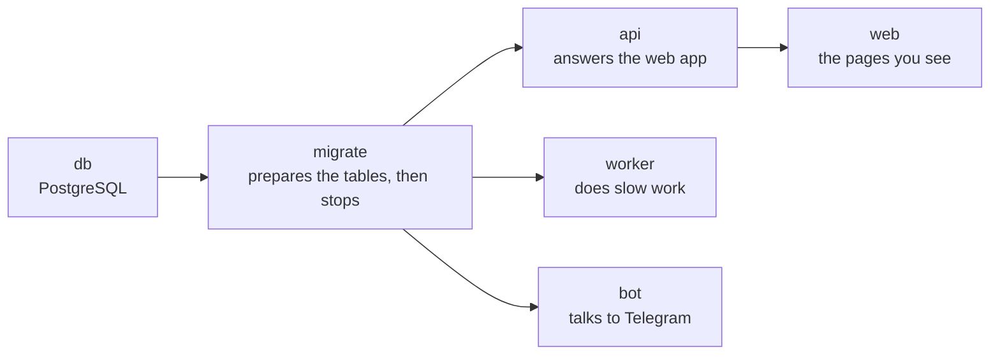
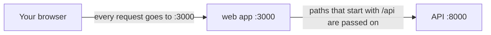
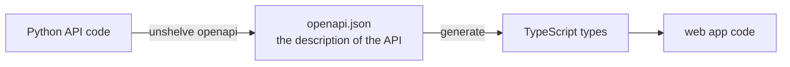

# 1. The project skeleton

> Pull request: [#44](https://github.com/herman72/unshelve/pull/44) · Code: [`deploy/compose.yaml`](../../deploy/compose.yaml), [`apps/api/src/unshelve/api/ops.py`](../../apps/api/src/unshelve/api/ops.py), [`apps/web/next.config.ts`](../../apps/web/next.config.ts) · Interactive: [system map](../architecture-explorer.html)

## In one minute

This part builds the frame of the project. After it, one command starts the whole system on your laptop, and one command checks all the code. The system does nothing useful yet. But every later part has a place to live, and every later change is checked automatically.

## 1. One command starts six small programs

```bash
docker compose up -d --build --wait
```

Unshelve is not one big program. It is six small ones. Each one runs in its own *container*. A container is a closed box that holds one program and everything that the program needs.



An arrow means "must be ready first". The database starts first. Then `migrate` creates the tables and stops. Only then the other programs start.

**A comparison from daily life:** a restaurant. The kitchen must be ready before the waiters open the door.

## 2. Two different questions: "alive?" and "ready?"

Each program must be able to answer two questions.

| Question | Address | It checks | Example answer |
|---|---|---|---|
| Are you alive? | `/api/v1/healthz` | Only that the program runs | `{"status":"ok","version":"0.1.0"}` |
| Can you serve a request now? | `/api/v1/readyz` | That the database answers | `200` when yes, `503` when no |

Why two questions? Many systems restart a program that answers "I am not alive". Kubernetes is one of them. Now here is a story: the database stops for one minute.

| | If "alive?" also checked the database | With two questions (what we do) |
|---|---|---|
| What the system thinks | "The API is dead" | "The API is alive, but not ready" |
| What it does | It restarts the API again and again | It waits |
| Result | The database is still down. Now the API is also restarting. | When the database is back, the API works at once |

A restart does not repair a database. So "alive?" must not look at the database.

**A comparison from daily life:** a shop. "Are the lights on?" is one question. "Does the cash register work?" is a different question. If the cash register is broken, you do not tear down the shop and build it again.

## 3. The browser talks to one address only

The web app runs on port 3000. The API runs on port 8000. For a browser, these are two different sites.



The browser only knows the web app. The web app passes each `/api/...` request to the API. This is called a *proxy*: a program that passes requests on to a different program.

Why: a browser protects you. It does not send your sign-in cookie from one site to a different site without extra settings. With the proxy there is only one site, so no extra settings exist that somebody could get wrong.

## 4. A new copy of the project is safe and free

These are the default settings:

```text
UNSHELVE_PROVIDERS=fake      the "AI model" is a small local stand-in
UNSHELVE_FETCHER=fixtures    web pages come from files, not from the internet
```

So a person who downloads the project and starts it pays nothing and sends nothing to the internet. To use real services, you must change the settings on purpose.

**The rule:** the dangerous or expensive behaviour is never the default.

## 5. One file describes the API, and the web app is checked against it



Example: the API answers `{"status": "ok", "version": "0.1.0"}`. Somebody renames `version` to `ver` in the Python code.

- Without this chain: the web page shows "undefined" where the version was. Nobody sees it before a user does.
- With this chain: the TypeScript types change. The web app does not build. The mistake is found in one minute.

## 6. Every change is checked by a machine

*CI* (continuous integration) is a service that runs the checks on each pull request. It has four jobs here:

| Job | What it proves |
|---|---|
| API | The Python code has no style problems, no type errors, and all tests pass |
| Web | The web app has no style problems, no type errors, and it builds |
| Contract | `openapi.json` and the TypeScript types are up to date |
| Stack | The six programs really start together |

## What a senior engineer checks here

- **Are tool versions fixed?** The same tool version runs on the laptop, in CI and in the container. Then "it works on my machine" and "it works in CI" mean the same thing.
- **Does each program run as a normal user inside its container?** Yes. A program that runs as the administrator can do more damage if somebody breaks into it.
- **Who can reach the ports?** Only your own computer (`127.0.0.1`). A laptop in a café does not show its database to the café network.

## Exercise (15 minutes)

In [`apps/api/tests/test_ops.py`](../../apps/api/tests/test_ops.py), one test uses a database address where nothing listens (port 1). The connection fails at once.

1. Add a test that uses an address that never answers: `10.255.255.1`.
2. Measure how long the test takes.
3. Explain the number. Hint: look for `connect_timeout` in the address.

(Pull request #51 has one solution.)

## Words used in this note

| Word | Meaning |
|---|---|
| Container | A closed box that holds one program and everything it needs to run |
| Image | The recipe from which a container is made |
| Health check | A small question that one program asks another: "are you alive?" or "are you ready?" |
| Proxy | A program that passes requests on to a different program |
| CI | A service that runs the checks on each change automatically |
| Lock file | A file that fixes the exact version of each library |

## To read more

- [Liveness, readiness and startup probes](https://kubernetes.io/docs/concepts/configuration/liveness-readiness-startup-probes/), Kubernetes documentation. The same two questions, in the most used system for containers.
- [Control startup order in Compose](https://docs.docker.com/compose/how-tos/startup-order/), Docker documentation. How "must be ready first" is written.
- [Same-origin policy](https://developer.mozilla.org/en-US/docs/Web/Security/Same-origin_policy), MDN. Why a browser treats two ports as two sites.

Next: [2. Contracts and fakes](02-contracts-and-fakes.md)
