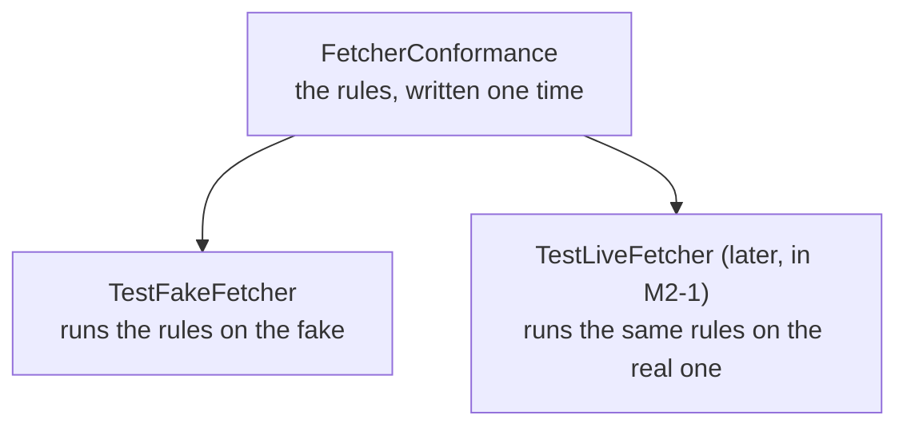

# 2. Contracts and fakes

> Pull request: [#45](https://github.com/herman72/unshelve/pull/45) · Code: [`contracts/`](../../apps/api/src/unshelve/contracts/), [`testing/fakes.py`](../../apps/api/src/unshelve/testing/fakes.py), [`testing/conformance.py`](../../apps/api/src/unshelve/testing/conformance.py)

## In one minute

Unshelve has parts that talk to the outside world. One part downloads web pages. One part asks an AI model. One part stores files.

This step does not build these parts. It writes down what each part must do. That is the *contract*. It also builds a simple stand-in for each part. That is the *fake*.

With the contracts and the fakes, every later part can be built and tested with no internet and at no cost.

## 1. What is a "fake"?

The real `Fetcher` downloads a page from the internet. That is slow, and it can fail.

In tests we use `FakeFetcher`. It does not use the internet. It returns pages that the test gave to it.

```python
fetcher = FakeFetcher()
fetcher.add("https://ok.test/", "hello")     # the test writes the page

page = await fetcher.get("https://ok.test/", max_bytes=1000, accept=["text/*"])
print(page.body)                              # b"hello"
```

## 2. The problem: the fake and the real one can become different

Here is a story about one rule: "a page that is too large is an error".

| Day | Real `Fetcher` | `FakeFetcher` | Tests | Reality |
|---|---|---|---|---|
| 1 | too large → error | too large → error | green | correct |
| 30 | someone changes it: too large → **cuts the page** | still: too large → error | **green** | **wrong**: the summariser gets half an article |

On day 30 the tests are green, but the program is wrong. The tests use the fake, and the fake no longer behaves like the real one. Engineers say: "the fake drifted".

## 3. The solution: one list of tests for both

We write the rules one time, in a class named `FetcherConformance`. "Conformance" means "it obeys the rules".



In code, the reuse is only this:

```python
class TestFakeFetcher(FetcherConformance):   # take all the rules
    @pytest.fixture
    def case(self):                           # say which fetcher to test
        ...
```

Go back to day 30. The changed real fetcher now fails the rule `test_a_body_over_the_limit_is_an_error_not_a_truncation`. The tests are red, and somebody sees the problem on the same day.

**A comparison from daily life:** a wall socket. Every plug must fit the same socket. We do not test each lamp in each room. We test one thing: "does the plug fit the standard?"

**The name of the idea:** if code works with one `Fetcher`, it must work with every `Fetcher`, and it must not need to know which one it has. This is the *Liskov substitution principle*.

## 4. Three more rules in this step, each with an example

**a) A job carries ids only, not data.**

```text
Bad:   job = {"item_id": 7, "title": "Old title"}
       10:00  the job is created
       10:01  you change the title to "New title"
       10:02  the job runs with "Old title"      <- wrong: the data is old

Good:  job = {"item_id": 7}
       10:02  the job reads item 7 from the database -> "New title"
```

**b) A data object cannot change after it is made.** The word for this is "immutable".

```python
envelope = CaptureEnvelope(...)
envelope.text = "changed"     # error: the object is frozen
```

Why: function A gives the object to function B. If B could change it, A would see different data later and would not know why.

**c) No reading state is a dead end.**

An archived item can go back to the inbox (`archived → inbox`). The test `test_every_status_is_reachable_from_inbox_and_can_return_to_it` checks all states. So nobody can add a state by mistake that has no way out.

## 5. What a fake can test, and what it cannot

`FakeEmbedder` does not understand meaning. It only looks at the words. The numbers below are real results from this code (1.0 = the same, 0.0 = nothing in common).

| Sentence A | Sentence B | `FakeEmbedder` | A real model |
|---|---|---|---|
| "tuning a postgres index" | "postgres index tuning guide" | 0.75 (shared words) | similar |
| "the car is fast" | "the car is very fast" | 0.87 (shared words) | similar |
| "the car is fast" | "an automobile with high speed" | **0.0** (no shared word) | similar: same meaning |

So we use the fake to test the *machine* around the model: are the results in the correct order, do the filters work, is the data stored? We do not use the fake to test if search understands meaning. That needs a real model and labelled examples (milestone M4).

## A choice that we made

Python has two ways to say "this class is a `Fetcher`".

1. **Inheritance.** You write `class MyFetcher(FetcherBase)`. The class must import the parent class.
2. **Protocol** (what this step uses). A class is a `Fetcher` if it has the correct methods. It does not import a parent.

We use Protocols. The fake, the real fetcher, and a class from another library can then all be a `Fetcher` without a common parent. The type checker checks that the methods have the correct shape. The conformance tests (see below) check that the methods behave correctly.

## Exercise (10 minutes)

Open a Python shell with `cd apps/api && uv run python`, then run:

```python
import asyncio
from unshelve.testing.fakes import FakeEmbedder

e = FakeEmbedder()
a, b = asyncio.run(e.embed_documents(["the car is fast", "an automobile with high speed"]))
print(sum(x * y for x, y in zip(a, b)))    # 0.0 means "nothing in common"
```

Change the second sentence to `"the car is very fast"` and run it again. Then write one sentence: why did the number go up?

## Words used in this note

| Word | Meaning |
|---|---|
| Contract | A written promise about a part: its inputs, its outputs and its errors |
| Protocol | The Python way to write a contract: a list of methods that a class must have |
| Fake | A simple stand-in for a real part, used in tests |
| Conformance suite | One set of tests that every version of a part must pass |
| Immutable | Cannot be changed after it is made |
| Payload | The data that a job carries |
| State | One of the fixed situations that a thing can be in, for example `inbox` or `done` |

## To read more

- [Mocks Aren't Stubs](https://martinfowler.com/articles/mocksArentStubs.html) by Martin Fowler. Read the part "The Difference Between Mocks and Stubs". It explains the words fake, stub and mock.
- [Liskov substitution principle](https://en.wikipedia.org/wiki/Liskov_substitution_principle) on Wikipedia. Read only the introduction.
- [PEP 544, Protocols](https://peps.python.org/pep-0544/). Read "Rationale and Goals". It explains how a class can obey an interface without inheritance.

Previous: [1. The project skeleton](01-project-skeleton.md) · Next: [3. The database schema](03-database-schema.md)
