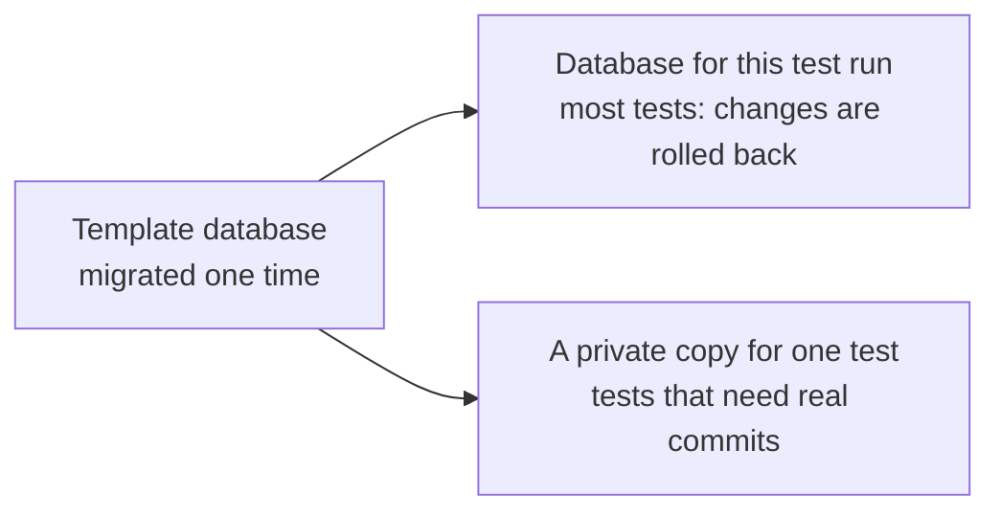

# 3. The database schema

> Pull request: [#46](https://github.com/herman72/unshelve/pull/46) · Code: [`db/models.py`](../../apps/api/src/unshelve/db/models.py), [`migrations/versions/0001_initial.py`](../../apps/api/migrations/versions/0001_initial.py), [`tests/db/`](../../apps/api/tests/db/)

## In one minute

All data of Unshelve is in one PostgreSQL database: the saved items, the jobs, and the data for search.

This step creates the 19 tables. It also puts the most important rules into the database itself, so that no program can break them. And it gives each test run its own database.

## 1. A rule in the database protects you from every program

Here is one rule: "a running job always has a worker name and an end time".

```text
state = 'running', locked_by = 'w1', locked_until = 12:01    allowed
state = 'running', locked_by = NULL                          refused by the database
state = 'pending', locked_by = 'w1'                          refused by the database
```

Four things write to this table: the API, the worker, the bot, and you with `psql`. A rule in Python protects only the Python code that remembers the rule. A rule in the database protects all four.

This rule helps while you write the queue code of [note 4](04-job-queue.md). If `complete()` forgets `locked_by=None`, the database refuses the change, and the test shows the name of the rule: `ck_jobs_running_has_lease`.

**A comparison from daily life:** a rule in Python is a sign that says "please close the door". A rule in the database is a door that closes itself.

## 2. One function cleans text for saving and for searching

The Persian word for "book" can be typed in two ways:

| Typed | Letter | Looks like |
|---|---|---|
| `كتاب` | Arabic kaf (U+0643) | the same word |
| `کتاب` | Persian kaf (U+06A9) | the same word |

For you they are the same. For a computer they are two different texts. If you save the first one and search for the second one, you find nothing.

`u_norm()` changes both to one form:

```sql
SELECT u_norm('كتاب') = u_norm('کتاب');   -- true
```

The same function is used in three places: when a title is stored, in the search index, and in the search query. So the stored text and the query are always cleaned in the same way. The function is written in SQL for this reason: all three places are inside the database.

## 3. Each test run gets its own database



A copy of a template takes a few milliseconds. Each database has a random name, for example `unshelve_test_3fa9c1`.

Why: you and a coding agent can run the tests at the same moment against one Postgres. With random names, the two runs never see the rows of the other run. Tests that share data are the most common reason for tests that fail "sometimes".

## 4. The privacy test

This is the idea of `tests/db/test_public_boundary.py`:

1. Put a secret word in private places: a private note, a goal, a private tag. The word is `SENTINEL-MUST-NOT-LEAK`.
2. Change to the database role that builds the public feed.
3. Read everything that this role can read.
4. Check that the secret word is not there.

Try it: add `i.note` to the view in the migration, then run the tests. The test fails. That is a test that really protects something.

## A choice that we made

How do we store a value like the status of an item (`inbox`, `done`, ...)? There are two ways.

1. A Postgres `ENUM` type.
2. A text column with a rule (what this step uses):

```sql
CHECK (status IN ('inbox', 'queued', 'reading', 'done', 'archived'))
```

Try to save `'snoozed'`: the database refuses it.

Why not `ENUM`? You cannot remove a value from an `ENUM`, and for many years a new value could not be added inside a migration's transaction. A `CHECK` rule is replaced like any other rule. The cost is a few more bytes for each row.

## What a senior engineer checks

- **Does the way back work?** The test runs "upgrade, downgrade, upgrade". Most projects never run a downgrade before the day they need it.
- **Is the migration independent?** It must not import code from the application. If it did, a later change of that code would break an old migration.
- **Can two test runs collide?** See part 3.

## Exercise (25 minutes)

**Part 1: add a private column.**

1. Add a column to the `Item` model in `db/models.py`: `source_note` (text, can be empty).
2. Create the migration: `cd apps/api && uv run alembic revision --autogenerate --rev-id 0002 -m "add source note"`.
3. Run `uv run pytest tests/db`. All tests pass.

Nothing tells you that the new column is private. That is correct: private is the normal case. The column is in the table `items`. It is not in the view `pub.items`, because the view lists its columns one by one.

**Part 2: try to make the column public.**

4. Open `migrations/versions/0001_initial.py` and copy the text of `PUB_ITEMS_VIEW`.
5. In the `upgrade()` of your new migration, run that text with two changes: write `CREATE OR REPLACE VIEW` at the start, and add `i.source_note` as the last column, after `tags`.
6. Run `uv run pytest tests/db/test_public_boundary.py`. One test fails. Read its name and its message.
7. Make the test pass.

**Part 3: throw it away.** Delete your migration file and undo your change in `models.py`. An exercise must not go into a pull request.

<details>
<summary>The answer</summary>

The test `test_the_public_view_has_exactly_the_agreed_columns` fails with this message:

```text
Left contains one more item: 'source_note'
```

To make the test pass, you add `"source_note"` to the list `PUBLIC_COLUMNS` in the test file.

So a column becomes public only when you change **two** places on purpose: the view, and the list in the test. A column that you only add to the table stays private. And a reviewer sees both changes in the pull request.

</details>

## Words used in this note

| Word | Meaning |
|---|---|
| Schema | The list of the tables and columns of a database |
| Migration | A script that changes the schema from one version to the next |
| Constraint | A rule that the database checks on each write. A `CHECK` is one type of constraint. |
| Generated column | A column that the database fills by itself from other columns |
| Index | A structure that makes a search fast |
| Role | A database user with a set of permissions |
| View | A saved query that you can read like a table |

## To read more

- [PostgreSQL manual, "Constraints"](https://www.postgresql.org/docs/current/ddl-constraints.html). Read "Check Constraints".
- [PostgreSQL manual, "Generated Columns"](https://www.postgresql.org/docs/current/ddl-generated-columns.html). This is how the search column fills itself.
- [Alembic tutorial](https://alembic.sqlalchemy.org/en/latest/tutorial.html). Read "Running our First Migration".

Previous: [2. Contracts and fakes](02-contracts-and-fakes.md) · Next: [4. The job queue](04-job-queue.md)
