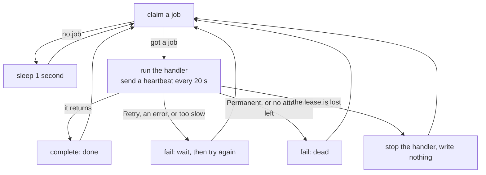

# 5. The worker loop

> Pull request: [#52](https://github.com/herman72/unshelve/pull/52) · Code: [`queue/worker.py`](../../apps/api/src/unshelve/queue/worker.py), [`queue/registry.py`](../../apps/api/src/unshelve/queue/registry.py), [`tests/queue/test_worker.py`](../../apps/api/tests/queue/test_worker.py) · Interactive: [job queue simulator](../queue-simulator.html)

## In one minute

The queue functions of [note 4](04-job-queue.md) change one job row safely. The worker loop is the program that uses them all day.

It takes a job. It runs the correct function for that job. It keeps the lease alive while the function runs. Then it writes the result. It also decides what to do when the function fails or is too slow.

## 1. The loop in one picture



## 2. How a handler says what happened

A handler is a normal `async` function. It reports its result in the normal Python way: it returns, or it raises.

| The handler... | Example | The job becomes |
|---|---|---|
| returns | `return` | `done` |
| asks for a later try | `raise Retry("the site answered 503", after=timedelta(minutes=5))` | `pending`, and it runs again in 5 minutes |
| says "this can never work" | `raise Permanent("the item does not exist")` | `dead` |
| has a bug | `raise ValueError("boom")` | `pending`, and it runs again after a wait |
| is too slow | longer than its `timeout_s` | stopped, then `pending` again |

## 3. The wait doubles after each failed try

The word for this is "backoff".

| Attempt | Wait before the next try |
|---|---|
| 1 | 10 seconds |
| 2 | 20 seconds |
| 3 | 40 seconds |
| ... | ... |
| 7 and later | 10 minutes (the maximum) |

**A comparison from daily life:** you call a friend and the line is busy. You do not call again each second. You wait a little, and then longer each time.

Why: a website that is down needs time to come back. If every failed job tries again at once, the jobs keep the website down.

## 4. What happens when the worker process is killed

Here is the story with real times. The lease is 60 seconds.

```text
12:00:00  worker A takes job 1               row: running, locked_by A, until 12:01:00
12:00:10  worker A is killed (kill -9)       row: no change. A dead process cannot write.
12:01:00  the lease ends                     row: no change. Nobody looked at it yet.
12:01:05  worker B runs the reaper           row: pending, attempts still 1
12:01:05  worker B takes job 1               row: running, locked_by B, attempts 2
12:01:07  worker B finishes                  row: done
```

The test `test_a_killed_worker_leaves_the_job_for_the_reaper` is this story.

So a job can run two times: one time half, and one time complete. The queue cannot prevent that. For this reason, each handler must give the same result when it runs again. The word for this is "idempotent". Example: "set the title to X" is safe to repeat. "Add 1 to the counter" is not.

## 5. Why the handler is stopped when the lease is lost

Remember the ticket from [note 4](04-job-queue.md) (`attempts`). When another worker has the job, the result of the first worker is refused. So more work on it is wasted. The next heartbeat sees that the lease is lost, and the worker stops the handler immediately.

## A choice that we made

Who sends the heartbeat ("I am alive")?

1. **The worker sends it automatically** while the handler runs. This step does that.
2. **Each handler must call `ctx.heartbeat()`** in its own code.

Example for way 2: a handler downloads a large page for 90 seconds, and its author forgot the call. The lease is 60 seconds. At second 60 the lease ends, the reaper gives the job to a second worker, and the page is downloaded two times.

Way 1 cannot be forgotten. It has one cost: a handler that hangs for ever would keep its lease for ever. That is why each handler also has a time limit (`timeout_s`).

## What a senior engineer checks

- **Can a broken handler stop the loop?** No. Each error is caught, written to `last_error`, and the loop continues.
- **Can the database go away for a minute?** Yes. The loop logs the error, waits, and tries again.
- **What is not done:** the waits have no random part ("jitter"). With hundreds of workers, all of them would try again at the same moment. This system has one or two workers, so it does not need jitter now.

## Exercise (15 minutes)

In `tests/queue/test_worker.py`, copy the test `test_retry_puts_the_job_back_for_later` and give it a new name. Change the handler: on attempt 1 it raises `Retry` with `after=timedelta(0)`, and on attempt 2 it returns. The number of the attempt is `ctx.job.attempts`. Call `run_one()` two times. Then assert that the job is `done` and that `attempts` is 2.

## Words used in this note

| Word | Meaning |
|---|---|
| Handler | The function that does the work of one kind of job |
| Registry | The list that says which handler belongs to which kind of job |
| Heartbeat | A short message "I am alive" that moves the end of the lease |
| Backoff | A wait that becomes longer after each failed try |
| Timeout | The longest time that a handler may run |
| Idempotent | Safe to run two times: the second run gives the same result |
| SIGTERM | The signal that asks a program to stop |

## To read more

- [Timeouts, retries, and backoff with jitter](https://aws.amazon.com/builders-library/timeouts-retries-and-backoff-with-jitter/), Amazon Builders' Library. Read the part "Retries and backoff".
- [asyncio timeouts](https://docs.python.org/3/library/asyncio-task.html#timeouts), Python documentation. This is the `asyncio.timeout` that stops a slow handler.
- [How to do distributed locking](https://martin.kleppmann.com/2016/02/08/how-to-do-distributed-locking.html) by Martin Kleppmann. Read "Making the lock safe with fencing tokens". It is the ticket idea.

Previous: [4. The job queue](04-job-queue.md) · Next: [6. The API contract and the web shell](06-api-contract-and-web-shell.md)
