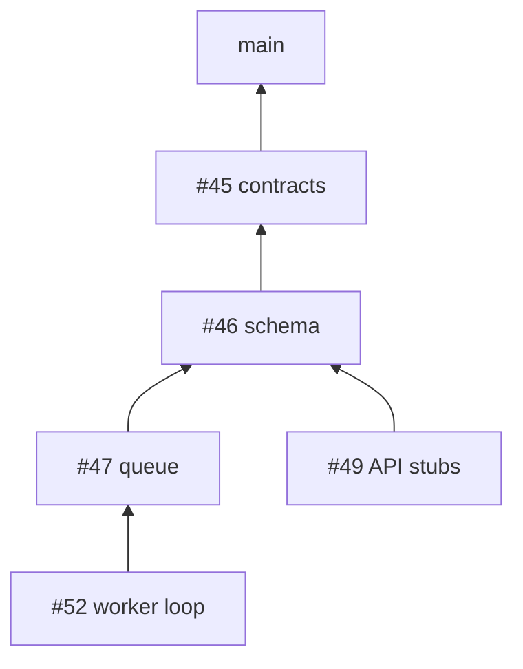

# 7. Stacked pull requests with git

> This note is not about one feature. It is about the way of working in this repository. Every example is a thing that really happened during the first milestone.

## In one minute

The work is cut into small pull requests. Many of them build on each other, like floors of a house. This is called a *stack*. A stack keeps each review small. But after each merge, the floors above must be moved. This note shows the commands for that, and five mistakes to avoid.

## 1. What a stack looks like



Read it from the bottom. #46 contains the commits of #45 plus its own. #47 contains #45, #46 and its own. So #45 must be merged first.

## 2. Why the upper branches must move after a merge

We merge with "Rebase and merge". GitHub then *copies* the commits onto `main`. A copy of a commit gets a new name (a new *hash*).

```text
branch m0-1/scaffold, before the merge:    99e33c6  "ci: pin setup-uv ..."
main, after the merge:                     7c34a4f  "ci: pin setup-uv ..."    <- same change, new name
```

The next branch still contains the old `99e33c6`. For git, that is a different commit from `7c34a4f`. So the next branch must be moved onto the new `main`.

## 3. The command that moves a branch: `git rebase --onto`

```bash
git rebase --onto NEW OLD BRANCH
```

In words: "take the commits of `BRANCH` that come after `OLD`, and put them on top of `NEW`".

```text
before:   main ── A' B'                      (new copies of A and B)
          A ── B ── C ── D                   (branch m0-3: old A, B and its own C, D)
                   ^OLD

command:  git rebase --onto origin/main B m0-3/contracts

after:    main ── A' B' ── C' ── D'          (only C and D were moved)
```

Real example from this repository:

```bash
git rebase --onto origin/main 99e33c6 m0-3/contracts
```

## 4. Sending a moved branch: `--force-with-lease`

A moved branch has new commit names. A normal `git push` is refused. You must force it. There are two ways.

| Command | What it does |
|---|---|
| `git push --force` | Overwrites the branch on GitHub. If another person pushed one minute ago, their work is gone. |
| `git push --force-with-lease` | Overwrites only if GitHub still has what you saw last time. If somebody else pushed, it stops. |

**The rule:** always `--force-with-lease`. Never `--force`.

## 5. Five mistakes that happened here

### a) A relative command was run two times

```bash
git reset --hard HEAD~1
```

`HEAD~1` means "one commit below where I am now". The first run removed the correct commit. The second run removed one more: the 23 tests of the exercise.

**Do this:** name the target. This gives the same result on every run:

```bash
git reset --hard origin/m0-4/queue-store
```

### b) `git reset --hard` also deletes work that is not committed

Git can bring back a commit that you removed (see part 6). Git cannot bring back changes that you never committed.

**Do this:** before a reset, run `git status -sb`. If it shows files, commit them first.

### c) A pull request was opened from the wrong branch

```bash
gh pr create --base main --fill
```

`gh` uses the branch that you are on. It was the wrong one, and GitHub accepted it, because the *base* was different from the other pull request of that branch.

**Do this:** name the source branch:

```bash
gh pr create --base main --head test/readyz-timeout --fill
```

### d) A new branch followed the wrong branch on GitHub

```bash
git switch -c test/readyz-timeout origin/main
```

The new branch now "tracks" `origin/main`. A plain `git push` is then refused, which is correct but confusing.

**Do this:** the first push names the branch:

```bash
git push -u origin test/readyz-timeout
```

### e) The checks did not run after a rebase

The branch was pushed first, and the base of the pull request was changed second. For a short time, the pull request had a conflict with its old base. GitHub does not start the checks for a pull request with a conflict.

**Do this:** change the base first (`gh pr edit 45 --base main`), then push.

This repository now deletes a merged branch automatically. GitHub then changes the base of the next pull requests to `main` by itself. That happened when #46 was merged. So read the bases first, and change a base by hand only if GitHub did not do it:

```bash
gh pr list --json number,baseRefName
```

## 6. Your safety net: `git reflog`

Git writes down every move of your position:

```text
$ git reflog -3
a1c4d47 HEAD@{0}: reset: moving to HEAD~1       <- the mistake
001fb96 HEAD@{1}: reset: moving to HEAD~1
0a8bd9d HEAD@{2}: checkout: moving from test/readyz-timeout to m0-4/queue-store
```

The commit `001fb96` is not gone. You can go back to it:

```bash
git reset --hard 001fb96
```

With the default settings, a removed commit stays in the reflog for at least 30 days.

## 7. After a rebase: prove that no file changed

A rebase gives each commit a new name. The files must stay the same. Do not believe it. Measure it.

Real example: #46 was merged, and the branch of #47 was moved onto the new `main`. Its last commit was `aa13a93` before the move, and it is `720638b` after the move.

```bash
git diff --stat aa13a93 720638b
```

The command prints nothing. That means: the two commits contain the same files, byte for byte. So the test results from before the move are still true.

A second command compares the commits one by one:

```text
$ git range-diff 48714af..aa13a93 origin/main..720638b
1:  8b34130 = 1:  00d7173 feat(queue): add the job store with enqueue and heartbeat
2:  5c290e1 = 2:  538aa08 test(queue): specify the job store
3:  aa13a93 = 3:  720638b feat(queue): implement claim, complete, fail and reap_expired
```

The sign `=` means "the same change". A `!` means "the change is different": then read that commit again.

**A comparison from daily life:** you move to a new flat. The address is new. You count the boxes before and after the move, to know that nothing was lost.

## 8. Two questions before every risky command

```bash
git status -sb          # Where am I? Is there work that is not committed?
```

```bash
git log --oneline -3    # What are the last three commits here?
```

Risky commands are: `reset --hard`, `rebase`, `push --force-with-lease`, `branch -D`, `checkout <file>`.

## What a senior engineer checks here

- **Does a command give the same result when it runs two times?** If not, it must never be in a script or in a list of steps that somebody may repeat.
- **Is each pull request about one thing?** A test for the health check does not belong in the pull request for the queue. It got its own pull request (#51) with `git cherry-pick`.
- **Can the stack be seen?** Each pull request says in its first line what it is stacked on.

## Exercise (15 minutes)

Make a playground that cannot hurt the real work:

```bash
git switch -c playground
```

1. Make two small commits (for example, add two lines to a new file `scratch.txt`).
2. Run `git reset --hard HEAD~1`. Look at `git log --oneline -3`.
3. Find the removed commit with `git reflog -5`, and bring it back with `git reset --hard <its name>`.
4. Go back to the branch where you were with `git switch -`. Then delete the playground with `git branch -D playground`.

## Words used in this note

| Word | Meaning |
|---|---|
| Commit | One saved step of work, with a message |
| Hash | The name of a commit: a short code like `99e33c6` |
| Branch | A named line of commits |
| Pull request | A request to put the commits of one branch into another branch |
| Base | The branch that a pull request wants to go into |
| Stack | Pull requests that build on each other |
| Rebase | To move commits onto a different starting point |
| Force push | A push that overwrites the branch on GitHub |
| Cherry-pick | To copy one commit onto a different branch |
| Reflog | Git's diary of every move you made |

## To read more

- [Pro Git, "Rebasing"](https://git-scm.com/book/en/v2/Git-Branching-Rebasing). Read the first part and "More Interesting Rebases", which explains `--onto` with pictures.
- [Pro Git, "Reset Demystified"](https://git-scm.com/book/en/v2/Git-Tools-Reset-Demystified). What `reset` really changes.
- [git push documentation](https://git-scm.com/docs/git-push). Search the page for `--force-with-lease`.

Previous: [6. The API contract and the web shell](06-api-contract-and-web-shell.md) · Back to the [list of notes](README.md)
