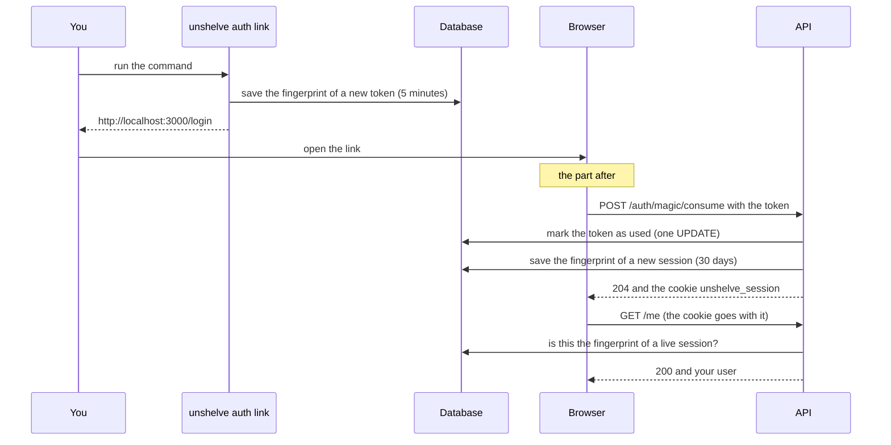

# 8. Signing in with a one-time link

> Pull requests: [#53](https://github.com/herman72/unshelve/pull/53), and [#62](https://github.com/herman72/unshelve/pull/62) for part 9 · Code: [`bot/private.py`](../../apps/api/src/unshelve/bot/private.py), [`auth/store.py`](../../apps/api/src/unshelve/auth/store.py), [`api/routes/auth.py`](../../apps/api/src/unshelve/api/routes/auth.py), [`api/deps.py`](../../apps/api/src/unshelve/api/deps.py) · Tests: [`tests/auth/test_store.py`](../../apps/api/tests/auth/test_store.py), [`tests/api/test_auth.py`](../../apps/api/tests/api/test_auth.py), [`tests/bot/test_private.py`](../../apps/api/tests/bot/test_private.py)

## In one minute

Unshelve has one user, and it has no password. You ask for a link, you open it, and your browser is signed in for 30 days.

Two secrets do the work. The *login token* is in the link. It works one time, for 5 minutes. The *session* is in a cookie. It works for 30 days, and you can close it.

The database never stores a secret. It stores a fingerprint of each one.

## 1. A real run, from the link to the answer

You ask for a link:

```text
$ docker compose exec api unshelve auth link
http://localhost:3000/login#token=HdxbXa…
This link works once, for 5 minutes.
```

The real token has 43 characters. This note shows the first 6.

You open the link. The page sends the token to the API. The API answers with a cookie:

```text
POST /api/v1/auth/magic/consume        {"token": "HdxbXa…"}
204 No Content
set-cookie: unshelve_session=7qEe75…; HttpOnly; Max-Age=2592000; Path=/; SameSite=lax
```

From now on, the browser sends the cookie with each request:

```text
GET /api/v1/me
200  {"id":1,"telegram_user_id":1,"display_name":null,"timezone":"UTC","queue_limit":5}
```

Somebody opens the same link a second time:

```text
POST /api/v1/auth/magic/consume        {"token": "HdxbXa…"}
401  {"type":"about:blank","title":"Unauthorized","status":401,"detail":"this link is not valid or has expired"}
```

## 2. The same run as a picture



The bot makes the same kind of link when you send it `/login`: see part 9. The command stays the way in for the first start, and for a day when the bot is down.

## 3. Why the token is after the `#`

Look at the link again:

```text
http://localhost:3000/login#token=HdxbXa…
                           └──────┬─────┘
                             the fragment
```

The part of an address after `#` is the *fragment*. A browser keeps the fragment for itself. It does not send the fragment to the server.

Why is this important? Telegram shows a small preview of each link in a chat. To make the preview, a server of Telegram opens the link. Compare two designs:

| Design | What the preview does | Result |
|---|---|---|
| `…/login?token=HdxbXa…`, used by a `GET` request | The preview opens the address. Our server gets the token and uses it. | The link is dead before you click it. |
| `…/login#token=HdxbXa…`, sent by a `POST` request (ours) | The preview opens `…/login`. No server gets the token. | The link waits for you. |

A small script on the page reads the fragment and sends the token in a `POST` request. Then it removes the fragment from the address bar.

**A comparison from daily life:** a letter. Each person who carries the letter can read the address on the envelope. The fragment is a note inside the envelope. Only the person who opens the letter reads it.

## 4. A link works once: one statement checks and changes

This is the table `auth_tokens` after the command. In this example, the command ran at 12:00:00.

```text
id | token_hash    | expires_at | used_at
1  | 3ed8e6f62a8c… | 12:05:00   | –
```

The sign-in runs one statement:

```sql
UPDATE auth_tokens
SET used_at = now()
WHERE token_hash = '3ed8e6f62a8c…'    -- the right token
  AND used_at IS NULL                 -- not used before
  AND expires_at > now()              -- not too old
RETURNING owner_id
```

If a row matches, the statement marks it as used and gives back the user. If no row matches, the answer is 401.

**The hard question:** two requests arrive with the same token at the same moment. What must happen?

| How the code is written | What happens | Good? |
|---|---|---|
| `SELECT` the token, then `UPDATE` it | The two requests read "not used". The two requests sign in. | No |
| One `UPDATE` with the check inside (ours) | The second request waits for the first. Then it sees that `used_at` is filled, and no row matches. | Yes |

You know this idea from the job queue: check and change in one statement ([note 4](04-job-queue.md), part 5). The test `test_two_requests_with_one_token_give_one_sign_in` plays the story with two real database connections.

**A comparison from daily life:** a cinema ticket. The person at the door tears your ticket when you go in. A torn ticket does not open the door a second time.

## 5. The database keeps a fingerprint, not the secret

The value in the link and the value in the table are different:

```text
in the link:      HdxbXa…          43 characters, the secret
in the database:  3ed8e6f62a8c…    64 characters, the fingerprint
```

A *hash function* makes the fingerprint. Here it is SHA-256. A hash function goes one way. From the secret, you get the fingerprint at once. From the fingerprint, nobody gets the secret back.

When a token arrives, the API makes its fingerprint. Then it looks for that fingerprint in the table.

Why: a copy of a database can leak. A backup on a wrong disk is sufficient. With fingerprints in the table, the thief has nothing that opens the door.

**A comparison from daily life:** the fingerprint of a person. You can take a fingerprint from a person. You cannot make the person from a fingerprint.

A password needs a slow hash function, because a password is short and somebody can guess it. Our secrets are 256 random bits. Nobody can guess them, so the fast SHA-256 is correct here.

## 6. The cookie has three locks

```text
set-cookie: unshelve_session=7qEe75…; HttpOnly; Max-Age=2592000; Path=/; SameSite=lax
```

| Part | Meaning | It stops |
|---|---|---|
| `HttpOnly` | Scripts on the page cannot read the cookie. | A bad script that copies your session. The name of this attack is XSS. |
| `SameSite=lax` | The browser does not send the cookie with a `POST` that a different site started. | A different site that makes your browser act in your name. The name of this attack is CSRF. |
| `Secure` | The browser sends the cookie over HTTPS only. | A person on the network who reads the cookie. |
| `Max-Age=2592000` | The cookie lives 30 days: 30 × 24 × 60 × 60 seconds. | – |

`Secure` is not in the example, and that is correct. The example ran on `http://localhost`. The API adds `Secure` when the address of the web app starts with `https://`.

The first lock was checked in a real browser. After the sign-in, `document.cookie` did not contain `unshelve_session`.

## 7. A session is a row, so you can close it

```text
id | session_hash  | lifetime | revoked_at
1  | 526a87ef4005… | 30 days  | –
```

Sign-out fills `revoked_at`. From this moment the cookie has no value, also when a copy of it is still in a browser:

```text
POST /api/v1/auth/logout      204
GET  /api/v1/me               401  "sign in first"        <- with the old cookie
```

**A comparison from daily life:** a hotel key card. The reception can switch off one card. The card still exists, but the door stays closed.

## 8. One door for every route

Every route needs a session, with three exceptions: the two health checks and the sign-in. One function is the door: `current_user` in `api/deps.py`.

| The request has… | Answer | Is the database asked? |
|---|---|---|
| no cookie | 401 "sign in first" | No |
| a cookie that is not a live session | 401 "sign in first" | Yes |
| the cookie of a live session | the route answers | Yes |
| a cookie, but the database is down | 503 "try again" | It gave no answer |

Look at the last row. When the door cannot check a session, it stays closed. It also does not say "sign in first". That answer would be wrong: the session is possibly good, and only the database has a problem.

A new route is protected from its first moment. A test reads all the routes from the application and tries each one in three ways. Nobody must remember to add a test for a new route.

## 9. The bot gives you the link

You write `/login` to your bot, in the private chat with it. The bot answers:

```text
Open this link to sign in. It works one time, for 5 minutes.

http://localhost:3000/login#token=HdxbXa…
```

This is the link of part 1. The bot makes it with the same function as the command `unshelve auth link`.

The bot answers one person:

| Who writes, and where | What the bot does |
|---|---|
| You, in the private chat | It answers. |
| A different person, in the private chat | Nothing. The log gets one line, without a name and without an id. |
| You, in a group | Nothing. Each member of the group would see the link. |
| Anybody, when `UNSHELVE_OWNER_TELEGRAM_ID` is not set | Nothing. |

Why does a stranger get no answer at all, not even "this bot is private"? A bot has a public name, so anybody can find it and write to it. An answer tells the stranger that something is here. It also lets the stranger make your bot send messages. Silence gives nothing.

**A comparison from daily life:** a stranger rings at your flat and asks if this is a shop. You do not open the door to say no. You do not open.

Three details of the message:

- **It is plain text, and the address stands alone in a line.** A link on your own computer starts with `http://localhost`. If Telegram does not show it as a link, you can copy it.
- **It asks Telegram for no preview.** Part 3 explains why a preview is a danger for a link with a secret.
- **The link is not in the log.** The log line is `login.link_sent`, and nothing more.

This part was tested with a pretend Telegram only. The bot sends its first real message when you write `/login` to it after the merge.

## A choice that we made

Where does a session live?

| | A row in the database (ours) | A signed token in the cookie (JWT) |
|---|---|---|
| The check | One small query for each request | No query. The API checks a signature. |
| Sign out | Fill `revoked_at`. It works at once. | Not possible before the token expires, unless you keep a list of closed tokens. |
| Good for | One application with one database | Many services that do not share a database |

Unshelve is one application with one database. It holds private notes, so "close this session now" must work. The row is the better choice here.

Why is there no password? Somebody must store a password, reset it and protect it against guesses. A link that only you can get needs none of this.

## What a senior engineer checks here

- **Does a wrong answer give away a fact?** A wrong token, a used token and an old token get exactly the same answer. An attacker learns nothing from a difference.
- **What happens when one part fails?** If the database is down, the answer is 503. It is not "signed in" and not "signed out". If a request stops after it used the token and before it saved its work, the token is not used up. The test `test_a_request_that_fails_does_not_use_up_the_token` shows this.
- **Is a secret in a log?** The log of the API shows `POST /api/v1/auth/magic/consume 204`. The token is in the body of the request, and the log does not print bodies.
- **Can the tests fail?** The code was broken in 14 places, one at a time. Two examples: a used token works again, and the cookie loses `HttpOnly`. A test failed each time.
- **Can a test reach the real world?** It could. The handler of part 9 answers a private message. Four older tests deliver a recorded private message, and their test bot had a real connection. So these tests sent a request to the real Telegram, with a made-up token, and Telegram refused it. Now each test bot has a pretend connection that only keeps the messages. A guard also refuses each connection from a test to a different computer ([`tests/test_no_network.py`](../../apps/api/tests/test_no_network.py)).
- **What is not done:** nothing deletes old rows yet. Old tokens and closed sessions stay in the tables, and they do no harm. There is also no limit on the number of tries. A secret of 256 random bits makes guessing useless.

## Exercise (15 minutes)

Break the rule "a link works once", and see which tests find it.

1. Open `apps/api/src/unshelve/auth/store.py` and go to the function `consume_login_token`.
2. Delete this one line: `AuthToken.used_at.is_(None),`
3. Run the tests:

```bash
cd apps/api && uv run pytest tests/auth tests/api/test_auth.py
```

4. Count the failed tests and read their names.
5. Put the line back with the undo of your editor. Run the tests again, and make sure that all 30 pass.

Then answer this question: in the test with two requests, does the second request still wait for the first one?

<details>
<summary>The answer</summary>

Three tests fail, and 27 pass:

```text
FAILED tests/auth/test_store.py::test_a_login_token_works_once
FAILED tests/auth/test_store.py::test_two_requests_with_one_token_give_one_sign_in
FAILED tests/api/test_auth.py::test_a_login_link_works_once
```

Yes, the second request still waits. The two requests want to change the same row, and the database lets one of them work at a time. But after the wait, nothing stops the second request. The line that you deleted was the check that it does after the wait. So the lock alone is not sufficient: you need the lock and the check.

</details>

## Words used in this note

| Word | Meaning |
|---|---|
| Login token | A secret in a link. It works one time, for 5 minutes. |
| Session | The fact that one browser is signed in. Here it is a row in the table `sessions`. |
| Cookie | A small value that the browser keeps and sends with each request to the same site. |
| Fragment | The part of an address after `#`. The browser does not send it to the server. |
| Hash function | A function that makes a fingerprint from a value. It goes one way only. |
| XSS | An attack where a bad script runs inside your page. |
| CSRF | An attack where a different site makes your browser send a request in your name. |
| Revoke | To close a thing before its end time. Here: to close a session. |

## To read more

- [Set-Cookie](https://developer.mozilla.org/en-US/docs/Web/HTTP/Reference/Headers/Set-Cookie), MDN. Read the parts "HttpOnly" and "SameSite".
- [URI fragment](https://developer.mozilla.org/en-US/docs/Web/URI/Reference/Fragment), MDN. It says that the fragment is not sent to the server.
- [Session Management Cheat Sheet](https://cheatsheetseries.owasp.org/cheatsheets/Session_Management_Cheat_Sheet.html), OWASP. A list of the rules that a good session follows.

Previous: [7. Stacked pull requests with git](07-stacked-pull-requests.md) · Next: [9. The walking skeleton](09-walking-skeleton.md)
