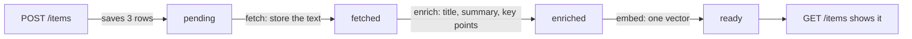

# 9. The walking skeleton: from a saved link to a finished item

> Pull request: [#54](https://github.com/herman72/unshelve/pull/54) · Code: [`ingest/resolve.py`](../../apps/api/src/unshelve/ingest/resolve.py), [`pipeline/items.py`](../../apps/api/src/unshelve/pipeline/items.py), [`api/routes/items.py`](../../apps/api/src/unshelve/api/routes/items.py), [`api/item_views.py`](../../apps/api/src/unshelve/api/item_views.py) · Tests: [`tests/test_walking_skeleton.py`](../../apps/api/tests/test_walking_skeleton.py), [`tests/pipeline/test_items.py`](../../apps/api/tests/pipeline/test_items.py), [`tests/api/test_items.py`](../../apps/api/tests/api/test_items.py) · Interactive: [job queue simulator](../queue-simulator.html)

## In one minute

A *walking skeleton* is the thinnest system that goes through all its layers. Each part exists, and each part is thin.

Here is ours. You save a link. The API answers at once. Then a worker does three steps for the item: fetch, enrich, embed. After the last step the item is ready, and the list shows it.

The three steps use fake providers. They open no link and they call no real model. Later milestones make each step thicker. The path stays the same.

## 1. A real run

You save a link:

```text
POST /api/v1/items   {"url": "https://example.com/how-pgvector-works",
                      "text": "A short guide to vector search in Postgres with pgvector"}
201  {"id": 1, "enrich_state": "pending", "title": null, "summary": null, ...}
```

You read the item again 0.7 seconds later:

```text
GET /api/v1/items/1
200  {"id": 1, "enrich_state": "ready", "kind": "note", "est_minutes": 1, "partial": true,
      "title": "a short guide to vector search in postgres with pgvector",
      "key_points": ["short", "guide", "vector"], ...}
```

In that time, the worker wrote three lines to its log:

```text
job.finished  kind=fetch_item   attempt=1  seconds=0.051  state=done
job.finished  kind=enrich_item  attempt=1  seconds=0.011  state=done
job.finished  kind=embed_item   attempt=1  seconds=0.012  state=done
```

The title looks strange. The reason: the fake model builds its answer from the first words of the text.

`"partial": true` means: the item has a link, and nobody opened the link. The text came from the saved message only.

## 2. The path in one picture



The four words in the middle are the *processing state* of the item. Only a worker changes it.

| Step | It reads | It calls | It writes |
|---|---|---|---|
| fetch | the saved message | an extractor (for now: it returns the saved text) | the text, the kind |
| enrich | the text | the model | the title, the summary, the key points, the reading time |
| embed | the title, the summary, the key points | the embedder | one vector |

A *vector* is a list of numbers that stands for the meaning of a text. The search of a later milestone compares vectors.

## 3. Why the API answers before the work is done

The fake steps take 0.07 seconds together. The real steps download a page and ask a model. That can take 20 seconds, and it can fail.

A browser must not wait for that. So `POST /items` does one small thing: it writes three rows.

```text
captures   the message as it arrived
items      the thing to read, with the state "pending"
jobs       "fetch item 1", for the worker
```

The three rows are saved together, or none of them is saved. Think of the opposite: an item without its job stays "pending" for ever.

**A comparison from daily life:** a dry cleaner. You hand in your coat, and you get a ticket at once. The cleaning happens later, when you are not there.

## 4. Each step has the same three moves

1. **Read the item.** If the item does not wait for this step, stop. The step ran before.
2. **Call the service.** No database transaction is open at this time.
3. **Save.** In one transaction: write the result, move the item to the next state, add the next job.

Why is no transaction open in move 2? A transaction holds one connection to the database. If the model takes 20 seconds, the connection is blocked for 20 seconds.

Move 3 uses a statement that you know:

```sql
UPDATE items
SET enrich_state = 'fetched', ...
WHERE id = 1
  AND enrich_state = 'pending'     -- only if the item still waits for this step
```

It is "check and change in one statement" again. The job queue uses it for the ticket ([note 4](04-job-queue.md)). The sign-in uses it for the login token ([note 8](08-login.md)).

## 5. The worker dies: a real experiment

I saved 150 items. Then I killed the worker with `kill -9` in the middle of its work. These are the real numbers:

```text
the kill           The worker had finished 50 "fetch" jobs. It held job 54 at that moment.
                   But 51 items had the state "fetched".

                   So the step of job 54 had saved its result. Then the worker died,
                   before it could mark the job as done.

62 seconds later   A second worker took job 54 again (attempt 2). The step saw that the
                   item was not "pending". It stopped and wrote nothing.

the end            151 items ready, 151 texts, 151 vectors.
                   Job 54: done, 2 attempts. No step ran two times for an item.
```

The number 151 is the 150 items and the one item of part 1.

Why 62 seconds? A worker gets a job for 60 seconds. This is the lease of [note 4](04-job-queue.md). The second worker could take job 54 only after the lease of the dead worker ended.

A worker can die at two different moments. The steps are safe for the two:

| The worker dies… | What is in the database | What the next worker does |
|---|---|---|
| before the step saved | nothing new | It does the step. |
| after the step saved, before the job was marked as done | the result, and a job that looks "running" | It starts the step. Move 1 stops it. |

The experiment found the second case by chance. Two tests play the two cases on purpose.

## 6. The slow worker: why the check is inside the `UPDATE`

Move 1 is not sufficient. Here is the story where it fails:

```text
12:00:00  worker A starts "enrich" for item 1. It reads: the item waits. It asks the model.
12:00:05  worker A freezes. For example: the laptop goes to sleep.
12:01:10  the lease of A ended. Worker B gets the job. It reads: the item waits.
12:01:11  worker B finishes "enrich", and then "embed". The item is ready.
12:01:30  worker A wakes up with the answer of its model. It saves its result.
```

Worker A read the item at 12:00:00. At that time the item waited, so move 1 let A continue.

Without the check in the `UPDATE`, worker A moves the item back from "ready" to "enriched". It replaces the summary and adds a second "embed" job. With the check, the statement finds no row, and worker A writes nothing.

**A comparison from daily life:** two cooks get the same order by mistake. The first plate goes to the table. When the second plate is ready, the waiter looks at the order: it is served. The second plate does not go to the table.

The test `test_a_slow_worker_that_finishes_late_does_not_move_the_item_back` plays this story.

## 7. The list comes in pages, and each page has a bookmark

The list shows the newest item first. Five items give this list: 5, 4, 3, 2, 1. One page has two items.

```text
page 1                      -> items 5, 4
a new item 6 arrives
page 2, "skip 2 rows"       -> items 4, 3      wrong: you see item 4 two times
page 2, "after item 4"      -> items 3, 2      correct
```

The API uses the second method. With each page it gives a *cursor*: the position of the last item of the page. The next request sends the cursor back.

**A comparison from daily life:** a bookmark. "Continue after this line" stays correct when somebody adds pages at the front of the book. "Continue at page 3" does not.

## 8. A filter that is not built says so

```text
GET /api/v1/items?tag=databases
501  {"type":"about:blank","title":"Not Implemented","status":501,"detail":"the filter 'tag' is not built yet"}
```

Tags arrive in a later milestone. The API could ignore the filter and give the full list. But that answer looks correct, and it is wrong. A clear "not built" is better than a wrong list.

## A choice that we made

How do you make sure that a step has its effect one time?

| | Deliver each job exactly one time | Deliver at least one time, and make each step safe to repeat (ours) |
|---|---|---|
| Is it possible? | No. A worker can die between "I did the work" and "I reported it". Nobody can tell which of the two happened. | Yes. |
| The cost | – | Each step must check before it writes. |

A step that is safe to repeat is called *idempotent*. Example: "set the state to fetched" gives the same result the second time. "Add 1 to a counter" does not.

Why a thin path through all layers first, and not one finished step after the other? Because the hard problems are between the parts. This pull request found one of them (see the next part).

## What a senior engineer checks here

- **What is in the database between two writes?** Go through each step and stop it in your head after each write. Part 5 is this check.
- **Is a transaction open during a slow call?** No. Each step reads, closes, calls, and then opens a new transaction to save.
- **Does each query name the owner?** Yes. The item of a different owner gives 404, the same answer as an item that does not exist.
- **Can the tests fail?** The code was broken in 24 places, one at a time. The tests found 23. The one that they missed was the check of part 6. So that check got its own test. A guard without a test is a guard that somebody removes later.
- **What is not done:** the web page has no form to save a link. A link that you save two times makes two items. The steps do not handle a provider that fails, because the fake providers do not fail.

## Try it yourself

Do this after the pull request is merged.

1. Run `make up`. It builds the stack with the new code.
2. Sign in: the [README](../../README.md#development) says how.
3. On the Unshelve page, open the developer console of your browser. Paste this one line and press Enter. Chrome can ask you to type `allow pasting` first.

```js
fetch("/api/v1/items", {method: "POST", headers: {"content-type": "application/json"}, body: JSON.stringify({url: "https://example.com/how-pgvector-works", text: "A short guide to vector search in Postgres with pgvector"})})
```

4. Wait one second. Then load the inbox page again. You see a card with the title, "1 min read" and the word "Partial".

This is a temporary way. The bot of milestone M1 is the real way to save.

## Exercise (15 minutes)

Remove the check of part 6, and see which test finds it.

1. Open `apps/api/src/unshelve/pipeline/items.py` and go to the function `_advance`.
2. Change the line `.where(Item.id == item_id, Item.enrich_state == start)` to `.where(Item.id == item_id)`.
3. Run the tests:

```bash
cd apps/api && uv run pytest tests/pipeline
```

4. Read the name of the test that fails.
5. Put the line back with the undo of your editor. Run the tests again, and make sure that all 18 pass.

Then answer this question: the test "a step that runs again changes nothing" still passed. Why?

<details>
<summary>The answer</summary>

One test fails, and 17 pass:

```text
FAILED tests/pipeline/test_items.py::test_a_slow_worker_that_finishes_late_does_not_move_the_item_back
```

The other test passed because of move 1. Each step reads the item first, and it stops when the item does not wait for it. That is sufficient when the second run starts after the first run is finished.

It is not sufficient when two runs are open at the same time. The two runs read "the item waits", and the two runs continue. Only the check inside the `UPDATE` stops the second one. So you need the two guards: move 1 saves a model call, and the check in the `UPDATE` protects the data.

</details>

## Words used in this note

| Word | Meaning |
|---|---|
| Walking skeleton | The thinnest version of a system that goes through all its layers |
| Pipeline | The steps that an item goes through, one after the other |
| Processing state | Where an item is in the pipeline: pending, fetched, enriched or ready |
| Idempotent | Safe to do two times: the second time changes nothing |
| At least one time | A job can run more than one time, but never zero times |
| Cursor | A bookmark in a list: the position of the last item that you got |
| Vector | A list of numbers that stands for the meaning of a text |
| Partial | The item was built from the saved text, because nobody opened its link |

## To read more

- [Walking skeleton](https://wiki.c2.com/?WalkingSkeleton), the wiki of Ward Cunningham. The definition by Alistair Cockburn is the first paragraph.
- [Designing robust and predictable APIs with idempotency](https://stripe.com/blog/idempotency), Stripe. Why a request that runs two times must have one effect.
- [We need tool support for keyset pagination](https://use-the-index-luke.com/no-offset), Markus Winand. Why "skip N rows" is the wrong way to get the next page.

Previous: [8. Signing in with a one-time link](08-login.md) · Back to the [list of notes](README.md)
