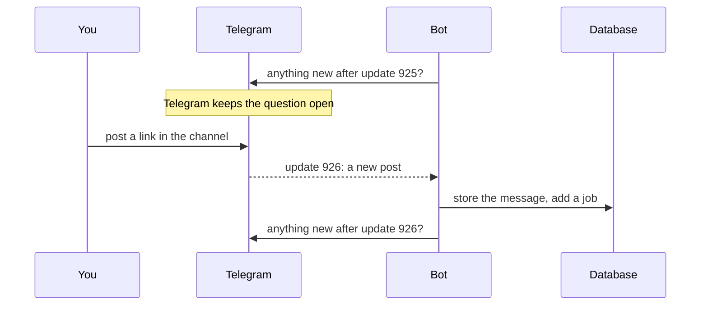

# 10. The bot: from a post in your channel to a stored message

> Pull request: [#56](https://github.com/herman72/unshelve/pull/56) · Decision record: [ADR 0009](../adr/0009-capture-rules-from-a-real-bot-and-real-exports.md) · Code: [`bot/envelope.py`](../../apps/api/src/unshelve/bot/envelope.py), [`bot/capture.py`](../../apps/api/src/unshelve/bot/capture.py), [`bot/runner.py`](../../apps/api/src/unshelve/bot/runner.py), [`ingest/resolve.py`](../../apps/api/src/unshelve/ingest/resolve.py) · Tests: [`tests/bot/`](../../apps/api/tests/bot/), [`tests/pipeline/test_ingest.py`](../../apps/api/tests/pipeline/test_ingest.py)

## In one minute

You post in your channel. One second later, the bot has stored the post, and a job waits for the worker.

The bot does one small thing: it stores the message. It does nothing slow. So the bot is ready for the next message at once, also when the model is slow.

The bot tells Telegram "I have this post" only after the post is in the database. So a post is not lost when the bot stops or when the database is down.

A message with three photos arrives as three messages. A job waits five seconds and joins them into one item.

## 1. A real run

This is the log of the bot with the test channel. The channel had three posts: three photos in one message, a YouTube link, and a forwarded post. The bot name in the log is replaced by an example name.

```text
bot.started      username=example_unshelve_bot  capture_chats=1
bot.chat_ready   status=administrator
capture.stored   message_id=9   album=14335384938541892
capture.stored   message_id=7   album=14335384938541892
capture.stored   message_id=10  album=None
capture.stored   message_id=8   album=14335384938541892
capture.stored   message_id=11  album=None
```

Five messages arrived for three posts. Look at their order: 9, 7, 10, 8, 11. In this run, the bot handled several messages at the same time, so the order was not fixed. Nothing in Unshelve depends on that order. The bot now handles one message after the other, and part 3 says why.

Some seconds later, the worker had made three items:

| Item | Made from | Link |
|---|---|---|
| 1 | message 11, the forwarded post | `http://github.com/cloudflare/security-audit-skill` |
| 2 | message 10 | `https://www.youtube.com/watch?v=UPtmKh1vMN8` |
| 3 | messages 7, 8 and 9, the photos | none |

## 2. Long polling: the bot asks, and Telegram answers



The bot asks "anything new?". If there is nothing, Telegram keeps the question open for some seconds. This is *long polling*.

The number in the question is important. "After update 926" also means: "I have everything up to 926." Telegram then forgets these updates.

So an update is safe when the bot asks the next question only after it stored the post. Part 3 shows that this needs care.

Why this method? The bot opens the connection, from the inside. Your laptop needs no address on the internet. Telegram also keeps updates for 24 hours, so a bot that was off for one night misses nothing.

**A comparison from daily life:** you go to the post office and ask "any letters for me?". The other method is a postman who comes to your door. For that, the postman must know your address, and you must be at home.

## 3. The promise: confirm a post only after it is stored

I wrote this sentence first for this note:

> If the bot stops before it stored the post, Telegram sends the post again.

Then I read the code of the bot library to check the sentence. It was false in two cases.

**Case 1: the library works on several updates at the same time.** That is its default. This is what can happen:

```text
12:00:00.000  update 926 arrives. The library starts to store it, in the background.
12:00:00.001  the library asks Telegram: "anything after 926?"     <- Telegram forgets 926 now
12:00:00.005  the bot is killed. Update 926 is not in the database yet.
              After the restart, Telegram does not send 926 again. The post is lost.
```

**Case 2: the database is down.** Storing fails with an error. The library writes the error to the log and counts the update as done. The next question confirms it, and the post is lost.

The bot has one answer for each case:

| Case | What the bot does now |
|---|---|
| 1 | It handles one update after the other. The next question leaves only after the post is stored. |
| 2 | When the database does not answer, the bot waits and tries again: after 1, 2, 5, 10 and then each 30 seconds. In that time it asks Telegram for nothing, so Telegram keeps the update. |

A test proves it. It runs the real loop of the library against a pretend Telegram. At the moment of the second question, the test looks into the database: the post must be there. With the default of the library, this test fails.

**A comparison from daily life:** you sign for a parcel after you have it in your hands, not when the courier rings the bell.

## 4. The envelope: one shape for each saved message

The bot does not give the message of Telegram to the system. It makes an *envelope* from it. This is the post with the YouTube link:

| Field of the envelope | Value | Where it comes from |
|---|---|---|
| `chat_id`, `message_id` | the channel, `10` | the message |
| `edit_seq` | `0` | `0` means: as it was posted |
| `posted_at` | 13 October, 20:26:07 UTC | `date` |
| `text` | `https://www.youtube.com/watch?v=UPtmKh1vMN8` | `text` |
| `urls` | the same address | the link marks of Telegram |
| `media` | nothing | – |
| `raw` | the whole message | exactly as Telegram sent it |

Why an envelope? The importer makes the same envelope from an export file. The rest of Unshelve has one input, and it does not know where a message came from.

`raw` is the safety net. A later version can read an old message again and take a field that this version does not use.

## 5. A trap: where does a link start?

Telegram does not send the link as a separate value. It sends the text, and a mark: "a link starts at position 23 and is 14 long". Here is a text with an emoji:

```text
👋 سلام، این را بخوان: example.com/fa و این
```

```text
Python counts characters:        text[23:37]  ->  'xample.com/fa '     wrong
Telegram counts UTF-16 units:                 ->  'example.com/fa'     correct
```

The emoji 👋 is one character for Python. It is two units for Telegram. So each position after the emoji is moved by one.

The text has no error and the program does not stop. You get a wrong link, and you see it weeks later. The bot uses a function that counts the way Telegram counts.

**The rule:** when a system gives you a position in a text, ask in which unit it counts.

## 6. The same message two times is stored one time

Telegram can send an update again (part 2 and part 3). The database has one rule for that: no two captures with the same channel, the same message id and the same edit number.

The bot does not look first and write second. It writes, and the database refuses a repeat. Second start of the real run:

```text
captures before the second start: 5
captures after the second start:  5
```

It is "check and change in one statement" again, as in notes 4, 8 and 9.

## 7. An album: three messages, and one job that waits

When the first photo arrives, the bot cannot know how many photos follow. So it does not make the item at once.

```text
12:00:00.0   message 7 arrives   stored. A job "join album 1433…" is added. It starts 5 seconds later.
12:00:00.1   message 8 arrives   stored. The job exists already, so nothing is added.
12:00:00.2   message 9 arrives   stored. The job exists already.
12:00:05.0   the job runs        3 messages -> 1 item
```

Each message asks for the same job. The queue keeps one, because the three requests have the same key (the number of the album).

Why a job in the database, and not a timer in the memory of the bot? If the bot restarts in these 5 seconds, a timer is gone. A job waits in its table.

A photo that arrives after the job is not lost. The job runs again and adds the photo to the item that exists.

**A comparison from daily life:** three parcels with the same order number. You wait until the delivery van has left, and then you open them together.

## 8. Only your channels: the check is the channel, not the person

A channel post names no author (see [ADR 0009](../adr/0009-capture-rules-from-a-real-bot-and-real-exports.md)). And any person can make any bot an administrator of their own channel.

So the bot has a list of channels: `UNSHELVE_CAPTURE_CHAT_IDS`. A post from a channel that is not in the list is not stored. The bot writes one line to its log:

```text
capture.chat_not_allowed  chat_id=-1009999999999  chat_title='Somebody else'
                          hint='to capture from this channel, add its id to UNSHELVE_CAPTURE_CHAT_IDS'
```

This line is also the way to find the id of your own channel: post one message, and read the log.

## 9. The bot checks its setup at the start

A bot gets the posts of a channel only when it is an administrator. If it is not, no error comes later. The posts do not arrive, and nothing says why.

So the bot asks Telegram at its start, for each channel in the list:

```text
bot.chat_ready             status=administrator
bot.not_an_administrator   status=left     hint='make the bot an administrator of this channel'
```

**The rule:** if a wrong setup gives silence and not an error, check the setup when the program starts.

## 10. The token stays out of the log

The token is part of the address of each request to Telegram. A library can write that address into a log line when a request fails. A token in a log file is a leaked token.

So the bot puts a filter on the log. The filter replaces the token with the text `<bot token>` in each line. In the real run, the token was in no line.

## A choice that we made

How much does the bot do when a message arrives?

| | The bot stores the message and adds a job (ours) | The bot does all the work at once |
|---|---|---|
| Time for one message | some milliseconds | seconds, because of the download and the model |
| The model is down | The bot does not notice. The jobs wait. | The message fails, or the bot is blocked. |
| The bot stops in the middle | The message is stored, or Telegram sends it again. | Half of the work is lost. |

The cost of our choice: you see the item some seconds after the post, not at once.

An edit of a post is stored as a message of its own, with the time of the edit as its number. The item of the post then reads the new version ([note 12](12-resolver.md), part 9).

## What a senior engineer checks here

- **What does the library really promise?** Part 3. The sentence in the first version of this note sounded correct, and it was false. The code of the library had the answer.
- **What if the same input arrives two times?** It is stored one time (part 6).
- **What if the program is off for a day?** Telegram keeps updates for 24 hours. For a longer time, the importer reads an export, and the rule of part 6 prevents a second copy.
- **In which unit is a position?** Part 5.
- **Can a secret reach a log?** Part 10.
- **Can the tests fail?** The code was broken in 27 places, one at a time. A test failed 26 times. The last change has no effect on a channel post, so no test can see it.
- **What is not done:** the bot was tested with all rights, and not yet with fewer.
- **Done after this note:** an edit and a late photo of an album change the item ([note 12](12-resolver.md), part 9). In the private chat the bot knows `/login` ([note 8](08-login.md), part 9) and `/digest` ([note 13](13-cards-and-digest.md)).

## Try it yourself

Do this after the pull request is merged. The `.env` file has the token and the two ids already.

1. Run `git pull`, and then `make up`. The first command gets the new code. The second builds the stack with it.
2. Post a link in the channel "Unshelve test".
3. Read the last lines of the log of the bot:

```bash
docker compose logs bot --tail 5
```

One line must have the text `capture.stored`.

4. Sign in to the web app and open the inbox. The [README](../../README.md#try-it-on-your-computer) says how to sign in. The card of your post is there.

## Exercise (15 minutes)

Make the mistake of part 5, and see which test finds it.

1. Open `apps/api/src/unshelve/bot/envelope.py` and go to the function `_urls`.
2. Change the line `url = entity.extract_from(text)` to `url = text[entity.offset : entity.offset + entity.length]`.
3. Run the tests of the bot:

```bash
cd apps/api && uv run pytest tests/bot
```

4. Read the name of the test that fails, and the two lists in its message.
5. Put the line back with the undo of your editor. Run the tests again, and make sure that all 43 pass.

Then answer this question: the test "a post with a link" has a link too. Why did it still pass?

<details>
<summary>The answer</summary>

One test fails, and 42 pass:

```text
FAILED tests/bot/test_envelope.py::test_a_link_is_found_after_an_emoji_and_persian_text
AssertionError: assert ['https://xam...g/hidden?x=1'] == ['https://exa...g/hidden?x=1']
```

The wrong link starts with `xam` and not with `exa`: it is moved by one position.

The other test passed because its text has no emoji. Each of its characters is one unit for Python and one unit for Telegram, so the two ways to count give the same position.

This is why the mistake is dangerous. It works for most messages, and it fails only for a text with an emoji before the link. A test with plain English text does not find it. You need a test with the hard input.

</details>

## Words used in this note

| Word | Meaning |
|---|---|
| Update | One thing that happened, as Telegram tells it to a bot: a new post, a button press |
| Long polling | The bot asks for updates, and Telegram keeps the question open until there is an answer |
| Offset | The number in the question "anything new after …?". It also confirms the older updates. |
| Envelope | One saved message in the shape that Unshelve uses, from the bot or from an export |
| Album | Several photos or videos that you send as one message. Telegram sends one message for each. |
| Allow-list | A list of the things that are accepted. Each thing that is not in the list is refused. |
| UTF-16 unit | The unit in which Telegram counts positions in a text. An emoji is two units. |

## To read more

- [getUpdates](https://core.telegram.org/bots/api#getupdates), Telegram Bot API. Read the text about `offset`: it explains how an update is confirmed.
- [Styled text with message entities](https://core.telegram.org/api/entities), Telegram. Read the part "Entity length". It says that lengths are in UTF-16 units.
- [Long-polling](https://docs.aiogram.dev/en/latest/dispatcher/long_polling.html), the documentation of aiogram, the library that the bot uses.

Previous: [9. The walking skeleton](09-walking-skeleton.md) · Next: [11. The importer](11-export-importer.md)
