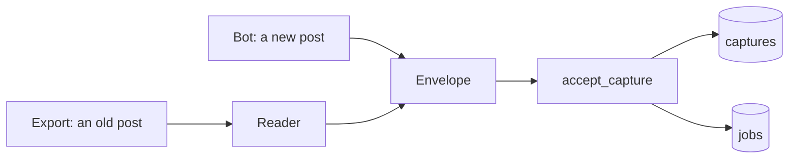

# 11. The importer: the old posts of your channel, from an export

> Pull request: [#59](https://github.com/herman72/unshelve/pull/59) · Decision record: [ADR 0009](../adr/0009-capture-rules-from-a-real-bot-and-real-exports.md) · Code: [`ingest/export_html.py`](../../apps/api/src/unshelve/ingest/export_html.py), [`ingest/importer.py`](../../apps/api/src/unshelve/ingest/importer.py), [`cli.py`](../../apps/api/src/unshelve/cli.py) · Tests: [`tests/ingest/`](../../apps/api/tests/ingest/), [`tests/test_cli.py`](../../apps/api/tests/test_cli.py)

## In one minute

The bot gets only the posts that arrive after it became an administrator. Your channel has years of posts before that moment.

Telegram can write these old posts into a folder on your computer. This folder is an *export*. It holds web pages with the name `messages.html`, `messages2.html`, and so on.

The importer reads these pages. It turns each old post into the same envelope that the bot makes ([note 10](10-bot-capture.md)). Then it gives the envelope to the same function.

So the rest of the system does not know if a post came from the bot or from an export.

## 1. A real run

This is the export of the test channel, with five posts. First a *dry run*: the command reads everything and changes nothing.

```text
$ unshelve import /imports/ChatExport_2026-10-13-html --timezone Europe/Helsinki --dry-run
Export of "Unshelve test": 5 posts, into the chat -1001234567890.
From 2026-10-13 22:40 to 2026-10-13 22:44, clock time of Europe/Helsinki.
Not imported: 1 x service message.
Dry run: 5 posts are new, 0 are stored already. Nothing was changed.
```

The same command without `--dry-run` ends with this line:

```text
Stored 5 new posts. 0 were stored already.
```

Then I imported a second export of the same channel. A different Telegram app wrote it, and its pages look different.

```text
Stored 0 new posts. 5 were stored already.
```

The "service message" is the line "Channel created". It is a message of Telegram, and it is not a post of yours.

## 2. Two doors, one room



The reader is the only new part that knows the pages of Telegram. After the envelope, each step is the code of the earlier notes.

**A comparison from daily life:** a shop has a front door and a delivery door. The goods of the two doors go to the same shelf, and the same person writes them into the same book.

## 3. What the reader takes from one post

To *parse* a text is to read its structure and to get its parts. Here is one post of the page, made shorter:

```html
<div class="message default clearfix" id="message4">
  <div class="pull_right date details" title="13.10.2026 22:42:44 UTC+02:00">22:42</div>
  <div class="forwarded body">
    <div class="from_name">Systems Notes <span class="date details" title="20.06.2026 15:56:02 UTC+02:00">…</span></div>
    <div class="text">A note.<br><br><a href="https://video.example.com/watch?v=x9y8">https://video.example.com/watch?v=x9y8</a><br><a href="https://t.me/systemsnotes">@systemsnotes</a></div>
  </div>
</div>
```

| In the page | In the envelope |
|---|---|
| `id="message4"` | `message_id` is 4. It is the same number that the bot gets for this post. |
| `title="13.10.2026 22:42:44 …"` | `posted_at`. Part 4 explains the time zone. |
| `<br>` | A line break in `text`. |
| `<a href="https://video.example.com/…">` | One entry in `urls`. |
| `<a href="https://t.me/systemsnotes">@systemsnotes</a>` | Text only. A mention is not a link of the post. The bot has the same rule. |
| `from_name` inside `forwarded body` | The name of the source of a forwarded post. |

The reader finds these parts with *selectors*. A selector is a short pattern for elements: `div.text` means "each `div` element that has the class `text`".

## 4. The export has clock times, and you give the time zone

The page says that the first post was sent at `22:40:37`, and it adds `UTC+02:00`.

That zone is wrong. The computer was in Helsinki in summer time, which is UTC+03:00. The second Telegram app writes `13 October 2026, 22:40:37` and no zone.

So the importer does not use the zone text of the page. It uses the clock time, and you give the zone: `--timezone Europe/Helsinki`.

| Clock time in the export | Zone that you give | The moment that is stored (UTC) |
|---|---|---|
| 13 October 2026, 22:40:37 | `Europe/Helsinki` | 19:40:37. Summer time: 3 hours. |
| 15 January 2026, 10:00:00 | `Europe/Helsinki` | 08:00:00. Winter time: 2 hours. |
| 13 October 2026, 22:40:37 | `Asia/Tehran` | 19:10:37. Three and a half hours. |

Why a name such as `Europe/Helsinki`, and not a number such as `+03:00`? Look at the first two rows. One name gives two different numbers, because the name knows the rule for summer time on each date.

**A comparison from daily life:** a photo of a wall clock shows 10:40. To know the moment, you must know in which city the clock hangs.

One hour each year stays unclear. In the night when the clocks go back, the time 03:30 is on the clock two times. The importer takes the first one.

## 5. The same post two times is stored one time

A capture has a key: the owner, the chat, the message id and the edit number. The database refuses a second row with the same key ([note 10](10-bot-capture.md), part 6).

The importer uses the same ids as the bot. So these three cases need no special code:

```text
You import the same export again                     0 new posts
You import an export that a different app wrote      0 new posts
The bot stored 5 of the 16 posts of the export       11 new posts, 5 were stored already
```

One thing is missing in the export: the id of the channel. The page has only the title of the channel.

So the importer takes the chat from your settings, when `UNSHELVE_CAPTURE_CHAT_IDS` holds one chat. With more chats, you give `--chat-id`.

A wrong chat id is the one mistake that the key cannot catch. The posts get a different key, so they are stored a second time. A dry run shows this before it happens: it says "0 are stored already" for a channel where the bot stored posts.

## 6. An album has no mark in the export

You send three photos as one album. Telegram stores three messages. The bot gets them with the same `media_group_id`, so it knows that they belong together.

The export has no such field. I read the code that writes the export in Telegram Desktop: it writes each part of an album as a normal message. This is what the page gives:

```text
message 7   23:25:17   a photo
message 8   23:25:17   a photo
message 9   23:25:17   a photo
```

So the importer uses signs. Two messages are parts of one album when all of these are true:

1. Their ids follow each other.
2. They have the same second as their time.
3. Their files can be together in an album: photos with videos, documents with documents, audio files with audio files.
4. They have the same source, if they were forwarded.
5. One of them at most has a text.

A rule that works from signs is a *heuristic*. It is correct most of the time, and it can be wrong.

Here is a case where this rule is wrong. A channel sent two photo posts in the same second. You selected the two posts and forwarded them together. The importer makes one item of them, and two items are correct.

The cost of this mistake is small: one item has two photos. A post that the bot receives never has this problem, because the bot gets the real mark.

## 7. What the reader does not know, it counts

The made-up test export has a poll. A poll has no place in an item yet. This is the summary of the import:

```text
Not imported: 1 x location.
Not imported: 1 x poll.
Not imported: 1 x rich message.
Not imported: 1 x service message.
```

The reader could guess a text for the poll and store it. It does not, for this reason:

> A post that was left out can be imported later. A stored capture is never changed.

Run the import again after the reader learned polls, and the poll comes in. A capture with a wrong text stays wrong, because a second import skips a post that is stored.

Some things are worse than a poll: a post without an id, or with a date that the reader cannot read. Then the import stops, and the message names the page and the post:

```text
This export cannot be read: messages.html: message 3 has a date in a form that the importer does not know: 'soon'
```

**A comparison from daily life:** a customs officer gets a parcel with papers that he cannot read. He does not guess what is inside. The parcel waits, and it is on a list.

## 8. A test page from memory tests your memory

The format of the export has no documentation. So the tests need pages with the real structure.

I wrote the two first test pages by hand, after I looked at your real exports. All tests passed. Then a small script compared each test page with the real page, element by element. It found one difference:

```text
real page:   <div class="message service">                    a line with a date, without an id
my page:     <div class="message service" id="message-1">
```

The reader counted this line as a service message, in real exports of the Mac app only. The tests could not see it, because my page had the same mistake as my code.

Now the folder [`tests/ingest/fixtures`](../../apps/api/tests/ingest/fixtures/) has three exports, and its `README.md` says which is which:

| Folder | Where its structure comes from |
|---|---|
| `export_desktop` | A real export of Telegram Lite. The texts and the names are replaced. |
| `export_macos` | A real export of Telegram for macOS. The texts and the names are replaced. |
| `export_made_up` | The code of Telegram Desktop, for kinds of posts that no real export showed yet. |

## A choice that we made

How do you get data from a web page that a program wrote?

| | An HTML parser with selectors (ours) | Regular expressions on the text of the page |
|---|---|---|
| The page gets a new space or a new order of attributes | No change | The pattern can stop matching |
| A text contains `<` or `&` | The parser gives the real character | You must decode it yourself |
| Speed | 3,000 posts in 0.07 seconds, measured | Fast |
| Cost | One more library (`selectolax`) | No library |

A third way was the plan before the test with real exports: read the JSON export. It has exact times and the id of the channel. But the Telegram apps of the Mac App Store do not offer JSON for one chat (ADR 0009). An importer that most users cannot feed is not useful.

## What a senior engineer checks here

- **Who owns the format?** Telegram does, and it can change it. So the reader is strict, the tests use real pages, and an unknown structure gives a clear error or a count. It never gives a silent wrong row.
- **Is it safe to run two times?** Yes. The key of a capture makes the second run store nothing.
- **What if it stops in the middle?** The importer saves 200 posts in one transaction, then the next 200. A post and its job are saved together. After a stop, you run the command again.
- **Is the input trusted?** No. The page is data. The path of a file is text from the page, so the code that opens the file must make sure that the path stays inside the folder of the export ([note 27](27-export-files.md), part 3).
- **Can the tests fail?** I broke the code in 72 places, one at a time. The tests missed 8. Three of them showed code that no real export needs, and I removed that code. Three showed a missing test, and I added it. Two changed nothing that a user can see. Now the tests find each of the 69 mistakes of the final list.
- **What is not done:**
  - The files of an export were not copied. Since [#85](https://github.com/herman72/unshelve/pull/85), the import copies them, and a second run gives the posts of an earlier import their files ([note 27](27-export-files.md)).
  - The JSON export has no reader. No real JSON export was seen ([issue #58](https://github.com/herman72/unshelve/issues/58)).
  - The album rule was not seen on a real export yet. It follows the code of Telegram Desktop and the test with the bot.
  - The export of Telegram for macOS was seen with five simple posts. Use Telegram Lite for an export when you can.
  - A poll, a location, a contact and a rich message are counted and left out.

## Try it yourself

Do this after the pull request is merged.

1. Run `git pull`, and then `make up`. The first command gets the new code. The second builds the stack with it.
2. Open the channel "Unshelve test" in Telegram Lite. Open the menu with the three dots and select "Export chat history". Then select "Export".
3. Move the folder that Telegram made into the folder `exports` of the project.
4. Run a dry run. Use the name of your folder:

```bash
docker compose exec api unshelve import /imports/ChatExport_2026-10-14 --timezone Europe/Helsinki --dry-run
```

5. Read the last line. The bot stored a post of this channel already: the link that you posted after pull request #56. So the line must say that one post or more is "stored already". This is the proof that the ids of the export are the ids of the bot.
6. Run the command again without `--dry-run`. Then open the inbox in the web app. The old posts are there.

If the name of the folder has a space, put the path in quotation marks.

## Exercise (15 minutes)

Remove one condition of the album rule, and see why it is there.

1. Open `apps/api/src/unshelve/ingest/importer.py` and go to the function `_same_album`.
2. Change the line `if later.message_id != earlier.message_id + 1 or later.sent_at != earlier.sent_at:` to `if later.message_id != earlier.message_id + 1:`.
3. Run the tests:

```bash
cd apps/api && uv run pytest tests/ingest -q
```

4. Count the tests that fail, and read their names.
5. Put the line back with the undo of your editor. Run the tests again, and make sure that all 112 pass.

Then answer this question: the test `test_the_made_up_export_has_two_albums` fails. Which two posts did the weaker rule join?

<details>
<summary>The answer</summary>

Seven tests fail, and 105 pass. One of them has the name of the rule that you removed:

```text
FAILED tests/ingest/test_importer.py::test_photos_of_two_different_seconds_are_not_an_album
```

The weaker rule joined the posts 13 and 14 of the made-up export. They are two videos, and their ids follow each other. But you sent them one minute apart: 23:31:00 and 23:32:00.

Without the condition "the same second", each two photos or videos that you post one after the other become an album. In a real channel, that joins many posts that do not belong together.

The other failing tests count the albums or the jobs of the made-up export. One wrong album changes their numbers.

</details>

## Words used in this note

| Word | Meaning |
|---|---|
| Export | A folder that Telegram writes on your computer, with the posts of one chat as web pages |
| Importer | The command that reads an export and stores its posts |
| Parse | To read a text that has a structure, and to get its parts |
| Selector | A short pattern that finds elements of a page, such as `div.text` |
| Clock time | A date and a time without a time zone: what a wall clock shows |
| Time zone name | A name such as `Europe/Helsinki`. It knows the difference to UTC for each date. |
| Dry run | A run that shows what the command would do, and changes nothing |
| Heuristic | A rule that works from signs. It is correct most of the time. |
| Service message | A line that Telegram writes itself, such as "Channel created" |
| Fixture | Data that a test uses, kept in a file |

## To read more

- [zoneinfo](https://docs.python.org/3/library/zoneinfo.html), the Python documentation. Read "Using ZoneInfo". It shows how one zone name gives different differences to UTC, and what `fold` does for the hour that is on the clock two times.
- [export_output_html.cpp](https://github.com/telegramdesktop/tdesktop/blob/dev/Telegram/SourceFiles/export/output/export_output_html.cpp), the code of Telegram Desktop that writes the export. Search for `pushMessage`: this function writes one post.
- [Falsehoods programmers believe about time](https://infiniteundo.com/post/25326999628/falsehoods-programmers-believe-about-time), Noah Sussman. A short list of the things that are not true about clocks and dates.

Previous: [10. The bot](10-bot-capture.md) · Next: [12. The resolver](12-resolver.md)
