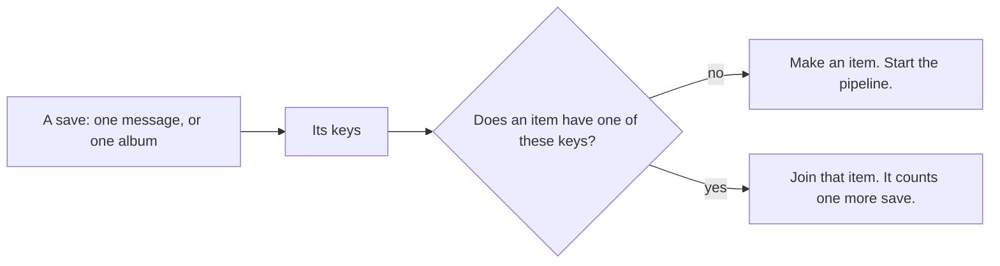

# 12. The resolver: one item for one thing, also when you save it two times

> Pull requests: [#61](https://github.com/herman72/unshelve/pull/61), and [#65](https://github.com/herman72/unshelve/pull/65) for part 9 · Decision record: [ADR 0003](../adr/0003-item-identity-through-alias-keys.md) · Code: [`ingest/canonical.py`](../../apps/api/src/unshelve/ingest/canonical.py), [`ingest/keys.py`](../../apps/api/src/unshelve/ingest/keys.py), [`ingest/resolve.py`](../../apps/api/src/unshelve/ingest/resolve.py) · Tests: [`test_canonical.py`](../../apps/api/tests/ingest/test_canonical.py), [`test_canonical_properties.py`](../../apps/api/tests/ingest/test_canonical_properties.py), [`test_keys.py`](../../apps/api/tests/ingest/test_keys.py), [`test_resolve.py`](../../apps/api/tests/ingest/test_resolve.py), [`test_resolve_together.py`](../../apps/api/tests/ingest/test_resolve_together.py)

## In one minute

You save a paper today. Next month you see it again in a different channel, and you save it again. The second address looks different, but it is the same paper.

Before this change, that made two items. Now it makes one item, and the card says "Saved 2 times".

The part that does this is the *resolver*. It has three small steps:

1. Give each address one form.
2. Give each save its keys.
3. Find the item that has one of these keys, or make a new item.

The third step must also be correct when two workers do it at the same moment.

## 1. A real run

I saved one paper two times, through the API. The second address is the PDF, with `www.`, with `http` and with a parameter of a share button.

```text
POST /api/v1/items   {"url": "https://arxiv.org/abs/1706.03762"}
201  {"id": 1, "url": "https://arxiv.org/abs/1706.03762", "capture_count": 1, ...}

POST /api/v1/items   {"url": "http://www.arxiv.org/pdf/1706.03762v7?utm_source=telegram",
                      "text": "read this before Friday"}
201  {"id": 1, "url": "https://arxiv.org/abs/1706.03762", "capture_count": 2, ...}

GET /api/v1/items    1 item
```

The second answer has the same `id`. `capture_count` is the number of saves.

Nothing is lost: the second message is stored as it arrived, with its own address and its own text.

## 2. The three steps in one picture



A *save* is one message, or the messages of one album. An album of three photos is three messages and one save.

## 3. Step one: one form for each address

Many addresses open the same page. The *canonical form* is the one form that we agree to use.

| The address that you saved | Its canonical form |
|---|---|
| `http://www.example.com/post/?utm_source=telegram#top` | `https://example.com/post` |
| `https://youtu.be/dQw4w9WgXcQ?si=AbCdEf123` | `https://youtube.com/watch?v=dQw4w9WgXcQ` |
| `https://www.youtube.com/live/dQw4w9WgXcQ?si=abc&t=120` | `https://youtube.com/watch?v=dQw4w9WgXcQ` |
| `https://twitter.com/SomeUser/status/1234567890?s=20&t=AbCdEf` | `https://x.com/someuser/status/1234567890` |
| `https://arxiv.org/pdf/2607.16100v3.pdf` | `https://arxiv.org/abs/2607.16100` |
| `https://github.com/Cloudflare/Workers-SDK` | `https://github.com/cloudflare/workers-sdk` |
| `https://fa.m.wikipedia.org/wiki/تهران` | `https://fa.wikipedia.org/wiki/%D8%AA%D9%87%D8%B1%D8%A7%D9%86` |

These rows are from the test table. The table has 127 rows, and it is the contract of the function `canonicalize`.

**A comparison from daily life:** you can write one phone number as `040 123 4567` or as `+358 40 1234567`. Your phone stores one form. So it finds the person with each of the two.

The function can make two different mistakes:

| The mistake | What you see | The cost |
|---|---|---|
| It joins two addresses that are two pages | One of your items is hidden behind the other | High. You do not know that something is missing. |
| It does not join two addresses of one page | One thing is in the list two times | Low. You see it. |

So the function is careful. In doubt, two addresses stay different:

```text
https://example.com/post?page=2      is not    https://example.com/post
https://example.com/Post             is not    https://example.com/post
github.com/a/b/blob/main/README.md   is not    github.com/a/b/blob/main/readme.md
```

The function opens no address. It is a *pure* function: the same input gives the same output, and nothing else happens. So it cannot know where a short link such as `bit.ly/3xYz` goes. The fetch step of a later milestone opens the link, and then it adds the final address as one more key.

## 4. Step two: a save has keys

A *key* is a name under which Unshelve finds a thing again. One thing can have many keys.

| The save | Its keys |
|---|---|
| A post with a link | `url:https://example.com/post` |
| A post that you forwarded from a channel | `tg_fwd:-1001111111111:590`, and the key of its link or of its text |
| A photo | `tg_file:unique-a` |
| An album of three photos | `tg_album:-1001234567890:143`, and one `tg_file:` key for each photo |
| A note without a link and without a file | `text:2805be1458982bb6df7c35af805fa0c1` |

The last key is a *hash* of the text: a short code that is the same for the same text. Capital letters and the amount of white space do not change it.

The rule of the resolver is one sentence:

> Two saves that share one key are the same thing.

Only the first link of a post is a key. A post with five links is about its first link, and the other four are extra.

**A comparison from daily life:** a library has one book and many index cards for it: one for the title, one for the author, one for the number. Each card points to the same book.

A column "the address of the item, no two the same" cannot do this. A photo has no address. And one thing has more than one name.

## 5. Step three: the same thing again

The resolver looks for an item that has one of the keys of the new save.

```text
no item has one    make an item, give it the keys, add the first job of the pipeline
an item has one    link the new message to that item, and count one more save
```

For the second case, these are the values of one test:

```text
the first save     13 October, 12:00    capture_count 1
the second save    12 November, 12:00   capture_count 2
                                        first saved 13 October, last saved 12 November
                                        still one "fetch" job: the same text, so the pipeline
                                        does not start again (part 9)
```

Three details:

- **An album is one save.** Three photos give three messages, and `capture_count` is 1.
- **A job that runs two times counts one time.** The messages of a save that has its item are not counted again ([note 9](09-walking-skeleton.md), "safe to run two times").
- **An old post can come in late.** The importer of [note 11](11-export-importer.md) can bring a post of last year, after the bot stored a post of today with the same link. Then "first saved" moves back to last year.

Sometimes a save has keys of two different items. Example: you saved a link, and you forwarded a post without a link. Later the channel adds the link to its post, and you forward the post again. The new save has the key of the link and the key of the post.

Then the two items are one thing. The older item stays. The newer item gets a pointer to the older one, and it leaves the list. Nothing is moved and nothing is deleted, so a wrong match can be undone.

## 6. Two workers at the same moment

This is a real experiment: 200 saves of 40 links, five forms of each link, and four worker processes that start together.

```text
with the lock       40 items. Each item: "Saved 5 times".
without the lock    41 items. One link got two items.
```

Here is what happens without the lock:

```text
worker A   looks for the key "url:https://example.com/articles/7"    no item has it
worker B   looks for the same key                                     no item has it
worker A   makes item 12
worker B   makes item 13                                              the same link, two items
```

Each worker did the right thing. The mistake is in the time between "look" and "make".

The cure is a lock with the name of the key. Before a worker looks, it takes the lock. The second worker waits at that point. When the first worker is done, the second one looks, and it finds item 12.

Postgres has such a lock: an *advisory lock*. It is a lock on a name that the programs agree on. The database connects it to no table and no row.

**A comparison from daily life:** an office has one meeting room, and its key hangs at the reception. The door has no lock for each person. The rule is: the person who holds the key uses the room.

Two more points:

- **Two different links do not wait for each other.** Each key has its own lock. A test proves it: worker A waits inside its work until worker B has finished a different link.
- **The locks are taken in a sorted order.** A save can have three keys. If worker A takes key 1 and then key 2, and worker B takes key 2 and then key 1, each one can wait for the other for ever. That is a *deadlock*. With a sorted order, the two ask for key 1 first.

Why is this not "check and change in one statement", as in notes 4, 8 and 9? Because two rows are necessary: the item, and the key that points to it. The item must exist first. The lock makes the two writes one unit.

## 7. A tool that makes strange addresses

This address broke my first version:

```text
http://www.www.example.com/
after one pass     https://www.example.com/
after two passes   https://example.com/
```

The rule "remove `www.`" ran one time. So the canonical form changed when it went into the function again. A key that is different the second time is two keys for one page.

My first check did not find this address. It was simple: 200,000 random texts. Random letters almost never make `www.` two times in the right place.

Then I read each rule and asked one question: is the result the same on a second pass? Five rules were not.

A better tool asks this question for you: the library Hypothesis. With it, you do not write examples. You write a rule that must be true for each input:

```python
once = canonicalize(address)
assert canonicalize(once) == once
```

The library builds thousands of addresses from parts, also strange ones. When one breaks the rule, the library makes it smaller and smaller, and it gives you the smallest one. This is a *property test*.

To check the tool, I removed each of my five corrections again, one at a time. The library found each mistake. These are the smallest addresses that it gave me:

```text
http://www.www.example.com/      "www." was removed one time only
http://en.m.m.wikipedia.org/     the phone address of Wikipedia was corrected one time only
http://t.me/s/s/s                the "/s/" of a Telegram address was removed one time only
http://github.com//.git          ".git" was removed from a name that is only ".git"
http://example.com/%%341         a "%" that starts no code was read in two ways
```

Each one is a row of the table now, so the normal test run finds it again.

The library also found a mistake in one of my rules for the tests. I wrote "a tracking parameter never changes the canonical form". The library gave me an address with a space at its end. Without a parameter, the space is at the end, and it is removed. With a parameter, the same space is in the middle. A property test also shows you what you really promise.

By default these tests make the same addresses in each run and on each computer. So a failure on CI can be repeated on your Mac. To let them look for new problems:

```bash
cd apps/api && HYPOTHESIS_PROFILE=explore uv run pytest tests/ingest/test_canonical_properties.py
```

## 8. The items that exist get their keys

An item that you saved before this change has no keys. A new save of its link does not find it.

One command corrects this. It reads the stored messages of each item again and makes the keys:

```text
$ unshelve rekey
Items: 13. New keys: 8. Joined to an older item: 0.
```

This is possible because Unshelve keeps each message as it arrived. The messages are the source. The items and the keys are made from them, so they can be made again.

The same command is the plan for a later change of the rules. The rules for an address have a version number. After a new version, `unshelve rekey` gives each item the keys of the new rules.

## 9. An edit, and a save with a new text

You post a link with a short note. Five minutes later you correct the note:

```text
22:40  you post         "A short guide to vector search"                 item 1, then ready
22:45  you correct it   "A short guide to vector search in Postgres"
       the bot gets the edit as a new version of the same message
       the item reads the new version, and its pipeline starts again     item 1, ready again
```

Each version is a capture of its own, and no stored version is ever changed. The item reads the latest version of each of its messages.

| What arrives | What happens |
|---|---|
| An edit with a new text, link or file | The item reads the new version, and its pipeline starts again. |
| An edit that changes nothing that the item reads | Nothing. Example: when the bot puts a button under a post, Telegram marks the post as edited ([ADR 0009](../adr/0009-capture-rules-from-a-real-bot-and-real-exports.md), question 7). |
| An edit that corrects the link | The item moves to the new address. The old key stays, so a save of the old link still finds the item. |
| A second save with a new text | The item counts one more save, shows the two texts, and its pipeline starts again. |
| A second save with the same text | The item counts one more save. No step runs again, so no model is asked again. |
| An edit that arrives before the job of the first version | It waits. The job of the first version links the two versions. |
| An edit of a post that the bot never saw | It is the save. |

**How "the same text" is decided.** The item reads each different text, link and file one time. From these it makes a short code. A new message or a new version that does not change the code starts nothing. That rule keeps the cost down in milestone M2, where each run of the pipeline asks a model.

**A step that read an old version writes nothing.** Here is the story where it matters:

```text
22:40:00.0  worker A starts "fetch" for item 1. It reads "A short guide to vector search".
22:40:00.1  the bot gets your edit. The item is sent back to the start, with a new fetch job.
22:40:00.2  worker A saves the old text and moves the item on       without a check: the old text wins
```

The check of [note 9](09-walking-skeleton.md), part 6 is one condition in the `UPDATE`: "only if the item still waits for this step". Here the save has one more condition: "only if the item still has the messages that I read". The number of its messages and the highest id among them are the same as at the start, or the step writes nothing. Then the new fetch job reads the correction.

**A comparison from daily life:** a cook makes a plate. The guest changes the order. Before the plate goes to the table, the waiter looks at the order again. It is different, so the plate goes back.

**Each run writes all of its fields.** Before this change, the pipeline ran one time for each item. The fetch step wrote a field only when it had a value. The enrich step kept a title that was there already, because a title from the page is better than a title from the model.

On a second run, these two rules kept the title of the old version. A test found it:

```text
after the edit    text  "The corrected text"     correct
                  title "the first text"         wrong: from the first run
```

Now each step writes each of its fields on each run, also an empty one. So the result depends only on the latest versions, and not on an earlier run. A second test removes the caption of a photo: nothing of the old card stays.

**A comparison from daily life:** before you write a new plan on a whiteboard, you clean the whole board. If you write only over the parts that changed, old words stay in the corners.

## A choice that we made

How do you make "find it, or make it" safe when two workers do it at the same moment?

| | A lock with the name of the key (ours) | Insert, and handle the answer "exists already" |
|---|---|---|
| The idea | Wait first. Then do the normal steps. | Do the steps. Repair when the database refuses. |
| The code | Straight: lock, look, write | An item that is made and then removed again, or a savepoint and a second try |
| The risk | Each piece of code that writes keys must take the lock | Two keys in a different order can make a deadlock |
| Other databases | No. It is a feature of Postgres. | Yes |

With the lock, one guard is still in the database: a key cannot belong to two items, because the key is the primary key of its table. If a piece of code forgets the lock, the database gives an error. It does not store two owners of one key.

## What a senior engineer checks here

- **Which mistake costs more?** Joining two things by mistake hides an item. So the rules for addresses are careful, and a join of two items is a pointer that can be removed.
- **Does the function always give an answer, and the same answer?** It never fails, also for a text that is not an address. Its result does not change on a second pass. Property tests check the two.
- **What do two transactions do at the same moment?** I ran it with real processes, with the lock and without it. A test repeats the bad order of events on purpose.
- **Can the data be made again?** Yes. The keys come from the stored messages (`unshelve rekey`).
- **Can the tests fail?** I broke the code in 80 places, one at a time. The first runs missed 7. I added a test for 5 of them, removed a shortcut that changed nothing, and corrected a comment that said too much. Now the tests find each of the 80.
- **Does a second run give the same result as a first run?** Yes. Each step writes all of its fields, also the empty ones (part 9). For part 9, I broke the new code in 29 places, one at a time. The tests found each of the 29.
- **An old mistake that the experiment found.** On a new database, two workers that run their first "embed" step at the same moment could fail one time: 8 of 60 tries. The job ran again and passed, so no data was wrong. The cause was one index name in an `INSERT`. It is corrected, and it has a test.
- **What is not done:**
  - A short link is not followed. That needs the fetch step of milestone M2.
  - A file from an export has no key, because an export gives no id for a file ([issue #57](https://github.com/herman72/unshelve/issues/57)).
  - A second save of an item that you archived only raises the number. You decided: this stays until you use Unshelve for real ([issue #60](https://github.com/herman72/unshelve/issues/60)).
  - The web app cannot change a title yet ([issue #24](https://github.com/herman72/unshelve/issues/24)). When it can, a restart must keep your title, because the pipeline now writes the title on each run.

## Try it yourself

Do this after the pull request is merged.

1. Run `git pull`, and then `make up`. The first command gets the new code. The second builds the stack with it.
2. Give the items that you have their keys:

```bash
docker compose exec api unshelve rekey
```

3. Post this address in the channel "Unshelve test": `https://arxiv.org/abs/1706.03762`
4. Wait some seconds. Then post this one: `https://arxiv.org/pdf/1706.03762v7`
5. Open the inbox of the web app. You see one card for the paper, and the card says "Saved 2 times".
6. Post this text in the channel: `Notes on vector search`
7. Reload the inbox. A new card has the title "notes on vector search". The fake model makes the title from the first words, in small letters.
8. In Telegram, edit the post. Change the text to `Notes on vector search in Postgres`
9. Wait some seconds, and reload the inbox. The same card has the title "notes on vector search in postgres". There is no second card.

## Exercise (10 minutes)

Add a tracking parameter, test first. Facebook adds `mibextid` to a link that you share.

1. Open `apps/api/tests/ingest/test_canonical.py`. Find the row with `uclick_id`, and add this row under it:

```text
    ("https://example.com/post?mibextid=abc", "https://example.com/post"),
```

2. Run the tests of the table:

```bash
cd apps/api && uv run pytest tests/ingest/test_canonical.py -q
```

3. Read the result. One test must fail.
4. Open `apps/api/src/unshelve/ingest/canonical.py`. Add `"mibextid",` to the set `_TRACKING`.
5. Run the tests again. All of them must pass.
6. Remove your two changes with the undo of your editor.

Then answer this question: you changed a rule. Which two other things must change before this goes into `main`?

<details>
<summary>The answer</summary>

After step 2, one test fails and 284 pass:

```text
FAILED tests/ingest/test_canonical.py::test_an_address_gets_its_canonical_form[https://example.com/post?mibextid=abc-https://example.com/post]
1 failed, 284 passed
```

After step 4, all 285 pass.

The two other things:

1. `VERSION` in `canonical.py` goes from 1 to 2, because an address has a different canonical form now. One test holds the number 1, so that nobody changes a rule and forgets the version.
2. After the update, somebody runs `unshelve rekey`. An item that was saved with `?mibextid=…` has a key with that parameter. The command gives it the new key too.

</details>

## Words used in this note

| Word | Meaning |
|---|---|
| Resolver | The part that decides which item a saved message belongs to |
| Save | One message, or the messages of one album |
| Canonical form | The one form that we use for a thing that has many forms |
| Pure function | A function that only makes its answer: the same input gives the same output |
| Key | A name under which Unshelve finds a thing again. One thing can have many. |
| Hash | A short code that is made from a text. The same text gives the same code. |
| Advisory lock | A lock on a name that the programs agree on. Postgres keeps it. |
| Deadlock | Two programs wait for each other, and none of them can continue |
| Property test | A test of a rule that must be true for each input. A library makes the inputs. |
| Tracking parameter | A part of an address that a share button adds. It does not change the page. |

## To read more

- [RFC 3986, section 6: Normalization and Comparison](https://datatracker.ietf.org/doc/html/rfc3986#section-6), the standard for web addresses. It lists which changes of an address are safe. The first part of `canonicalize` follows it.
- [Advisory Locks](https://www.postgresql.org/docs/current/explicit-locking.html#ADVISORY-LOCKS), the PostgreSQL documentation. Read the difference between a lock for a session and a lock for a transaction. The resolver uses the second one.
- [What is property-based testing?](https://hypothesis.works/articles/what-is-property-based-testing/), David MacIver, the author of Hypothesis. A short text about the idea.

Previous: [11. The importer](11-export-importer.md) · Next: [13. Cards, a button, and the digest](13-cards-and-digest.md)
