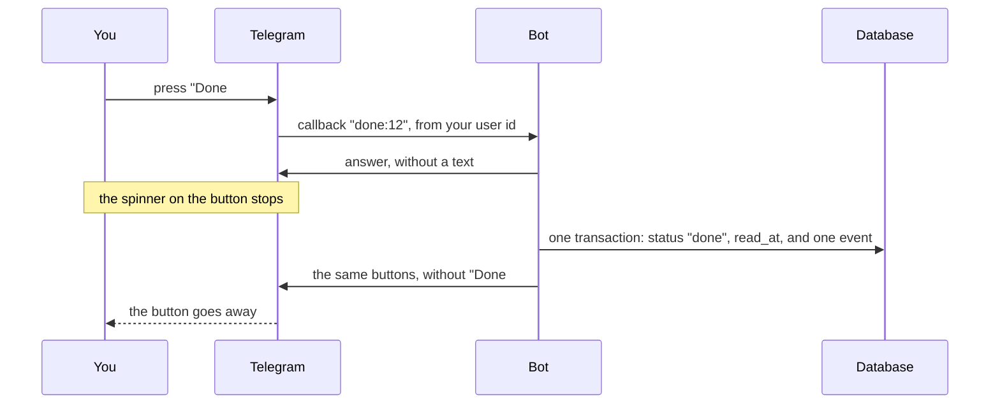

# 13. Cards, a button, and the digest

> Pull requests: [#63](https://github.com/herman72/unshelve/pull/63), and [#64](https://github.com/herman72/unshelve/pull/64) for part 8 · Code: [`resurface/weekly.py`](../../apps/api/src/unshelve/resurface/weekly.py), [`bot/cards.py`](../../apps/api/src/unshelve/bot/cards.py), [`bot/private.py`](../../apps/api/src/unshelve/bot/private.py), `resurface/digest.py` (removed in #96), [`track/status.py`](../../apps/api/src/unshelve/track/status.py) · Tests: [`tests/bot/test_cards.py`](../../apps/api/tests/bot/test_cards.py), [`tests/bot/test_private.py`](../../apps/api/tests/bot/test_private.py), [`tests/resurface/`](../../apps/api/tests/resurface/), [`tests/track/`](../../apps/api/tests/track/)

## In one minute

Saving is easy. Coming back to a saved thing is the hard part. So Unshelve must bring things back to you: it must *push*, not only store.

You write `/digest` to the bot. The bot answers with one message: the things that you saved in the last 7 days, and one older thing from your inbox. Each thing is a *card* with two buttons: "Open" and "Done".

When you press "Done", the item is read. The button goes away, and the item leaves the inbox of the web app.

The same digest also comes by itself, each Sunday at 09:00 (part 8).

> **Since #96:** the digest chooses its items by your goals and a reading time ([note 34](34-choosing-a-digest.md)), and a stale prompt follows it ([note 35](35-sending-the-digest.md)). Parts 1 and 7 of this note describe the first choice of items; the other parts still hold.

## 1. A digest, as Telegram gets it

The text has a few HTML marks, such as `<b>` for bold:

```text
<b>Your digest</b>
You saved 2 things in the last 7 days.

<b>Queues &amp; &lt;locks&gt; in Postgres</b>
#1 · example.com · 8 min · saved 2 times
Why SKIP LOCKED makes a job queue safe.

<b>مقدمه‌ای بر pgvector و جستجوی برداری</b>
#2 · blog.example.org · 6 min
این نوشته نشان می‌دهد چگونه بردارها ذخیره می‌شوند.

<b>From your shelf</b>
<b>Attention is all you need</b>
#3 · arxiv.org · 40 min
saved 3 months ago
```

Under the text are three rows of buttons:

```text
[ Open #1 ]  [ Done #1 ]
[ Open #2 ]  [ Done #2 ]
[ Open #3 ]  [ Done #3 ]
```

"Open" is a link to the address of the item. "Done" sends a *callback* to the bot: a short text that the bot gets when you press the button. Here it is `done:12`, the id of the item.

## 2. A title cannot add marks to the message

Look at the first title. The page was called `Queues & <locks> in Postgres`. In the message it is `Queues &amp; &lt;locks&gt; in Postgres`.

A title, a summary and a site name are text from the internet. If a page calls itself `<b>Win</b>`, Telegram would read `<b>` as a mark. A page could change how your message looks, or break it. So each such text is *escaped*: `<` becomes `&lt;`, `>` becomes `&gt;`, and `&` becomes `&amp;`. Telegram shows these as the normal characters.

**A comparison from daily life:** you write a letter, and you quote what a person said. The quotation marks show that these are their words, not your instructions.

The web app has the same rule: React escapes each text that it shows. Here the code must do it, with `html.escape`.

## 3. A Persian title has a line of its own

Telegram gives each line the direction of its first letter. A Persian letter makes the line right to left, and an English letter makes it left to right.

If a Persian title and the English words "6 min" were on one line, the parts could show in a strange order. So each card has three lines:

```text
the title alone                       its own direction
#2 · blog.example.org · 6 min         our words: always left to right
the summary alone                     its own direction
```

The web app does the same with `dir="auto"` on each element that shows saved text ([`item-card.tsx`](../../apps/web/src/components/item-card.tsx)).

## 4. A press of a button, step by step



**The answer comes first.** Telegram waits for an answer to each press, and it forgets the press after some seconds. The test with the real bot showed it: a late answer got the error "query is too old" ([ADR 0009](../adr/0009-capture-rules-from-a-real-bot-and-real-exports.md)). So the bot answers at once, and then it does the work.

The answer has no text. The button that goes away is the answer that you see.

## 5. One way to change the status, and a log of each change

The status of an item changes in one place: `track/status.py`. Two rows are written in one transaction:

```text
items    status "inbox" → "done", read_at 2026-10-18 09:31
events   item 12, user, "status", from "inbox" to "done", via "telegram"
```

The *event log* is the table `events`. A trigger in the database refuses a change or a deletion of a row there, so the log only grows. Later milestones read it: how fast do you read what you save?

Three cases are not errors:

| What happens | What the bot does |
|---|---|
| You press "Done" a second time | Nothing. The item is done already, and no second event is written. |
| You press two times very fast | The row of the item is locked. The second press waits, then it sees "done". One event. |
| The item was archived in the web app | Nothing. An archived item goes back to the inbox first: that is the table of moves. |
| The worker merged the item into an older item after the digest | The bot moves the older item: you read the thing, so the thing is done. |

[Note 30](30-reading-status.md) shows the whole table of moves, the buttons of the web app, and the limit of the reading queue.

## 6. Who may press

The digest goes to your private chat, so you are the only person who sees its buttons. But a message can be forwarded with its buttons.

So the bot checks who pressed. A press of a different person gets an answer without a text, so that the spinner stops. Nothing else happens, and the log does not name the person. The same rule protects `/login` ([note 8](08-login.md), part 9).

## 7. The older thing comes from a shelf

The last card is one thing that you saved more than 7 days ago and that still waits in the inbox. It is chosen at random.

Why at random? A digest of the last 7 days only repeats your week. A thing that is older than one week never comes back. A random choice gives each old thing a chance.

The choice is random, and it is also repeatable. The random generator starts from a *seed*: a fixed text. With the same seed it makes the same choice. Today the seed is your user and the date: `/digest` two times on one day shows the same old thing. A digest that is sent again after an error also shows the same thing.

## 8. On Sunday at 09:00, the digest comes by itself

The worker process looks once a minute: is a digest due? You set the moment in `.env`:

```text
UNSHELVE_TIMEZONE=Europe/Helsinki
UNSHELVE_DIGEST_DAY=sunday
UNSHELVE_DIGEST_HOUR=9
```

The time zone is a name, as for the importer ([note 11](11-export-importer.md), part 4). 09:00 in Helsinki is 06:00 UTC in summer and 07:00 UTC in winter. The name knows which one.

Your Mac can sleep on Sunday morning. So the digest can come late:

| Your Mac | What happens |
|---|---|
| Awake on Sunday at 09:00 | The digest comes within one minute. |
| Asleep, and awake again on Monday at 08:00 | The digest comes on Monday at 08:00. |
| Asleep until Tuesday at 10:00 | No digest for this week. It is more than 48 hours late, and an old digest is no help. |

**Exactly one digest each week.** Each week has a name, such as `2026-W42`, and one row in the table `digests`. The worker makes the row and the job that sends the digest in one transaction. Then the next minute, and a second worker, find the row and make nothing.

The name of a week follows ISO 8601: a week belongs to the year of its Thursday. So Sunday, 3 January 2027 is in the week `2026-W53`.

**First sent, then marked.** The job sends the message, and then it marks the row as sent. If the worker stops between these two steps, the job runs again, and the digest comes two times. The other order is "mark, then send". Then a stop between the steps loses the week. A lost week is worse than a message that comes two times.

**When Telegram says no:**

| What Telegram says | What the job does |
|---|---|
| "Too many requests, wait 7 seconds" | It tries again after 7 seconds. |
| No answer: no connection | It tries again after 30 seconds. |
| An error of the server of Telegram | It tries again after 60 seconds. |
| The bot is blocked, the token is wrong, or the chat is unknown | It stops. A second try gets the same answer. |

You can see a digest before Sunday:

```bash
docker compose exec worker unshelve digest preview
```

This prints the digest and sends nothing. `unshelve digest send` sends it to you now.

## A choice that we made

One message for the whole digest, or one message for each card?

| | One message (ours) | One message for each card |
|---|---|---|
| Sending | One request. The digest arrives as a whole, or not at all. | Six requests. An error after the third leaves half a digest, and a second try sends the first three again. |
| Limits | One message has at most 4096 characters. If the text is longer, the summaries go first. | Telegram slows down many messages to one chat. |
| Buttons | All in one block, with numbers | Next to each card |

A digest that arrives as a whole is easier to make exactly one time. The next pull request needs that: "exactly one digest each week".

## What a senior engineer checks here

- **Can text from the internet change the message?** No. Each such text is escaped, and a test sends `<b>` and `<script>` in a title, a summary and a site name.
- **What does a second press do?** Nothing, and it is no error. Telegram also refuses a change of buttons that changes nothing ("message is not modified"), so the bot changes the buttons only when the pressed one is still there.
- **What do two presses at the same moment do?** One event. A test makes the first press slow on purpose; the lock of the row makes the second one wait.
- **Who can do what?** Only the owner can press. A stranger gets an empty answer.
- **Can a digest come two times, or never?** Two times, if the worker stops in a short moment after the sending. Never in a week when the Mac sleeps for more than 48 hours after the moment. Part 8 explains why.
- **Can the tests fail?** I broke the new code in 38 places, one at a time. The tests found 37. The one that they missed was "an item in the queue comes from the shelf", because the random choice took a different item by chance. A test without chance finds it now.
- **What is not done:**
  - The digest does not say which days it covers ("13 to 19 October").
  - "Done" is the only button. "Later", "Archive" and the queue with its limit arrive with milestone M3.
  - The titles and the summaries come from the fake model, so they are the first words of the saved text. Milestone M2 makes them real.

## Try it yourself

Do this after the pull request is merged.

1. Run `git pull`, and then `make up`.
2. Write `/digest` to your bot. You get the link that the bot stored after pull request #56.
3. If you imported your export (note 11), you see more things. Press "Done" under one of them.
4. Open the inbox of the web app. The item that you marked is not there any more: the inbox shows the items with the status "inbox".

## Exercise (10 minutes)

Remove the escaping of the title, and see which test finds it.

1. Open `apps/api/src/unshelve/bot/cards.py`, and go to the function `card`.
2. Change `html.escape(title_of(item), quote=False)` to `title_of(item)`.
3. Run the tests of the cards:

```bash
cd apps/api && uv run pytest tests/bot/test_cards.py -q
```

4. Read the name of the test that fails. Then put the line back with the undo of your editor.

Then answer this question: the test of the Persian title still passed. Why?

<details>
<summary>The answer</summary>

One test fails, and 14 pass:

```text
FAILED tests/bot/test_cards.py::test_text_from_the_internet_cannot_add_marks_to_the_message
```

The Persian title has no `<`, `>` or `&`. For such a text, escaping changes nothing, so a test with it cannot see if the escaping is there. A test of a protection needs an input that the protection changes: a title with `<b>` in it.

</details>

## Words used in this note

| Word | Meaning |
|---|---|
| Card | The lines that show one item in a message: title, facts, summary |
| Digest | One message with the things of the last days and one older thing |
| Callback | The short text that the bot gets when you press one of its buttons |
| Escape | To write a character so that it is shown, and not read as a mark: `<` as `&lt;` |
| Event log | The table `events`. Each change of a status is one row, and no row is ever changed. |
| Seed | The start value of a random generator. The same seed gives the same choices. |
| Push | To bring information to a person, without a question from that person |

## To read more

- [Formatting options](https://core.telegram.org/bots/api#formatting-options), Telegram Bot API. Read "HTML style". It lists the marks that Telegram knows, and the three characters that must be escaped.
- [answerCallbackQuery](https://core.telegram.org/bots/api#answercallbackquery), Telegram Bot API. The first sentences say that a press must get an answer.

Previous: [12. The resolver](12-resolver.md) · Next: [14. The fetcher and its guard](14-fetcher-and-guard.md)
