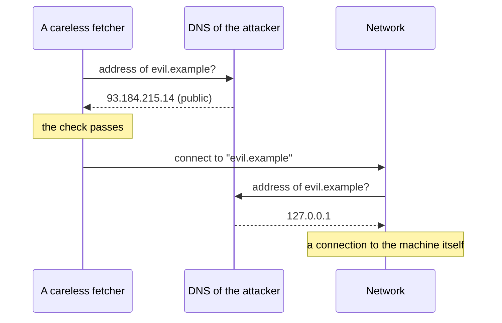
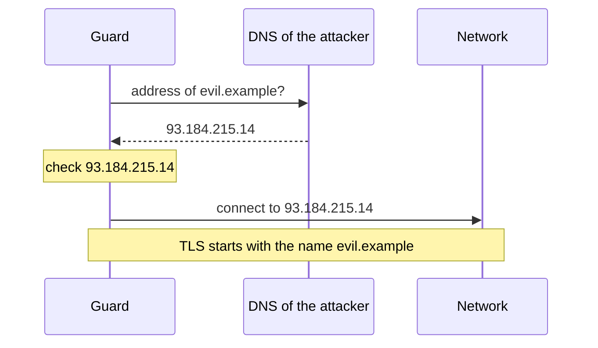

# 14. The fetcher and its guard

> Pull request: [#66](https://github.com/herman72/unshelve/pull/66) · Decision record: [ADR 0010](../adr/0010-one-guarded-way-to-the-internet.md) · Code: [`net/fetcher.py`](../../apps/api/src/unshelve/net/fetcher.py), [`net/guard.py`](../../apps/api/src/unshelve/net/guard.py), [`net/addresses.py`](../../apps/api/src/unshelve/net/addresses.py), [`net/bodies.py`](../../apps/api/src/unshelve/net/bodies.py), [`net/pacing.py`](../../apps/api/src/unshelve/net/pacing.py) · Tests: [`tests/net/`](../../apps/api/tests/net/)

## In one minute

Until now, Unshelve stored the text of a post and never opened its link. From milestone M2, the worker opens each saved link to read the page.

Opening a link is not safe. A link is text from the internet, and it can point inside your own network: to your router, to the database of Unshelve, or to the secret service of a cloud machine.

The fetcher is the only code that opens a link. Each of its connections passes a guard. The guard lets a connection go only to a public address.

## 1. The attack, with one address

Here is a link that looks harmless:

```text
http://169.254.169.254/latest/meta-data/
```

On a cloud machine (AWS, Google Cloud, Azure), this address is the *metadata service*: a small web server that only the machine itself can reach. It answers with facts about the machine, and on some clouds also with its access keys.

Suppose that the worker opens this link and stores the answer as the text of the item. Then the summary of the item shows the keys of the machine. A person who can make you save a link (with a forwarded post, or with a page that redirects) can read them.

This attack is called SSRF, *server-side request forgery*: a stranger makes a server open an address that only the server can reach.

The same risk exists on your Mac:

| Link | What answers |
|---|---|
| `http://192.168.1.1/` | the page of your router |
| `http://localhost:8000/` | the API of Unshelve |
| `http://db/` | the database container, seen from the worker in Docker |

**A comparison from daily life:** a secretary opens each letter and phones each number in it. One letter says "please call extension 100". Extension 100 is the boss. Now a stranger talks to the boss through the secretary. The rule for the secretary: call outside numbers only.

## 2. One address, many forms

The guard cannot compare text. Each of these links opens 127.0.0.1, the machine itself:

| Form | Example |
|---|---|
| Normal | `http://127.0.0.1/` |
| Short | `http://127.1/` |
| Hexadecimal | `http://0x7f.1/` |
| One number | `http://2130706433/` |
| Octal | `http://017700000001/` |
| IPv4 inside IPv6 | `http://[::ffff:127.0.0.1]/` |
| Through NAT64 | `http://[64:ff9b::7f00:1]/` |
| A public name | `http://localtest.me/` (DNS answers 127.0.0.1) |

A check such as "the host must not start with 127." misses each form after the first one.

So the guard compares *addresses*, not text:

1. It reads each form of an address into one address. It reads old forms such as `0x7f.1` itself, so DNS gets no question for them.
2. It asks DNS for the addresses of a name.
3. It checks each address against lists of networks that are not public.

The test `test_the_real_rules_refuse_each_form_of_a_local_address` tries 22 such links. Each one is refused, and the test proves that no connection was opened.

## 3. What is public

The lists are in `net/addresses.py`. Examples:

| Address | Decision | Why |
|---|---|---|
| `8.8.8.8` | public | |
| `10.0.0.1`, `172.16.0.1`, `192.168.1.1` | refused | private networks |
| `127.0.0.1`, `::1` | refused | loopback: the machine itself |
| `169.254.169.254` | refused | link-local: the metadata service |
| `100.64.0.1` | refused | the shared network of a provider |
| `224.0.0.1` | refused | multicast |
| `fc00::1`, `fe80::1` | refused | IPv6 unique local, IPv6 link-local |
| `::ffff:8.8.8.8` | public | the IPv4 address inside decides |

For IPv6 the rule is the other way around: only the network `2000::/3` can be public, and the guard refuses some parts of it, too.

How do we know that the lists are complete? Python has its own answer, `ipaddress.is_global`. A property test makes 50,000 random addresses. For each address that Python calls "not global", our guard must refuse it, too. Our lists are a little stricter: Python calls a multicast address global.

## 4. DNS rebinding: the check and the connection must use one answer

A name can point to a different address at each question. The owner of a DNS server tells the world to keep each answer for 0 seconds, and then answers by turns:



The careless fetcher checked one answer, and it connected with a second answer. This attack is called *DNS rebinding*.

Our guard asks DNS one time, and it connects to the address that it checked:



How does the guard get between the check and the connection? The fetcher uses the library httpcore. httpcore opens each connection through a *network backend*: an object with one method, `connect_tcp(host, port)`. The guard is that network backend. It gets the name, finds and checks the addresses, and gives a checked address to the real network.

After the connection, httpcore starts TLS with the name, not with the address. So the certificate must still be valid for the name.

**A comparison from daily life:** you check the address of a shop on a map. Then you give the taxi driver the name of the shop. The driver looks up the name again, in a different book, and drives to a different place. The safe way: give the driver the address that you checked.

A test shows it. Its pretend DNS answers a public address first, and 127.0.0.1 after that. The record of the connections shows `('93.184.215.14', 80)`: the checked address, not the name.

## 5. Each redirect is a new door

A public page can answer "301: the page is now at `http://169.254.169.254/`". So the fetcher follows at most 5 redirects, and each new connection passes the guard again.

The test `test_a_redirect_to_the_metadata_service_gets_no_connection` sends exactly this answer. The record of the connections has one line: the first page. The redirect got no connection.

## 6. A server controls the size and the speed

A server can also attack with its answer:

| What the server does | The limit of the fetcher |
|---|---|
| It sends 5 GB | `max_bytes`, which the caller sets. More is an error, never a cut text. |
| It sends 50 kB of gzip that becomes 50 MB | `max_bytes` also counts the bytes after decompression. |
| It sends one byte at a time, slowly | One time limit for the whole fetch with its redirects: 30 s. |
| It redirects for ever | At most 5 redirects. |
| It listens on port 22 or 6379 | Only the ports 80 and 443. |
| It gets ten requests in one second | A pause of 1 s between two requests to one host. |

The second row is a *gzip bomb*. A test makes one: 50 MB of zeros become less than 100 kB. The fetcher asks the decompressor for at most one byte more than the limit, again and again. So it stops after the first megabyte. The test measures the memory: less than 5 MB at the highest point.

The third row needs one limit for the whole fetch. Each byte arrives in time, so a limit for each read never fires. A test sends one byte each 0.05 s, and only the limit of the whole fetch stops it.

## 7. What the fetcher answers

A fetch gives a page, or an error with a reason. The next package, M2-3, decides what to do from the reason:

| Reason | Example | Try again? |
|---|---|---|
| `blocked_address` | `http://169.254.169.254/` | no |
| `no_such_host` | a name that DNS does not know (new in this package) | no: the link is dead |
| `too_large` | a page of 20 MB | no |
| `unsupported` | `ftp://`, or a zip file when the caller asks for HTML | no |
| `http_error` | 404: no. 429 and 503: yes, after the time in `Retry-After` | it depends |
| `timeout` | a server that never answers | yes |
| `network` | a closed port, or a broken gzip body | yes |

## A choice that we made

Where does the check go?

| | A network backend of httpcore (ours) | Check the name, then let the library connect to the name | An egress proxy, such as Smokescreen |
|---|---|---|---|
| DNS rebinding | closed: one DNS answer | open: two DNS questions | closed |
| Redirects | each new connection is checked | each hop must be checked by hand | each connection is checked |
| What it costs | about 140 lines and one library | a few lines | one more service to run |

An egress proxy is a separate program between Unshelve and the internet. It protects each program on the machine, also code that forgets the rule. It is a good candidate for the hosting decision of milestone M6. For a laptop, the network backend is enough.

## What a senior engineer checks here

- **Where is the one place that opens a connection?** `GuardedBackend.connect_tcp`. The tests write down each connection, and they prove that a refused address got none.
- **Can a second way out appear later?** A test reads the imports of the whole package. Only `unshelve.net` may import an HTTP client. The test also refuses `trafilatura.fetch_url`: the article extractor of M2-2a uses trafilatura, and that function downloads a page without the guard.
- **Do the check and the connection use one DNS answer?** Yes. Part 4.
- **Does each form of an address get the same answer?** 22 forms in one test, and a property test for each IPv4 address inside IPv6.
- **What does the server control?** Size, time, encoding, redirects, `Retry-After`. Each one has a limit. A `Retry-After` of more than one day is read as one day.
- **Was it tried with the real internet?** Yes, with the new command `unshelve fetch`: example.com, github.com (a redirect from http to https, with gzip), Wikipedia, and a name that does not exist. The two public names `localtest.me` and `127.0.0.1.nip.io` point to 127.0.0.1, and both were refused.
- **Can the tests fail?** I broke the new code in 47 places, one at a time. The tests found 45. The two misses were useful:
  - A check of the characters of a host changed nothing, because `inet_aton` refuses the same hosts. I removed the check.
  - The test of the gzip bomb gave the bomb in pieces of 1,000 bytes. Each piece becomes only about 1 MB, so the test did not see a decompressor without a limit. Now the test gives the whole bomb in one piece, as a fast server can. The tests find each of the 46 that remain.
- **What is not done:**
  - The pipeline does not use the fetcher yet. The step `fetch_item` with the extractors is package M2-3.
  - The pause between requests is kept in each process. Two workers can each ask one host in the same second.
  - The fetcher does not read `robots.txt`. It opens a page only because you saved its link, as a browser does.
  - The tests do not test TLS. A test server with a certificate needs one more library. The real check with example.com and github.com used TLS.

## Try it yourself

Do this after the pull request is merged.

1. Run `git pull`, and then `make up`.
2. Open a public page:

```bash
docker compose exec worker unshelve fetch https://example.com/
```

You see a log line with `fetch.done`, then `200 https://example.com/`, then the type and the size of the page.

3. Try the database, from inside Docker:

```bash
docker compose exec worker unshelve fetch http://db/
```

The last line says `Not fetched: blocked_address (db is 172.20.0.5: private).` Your number can be different. The database container is one name away from the worker, and the guard refuses it.

4. Try the metadata address:

```bash
docker compose exec worker unshelve fetch http://169.254.169.254/latest/meta-data/
```

It is refused in a few milliseconds, without a DNS question.

## Exercise (10 minutes)

Make the guard connect to the name, and see which test finds it.

1. Open `apps/api/src/unshelve/net/guard.py`, and go to `connect_tcp`.
2. In the call `self._inner.connect_tcp(...)`, change `str(address),` to `host,`.
3. Run the tests of the guard:

```bash
cd apps/api && uv run pytest tests/net/test_guard.py -q
```

4. Read the names of the tests that fail. Then put the line back with the undo of your editor.

Then answer this question: the guard still checks each address before the connection. Why is the change dangerous?

<details>
<summary>The answer</summary>

Four tests fail, and 17 pass. One of the four is the test of part 4:

```text
FAILED tests/net/test_guard.py::test_a_second_dns_answer_cannot_change_the_address_of_the_connection
E       AssertionError: assert [('rebind.example', 80)] == [('93.184.215.14', 80)]
```

The check is still correct, but it checks the first DNS answer. The connection now goes to the name, so the network asks DNS a second time. The attacker's DNS gives 127.0.0.1 to that second question. The check and the connection now see different addresses: that is DNS rebinding.

A check protects only the thing that it checked. The connection must use the checked value, and not the name again.

</details>

## Words used in this note

| Word | Meaning |
|---|---|
| SSRF | Server-side request forgery: a stranger makes a server open an address that only the server can reach |
| Metadata service | A web server at 169.254.169.254 on a cloud machine. It tells the machine about itself, on some clouds with keys. |
| Public address | An address on the internet, not inside a network |
| Loopback | The address of the machine itself: 127.0.0.1 or ::1 |
| DNS | The service that gives the address of a name |
| DNS rebinding | A DNS server gives a different address at each question, so that a check and a connection see different addresses |
| Redirect | An answer such as 301 that says: the page is at a different address |
| Network backend | The part of httpcore that opens a connection |
| TLS | The encryption of https. The server shows a certificate for its name. |
| gzip bomb | A small compressed body that becomes very large when it is decompressed |
| Retry-After | A header in which a server says how long to wait before the next try |

## To read more

- [Server-Side Request Forgery Prevention Cheat Sheet](https://cheatsheetseries.owasp.org/cheatsheets/Server_Side_Request_Forgery_Prevention_Cheat_Sheet.html), OWASP. Read "Case 2": an application that must be able to open any address on the internet. That is the case of Unshelve.
- [Network Backends](https://www.encode.io/httpcore/network-backends/), the documentation of httpcore. It shows the method `connect_tcp` that the guard implements.

Previous: [13. Cards, a button, and the digest](13-cards-and-digest.md) · Back to the [list of notes](README.md)
