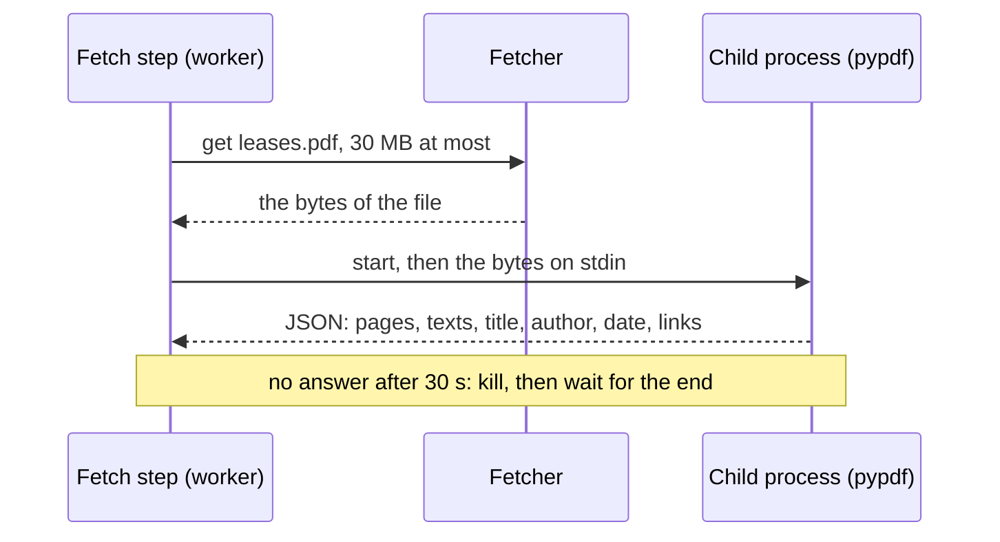

# 24. Reading a PDF file

> Pull request: [#80](https://github.com/herman72/unshelve/pull/80) · Code: [`extract/pdf.py`](../../apps/api/src/unshelve/extract/pdf.py), [`extract/pdf_reader.py`](../../apps/api/src/unshelve/extract/pdf_reader.py), [`extract/article.py`](../../apps/api/src/unshelve/extract/article.py) (the hand-off) · Tests: [`tests/extract/test_pdf.py`](../../apps/api/tests/extract/test_pdf.py), [`tests/extract/test_pdf_reader.py`](../../apps/api/tests/extract/test_pdf_reader.py), [`tests/extract/test_pdf_live.py`](../../apps/api/tests/extract/test_pdf_live.py)

## In one minute

You save the link `https://aclanthology.org/N19-1423.pdf`, the paper about BERT.

| Before | Now |
|---|---|
| No extractor read a PDF: the item kept only the link | the title, the four authors, 16 pages, the date, and 10,191 words of text |
| The item took "1 min" | about 47 minutes: the time to read the words |

The first lines of the text:

```text
BERT: Pre-training of Deep Bidirectional Transformers for Language Understanding
A PDF document by Jacob Devlin ; Ming-Wei Chang ; Kenton Lee ; Kristina Toutanova, 16 pages, made on 29 April 2019.

Proceedings of NAACL-HLT 2019, pages 4171–4186
```

The whole read took 1.55 seconds: 1.06 seconds for the download, the rest for the text.

## 1. Which links are PDF files

A link is a PDF file when the name of its file ends with `.pdf`: `leases.pdf`, `LEASES.PDF`, `leases.pdf?download=1`. The score of the PDF extractor is 30:

```text
an extractor for one site   50   arXiv keeps arxiv.org/pdf/2610.01234v1.pdf
a type of file              30   the PDF extractor
the article extractor       10   it leaves a link to a file alone
```

Two links need one more step:

- **GitHub.** `github.com/…/blob/main/paper.pdf` opens a page of GitHub that shows the file. The same address with `/raw/` gives the bytes of the file. The extractor asks for that address.
- **A link without `.pdf`.** `example.com/download?id=7` can answer with a PDF. The article extractor asks for HTML. The fetcher sees the type `application/pdf` in the headers, stops before the body, and says which type it refused. Then the article extractor gives the link to the PDF extractor. It asks again, with the limit of a file: 30 MB, not the 5 MB of a page.

## 2. A process of its own

A PDF comes from anywhere. A broken or hostile file can keep a reader busy for minutes, or fill the memory. In the worker process, a full memory stops the whole worker, and a reader that never ends holds its job for ever.

So the worker does not read a PDF itself. It starts a child process: a second Python program with its own memory. It sends the bytes on stdin and reads one JSON answer on stdout.



Why a process and not a thread? A thread cannot be stopped from outside: you can only ask it to stop. A process can be killed at any time, and its memory goes back to the system.

**A comparison from daily life:** a thread is a helper in your kitchen; you can ask the helper to stop, nothing more. A process is a machine with its own power switch. If it smokes, you switch it off, and the kitchen is safe.

The child process has three limits:

| Limit | Value | Who stops it |
|---|---|---|
| Wall time | 30 seconds | the worker kills the process, and waits for its end |
| CPU time | 60 seconds | the system, if the worker cannot (a second limit) |
| Memory | 500 MB, on Linux | the system refuses more memory; that page gives no text |

The numbers are measured in the worker image, not guessed. pypdf keeps each page that it has read, so its memory grows page by page:

| File | Time | Memory |
|---|---|---|
| The made-up paper of the tests (3 pages) | 0.4 s | 40 MB |
| 1 page whose stream expands to 70 MB | 3.9 s | 172 MB |
| 10 such pages, with a limit of 1 GB | 35.8 s | 773 MB |
| 10 such pages, with the limit of 500 MB | 19.5 s | 440 MB; pages 6 to 10 give no text |

These runs had no limit of time. In the worker, the run of 35.8 seconds stops at 30 seconds.

pypdf has a limit of its own: a stream that expands to more than 75 MB gives no text. A page of 100 MB stops at once.

## 3. The marks of the format

A PDF stores glyphs: the shapes that a printer draws. The text is a second thing, and the extractor rebuilds it. Three marks of the format come out with it, and the extractor removes them.

**Glyph forms.** An Arabic or Persian letter has a different shape at the start, in the middle and at the end of a word. Unicode has one code point for each shape, the "presentation forms". The Persian file of the tests gives this first line:

```text
pypdf gives    ﺻﻒ ﮐﺎرھﺎ در ﭘﺴﺘﮕﺮس
the text has   صف کارها در پستگرس
```

They look the same, but they are different code points, so a search for "صف" does not find the first line. The Unicode normalization NFKC turns each glyph form into its letter. The extractor applies it only to the glyph forms, and to the Latin ligatures such as "fi" as one sign (U+FB01). NFKC on the whole text would also change "x²" into "x2".

**A comparison from daily life:** in a printed book, the letters "f" and "i" can touch as one sign. A reader still reads two letters. NFKC does the same for the text.

**The wrong heh.** A font can draw the Persian heh (ه, U+0647) and the heh doachashmee (ھ, U+06BE) with one glyph. The font of the test file does, and the file maps that glyph to U+06BE: "کارها" comes out as "کارھا". The extractor writes ه again. Urdu and Kurdish use U+06BE as a letter of its own, so a text with a letter of those languages (for example ٹ in Urdu) keeps it.

**Line breaks and spaces.** Each line of a page ends with a line break, sometimes as `\r\n`. A page can hold control signs, and words can have two spaces between them. The text gets one kind of line break, one space between words, and one empty line at most.

**Columns** need no work: a paper in two columns comes out column by column. A test checks that "1 Introduction" comes before "2 Leases", and the live test checks the BERT paper.

**What stays wrong.** In a line that mixes Persian and English, the parts come in the order of the page, from left to right. The test file has "در این نوشته … جدول Postgres می‌سازیم. هر کار" and gives "می سازیم. هر کارPostgres در این نوشته … جدول". Each word is right, and the order of the parts is not. A number in such a line can come out reversed: "۳۰" as "٠٣". The model and the search work with words, so most of the meaning stays.

## 4. A long file

A book of 600 pages has more text than the model and the vectors use: the model reads the first 24,000 characters, and the vectors cover about 160,000. So the reader stops after 300 pages or 300,000 characters, and the text says so:

```text
A PDF document, 600 pages, made on 2 March 2024. The text is from the first 120 pages.
```

The time to read the item is still the time for all its pages: the minutes of the text that was read, times 600 / 120.

## 5. When a file gives no text

| The file | What happens |
|---|---|
| A scan: pictures of pages, no text layer | an `ExtractError`: the item keeps its saved text |
| A file with a password | an `ExtractError` ("needs a password") |
| A file that only limits printing (an empty user password) | it is read |
| A cut file, or bytes that are no PDF | an `ExtractError` |
| A `.pdf` link that answers with a page (a sign-in page) | the `FetchError` "unsupported" goes up: the saved text |
| 429, 503, a timeout | the `FetchError` goes up; the fetch step tries again later |

## A choice that we made

Which library reads the PDF? We read the same files with two of them:

| | pypdf (ours) | pypdfium2 |
|---|---|---|
| The BERT paper, 16 pages | 0.30 s | 0.03 s |
| The Persian page from Chrome | each word right, in glyph forms | many words with their letters in reverse order: "فص" for "صف" |
| What it is | Python only | PDFium, the PDF engine of Chrome (C++), in a binary package |
| Licence | BSD | Apache 2.0 or BSD |

pypdfium2 is about ten times faster. But a word with reversed letters is lost for search and for the model, and the owner of this app saves Persian. A fast read of a wrong text is no gain. PyMuPDF, a third library, has the AGPL licence: a program that uses it, also as a web service, must give its users its whole source under the AGPL. Unshelve is MIT.

## What a senior engineer checks here

- **Can one hostile file stop the worker?** No: a process of its own with three limits. Tests: a reader that hangs is killed and waited for (no zombie), a reader that the system kills, an answer that is no JSON.
- **Are the limits measured?** Yes: the table in part 2 comes from the worker image.
- **Is the text right for the languages of the owner?** A Persian file from a real producer is a fixture. A library was refused for this reason.
- **Do the fixtures look like real files?** Chrome printed them; the live test reads two files of other producers (OpenOffice and LaTeX).
- **Does a new dependency fit the licence?** pypdf is BSD, cryptography (for files with AES) is Apache 2.0 or BSD.

## Try it yourself

After the merge, run `git pull` and `make up`. Then:

```bash
docker compose exec worker unshelve extract https://bitcoin.org/bitcoin.pdf
```

It prints "Reader: pdf" and the date 2009-03-24, and the text starts with "A PDF document, 9 pages, made on 24 March 2009." The file has no title in its facts, so the title stays empty, and the model writes one for the card.

## Exercise (10 minutes)

1. Open `apps/api/src/unshelve/extract/pdf.py`, and go to `clean_text`.
2. Remove the line with `_FORMS.sub(...)`.
3. Run `uv run pytest tests/extract/test_pdf.py -q` in `apps/api`.

Which tests fail? What would a search for "صف" find without that line?

<details>
<summary>The answer</summary>

Two tests fail: `test_a_persian_pdf_gives_letters_and_not_the_forms_of_its_glyphs` and `test_glyph_forms_become_letters`. Without the line, the text keeps the glyph forms. A search for "صف" (U+0635 U+0641) finds nothing, because the text has U+FEBB U+FED2: other code points that only look the same. The normalizer of the database (`u_norm`) does not change glyph forms, so the extractor must.

</details>

## Words used in this note

| Word | Meaning |
|---|---|
| Glyph | The shape that a font draws for a letter, or for two letters together |
| Presentation form | A Unicode code point for one shape of an Arabic letter: at the start, in the middle or at the end of a word |
| NFKC | A Unicode normalization: it turns compatibility characters, such as glyph forms and ligatures, into plain letters |
| Child process | A second program that a program starts, with its own memory; it can be killed |
| Text layer | The text that a PDF stores beside its glyphs; a scan has none |
| Link annotation | An area of a PDF page that opens an address when you click it |

## To read more

- [Extract Text from a PDF](https://pypdf.readthedocs.io/en/stable/user/extract-text.html), pypdf. Read the part "Why Text Extraction is hard": it lists the marks of the format in part 3.
- [Subprocesses](https://docs.python.org/3/library/asyncio-subprocess.html), Python. Read `communicate()` and `kill()`: the worker uses both, and the page says why `communicate()` avoids a deadlock.

Previous: [23. Reading a post on Telegram](23-telegram-post.md) · Back to the [list of notes](README.md)
