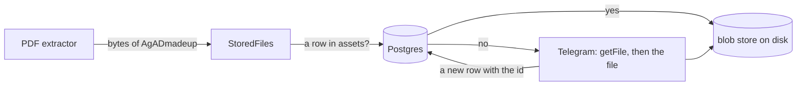

# 25. A file that you send

> Pull request: [#82](https://github.com/herman72/unshelve/pull/82) · Code: [`net/telegram_files.py`](../../apps/api/src/unshelve/net/telegram_files.py), [`pipeline/files.py`](../../apps/api/src/unshelve/pipeline/files.py), [`blobs.py`](../../apps/api/src/unshelve/blobs.py), [`extract/pdf.py`](../../apps/api/src/unshelve/extract/pdf.py) (`pdf_file`) · Tests: [`tests/net/test_telegram_files.py`](../../apps/api/tests/net/test_telegram_files.py), [`tests/pipeline/test_files.py`](../../apps/api/tests/pipeline/test_files.py), [`tests/test_blobs.py`](../../apps/api/tests/test_blobs.py)

## In one minute

You send `leases.pdf` to your channel as a file, with the caption "A paper to read".

| | Before | Now |
|---|---|---|
| What the worker had | the caption: 15 characters | the PDF: 3 pages, its title, its text |
| The kind of the item | note | pdf |
| The file | only its id at Telegram | a copy on your disk, read again without a download |

The worker asks Telegram two times. These are the real forms of the requests and the answer, with made-up ids:

```text
POST https://api.telegram.org/bot<token>/getFile   {"file_id": "BQACAgMadeUpFileId"}
  →  {"ok": true, "result": {"file_size": 96235, "file_path": "documents/file_7.pdf"}}
GET  https://api.telegram.org/file/bot<token>/documents/file_7.pdf
  →  the 96,235 bytes of the file
```

## 1. What the bot keeps

When you send a file, the bot gets no bytes. It gets ids and facts, and keeps them with the message ([note 10](10-bot-capture.md)):

| Field | Example | What it is |
|---|---|---|
| `file_id` | `BQACAgMadeUpFileId` | the id to download the file with; it is for this bot only |
| `file_unique_id` | `AgADmadeup` | an id that stays the same over time and for each bot; it cannot download the file |
| `mime`, `size_bytes`, `file_name` | `application/pdf`, 96,235, `leases.pdf` | what Telegram says about the file |

The worker needs both ids. `file_id` downloads the file, and `file_unique_id` finds the copy of a file that it read before.

## 2. The token is in the address

The two addresses above have the bot token in them. The token is the password of the bot: with it, anyone can read your channel and write as the bot. So the token must not reach a log line or an error message.

**A comparison from daily life:** a parcel with the code of your door on its label. Each person who handles the parcel sees the code. You must cover the code on the label, not only ask people not to read it.

Three places could show the token, and each is closed:

| Where | Without care | What the code does |
|---|---|---|
| The log of httpx | httpx writes each address at INFO | a filter on its logger writes `<bot token>` in place of the token |
| An error message | an error with the address | an error names the file only: "telegram file AgADmadeup" |
| The chain of an error | Python keeps the error of the HTTP client as the cause or the context | the new error is raised after the `except` block: no cause, no context |

This is the real log line of httpx, without the filter and with it:

```text
INFO httpx HTTP Request: POST https://api.telegram.org/bot123456789:MADE-UP-token_for_the_tests-only/getFile "HTTP/1.1 200 OK"
INFO httpx HTTP Request: POST https://api.telegram.org/bot<bot token>/getFile "HTTP/1.1 200 OK"
```

Why is `raise … from None` not enough? `from None` hides the earlier error in the printed trace, but the error still keeps it in `__context__`. A tool that reads `__context__` can still find the address. An error that is raised after the `except` block has no context at all. Each failure in the tests checks the whole printed trace, and checks that cause and context are empty.

## 3. One download, then a copy

The first read downloads the file and keeps a copy. Each later read, for example after an edit of the message, reads the copy:



The **blob store** keeps each file under the SHA-256 of its bytes: `var/blobs/ab/cd/abcd…`. The same bytes give the same name, so a file is never stored two times. A write goes to a temporary file first, and gets its name in one step. So a reader never sees half a file.

The row in `assets` keeps the `file_unique_id` (migration 0003). That is the link from the message to its copy. A key of the store must be 64 hex digits, so a key from the database can never name a file outside the store.

In the stack, the store is the Docker volume `blobs`. The files stay when a container is made again. A backup must copy this volume too (M6-2).

## 4. Which files are read

| The file | What happens |
|---|---|
| A PDF (by its type, or by a name that ends with `.pdf`) | read; a link to a page in the caption does not win over it |
| A PDF with a link to YouTube or arXiv in the caption | the extractor for that site wins (score 50 over 30) |
| A photo, a video, another document | not read yet; the images come with #18 |
| More than 20 MB | the Bot API gives no file over 20 MB: the item keeps its caption, and no request is made |
| A file of an export | read from the copy that the import made ([note 27](27-export-files.md)) |
| A worker without a bot token | only copies that exist are read; a new file keeps its caption |
| 429, 503, a timeout | the fetch step tries again later, with the wait that Telegram asks for |

## A choice that we made

When is a file downloaded?

| | When an extractor asks (ours) | When the bot gets the message | With aiogram, the library of the bot |
|---|---|---|---|
| What is downloaded | only files that an extractor reads | each file, also videos and stickers | (the same as ours) |
| The time of the bot | the bot only writes down the message | the bot waits for each download | |
| The token | our client: no address in an error, a filter on the log | (the same) | an error of aiohttp can hold the whole address |

## What a senior engineer checks here

- **Can the token leak?** A test at DEBUG level reads each log line; each failure checks the whole printed trace, its cause and its context.
- **Can a value from outside name a file outside the folder?** A path from Telegram must match `documents/file_7.pdf` and has no `..`; a key of the store must be 64 hex digits. Tests for both.
- **Is a half-written file possible?** No: the temporary file gets its name in one step. A test makes the rename fail and finds no file.
- **Is the data safe when a container is made again?** The volume `blobs` stays; a test in the image found that a new volume belongs to the app user.
- **Does a second read download again?** No: a test counts the downloads.

## Try it yourself

After the merge, run `git pull` and `make up`. The migration 0003 runs, and Docker makes the volume `blobs`. Then send a small PDF to "Unshelve test" as a file. Its card in the web app has the title of the PDF. To see the copy:

```bash
docker compose exec worker find /app/var/blobs -type f
```

## Exercise (10 minutes)

1. Open `apps/api/src/unshelve/net/telegram_files.py`, and go to `TelegramFiles.__init__`.
2. Remove the line `hide_in_logs(token)`.
3. Run `uv run pytest tests/net/test_telegram_files.py -q` in `apps/api`.

Which tests fail? Our own code never logs the address. Why is that not enough?

<details>
<summary>The answer</summary>

`test_the_token_is_in_no_line_of_the_log` and `test_the_filter_of_a_token_is_added_once` fail. Our code never logs the address, but httpx, a library that we use, logs each address at INFO, and the worker shows INFO lines. A secret in an address reaches each log that a library writes. So the protection must be where the line is written: on the logger of httpx.

</details>

## Words used in this note

| Word | Meaning |
|---|---|
| `file_id` | The id of a file at Telegram that this bot can download |
| `file_unique_id` | The id of a file that stays the same over time; it cannot download |
| Blob store | A store of bytes, where each name is the SHA-256 of the bytes |
| Volume | A folder that Docker keeps outside the containers |
| Log filter | A function that sees each log line before it is written, and can change it |
| Exception context | The earlier error that Python keeps in a new error that was raised during its handling |

## To read more

- [getFile](https://core.telegram.org/bots/api#getfile), Telegram Bot API. Read the limit of 20 MB and how long a file address is valid (at least one hour).
- [Exception context](https://docs.python.org/3/library/exceptions.html#exception-context), Python. Read what `__context__`, `__cause__` and `from None` keep: it is why the error is raised after the `except` block.

Previous: [24. Reading a PDF file](24-pdf-file.md) · Next: [26. The page of an item](26-item-page.md) · Back to the [list of notes](README.md)
