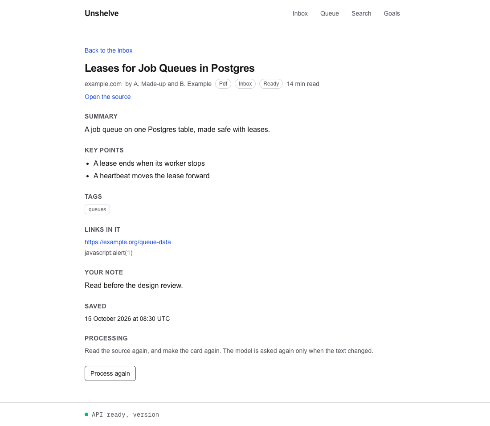
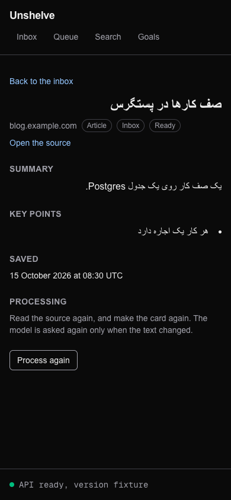
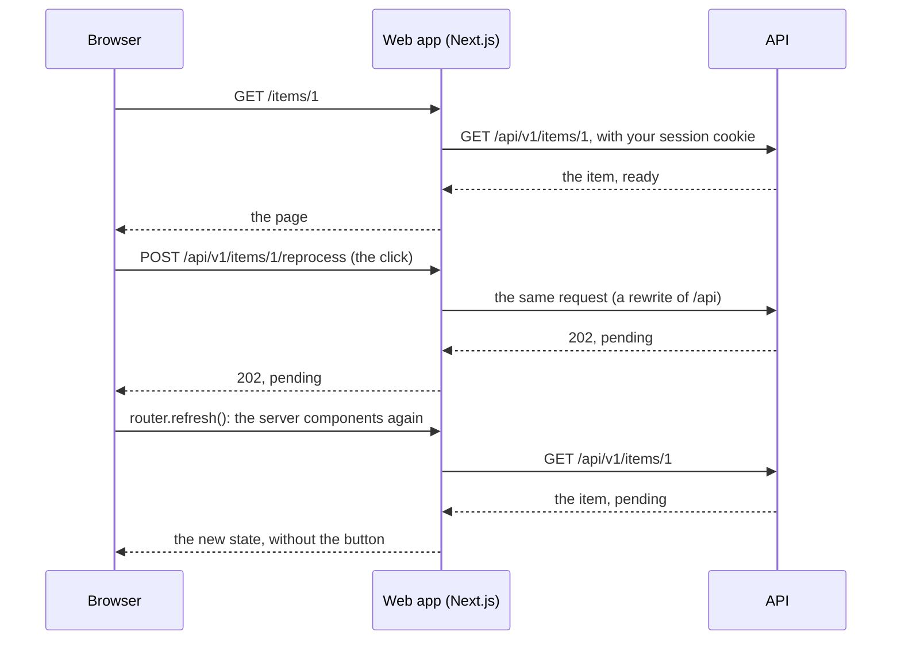

# 26. The page of an item

> Pull request: [#83](https://github.com/herman72/unshelve/pull/83) · Code: [`app/items/[id]/page.tsx`](../../apps/web/src/app/items/[id]/page.tsx), [`components/item-detail.tsx`](../../apps/web/src/components/item-detail.tsx), [`components/reprocess-button.tsx`](../../apps/web/src/components/reprocess-button.tsx), [`api/item_views.py`](../../apps/api/src/unshelve/api/item_views.py) (`reprocess_item`) · Tests: [`apps/web/e2e/items.spec.ts`](../../apps/web/e2e/items.spec.ts), [`tests/api/test_items.py`](../../apps/api/tests/api/test_items.py)

## In one minute

Before, the inbox showed a card for each item, and that was all. A card had no page of its own, and "process again" answered 501, "not built".

Now the title of a card opens `/items/1`: the whole item, the state of its pipeline, and a button that sends it back to the start. These are made-up items of the tests:





## 1. Two kinds of components

The page is made by two kinds of React components:

| | Where it runs | Here |
|---|---|---|
| Server component | on the server of the web app, for each request | `ItemView`: it reads the item with your session cookie and makes the HTML |
| Client component | in your browser | `ReprocessButton`: it answers your click |

A click goes this way:



The cookie of the session never reaches the code of the browser: it is HttpOnly, and the browser sends it to the same origin by itself.

## 2. The id waits inside Suspense

The address `/items/1` has a part that changes: the id. Next.js builds the frame of each page before any request (it prerenders it), and an id is known only at request time. So the code that reads the id must stand inside `<Suspense>`: the frame goes out at once, and the item follows when it is read.

That rule found a problem that was there before this pull request. The navigation of each page marks the current page, and it reads the path with `usePathname()`. On `/items/1` the path is also known only at request time, so the build stopped:

```text
Error: Route "/items/[id]": Next.js encountered URL data `usePathname()` in a Client Component outside of `<Suspense>`.
```

The layout now puts the navigation inside `<Suspense>`. Its fallback shows the same links, without a mark, until the path is known.

**A comparison from daily life:** a printed form with an empty box for your name. The office prints the form in advance; only the box waits for you.

## 3. Back to the start

"Process again" asks the API to run the pipeline of the item again: fetch, card, vectors. The answer comes at once (202); the worker does the work later.

| The state of the item | What the API does |
|---|---|
| ready, failed | back to pending, a job for the fetch step, an event "reprocess": 202 |
| pending, fetched, enriched | nothing: a step is at work, and a second start would race with it: 409 |

Two clicks at the same moment (a double click) give one job. The API locks the row of the item: the second request waits, then sees "pending", and gets a 409. A test sends two requests and counts one job.

A new run costs nothing when the text did not change: the answer of the model for the same text is kept ([note 17](17-model-card.md)).

## 4. Right to left

Each piece of saved content has `dir="auto"`: the browser finds the direction from the first strong letter. "صف کارها در پستگرس" runs right to left, and "Leases for Job Queues" left to right, on one page. A test asks the real browser: `element.matches(":dir(rtl)")`.

The screenshots found one fault that no test had seen. The dot of a Persian key point stood at the edge of the screen, outside the column: the list ran left to right, so its room for the dots was on the left. The dots now stand inside each point (`list-inside`), on the right of a Persian one.

## 5. Tests against a pretend API

The tests use Playwright: a program that drives a real browser, clicks, and reads the page. They run against a pretend API (`e2e/fixture-api.mjs`): six made-up items in the shapes of the real API, kept in memory.

| | Why |
|---|---|
| The production build, not `next dev` | the Next.js guide for Playwright says to test what runs for you |
| The API address in the build | the rewrite of `/api` is written into the build, so the tests build the app for the pretend API |
| The Google Chrome of the computer (`channel: "chrome"`) | nothing to download, also on the computers of CI |
| Two routes only for the tests | `/__reset` gives each test the same items; `/__items/{id}` changes an item while a page is open, so a test can show the 409 |
| Types in comments | `pnpm typecheck` checks the made-up items against the types of the real API: a field that the API renames fails there |

A second, smaller check opens each page under `next dev` ([`e2e-dev/pages.spec.ts`](../../apps/web/e2e-dev/pages.spec.ts)). `next dev` checks more than the build. It renders each page in stages, as a prerender would see it. When a page does a thing that a prerender must not do, it logs an error, for example for a read of the clock. The check fails on each such line in the log of `next dev`, and on each error in the browser console. Pull request [#104](https://github.com/herman72/unshelve/pull/104) fixed one such error, which the tests of the production build could not see.

The list of pages in that check, `PAGES`, is written by hand, because the page of an item needs a real id. A second test in the same file reads the page files of `src/app`, and it fails when a page has no entry in `PAGES`. So a new page cannot stay out of the check without a failure.

## A choice that we made

How do the tests of the web app get their data?

| | A pretend API (ours) | The real API with a test database |
|---|---|---|
| Speed | 12 tests in about 10 seconds, after the build | the same, plus a database and a worker |
| What it proves | the pages, against the shapes of the API | the pages and the API together |
| The risk | the pretend API and the real one can differ | slower, and more to start in CI |
| Against the risk | the type check of the made-up items; the API has its own tests | |

## What a senior engineer checks here

- **Does a double click make two jobs?** No: a lock on the row, and a test.
- **Can saved content run code in the page?** No: a link is a link only when it is a web address. Tests on the card and on the page of an item.
- **Is the direction of Persian tested in a real browser?** Yes: `:dir(rtl)` in Chrome.
- **Do the tests run what you run?** Yes: the production build.
- **Does the pretend API keep the shape of the real one?** The type check fails when it does not.

## Try it yourself

After the merge, run `git pull` and `make up`. Open http://localhost:3000, and click the title of an item. On a failed item, click "Process again".

To run the tests (they need Google Chrome):

```bash
pnpm --filter @unshelve/web test:e2e
```

To check each page under `next dev` (first stop your own `next dev` of this folder: Next.js allows one):

```bash
pnpm --filter @unshelve/web test:dev
```

## Exercise (10 minutes)

1. Open `apps/web/src/app/layout.tsx`.
2. Remove the `<Suspense>` around `<MainNav />` (keep `<MainNav />`).
3. Run `pnpm --filter @unshelve/web build`.

What fails? Why did it work before the page `/items/[id]` existed?

<details>
<summary>The answer</summary>

The build stops at `/items/[id]`: "Next.js encountered URL data `usePathname()` in a Client Component outside of `<Suspense>`". Before, each page had a fixed address, so the build knew each path in advance, and `usePathname()` had its answer. The page of an item has an id in its path, known only at request time. Each component that reads the path then waits, and the build needs a fallback to put in its place.

</details>

## Words used in this note

| Word | Meaning |
|---|---|
| Server component | A React component that runs on the server and sends HTML; it can read your cookie |
| Client component | A React component that runs in your browser; it can answer a click |
| Prerender | To build the frame of a page before any request |
| Suspense | A place in a page that can wait for data, with a fallback to show meanwhile |
| `dir="auto"` | An attribute that lets the browser find the direction of a text from its first strong letter |
| Pretend API | A small server with made-up answers in the shapes of the real API, for tests |

## To read more

- [usePathname](https://nextjs.org/docs/app/api-reference/functions/use-pathname), Next.js. Read the part "Cache Components": it is the rule that stopped the build.
- [dir](https://developer.mozilla.org/en-US/docs/Web/HTML/Reference/Global_attributes/dir), MDN. Read the value `auto`, and why it is the choice for text from users.

Previous: [25. A file that you send](25-files-you-send.md) · Next: [27. The files of an export](27-export-files.md) · Back to the [list of notes](README.md)
