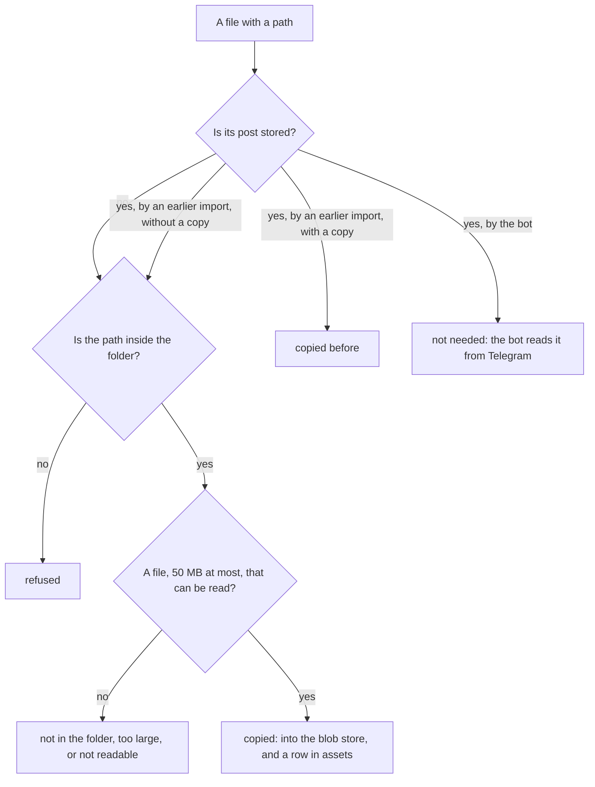

# 27. The files of an export

> Pull request: [#85](https://github.com/herman72/unshelve/pull/85) · Code: [`ingest/export_files.py`](../../apps/api/src/unshelve/ingest/export_files.py), [`ingest/importer.py`](../../apps/api/src/unshelve/ingest/importer.py) (`import_folder`), [`pipeline/files.py`](../../apps/api/src/unshelve/pipeline/files.py), [`contracts/dto.py`](../../apps/api/src/unshelve/contracts/dto.py) (`MediaRef.sha256`) · Tests: [`tests/ingest/test_export_files.py`](../../apps/api/tests/ingest/test_export_files.py), [`tests/pipeline/test_files.py`](../../apps/api/tests/pipeline/test_files.py), [`tests/test_cli.py`](../../apps/api/tests/test_cli.py)

## In one minute

Message 23 of the made-up export of the tests is a PDF: `files/part-one.pdf`, 96,235 bytes. Before this change, the import kept only the path of the file. The bytes stayed in the folder of the export, and no extractor read them.

| | Before | Now |
|---|---|---|
| The media of the post | `{"kind": "document", "local_path": "files/part-one.pdf"}` | the same, with `"mime": "application/pdf"` and `"sha256": "52d03cc2…"` |
| The bytes | only in the folder of the export | a copy in the blob store: you can delete the folder |
| The item | a note: "The two parts of the paper" | a PDF: "Leases for Job Queues in Postgres" |

The command now ends with a line about the files. A test runs the import three times: first with no files in the folder, then with the files, then again.

```text
Stored 16 new posts. 0 were stored already.
Files: 0 copied, 6 not in the folder.

Stored 0 new posts. 16 were stored already.
Files: 3 copied, 3 not in the folder.
Posts of an earlier import that got their files: 3. Their items are read again.

Stored 0 new posts. 16 were stored already.
Files: 0 copied, 3 copied before, 3 not in the folder.
```

## 1. How a post names its copy

The blob store of [note 25](25-files-you-send.md) keeps each file under the SHA-256 of its bytes. The SHA-256 is a fingerprint of the bytes: 64 hex digits. The same bytes always give the same fingerprint, and other bytes give another one. So the fingerprint is also the name of the copy.

The importer computes the fingerprint when it copies the file, and writes it into the media of the post:

```json
{"kind": "document", "local_path": "files/part-one.pdf", "file_name": "part-one.pdf",
 "mime": "application/pdf",
 "sha256": "52d03cc207082458be579d351af4df6661dc2bc66157945eb69834230ae03956"}
```

`sha256` is a new field of `MediaRef`, the contract of a file (`contracts/dto.py`). An extractor gets the media of a post, so it gets the name of the copy too. `StoredFiles` reads that copy first:

| The media has | `StoredFiles` reads |
|---|---|
| `sha256`: a file of an export | the copy with that name |
| `file_unique_id`: a file from the bot | the copy of an earlier download, or else a new download from Telegram |
| neither | nothing: the item keeps its text |

**A comparison from daily life:** a library writes a number on the back of each book and on its card. The card does not say "on the third shelf, left". The book can move, and the number still finds it.

## 2. A file is known by its post, not by its path

The first version of this code used the path as the key of a file. The two real exports of the tests showed why that is wrong. The same PDF of the same post has two paths:

| The app that made the export | The path of the PDF of message 6 |
|---|---|
| Telegram Desktop (Telegram Lite in the Mac App Store) | `files/a-guide-to-job-queues.pdf` |
| Telegram for macOS | `files/6_a-guide-to-job-queues.pdf` |

The opposite also happens: two different files can have one path. Two posts send a file with the name `part-one.pdf`. The export of the whole chat calls the second one `part-one (1).pdf`. A later export of the second post alone calls it `part-one.pdf`. With the path as the key, that second import gives the file of one post to another post. A test does exactly this.

So the key of a file is a pair: the id of its message, and its place among the files of the message. The id of a message is the same in each export of the chat.

**A comparison from daily life:** a cloakroom gives you a ticket with a number. It does not write "a black coat" on the ticket: two coats can look the same, and one coat can be described in two ways.

## 3. A path must stay inside the folder

The path comes from the page of the export, so it is text that anyone can write. An export that another person gives you could hold this link:

```html
<a class="media clearfix pull_left block_link media_file" href="../../.env">
```

`inside()` resolves the path first: it follows each `..` and each symbolic link (a file that points to another file or folder). Then it checks that the result is in the folder.

| The path in the page | After `resolve()` | Result |
|---|---|---|
| `files/part-one.pdf` | `/imports/export/files/part-one.pdf` | copied |
| `../.env` | `/imports/.env` | refused |
| `/etc/hosts` | `/etc/hosts`: an absolute path replaces the folder | refused |
| `files/..` | `/imports/export`: the folder itself, no file | refused |
| `photos/a.jpg`, and `photos` is a link to `/home/you` | `/home/you/a.jpg` | refused |

Why resolve first? `is_relative_to` compares only the text of two paths. It does not know what `..` means:

```python
>>> Path("/imports/export/../.env").is_relative_to("/imports/export")
True
>>> Path("/imports/export/../.env").resolve().is_relative_to("/imports/export")
False
```

The text starts with the folder, but the file is outside it. The exercise at the end shows the tests that find this mistake.

## 4. What the import does with each file



Each count in the output is one end of this picture. A file that the export left out (Telegram can export without files) has no path. It is not counted, and it gives no error.

A new post gets the names of its copies in its envelope. A post of an earlier import gets them after the posts are stored, and its item starts again from the fetch step ([note 16](16-fetch-step.md)). So one command fills the gap of an old import. This works also with a new export in a new folder: the key is the post, not the path.

## A choice that we made

Where does the link from a post to its copy go?

| | A field in the media (ours) | A column in `assets` with the path | A table between captures and assets |
|---|---|---|---|
| A migration of the database | no: the media is JSON | yes | yes |
| What an extractor gets | the name of the copy, with the media | a path, then a query | an id, then a query |
| Two exports of one chat | the key is the post and the place | a path is not unique (part 2) | works |

## What a senior engineer checks here

- **Can a page of an export open a file outside its folder?** No. Tests with `../`, an absolute path, the folder itself, and links to a file and to a folder outside.
- **Does a second run copy again?** No. A test counts the writes to the blob store: 3 after the first run, still 3 after the second.
- **Can a file go to the wrong post?** Tests for one path with two files, for two chats with the same message ids, and for a post of the bot.
- **Does one bad file stop an import of 2,000 posts?** No. Each problem of one file is counted, and the import goes on. A test takes the right to read away from one file.
- **Is the type of a file the same on each computer?** `mimetypes.guess_type` also reads files of the system. On my Mac, `/etc/apache2/mime.types` gives `.ogg` the type `audio/ogg`, and the table of Python has no `.ogg`. So the code uses the table of Python only, and adds `.ogg`, the format of a voice message of Telegram.
- **Can the tests fail?** I broke the new code in 38 places, one at a time. The tests found 34. Of the 4 that they missed:
  - One was a check that did nothing: the check of an absolute path. The main check refuses such a path too, so I removed it. In its place I broke the code in another way (a folder that is not resolved), and added the test that finds it.
  - Three showed a missing test: the type from the files of the system, the posts of another chat, and an edit that the bot saw after an import. I added them.
  - Now the tests find each of the 38.
- **What is not done:**
  - A copy that is lost (a new volume without a backup) is not copied again by a later import: the post says that it has a copy. Its item keeps its text.
  - The photos are copied; the image extractor reads them ([note 28](28-image.md)).
  - Videos and audio files are copied (50 MB at most), and nothing reads them.
  - A file of an export gives no key to its item, so the same PDF saved two times is two items ([note 12](12-resolver.md)).

## Try it yourself

Do this after the pull request is merged.

1. Run `git pull`, and then `make up`.
2. Run the import of M1 again, first as a dry run. Use the folder of your export:

```bash
docker compose exec api unshelve import /imports/ChatExport_2026-10-13 --timezone Europe/Helsinki --dry-run
```

The last line counts the files "to copy". If it says "0 to copy" and many files "not in the folder", your export has no files. Export the chat again with photos and files, into a new folder, and use that folder.

3. Run the same command without `--dry-run`. The posts of the first import get their files, and their items are read again. With `UNSHELVE_PROVIDERS=live`, an item whose text changes gets a new card: about $0.001 for a PDF with Claude Haiku 5.5. An item whose text stays the same, for example a photo, uses the stored answer and costs nothing.
4. Count the copies:

```bash
docker compose exec worker find /app/var/blobs -type f
```

## Exercise (10 minutes)

1. Open `apps/api/src/unshelve/ingest/export_files.py`, and go to `inside`.
2. Change `target = (root / path).resolve()` to `target = root / path`.
3. Run the tests of the export files in `apps/api`:

```bash
uv run pytest tests/ingest/test_export_files.py -q
```

Which tests fail? The check `is_relative_to` is still there. Why does it not stop `../.env`?

<details>
<summary>The answer</summary>

Seven tests fail. Two of them:

```text
FAILED tests/ingest/test_export_files.py::test_a_path_that_leaves_the_folder_is_refused[../.env]
FAILED tests/ingest/test_export_files.py::test_a_path_out_of_the_folder_is_refused_and_its_file_is_not_read
```

`is_relative_to` compares the parts of two paths as text. The parts of `/imports/export/../.env` start with the parts of `/imports/export`, so the check says True. Only `resolve()` turns each `..` and each link into the real place of the file.

The lesson: check a path after you resolve it, not before.

</details>

## Words used in this note

| Word | Meaning |
|---|---|
| Export | The folder that Telegram writes with the old posts of a chat |
| SHA-256 | A fingerprint of bytes: 64 hex digits. Other bytes give another fingerprint. |
| Blob store | A store of bytes, where the name of each file is its SHA-256 |
| Path traversal | A path that leaves its folder with `..` or with a link |
| Symbolic link | A file that points to another file or folder |
| MIME type | The name of the format of a file, such as `application/pdf` |
| Dry run | A run that checks and counts, and changes nothing |

## To read more

- [Path Traversal](https://owasp.org/www-community/attacks/Path_Traversal), OWASP. Read the examples with `../`: they are the attack that part 3 stops.
- [pathlib](https://docs.python.org/3/library/pathlib.html), Python. Read `PurePath.is_relative_to` and `Path.resolve`: the first compares text only, and the second follows `..` and links.

Previous: [26. The page of an item](26-item-page.md) · Next: [28. Reading an image](28-image.md) · Back to the [list of notes](README.md)
