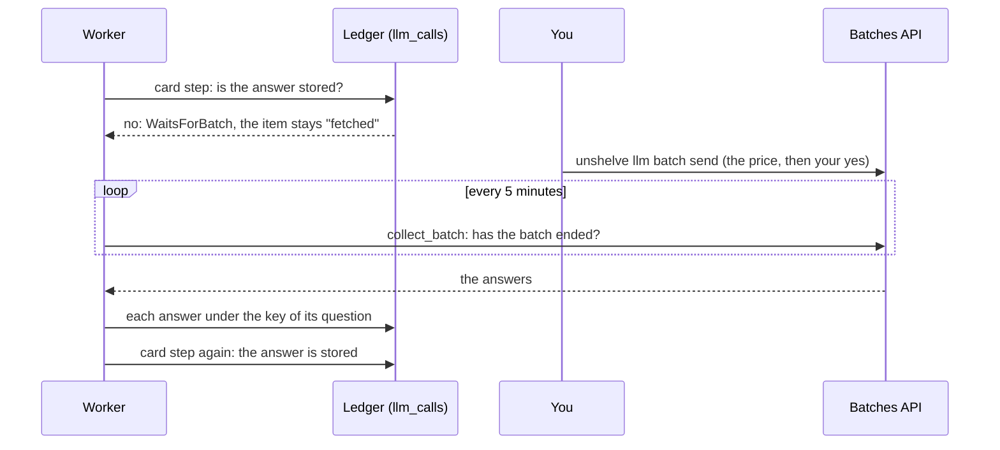

# 29. Cards in a batch

> Pull request: [#88](https://github.com/herman72/unshelve/pull/88) · Decision record: [ADR 0013](../adr/0013-cards-in-a-batch.md) · Code: [`pipeline/batches.py`](../../apps/api/src/unshelve/pipeline/batches.py), [`providers/batches.py`](../../apps/api/src/unshelve/providers/batches.py), [`providers/ledger.py`](../../apps/api/src/unshelve/providers/ledger.py), [`cli.py`](../../apps/api/src/unshelve/cli.py) (`llm batch`) · Tests: [`tests/pipeline/test_batches.py`](../../apps/api/tests/pipeline/test_batches.py), [`tests/providers/test_batches.py`](../../apps/api/tests/providers/test_batches.py), [`tests/providers/test_ledger.py`](../../apps/api/tests/providers/test_ledger.py)

## In one minute

You import the export of your channel: 2,000 posts. Each post needs a card from the model. With the prices of the comparison of 15 October ([note 17](17-model-card.md), part 6):

| | One card | 2,000 cards | The cards come |
|---|---|---|---|
| Claude Haiku 5.5, at once | about $0.00086 | about $1.72 | over two days: the daily budget of $1 stops the rest of the first day |
| Claude Haiku 5.5, in a batch | about $0.00043 | about $0.86 | within hours |
| Claude Opus 5.5, at once | about $0.034 | about $68 | over many days: the budget stops the rest of each day |
| Claude Opus 5.5, in a batch | about $0.017 | about $34 | within hours |

The Message Batches API answers the same requests at half the price. Most batches end within one hour, and each one within 24 hours.

This is a real run of a test, with two short notes and the prices of Claude Haiku 5.5:

```text
$ unshelve llm batch send
2 cards wait: 2 questions to claude-haiku-5-5.
Estimated price, at half the normal price: $0.0003 for about 1841 input and 800 output tokens.
Send this batch? [y/N]:
```

## 1. The path of a card in batch mode



With `UNSHELVE_CARDS=batch`, the cache does not ask the model for a card question without a stored answer. It raises `WaitsForBatch`. The card step ends, and its item stays in the state `fetched`. No job waits and tries again: the batch starts the step again when the answer is there.

**A comparison from daily life:** a print shop is cheaper for one large order than for many small ones. You collect the pages during the week, and you send them on Friday. The shop prints them, and you pick them up on Saturday.

## 2. One question, one key

The answer of a batch must go where the card step looks for it: under the cache key of its question ([note 17](17-model-card.md), part 3). So a question in a batch must be exactly the question of a call now:

- the same parts: `card_parts(text)` makes them for both;
- the same model, system prompt, effort and JSON schema of the answer (`transform_schema` of the SDK);
- its `custom_id` is its cache key: 64 hex digits, which fit the rule of the API (1 to 64 letters, digits, `-` or `_`).

A test sends one question now and one in a batch to two pretend APIs, and compares the two requests field by field. They are equal.

Two items with one text have one question, and the batch sends it one time.

## 3. Sending and collecting

`unshelve llm batch send` collects the waiting questions. A question with a stored answer, or in a batch that runs, is not sent again. The command shows the estimated price and asks for your yes. The estimate counts about 900 input tokens for the prompt and the schema, one token for each 2.5 characters of text, and 400 output tokens for each card.

The live check of 16 October sent one real batch to Claude Haiku 5.5: the three made-up notes of the tests.

| The note | The title of the card | Tokens in / out | In the batch | As a call now |
|---|---|---|---|---|
| SKIP LOCKED lets many workers share one queue. | SKIP LOCKED for shared work queues | 945 / 157 | $0.000086 | $0.000173 |
| A heartbeat moves the lease of a worker forward. | A heartbeat moves the lease of a worker forward | 944 / 194 | $0.000096 | $0.000191 |
| Leases make a job queue on one Postgres table safe. | Leases make a Postgres job queue safe | 944 / 161 | $0.000087 | $0.000175 |

- The batch ended after 2.7 minutes, and it cost $0.000270: half of the price of the same calls now.
- The API took each request as it was: the JSON schema, the effort, and the room to think. Each answer fit the schema of the card.
- The answers came back in another order than the questions. Each answer names its question by its `custom_id`, so the order does not matter.
- The estimate of the command was $0.0004. Its input was right within 3%, but a card of these short notes needed 157 to 194 output tokens, not 400. So the estimate is high on purpose: you never pay more than it says for the output.

Then the job `collect_batch` looks at the batch every 5 minutes, at most 300 times: 25 hours. When the batch has ended:

| The answer | What happens |
|---|---|
| It fits the schema | it goes into the ledger at half the price, and the card step of its items runs again: no model call |
| errored, expired, canceled, refused, or not the schema | the item waits for the next batch; `unshelve llm batch status` counts it |
| The batch did not end in 25 hours | the batch is "failed", and its items wait for the next batch |

## 4. The daily budget

A row of the ledger that came from a batch names the batch (`llm_calls.batch_id`). The daily budget ([note 17](17-model-card.md), part 4) does not count such rows: you accepted the price of the batch by hand. Without this rule, a batch of $5 would stop the calls of the rest of the day.

## 5. Two faults that the tests found

- **The wait between two tries.** The worker computed `10 s × 2^(tries − 1)`, and only then took the limit of 10 minutes. A job with 300 tries reaches `2^299`, and that number does not fit in a `timedelta`: the worker would stop with an `OverflowError` after about 3 hours of a long batch. The wait is computed in seconds now, and a test asks for try 300.
- **`dict()` of a result of the database.** `dict(rows)` failed with "object is not subscriptable". `dict()` reads an object with a method `keys()` as a mapping, and a result of SQLAlchemy has `keys()`: the names of its columns. So `dict()` asked `rows["id"]`. The code reads the columns by name now.

## A choice that we made

How does a card come to wait for a batch?

| | A mode: `UNSHELVE_CARDS=batch` (ours) | The daily budget at $0 | A batch each hour, by itself |
|---|---|---|---|
| What it says | "the cards come from a batch" | "no money today" | "cheap, always" |
| The jobs | none waits; the batch starts them | each job tries again each night | none waits |
| The price | shown before you pay | shown before you pay | never shown before it is paid |
| A new save | waits for the next batch | waits until midnight | waits up to an hour |

## What a senior engineer checks here

- **Is the answer of a batch the answer of the same question?** Yes: a test compares the request in a batch with the request of a call now, and the live check sent such a request to the real API.
- **Can a card be paid two times?** The command refuses in live mode, and a question in a batch that runs is not sent again. A test sends two times and counts the questions.
- **Does a job spin while it waits?** No: a waiting card has no job. A test counts the pending jobs.
- **Is a failure of the batch a dead end?** No: a question without an answer, and a batch that failed, leave their items waiting for the next batch. Tests for each case.
- **Can the tests fail?** I broke the new code in 34 places, one at a time. The tests found 31. The three that they missed showed weak tests: a card step that failed looked like a card step that waited, a test sent the second batch too late to see an answered question, and no test looked at the estimate of the tokens. Now the tests find each of the 34. During the run, the ledger of your instance kept its 38 rows: no test reached it.
- **What is not done:**
  - The images of an import are read at once, at the normal price, in the fetch step ([note 28](28-image.md)).
  - A batch cannot be canceled from Unshelve.

## Try it yourself

Do this after the pull request is merged, for the import of your real channel.

1. Run `git pull`, and then `make up`. The migration 0004 runs.
2. Put `UNSHELVE_CARDS=batch` and `UNSHELVE_PROVIDERS=live` into `.env`, and run `make up` again.
3. Import the export. Wait until the fetch step has read the posts: the web app shows them as processing.
4. Send the batch. Read the price, then answer `y`:

```bash
docker compose exec api unshelve llm batch send
```

5. Look at the batch. After it has ended, the cards come within some seconds:

```bash
docker compose exec api unshelve llm batch status
```

6. Put `UNSHELVE_CARDS=live` back into `.env`, and run `make up`. New saves get their cards at once again.

## Exercise (10 minutes)

1. Open `apps/api/src/unshelve/providers/ledger.py`, and go to `CachedLLM.generate`.
2. Remove the two lines `if stored is None and task in self.batch_tasks:` and `raise WaitsForBatch(key)`.
3. Run the tests of batch mode in `apps/api`:

```bash
uv run pytest tests/pipeline/test_batches.py -q
```

Which tests fail? What would the mode cost you, without these two lines?

<details>
<summary>The answer</summary>

Nine tests fail. The first one shows what the mode would cost:

```text
FAILED tests/pipeline/test_batches.py::test_in_batch_mode_a_card_waits_and_no_model_is_asked
E       AssertionError: assert [<EnrichState...ADY: 'ready'>] == [<EnrichState...D: 'fetched'>]
```

Without the two lines, the card step asks the model at once, at the full price, and the items are ready before any batch is sent. `unshelve llm batch send` then finds no card that waits. The mode would cost you the full price, and it would look as if it works.

</details>

## Words used in this note

| Word | Meaning |
|---|---|
| Batch | Many requests to the model, sent together and answered later, at half the price |
| `custom_id` | The name of one request in a batch; its answer comes back with it |
| Cache key | A short code of a question: the same question gives the same key ([note 17](17-model-card.md)) |
| Ledger | The table `llm_calls`: each answer with its tokens and its price |
| Polling | Asking again and again if a thing has ended |

## To read more

- [Batch processing](https://platform.claude.com/docs/en/build-with-claude/batch-processing), Claude Platform Docs. Read "Batch limitations" and "Pricing": the 24 hours, the 29 days of the results, and the prices of part 1.
- [dict](https://docs.python.org/3/library/stdtypes.html#dict), Python. Read what the constructor does with an argument that has a method `keys()`: it is the second fault of part 5.

Previous: [28. Reading an image](28-image.md) · Next: [30. The reading status](30-reading-status.md) · Back to the [list of notes](README.md)
