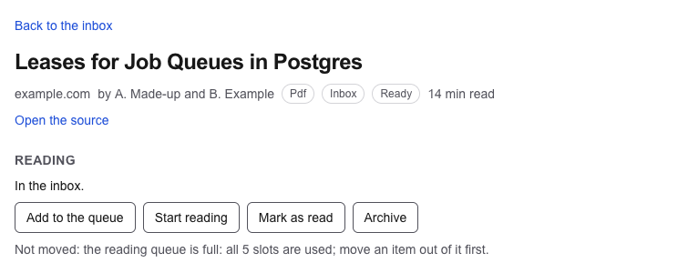
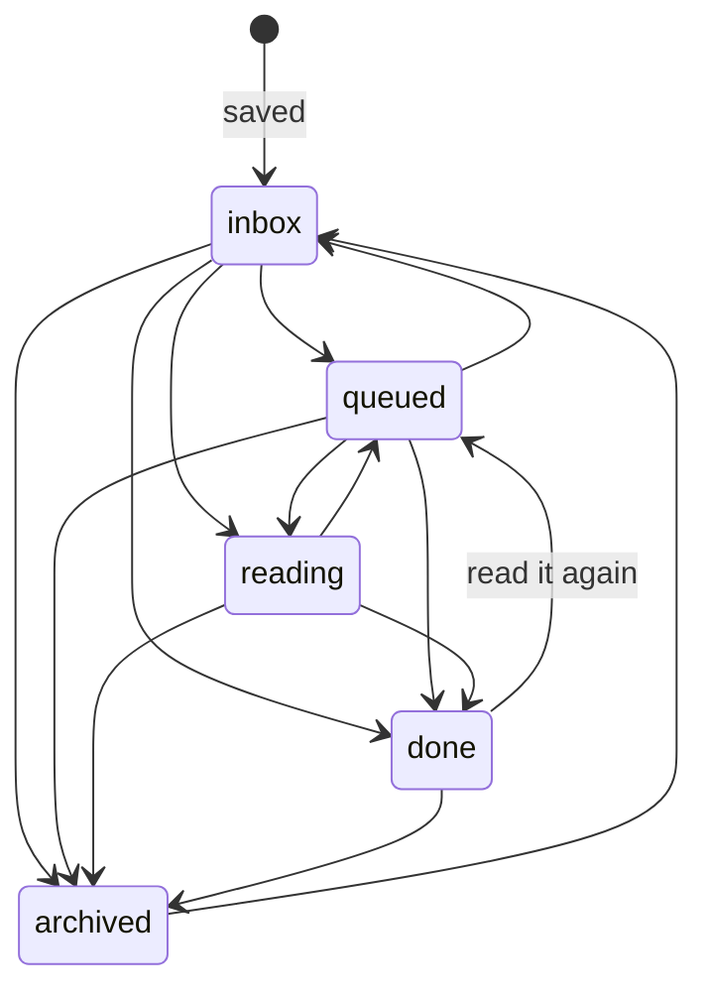
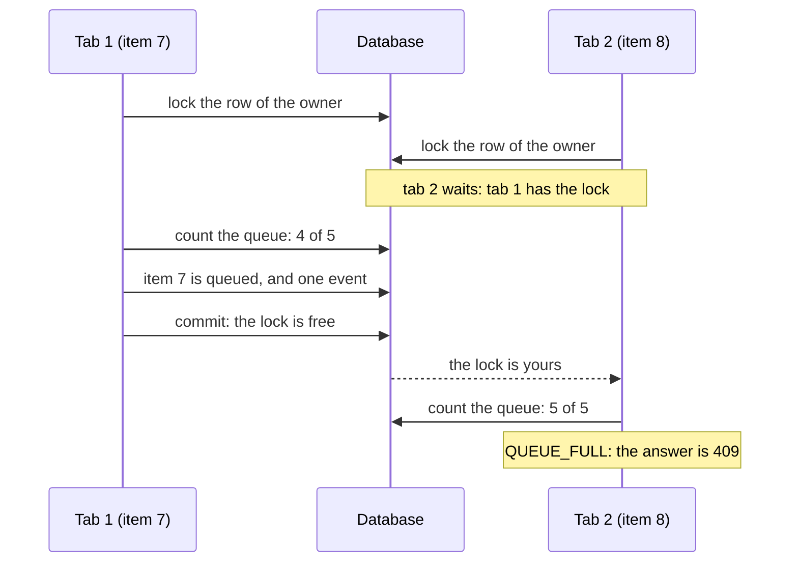

# 30. The reading status

> Pull request: [#90](https://github.com/herman72/unshelve/pull/90) · Code: [`track/status.py`](../../apps/api/src/unshelve/track/status.py), [`api/item_views.py`](../../apps/api/src/unshelve/api/item_views.py) (`transition_item`, `list_events`, `get_queue`), [`bot/private.py`](../../apps/api/src/unshelve/bot/private.py) (`on_done`), [`components/status-buttons.tsx`](../../apps/web/src/components/status-buttons.tsx), [`components/item-history.tsx`](../../apps/web/src/components/item-history.tsx) · Tests: [`tests/track/test_status.py`](../../apps/api/tests/track/test_status.py), [`tests/api/test_items.py`](../../apps/api/tests/api/test_items.py), [`apps/web/e2e/status.spec.ts`](../../apps/web/e2e/status.spec.ts)

## In one minute

Five items are in your reading queue. You open a sixth item and press "Start reading". These are made-up items of the tests:



| | Before | Now |
|---|---|---|
| Change the status of an item | only "Done" under a card of the digest, in Telegram | a button for each allowed move, on the page of the item; "Done" in Telegram stays |
| The reading queue | no limit | 5 slots; a move into a full queue is refused |
| The history of an item | in the table `events`, not shown | the section "History" on the page, newest first |
| The page "Queue" | "not built yet" | the items that you read now, then the items that wait |

The *reading status* is where an item is for you: `inbox`, `queued`, `reading`, `done` or `archived`. Only you change it. The worker changes a different field: the state of the pipeline ([note 26](26-item-page.md)).

## 1. The moves that are allowed

A *state machine* is a set of states, and the moves between them that are allowed. Each other move is refused.



The table is in [`contracts/states.py`](../../apps/api/src/unshelve/contracts/states.py). Five statuses give 20 moves, and the table allows 13 of them. The refused moves are in three groups:

| Refused move | Why |
|---|---|
| `reading` → `inbox`, `done` → `inbox` | The inbox holds the items that you did not sort yet. An item that you read is sorted. |
| `done` → `reading` | An item that you read again goes to the queue first. "Start reading" is one more press. |
| `archived` → each status except `inbox` | An archived item comes back through the inbox, and you sort it again. |

Each button on the page is one move of the table. The API gives the moves of the item in `allowed_transitions`, so the page shows no button for a refused move.

**A comparison from daily life:** a book of a library is on the shelf, then on loan, then back on the shelf. You cannot return a book that is on the shelf.

## 2. One write path

One function writes the status: `change_status` in [`track/status.py`](../../apps/api/src/unshelve/track/status.py). The API and the bot both call it. It writes two things in one transaction: the new status of the item, and one row in the table `events`.

A *transaction* is a group of writes that the database keeps all together, or not at all. So the log never misses a move, and it never shows a move that did not happen.

A press on "Add to the queue" writes this row:

| id | item_id | actor | type | from_status | to_status | payload |
|---|---|---|---|---|---|---|
| 41 | 7 | user | status | inbox | queued | `{"via": "api"}` |

The function asks six questions, in this order. The first "yes" gives the answer:

| Question | Outcome | The API answers | The "Done" button of the bot |
|---|---|---|---|
| No such item, or an item of another owner? | `NOT_FOUND` | 404 | goes away |
| Is the item a merged copy (part 5)? | `DUPLICATE` | 409, with the number of the older item | moves the older item |
| Has the item this status already? | `ALREADY` | 200, with the item | goes away |
| Is the move not in the table? | `NOT_ALLOWED` | 409: `cannot move from 'archived' to 'done'` | goes away; the log says why |
| Does the move need a slot, and is none free? | `QUEUE_FULL` | 409: `the reading queue is full: all 5 slots are used; …` | cannot happen: "done" takes no slot |
| Else | `CHANGED` | 200, with the item | goes away |

"Has the item this status already?" comes before the table, and the order is important. A second press on a button is not an error: two tabs, or a slow network, can send the same move two times. The table has no move from a status to the same status. So without this order, the second press would be a 409.

## 3. The limit of the queue, and two requests at the same moment

The queue has 5 *slots* at the start: the column `users.queue_limit`. An item takes a slot when its status is `queued` or `reading`. A move from `queued` to `reading` takes no new slot, because the item is in the queue already.

The check counts the queue first, and then it writes. Two requests at the same moment can break this. Four slots are used, and you press "Add to the queue" in two tabs, on two different items:



Without the lock, both tabs count 4 before one of them saves. Both write, and the queue has 6 items.

`SELECT … FOR UPDATE` locks the rows that it reads, until the transaction ends. A second `FOR UPDATE` on the same row waits.

Why the row of the owner, and not the rows of the items? The two moves change two different items. So a lock on one item does not stop the move of the other item. The row of the owner is the one row that both moves share.

**A comparison from daily life:** a meeting room has 5 chairs and one key. Only the person with the key counts the free chairs and takes one. The next person waits for the key.

A move into the queue locks two rows: the owner first, then the item. A *deadlock* is two transactions that wait for each other: A has row 1 and waits for row 2, and B has row 2 and waits for row 1. Postgres finds a deadlock and stops one of the two transactions with an error. Each move takes the two rows in the same order, so this cannot happen.

The test `test_two_moves_into_the_last_free_slot_fill_it_once` makes this race on purpose. The first move counts 4, and then it waits 0.3 seconds before it saves. The second move starts in this time. With the lock, the second move waits, and then it counts 5. Without the lock, it counts 4 too (the exercise).

## 4. The history of an item

`GET /api/v1/items/{id}/events` gives the events of one item, newest first, in pages of 30. After three presses, the section "History" shows this:


The worker writes events too: a source that could not be read, or a card that could not be made. The page shows each type in words. It shows a type that it does not know yet by its name.

A page of events ends with a *cursor*: the id of its last event. The next page asks for the events with a smaller id. A new event has a larger id, so it does not move the next page. The list of items works in the same way ([note 9](09-walking-skeleton.md)).

The page of the item asks for the item and for its history at the same time, with `Promise.all`. So one request does not wait for the other.

After a press, the page calls `router.refresh()`. Next.js renders the server parts of the page again: the status, the buttons and the history come from the API again. "Process again" works in the same way ([note 26](26-item-page.md), part 3).


## 5. A merged copy

A *merged copy* is an item that is the same thing as an older item: for example, a short link and the full address of one page. The older item stays, and the newer item gets `duplicate_of_id` ([note 12](12-resolver.md), parts 5 and 10). The lists show only the older item.

- **The API refuses to move a merged copy:** 409, `the item is the same thing as item 4: change that one`. A move of the copy would change an item that no list shows, and the copy would take a slot that you cannot see.
- **The page of a copy shows no buttons.** It shows a link to the older item.
- **The "Done" button in Telegram moves the older item.** The digest can show an item that the worker merged later. You read the thing, so the thing is done.

## A choice that we made

How do two moves at the same moment keep the limit?

| | A lock on the row of the owner (ours) | The isolation level `SERIALIZABLE` |
|---|---|---|
| What happens | The second move waits for the first | Postgres finds the conflict and stops one transaction with an error |
| The code | one `FOR UPDATE` | each caller must try the transaction again after the error |
| The cost | the moves of one owner wait in a line, for some milliseconds | no wait, but a second try |
| The risk | new code that writes the status without the lock | a caller without the second try: the move fails |

The one write path makes the lock simple: no other code writes the status.

## What a senior engineer checks here

- **Can a move happen without its event?** No. One function writes both, in one transaction. A test runs each of the 20 moves, and checks one event for each allowed move and no event for a refused move.
- **Can two requests break the limit?** No. A test makes the race with two connections. Without the lock on the owner, it fails.
- **Is a double click an error?** No. The second press is `ALREADY`, and the API answers 200.
- **Is the text of a 409 for a person?** Yes. Before this pull request, the error used the repr of the enum: `cannot move from <ItemStatus.ARCHIVED: 'archived'> …`. It uses the plain values now, and a test checks the text.
- **Can the tests fail?** I broke the new code in 35 places, one at a time: 31 in Python and 4 in the web app. The tests found 34 at first. The one that they missed was a weak test of the cursor. A cursor of the list has three parts, so it failed at the first step, and the check of its kind never ran. A new test sends a cursor of another kind with two parts. Now the tests find each of the 35.
- **What is not done:**
  - You cannot change the number of slots from the web app or the API yet. It is the column `users.queue_limit`.
  - The page shows the newest 30 events of an item. The older events are on the next pages of the API.
  - In Telegram, a card has only "Done". The other moves are on the page of the item.
  - The page of an item does not show the free slots before you press. The 409 says it, and the page "Queue" shows it.

## Try it yourself

Do this after the pull request is merged. The database needs no migration: the table `events` and the column `users.queue_limit` are in the first schema.

1. Run `git pull`, and then `make up`.
2. Open an item at `http://localhost:3000`, and press "Add to the queue". The section "History" shows the move.
3. See the moves in the database:

```bash
docker compose exec db psql -U unshelve -c "SELECT item_id, from_status, to_status, payload FROM events WHERE type = 'status' ORDER BY id DESC LIMIT 5"
```

4. Open `http://localhost:3000/queue`. It shows the item, and "1 of 5 queue slots used."

## Exercise (10 minutes)

1. Open `apps/api/src/unshelve/track/status.py`, and go to `change_status`.
2. In the select of `User.queue_limit`, remove `.with_for_update()`.
3. Run the tests of the status in `apps/api`:

```bash
uv run pytest tests/track/test_status.py -q
```

Which test fails? Why do the other 42 tests pass without the lock?

<details>
<summary>The answer</summary>

One test fails:

```text
FAILED tests/track/test_status.py::test_two_moves_into_the_last_free_slot_fill_it_once
E         At index 1 diff: <Outcome.CHANGED: 'changed'> != <Outcome.QUEUE_FULL: 'queue_full'>
```

Both moves took the last slot, and the queue has 6 items. The other tests send one request at a time, on one connection. A lock is important only when a second transaction wants the same row at the same moment. So a lock needs a test with two connections, and a pause that makes the two transactions overlap.

</details>

## Words used in this note

| Word | Meaning |
|---|---|
| Reading status | Where an item is for you: inbox, queued, reading, done or archived |
| State machine | A set of states, and the moves between them that are allowed |
| Event | One row in the table `events`: what happened to an item, who did it, and when |
| Transaction | A group of writes that the database keeps all together, or not at all |
| Row lock | A mark on a row: a second `FOR UPDATE` on the row waits until the first transaction ends |
| Race condition | A fault that happens only when two requests run at the same moment |
| Deadlock | Two transactions that wait for each other |
| Slot | One place in the reading queue; an owner has 5 at the start |
| 409 Conflict | The HTTP answer for a request that conflicts with the current state of the item |
| Merged copy | An item that is the same thing as an older item; the lists show only the older one |

## To read more

- [Explicit Locking](https://www.postgresql.org/docs/current/explicit-locking.html), PostgreSQL documentation. Read "Row-Level Locks" for what `FOR UPDATE` blocks, and "Deadlocks" for the rule of one order.
- [Transaction Isolation](https://www.postgresql.org/docs/current/transaction-iso.html), PostgreSQL documentation. Read "Read Committed Isolation Level": each statement sees the rows that were committed before the statement started. This is why the second move counts 5 after it gets the lock.

Previous: [29. Cards in a batch](29-cards-in-a-batch.md) · Back to the [list of notes](README.md)
