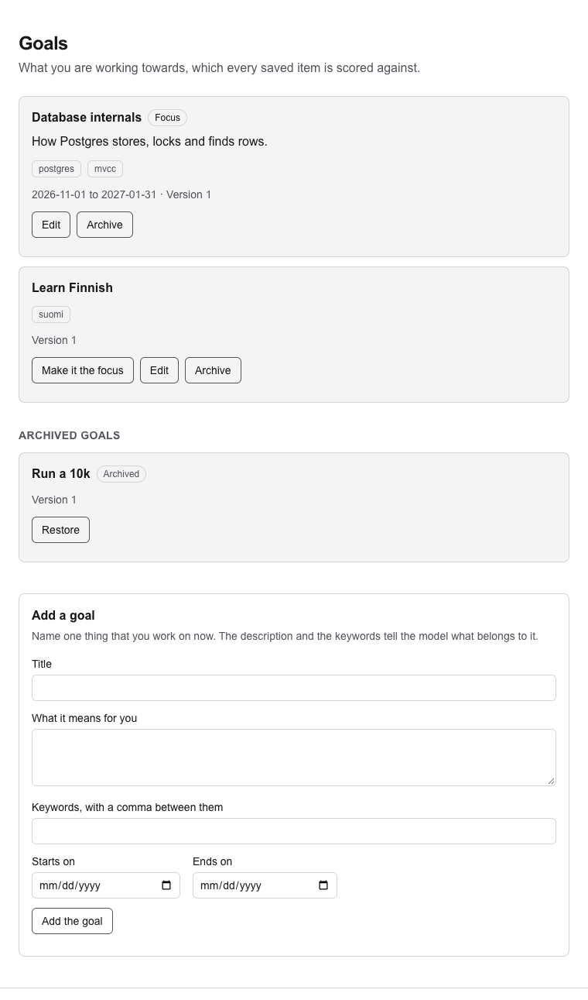

# 31. Goals

> Pull request: [#91](https://github.com/herman72/unshelve/pull/91) · Code: [`api/goal_views.py`](../../apps/api/src/unshelve/api/goal_views.py), [`api/routes/goals.py`](../../apps/api/src/unshelve/api/routes/goals.py), [`components/goal-form.tsx`](../../apps/web/src/components/goal-form.tsx), [`components/goal-actions.tsx`](../../apps/web/src/components/goal-actions.tsx), [`components/goal-list.tsx`](../../apps/web/src/components/goal-list.tsx) · Tests: [`tests/api/test_goals.py`](../../apps/api/tests/api/test_goals.py), [`apps/web/e2e/goals.spec.ts`](../../apps/web/e2e/goals.spec.ts)

## In one minute

You add the goal "Database internals", with the description "How Postgres stores, locks and finds rows." and the keywords "postgres, mvcc". These are made-up goals of the tests:



A *goal* is one thing that you work on now. In the next pull request, the model reads your goals, and it gives each saved item a score from 0 to 3 for each goal, with a reason. So a goal must say clearly what belongs to it: the description and the keywords are for the model too.

| | Before | Now |
|---|---|---|
| The page "Goals" | "not built yet" | add, change, archive, restore and focus a goal |
| The API of goals | each call answered 501 | `GET`, `POST` and `PATCH /goals`, and `POST /goals/{id}/focus` |
| A change of a goal | — | a new version when its meaning changes |

## 1. The slug: a name that never changes

The API makes a *slug* from the title: a short name of Latin letters, digits and hyphens.

| Title | Slug |
|---|---|
| `Rust & systems programming` | `rust-systems-programming` |
| `Café Systems!` | `cafe-systems` |
| a Persian title, such as `یادگیری سیستم‌ها` | `goal-` and 8 letters of a hash of the title |

The API makes the slug one time, when you add the goal. A new title keeps the old slug. The slug names the goal in other places: in the question to the model, and later in your labels. A name that changes would break each of these places.

Two goals with the same slug are a *clash*, and the API answers 409. The goal "GPU programming" exists, and you add "GPU  Programming!": the slug is the same, and the answer is `a goal with this title exists already: 'GPU programming'`. So a double click on "Add the goal" cannot add two goals.

## 2. The version: what the goal means

Each goal has a version. A test changes one field at a time and reads the version after each change:

| Change | Version after it |
|---|---|
| the same title, and the same keyword two times | 1 |
| a start date | 1 |
| an archive | 1 |
| a new description | 2 |
| a new keyword | 3 |
| a new title | 4 |

The model reads the title, the description and the keywords. So only a change of these three gives a new version. A score keeps the version that the model read (`item_goals.goal_version`). After you change the description, the goal is at version 2, and a score of version 1 is old. The next pull request scores such items again.

**A comparison from daily life:** a recipe has a version number. The guests' ratings belong to the version that they tasted. A new photo of the dish does not change the taste, so it keeps the version.

## 3. The focus, the archive and the limit

- **The focus.** At most one goal is the focus. The digest of M3 brings back items for the focus goal first. "Make it the focus" moves the focus from the old goal to the new one. A *partial unique index* in the database (`uq_goals_focus`) allows one focus for each owner, also for code that forgets the rule.
- **The archive.** An archived goal is a goal that you do not work on now. Its scores stay, and it loses the focus. "Restore" brings it back. A new goal with the title of an archived goal is a clash: restore the old goal, and its scores stay with it.
- **The limit.** You can have 10 active goals at most. Each goal adds words to each question to the model, and each word costs money.

## 4. Two requests at the same moment

Each write locks the row of the owner first, as a move into the reading queue does ([note 30](30-reading-status.md), part 3). Two tests make a race on purpose:

| The race | Without the lock | With the lock |
|---|---|---|
| 9 active goals, and two tabs add a goal | both tabs count 9, and both add: 11 goals | the second tab waits, counts 10, and gets a 409 |
| two tabs make two goals the focus | the second tab does not see the first focus yet; the database then refuses a second focus: an error 500 | the second tab waits, then it moves the focus: one focus |

## 5. The page

The page follows the pattern of [note 26](26-item-page.md), part 3: a client component sends the request to the API through the `/api` route of the app, and then `router.refresh()` fetches the goals again.

- After a save, the form "Add a goal" is empty again.
- When the API refuses a save, the form keeps what you typed, and the message says why: `Not saved: a goal with this title exists already: 'Learn Finnish'.`
- A refused click (409) can mean that the goal changed in another tab, so the page fetches the goals after it too.

## A choice that we made

Does the slug follow the title?

| | A slug that never changes (ours) | A slug that follows the title |
|---|---|---|
| After a new title | the labels and the old questions still name the goal | each place that names the goal must change too |
| A clash | only when you add a goal | also when you rename a goal |
| The cost | after a rename, the slug can look old | none |

## What a senior engineer checks here

- **Does the version go up only when the meaning changes?** Yes. A test changes each field, and it checks the version after each change.
- **Can a double click add two goals?** No. The same title gives the same slug: 409.
- **Can two requests break the limit, or give two focus goals?** No. The lock on the owner, and two tests that make each race.
- **Does a field that the request leaves out stay?** Yes. The API reads which fields the request sent (`model_fields_set`). A null date removes the date, and a null title is a 422.
- **Can the tests fail?** I broke the new code in 26 places, one at a time: 22 in Python and 4 in the web app. The tests found each of the 26.
- **What is not done:**
  - The items get no scores yet: that is the next pull request ([note 32](32-scores-against-goals.md)).
  - A change of a goal writes no event.
  - The archive has no "Are you sure?" question. "Restore" undoes it.

## Try it yourself

Do this after the pull request is merged.

1. Run `git pull`, and then `make up`.
2. Open `http://localhost:3000/goals`, and add a goal.
3. See the goal in the database:

```bash
docker compose exec db psql -U unshelve -c "SELECT slug, title, version, is_focus FROM goals ORDER BY id"
```

4. Change the description on the page, and run the query again: the version is 2.

## Exercise (10 minutes)

1. Open `apps/api/src/unshelve/api/goal_views.py`, and go to `update_goal`.
2. Remove the line `goal.is_focus = False  # an archived goal is not worked on`.
3. Run the tests of the goals in `apps/api`:

```bash
uv run pytest tests/api/test_goals.py -q
```

Which test fails? Why must an archived goal lose the focus?

<details>
<summary>The answer</summary>

One test fails:

```text
FAILED tests/api/test_goals.py::test_an_archived_goal_loses_the_focus_and_cannot_get_it
E       assert True is False
```

The archived goal kept the focus. Then the digest would bring back items for a goal that you do not work on. The API also refuses to make an archived goal the focus. So without this line, the page would show a focus that you can never give to that goal again.

</details>

## Words used in this note

| Word | Meaning |
|---|---|
| Goal | One thing that you work on now; the model scores each item against it |
| Slug | A short name of Latin letters, digits and hyphens, made from the title one time |
| Clash | Two goals of one owner with the same slug |
| Version | A number that goes up when the title, the description or the keywords change |
| Focus goal | The one goal that the digest serves first |
| Archive | A goal that you do not work on now; its scores stay |
| Partial unique index | An index that is unique only for the rows that match a condition, here `is_focus` |
| PATCH | An HTTP request that changes only the fields that it sends |

## To read more

- [Partial Indexes](https://www.postgresql.org/docs/current/indexes-partial.html), PostgreSQL documentation. Read "Setting up a Partial Unique Index": it is the rule of one focus.
- [PATCH](https://developer.mozilla.org/en-US/docs/Web/HTTP/Reference/Methods/PATCH), MDN. Read what PATCH changes and what it leaves: it is the rule of part 2 for a field that the request leaves out.

Previous: [30. The reading status](30-reading-status.md) · Next: [32. Scores against your goals](32-scores-against-goals.md) · Back to the [list of notes](README.md)
