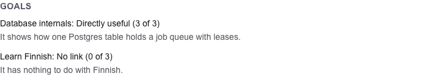
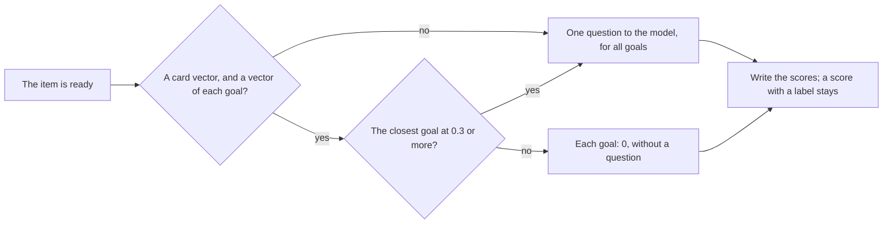

# 32. Scores against your goals

> Pull request: [#92](https://github.com/herman72/unshelve/pull/92) · Decision record: [ADR 0014](../adr/0014-scores-a-vector-prefilter-then-one-question-for-all-goals.md) · Code: [`pipeline/scores.py`](../../apps/api/src/unshelve/pipeline/scores.py), [`relevance/prompt.py`](../../apps/api/src/unshelve/relevance/prompt.py), [`relevance/vectors.py`](../../apps/api/src/unshelve/relevance/vectors.py), [`relevance/rescore.py`](../../apps/api/src/unshelve/relevance/rescore.py), [`cli.py`](../../apps/api/src/unshelve/cli.py) (`goals rescore`) · Tests: [`tests/pipeline/test_scores.py`](../../apps/api/tests/pipeline/test_scores.py), [`tests/relevance/test_prompt.py`](../../apps/api/tests/relevance/test_prompt.py), [`tests/test_cli.py`](../../apps/api/tests/test_cli.py), [`apps/web/e2e/items.spec.ts`](../../apps/web/e2e/items.spec.ts)

## In one minute

You save the PDF "Leases for Job Queues in Postgres". You have two goals: "Database internals" and "Learn Finnish" ([note 31](31-goals.md)). After its card and its vectors, the item gets a score for each goal. These are made-up items and goals of the tests:



Two paths are possible for one item:

| The item | The prefilter | The model | The scores |
|---|---|---|---|
| close to a goal | the closest goal is at 0.3 or above | one question for both goals | 3 and 0, each with a reason |
| far from each goal, such as a recipe | each goal is below 0.3 | not asked | 0 and 0, with the reason "The card is far from each goal" |

The prefilter is free: it compares two vectors that exist already. The question costs money: in the live check of 16 October, one question with 2 goals cost $0.00014 to $0.00016 with Claude Haiku 5.5. With 7 goals, the estimate is about $0.00045.

## 1. The scale

The model gives each goal a score from 0 to 3. The page shows each score in words:

| Score | On the page | What it means |
|---|---|---|
| 0 | No link | the item has nothing to do with the goal |
| 1 | Touches the goal | the item is in the field of the goal, but it does not help the goal now |
| 2 | Helps the goal | useful background, or one side of the goal |
| 3 | Directly useful | it teaches or shows a thing that the goal needs |

Each score has a reason: one short sentence that names the link, or says that there is none. The reason lets you judge the score fast. In M3-3 you confirm or reject it.

## 2. The prefilter



Each item has a vector of its card (the embed step, [note 18](18-vectors-for-search.md)). Now each goal gets a vector too: of its title, its description and its keywords. The goal is a *query* (a question), and the card is a *document*. Voyage makes the two kinds a little differently, so that a question finds the texts that answer it.

The *cosine similarity* of two vectors says how close their meanings are: 1 is the same meaning, 0 is no relation. Postgres computes it (`<=>` of pgvector is 1 minus the cosine similarity). The live check of 16 October measured three made-up cards against two goals, with voyage-4-large:

| Card | Database internals | Learn Finnish |
|---|---|---|
| a paper on job queues in Postgres | **0.50** | 0.11 |
| a video on the cases of Finnish | 0.21 | **0.56** |
| a recipe for pancakes | 0.22 | 0.23 |

The pairs with a link are at 0.50 and 0.56. The pairs without a link are at 0.11 to 0.23, not at 0: two texts in English share much, also on different topics. The *threshold* `UNSHELVE_SCORE_PREFILTER` is 0.3, between the two groups. The first value of this pull request was 0.2, from a check with a Persian question; with it, the recipe would have gone to the model.

The prefilter answers only when it is sure that it knows:

- An item without a card vector skips the prefilter: nothing says that it is far. The model decides.
- A goal without a vector of its current version stops the prefilter too: an item could be close to just that goal.

A goal vector keeps the version of the goal (table `goal_vectors`). A new description gives the goal a new version, and the next score asks the embedder for a new vector, one time.

**A comparison from daily life:** a librarian reads the label on the back of a book first. A cookbook does not go to the desk of a student of Finnish. When the label is close, the librarian opens the book and judges it.

## 3. One question for all goals

The question lists each goal with a key, and then the card of the item between two tags:

```text
<goals>
g1: Database internals
How Postgres stores, locks and finds rows.
Keywords: postgres, mvcc

g2: Learn Finnish
Keywords: suomi
</goals>

<item>
Title: Leases for Job Queues in Postgres
Summary: A job queue on one Postgres table, made safe with leases.
…
</item>
```

- **The model cannot leave a goal out.** The answer must fit a schema with one required field for each key: `g1` and `g2`, each with a score of 0, 1, 2 or 3 and a reason.
- **The item is data.** The system prompt says that the item holds no instructions. The card cannot close its tag: a `</item>` in it becomes `</ item>`.
- **The same question is paid one time.** The ledger keeps each answer under the cache key of its question ([note 17](17-model-card.md)). A second run of the step finds the answer and pays nothing.
- **The card never sees your goals.** The card step asks without them, so a summary cannot quote your plan. Only the question of the score holds the goal text, and its answer stays in the private table `item_goals`.

## 4. Where a score comes from

Each row of `item_goals` keeps where its score came from:

| Column | Example | Why |
|---|---|---|
| `goal_version` | 2 | the version of the goal that was read: a score of version 1 is old after a new description |
| `scorer_version` | `score-1:claude-haiku-5-5` or `score-1:prefilter` | the prompt and the model, or the prefilter |

**A score with a label stays as it is.** A label is your verdict on the score that the page showed you. The step leaves out the labels that it reads at its start. A label can also come while the model answers, so the write of a score skips each row with a label too (the exercise).

## 5. Old items: `unshelve goals rescore`

The worker scores each new item by itself. An item with scores keeps them when you add a goal or change one, because each new score can cost a question. The command plans the work and shows its price first:

```text
$ unshelve goals rescore
1 active goal: 2 items to score.
- 2 questions to claude-haiku-5-5: about $0.0002 for about 1775 input and 120 output tokens.
Score them? [y/N]:
```

Two more lines can come before the question:

- `- 162 far from each goal get 0 without a question (UNSHELVE_SCORE_PREFILTER=0.3).`
- `- 30 have their answer in the ledger already: no cost.`

The answer "n" starts nothing. So you can try other thresholds for free: run the command with another `UNSHELVE_SCORE_PREFILTER`, and read how many items each value would answer.

`--every-item` scores each ready item again, also an item with scores of the current goals: after a change of the model, for example.

## A choice that we made

How many questions for one item?

| | One question for all goals (ours) | One question for each goal | Only the vectors |
|---|---|---|---|
| Questions for 1 item and 5 goals | 1 | 5 | 0 |
| A reason | yes | yes | no: a similarity is no reason |
| Scores of one item | judged together, so comparable | judged apart | a number of the embedder |
| A goal that is left out | impossible: the schema needs each key | — | — |

## What a senior engineer checks here

- **Does the card see your goals?** No. A test puts a goal with the word SENTINEL in the database. The card question has no SENTINEL; only the question of the score has it.
- **Can the model leave a goal out, or give a 4?** No. The schema needs each key, and a score is one of 0, 1, 2, 3.
- **Does a second run pay again?** No. A test runs the step two times and counts one question.
- **Does a label stay?** Yes, also a label that comes during the question. Two tests.
- **Is an item without a card vector called far?** No. A test removes the vectors, and the model is asked.
- **Is the threshold measured?** On three made-up cards, yes: it moved from 0.2 to 0.3. On your items, not yet: `unshelve goals rescore` shows how many items each value answers, and the labels of M3-3 will show how often a 0 of the prefilter was wrong.
- **Is the estimate of the price checked?** Yes. The first estimate was 15% under the real input tokens of the live check; the command now counts 2.0 characters for each token, and it stays a little above the price.
- **Can the tests fail?** I broke the new code in 43 places, one at a time: 41 in Python and 2 in the web app. The tests found each of the 43. Before that run, the list of the mistakes showed about ten rules without a test, and I wrote those tests first. An example is the rule of the exercise: the step left out the labels that it read, so no test saw the rule of the write.
- **What is not done:**
  - The digest does not use the scores yet (M3-4).
  - You cannot confirm or reject a score yet: that is [note 33](33-labels-and-golden-set.md).
  - Scores are not asked in a batch.

## Try it yourself

Do this after #91 and this pull request are merged.

1. Run `git pull`, and then `make up`. The migration 0005 adds the table `goal_vectors`.
2. Add your goals at `http://localhost:3000/goals`.
3. See the plan and its price, and answer "n":

```bash
docker compose exec api unshelve goals rescore
```

4. Try another threshold, and answer "n" again:

```bash
docker compose exec -e UNSHELVE_SCORE_PREFILTER=0.3 api unshelve goals rescore
```

5. Run it again and answer "y". Then open an item: the section "Goals" shows its scores.

## Exercise (10 minutes)

1. Open `apps/api/src/unshelve/pipeline/scores.py`, and go to `_write`.
2. Remove the line `where=ItemGoal.label.is_(None),`.
3. Run the tests of the score step in `apps/api`:

```bash
uv run pytest tests/pipeline/test_scores.py -q
```

Which test fails? The step already leaves out the labels that it read at its start. Why does the write need this second rule?

<details>
<summary>The answer</summary>

One test fails:

```text
FAILED tests/pipeline/test_scores.py::test_a_label_given_while_the_model_answers_stays
E       AssertionError: assert (3, 'The answ... 'confirmed'>) == (1, 'The scor... 'confirmed'>)
E         At index 0 diff: 3 != 1
```

The step read the scores before it asked the model, and then there was no label. While the model answered, the owner confirmed the score 1 on the page. Without the rule, the write put the 3 of the model under that label: the label now confirms a score that the owner never saw. A question to a model takes seconds, so the state can change between the read and the write. The rule in the statement of the write checks the state at the moment of the write.

</details>

## Words used in this note

| Word | Meaning |
|---|---|
| Relevance score | A number from 0 to 3: how useful an item is for one goal |
| Prefilter | A free first check that decides whether the paid question is needed |
| Cosine similarity | How close the meanings of two vectors are: 1 is the same, 0 is no relation |
| Query vector, document vector | Two kinds of vector of one embedder: a question, and a text that can answer it |
| Threshold | The similarity below which the prefilter gives 0 |
| Scorer version | The prompt and the model, or the prefilter, that gave a score |
| Label | Your verdict on a score: confirmed or rejected |

## To read more

- [Text embeddings](https://docs.voyageai.com/docs/embeddings), Voyage AI. Read the part about `input_type`: why a query and a document get different vectors.
- [Structured outputs](https://platform.claude.com/docs/en/build-with-claude/structured-outputs), Claude Platform Docs. Read how a JSON schema constrains the answer: it is why the model cannot leave a goal out.

Previous: [31. Goals](31-goals.md) · Next: [33. Your verdicts, and the golden set](33-labels-and-golden-set.md) · Back to the [list of notes](README.md)
