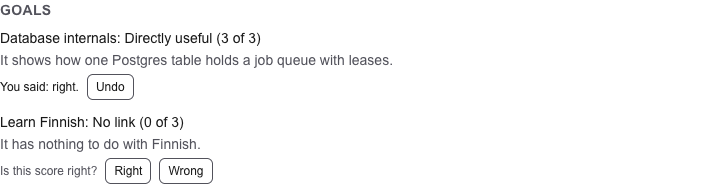

# 33. Your verdicts, and the golden set

> Pull request: [#94](https://github.com/herman72/unshelve/pull/94) · Code: [`relevance/labels.py`](../../apps/api/src/unshelve/relevance/labels.py), [`relevance/golden.py`](../../apps/api/src/unshelve/relevance/golden.py), [`bot/private.py`](../../apps/api/src/unshelve/bot/private.py) (`/label`), [`bot/cards.py`](../../apps/api/src/unshelve/bot/cards.py), [`components/label-buttons.tsx`](../../apps/web/src/components/label-buttons.tsx), [`cli.py`](../../apps/api/src/unshelve/cli.py) (`labels export`) · Tests: [`tests/relevance/test_labels.py`](../../apps/api/tests/relevance/test_labels.py), [`tests/relevance/test_golden.py`](../../apps/api/tests/relevance/test_golden.py), [`tests/bot/test_private.py`](../../apps/api/tests/bot/test_private.py), [`tests/api/test_items.py`](../../apps/api/tests/api/test_items.py), [`apps/web/e2e/items.spec.ts`](../../apps/web/e2e/items.spec.ts)

## In one minute

The model gave the item "Leases for Job Queues in Postgres" a 3 for the goal "Database internals". Is that right? You can say so in two places.

In the private chat, `/label` asks about one score at a time:

```text
Is this score right?

Leases for Job Queues in Postgres
example.com
A job queue on one Postgres table, made safe with leases.

Goal:
Database internals
Score: Directly useful (3 of 3)
It shows how one Postgres table holds a job queue with leases.

[Right] [Wrong] [Skip]
[Open]
```

On the page of an item, each score has the same question (made-up items of the tests):



Your *verdict* is a *label*: confirmed (right) or rejected (wrong). The labels become the *golden set*: an evaluation set, a list of questions with the answers that you checked. A new prompt or a new model must answer them as well as the old one.

| | Before | Now |
|---|---|---|
| A wrong score | it stayed, and nobody knew | you mark it, in the chat or on the page |
| An evaluation of the scorer | no data | `unshelve labels export` writes the golden set |

## 1. A verdict is about the score that you saw

The page shows the score 3. Before you press "Right", the score step writes a new score: 1. Your "right" was about the 3, so it must not confirm the 1.

So each request carries the score that it shows: the button of the chat has it in its data (`label:7:3:3:right` means item 7, goal 3, shown score 3, right), and the page sends it in the body. The write happens only while the score is still the shown one:

```sql
UPDATE item_goals
SET label = 'confirmed', label_source = 'dm', labelled_at = now()
WHERE item_id = 7 AND goal_id = 3 AND owner_id = 1
  AND score = 3          -- the score that you saw
RETURNING *;
```

No row comes back when the score changed. Then the page says `Not saved: the score changed since you saw it: it is 1 now; look at it again.`, and the chat says `The score changed to 1 since: I ask about it again.`

This is *compare and set*: the check and the write are one statement. With two statements (read the score, then write the label), the score step could write between them. One statement leaves no such gap.

**A comparison from daily life:** you sign a contract that you read. If somebody changes a page before you sign, your signature does not cover the new page.

The score step never writes over a score with a label ([note 32](32-scores-against-goals.md), part 4). So after your verdict, the score and the verdict stay together.

## 2. Which score the chat asks about next

You want each score value (0, 1, 2 and 3) in the golden set. A golden set of only 3s cannot show how often the model says 3 when the answer is 0. And the 0s of the prefilter matter most: a wrong 0 hides a useful item.

So the next question comes from the score value with the fewest verdicts so far:

| Verdicts so far | Scores that wait | The next question |
|---|---|---|
| none | 0, 1, 2, 3 | a 3: with equal counts, the higher score first |
| two on a 3, one on a 0 | 0 and 3 | a 0: it has fewer verdicts |

Among the scores of that value, a seed (the time of the question) gives the order. "Skip" leaves the score without a verdict. It does not come again in the next question; it can come later.

The chat asks only about scores that the lists show: of an active goal, of a ready item, not of a merged copy, and without a verdict.

## 3. A label keeps its source

Each label keeps where you gave it (`label_source`) and when (`labelled_at`):

| Source | Where |
|---|---|
| `dm` | the private chat, with `/label` |
| `web` | the page of an item |
| `digest` | later (M3-5): a button under a card of the digest |

The source matters for an evaluation. A label from the digest comes from an item that the digest chose, so it leans to high scores. The chat and the page let you judge any score.

A second verdict replaces the first, with its own source and time. "Undo" on the page removes the verdict, with its source and time.

## 4. The golden set

`unshelve labels export` writes one JSON line for each score with a verdict:

```json
{"card": "Title: Leases in Postgres\nSummary: A job queue on one table.\nTags: postgres", "goal": "database-internals", "goal_text": "Database internals\nHow Postgres stores rows.\nKeywords: postgres", "goal_version": 1, "goal_version_now": 2, "item_id": 7, "label": "confirmed", "label_source": "dm", "labelled_at": "2026-10-17T12:00:00+00:00", "reason": "Reason 3.", "relevant": true, "score": 3, "scorer": "score-1:claude-haiku-5-5"}
```

The truth of a line is `relevant`: does the item help the goal?

| Score | Your verdict | `relevant` |
|---|---|---|
| 2 or 3 | right | yes |
| 2 or 3 | wrong | no |
| 0 or 1 | right | no |
| 0 or 1 | wrong | yes: for a 0 of the prefilter, a hidden useful item |

The export is *reproducible*: the same database gives the same bytes. The lines are in the order of the item and the goal, the keys of each line are sorted, each time is in UTC, and the file holds no time of the export. So two exports of the same data compare equal, and a change in the file is a change in your verdicts.

The file holds your goals and the cards of your items: keep it out of git. The folder `exports/` is ignored by git.

## A choice that we made

How does a verdict make sure that it is about the score that you saw?

| | Compare and set, in one statement (ours) | A row lock, then a check, then a write |
|---|---|---|
| The gap between the check and the write | none: one statement | closed by the lock |
| The code | one `UPDATE … WHERE score = :shown` | `SELECT … FOR UPDATE`, a check in Python, a write |
| Can a test show the gap? | there is no gap to show | only with a pause between the statements |

## What a senior engineer checks here

- **Can a verdict confirm a score that you never saw?** No. The write needs the shown score. Tests in the chat, on the page and in the write path.
- **Can an old view of a question change a verdict?** No. A press brings the question as Telegram has it now; an answered question has no buttons of a verdict, so the press changes nothing.
- **Does a label keep its source?** Yes: `dm` from the chat, `web` from the page. Tests check both.
- **Is the export reproducible?** Yes. A test writes the verdicts in another order than the items, and the file is the same, with sorted keys. Another test sets the connection to the time of Helsinki: the times stay in UTC.
- **Can the tests fail?** I broke the new code in 35 places, one at a time: 32 in Python and 3 in the web app. The first run found 33. One mistake was missed: a skip that a weak test did not show, because the skipped score was the only one of its value. A new test skips one of two equal scores. One mistake did not run: its text did not match the code. Now the tests find each of the 35.
- **What is not done:**
  - The digest has no buttons of a verdict yet (M3-5).
  - No command compares the scorer with the golden set yet: the export is its input.

## Try it yourself

Do this after the pull request is merged.

1. Run `git pull`, and then `make up`.
2. Write `/label` to your bot, and answer some questions.
3. Open an item at `http://localhost:3000`: the section "Goals" shows your verdicts.
4. Export the golden set into the ignored folder `exports/`:

```bash
docker compose exec -T api unshelve labels export > exports/golden-set.jsonl
```

The summary comes on the screen, and only the lines go into the file.

## Exercise (10 minutes)

1. Open `apps/api/src/unshelve/relevance/labels.py`, and go to `set_label`.
2. Change `shown = () if shown_score is None else (ItemGoal.score == shown_score,)` to `shown = ()`.
3. Run the tests of the labels in `apps/api`:

```bash
uv run pytest tests/relevance/test_labels.py -q
```

Which test fails? What would a line of the golden set say about such a verdict?

<details>
<summary>The answer</summary>

One test fails:

```text
FAILED tests/relevance/test_labels.py::test_a_verdict_on_a_score_that_changed_since_it_was_shown_is_refused
E       AssertionError: assert <LabelOutcome.SET: 'set'> is <LabelOutcome.SCORE_CHANGED: 'score_changed'>
```

The page showed a 3, and you said "right". The score was 2 by then, and the verdict confirmed the 2. The line of the golden set would say: score 2, confirmed, so `relevant: true`. But you judged a 3: maybe a 2 was too high for you. The golden set would hold an answer that you never gave, and each later evaluation would trust it.

</details>

## Words used in this note

| Word | Meaning |
|---|---|
| Verdict, label | Your judgment of a score: right (confirmed) or wrong (rejected) |
| Golden set | An evaluation set: questions with answers that a person checked |
| Compare and set | A write that happens only while a value is still the one that you saw |
| Label source | Where a label was given: the chat (`dm`), the page (`web`) or a digest |
| Reproducible | The same input gives the same output, byte for byte |
| JSON Lines | A file with one JSON object on each line |

## To read more

- [UPDATE](https://www.postgresql.org/docs/current/sql-update.html), PostgreSQL documentation. Read about the `WHERE` condition and `RETURNING`: together they are the compare and set of part 1.
- [JSON Lines](https://jsonlines.org/), the format of the golden set. Read the three rules on the first page.

Previous: [32. Scores against your goals](32-scores-against-goals.md) · Back to the [list of notes](README.md)
