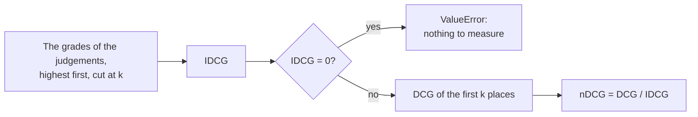

# 37. Fusion and metrics

> Pull request: [#98](https://github.com/herman72/unshelve/pull/98) · Code: [`search/fusion.py`](../../apps/api/src/unshelve/search/fusion.py), [`search/metrics.py`](../../apps/api/src/unshelve/search/metrics.py) · Tests: [`tests/search/test_fusion.py`](../../apps/api/tests/search/test_fusion.py), [`tests/search/test_metrics.py`](../../apps/api/tests/search/test_metrics.py)

Parts 1 to 4 give the formulas with worked examples. Part 5 shows how the code computes them. The tests are the specification, and they use the same numbers.

## In one minute

The search "postgres" of [note 36](36-three-retrievers.md) gives three lists (item 1 is the job queue, 2 pgvector, 3 Rust, 8 the weekend notes):

| Rank | Full text | Trigram | Vector |
|---|---|---|---|
| 1 | 1 | 1 | 1 |
| 2 | 2 | | 2 |
| 3 | 8 | | 3 |

Search must show one list. The scores of the retrievers cannot be added. A rank of full text (0.61 for a title), a similarity of trigrams (0.73 for a typo) and a cosine distance measure different things. *Reciprocal rank fusion* (RRF) uses only the places. With k = 60:

| Item | Score | Result |
|---|---|---|
| 1 | 1/61 + 1/61 + 1/61 = 0.0492 | first: first in each list |
| 2 | 1/62 + 1/62 = 0.0323 | second: second in two lists |
| 3 | 1/63 = 0.0159 | third: a tie with 8, and 3 is the lower id |
| 8 | 1/63 = 0.0159 | fourth |

Then, how good is a ranking? Three *metrics* answer it, against the answers that a person checked: recall@k, MRR and nDCG@k (parts 2 to 4). M4-5 uses them to compare the retrievers and the fusion on the same questions.

## 1. Reciprocal rank fusion

The score of an item is the sum, over the lists that contain it, of

```text
1 / (k + rank)        rank 1 for the first place
```

A list without the item adds nothing. The highest score comes first; on equal scores, the lower id comes first.

**Why the sum of 1/(k + rank)?** Each list gives a small vote, and a higher place gives a larger vote. An item that several retrievers find is very likely what you look for, so the votes add up.

**What k does.** Take two lists: `[1, 7, 2]` and `[8, 9, 2]`. Item 1 is first in one list; item 2 is third in both.

| k | Item 1 | Item 2 | Winner |
|---|---|---|---|
| 0 | 1/1 = 1.0 | 1/3 + 1/3 = 0.67 | 1: one first place |
| 60 | 1/61 = 0.0164 | 1/63 + 1/63 = 0.0317 | 2: agreement |

A large k makes the first places of a list count less against the later ones. The authors of RRF chose k = 60 (Cormack, Clarke and Büttcher, 2009), and many search engines use it.

**Copies.** If an id is two times in one list, only its first place counts. The copy keeps its place: in `[5, 6, 5, 7]`, item 7 has the rank 4.

**A comparison from daily life:** three friends each give you their list of the best cafés. You do not average their stars, because each friend gives stars differently. You count the places: a café that is high on all three lists wins.

## 2. recall@k

Recall@k is the share of the relevant items that are in the first k places. The ranking is `[3, 1, 4, 5, 9]`, and the relevant items are 1, 5 and 7:

| k | First k places | Relevant in them | recall@k |
|---|---|---|---|
| 1 | 3 | none | 0/3 = 0.0 |
| 2 | 3, 1 | 1 | 1/3 = 0.33 |
| 4 | 3, 1, 4, 5 | 1, 5 | 2/3 = 0.67 |
| 10 | the 5 places | 1, 5 | 2/3 = 0.67: item 7 is not in the ranking |

The divisor is the number of relevant items (3), not k. Recall answers: "Did the search find what exists?"

## 3. Reciprocal rank and MRR

The reciprocal rank is 1 / the place of the first relevant item. For `[3, 1, 4, 5, 9]` with the relevant items 1, 5 and 7, item 1 is at place 2: 1/2 = 0.5. Without a relevant item in the ranking, it is 0.

The MRR (mean reciprocal rank) is the mean over many queries:

| Ranking | Relevant | Reciprocal rank |
|---|---|---|
| `[3, 1, 4]` | 4 | 1/3 |
| `[2]` | 2 | 1 |
| `[9, 8]` | 7 | 0 |
| | **MRR** | (1/3 + 1 + 0) / 3 = 0.44 |

MRR answers: "How soon does the first good answer come?"

## 4. nDCG@k

Some items are more relevant than others. A person gives each judged item a *grade*: 0 (not relevant) to 3 (very relevant). nDCG@k compares the first k places with the best possible order.

1. The *gain* of a place is the grade of its item (0 for an item without a grade).
2. The *discount* of place i is `log2(i + 1)`: 1 for place 1, 1.58 for place 2, 2 for place 3. A lower place counts less.
3. DCG@k is the sum of gain / discount over the first k places.
4. IDCG@k is the DCG@k of the best order: all judged items, the highest grade first.
5. nDCG@k = DCG@k / IDCG@k, from 0 to 1.

An example with the grades 1: 3, 2: 2, 3: 1 and 4: 0, and the ranking `[2, 4, 1, 9, 3]`:

| Place | Item | Grade | Discount | Gain / discount |
|---|---|---|---|---|
| 1 | 2 | 2 | 1.00 | 2.00 |
| 2 | 4 | 0 | 1.58 | 0 |
| 3 | 1 | 3 | 2.00 | 1.50 |
| 4 | 9 | 0 (no grade) | 2.32 | 0 |
| 5 | 3 | 1 | 2.58 | 0.39 |
| | | | **DCG** | **3.89** |

The best order is items 1, 2, 3: 3/1 + 2/1.58 + 1/2 = **4.76** (IDCG). So nDCG@10 = 3.89 / 4.76 = **0.82**.

The best order reads the judgements, not the ranking. If the ranking misses a relevant item, the best order still has it, and nDCG goes down. That is the point: a search that misses an item is worse.

## 5. How the code works

I wrote the tests first: each test is one rule, with numbers that you can check by hand. Then I wrote the code to pass them, one function at a time.

### Fusion: one dict of scores

The code keeps one `dict` from item id to score. It reads each list from the top, and it adds `1 / (k + rank)` to the score of each item. For the search "postgres", the dict changes like this (a bold value changed in that step):

| After the list | `scores` |
|---|---|
| Full text `[1, 2, 8]` | 1: **1/61**, 2: **1/62**, 8: **1/63** |
| Trigram `[1]` | 1: **2/61**, 2: 1/62, 8: 1/63 |
| Vector `[1, 2, 3]` | 1: **3/61**, 2: **2/62**, 8: 1/63, 3: **1/63** |

The loop, without its comments:

```python
scores: dict[int, float] = {}
for ranking in rankings:
    seen: set[int] = set()
    for rank, item in enumerate(ranking, start=1):
        if item in seen:
            continue
        seen.add(item)
        scores[item] = scores.get(item, 0.0) + 1 / (k + rank)
```

- `enumerate(ranking, start=1)` gives each item its rank, and the first rank is 1.
- `scores.get(item, 0.0)` starts a new item at 0. So a list without the item adds nothing to it.
- `seen` holds the ids that this list showed already. Each list starts with a new, empty set.

**Copies.** The loop skips a copy, but `enumerate` still counts it. So the copy keeps its place. For `[5, 6, 5, 7]`:

| Rank | Item | Already in `seen`? | Result |
|---|---|---|---|
| 1 | 5 | no | 5 gets 1/61 |
| 2 | 6 | no | 6 gets 1/62 |
| 3 | 5 | yes | skipped, but the rank 3 is used |
| 4 | 7 | no | 7 gets 1/64 |

**The order.** One call of `sorted()` gives the order of the contract:

```python
fused = sorted(scores.items(), key=lambda pair: (-pair[1], pair[0]))
```

The *sort key* of the pair `(id, score)` is `(-score, id)`. `sorted()` puts the smallest key first, and Python compares two tuples part by part. The minus sign turns "the highest score first" into "the smallest key first". The id decides only when the scores are equal:

| Pair | Key | Place |
|---|---|---|
| (1, 0.0492) | (−0.0492, 1) | 1 |
| (2, 0.0323) | (−0.0323, 2) | 2 |
| (3, 0.0159) | (−0.0159, 3) | 3: the same score as 8, and 3 < 8 |
| (8, 0.0159) | (−0.0159, 8) | 4 |

Then `fused[:limit]` keeps the first `limit` pairs. The checks of `k` and `limit` come before the loop, so a wrong call fails before any work.

### Metrics: one helper for copies

recall@k, the reciprocal rank and nDCG@k read a ranking place by place. Each one must count a copy one time, and the copy must keep its place. One small helper does this for the three metrics:

```python
_first_places([5, 5, 2])  # [5, None, 2]
```

The helper replaces each later copy with `None`. `None` is never relevant, but it still fills the place 2. So item 2 stays at the place 3. The rule for copies is in one place, so the three metrics cannot disagree about it.

**recall@k** collects the relevant items of the first k places in a set. Then it divides by the number of relevant items:

```python
found = {
    item for item in _first_places(ranking)[:k] if item is not None and item in relevant
}
return len(found) / len(set(relevant))
```

For `[3, 1, 4, 5, 9]`, the relevant items `{1, 5, 7}` and k = 4, `found` is `{1, 5}`. So recall@4 is 2/3.

**The reciprocal rank** reads the places from the top, and it stops at the first relevant item: `return 1 / place`. If the loop ends without one, the result is 0. For `[5, 5, 2]` with the relevant item 2, the places hold 5, `None` and 2, so the result is 1/3.

**MRR** is `sum(...) / len(queries)`. An empty list of queries raises `ValueError` before the division. A query without relevant items raises too. A silent skip would hide a mistake in the judgements, and the number of measured queries would change without a message.

**nDCG@k** computes the best case first:



IDCG is the divisor. If it is 0, no ranking can gain anything, and the query cannot be measured. A check before the division gives a clear message, not a `ZeroDivisionError`. Then DCG reads the first k places through `_first_places`. Each place adds `relevance.get(item, 0) / log2(place + 1)`, so an item without a grade adds 0.

The check `idcg == 0` compares a float with `==`, and that is usually risky. Here it is exact: a grade of 0 gives a term of exactly 0.0, and each grade above 0 gives a term above 0.

## A choice that we made

**Which gain?** Two forms of DCG are common:

| | Gain = grade (ours) | Gain = 2^grade − 1 |
|---|---|---|
| A grade 3 against a grade 2 | 3 against 2 | 7 against 3 |
| Use | scikit-learn's `ndcg_score`; easy to check by hand | web search, where only the best answers matter |

With grades from 0 to 3 that come from one person, the plain grade is clearer, and you can check each value with scikit-learn.

**A query without relevant items** cannot be measured: each function raises `ValueError`, and the evaluation (M4-5) leaves the query out. Giving it 0 would punish the search for a question without an answer; giving it 1 would reward it.

**Skip a copy, or remove the copies first?**

| | Skip it in the loop (ours) | Remove the copies first: `dict.fromkeys(ranking)` |
|---|---|---|
| The rank of 7 in `[5, 6, 5, 7]` | 4: the copy keeps its place | 3: item 7 moves up |
| What the rank means | The place where the retriever put the item | A place that no retriever gave |

The retriever put item 7 at the place 4, so the code keeps that place.

**One sort, not a heap.** `heapq.nsmallest(limit, ...)` finds the first `limit` items without sorting all of them. That helps only for very long lists. Each retriever gives at most 50 ids (`LIMIT` in `search/retrievers.py`), so fusion sorts at most 150 items. One call takes about 30 microseconds on this Mac. A plain `sorted()` is easier to read and to check.

## What a senior engineer checks here

- **Off by one.** The first place is 1, in each formula: `1/(k + 1)`, `1/1` and `log2(2)`.
- **Copies.** Real lists can have them. A copy counts one time, and it keeps its place. One helper, `_first_places`, holds this rule for the three metrics.
- **The best order.** IDCG comes from the judgements, not from the items that the ranking found.
- **Equal floats.** The tests compare scores with `pytest.approx`, and they never permute the lists: adding floats in a different order can change the last digit.
- **Can the tests fail for the usual mistakes?** I put 21 typical mistakes into the code, one at a time. Each mistake fails at least one test. Some of the mistakes:
  - ranks from 0, and `log2(i)` for `log2(i + 1)`;
  - recall divided by k, and IDCG from the found items only;
  - copies counted again, and the gain 2^grade − 1.

  One of them, "nDCG@k with k = 5 by default", passed at first. A test now puts graded items at the places 10 and 11.
- **A second implementation.** scikit-learn's `ndcg_score` gives the same nDCG as our code for the example of part 4: 0.8162468467. The values for k = 1 and k = 3 are also the same.
- **Grades out of range.** The code trusts the grades. A negative grade can give an nDCG above 1: `ndcg_at_k([2], {1: -1, 2: 3})` is 1.27. M4-5 reads the judgements from a file, so it must check there that each grade is 0 to 3.

## Exercise (10 minutes)

The sort key of fusion is `(-score, id)`. A shorter key looks the same: `(score, id)` with `reverse=True`. Try it.

1. Open `apps/api/src/unshelve/search/fusion.py`, and replace the line `fused = sorted(...)` with:

```python
fused = sorted(scores.items(), key=lambda pair: (pair[1], pair[0]), reverse=True)
```

2. Run the tests of fusion in `apps/api`:

```bash
uv run pytest tests/search/test_fusion.py -q
```

3. Count the tests that fail. Look at their lists, and find what the failing tests have in common.
4. Undo the change: `git restore src/unshelve/search/fusion.py`.

<details>
<summary>The answer</summary>

```text
FAILED tests/search/test_fusion.py::test_the_scores_of_an_item_add_up_over_the_lists
FAILED tests/search/test_fusion.py::test_an_item_high_in_two_lists_beats_an_item_first_in_one
FAILED tests/search/test_fusion.py::test_equal_scores_put_the_lower_id_first
FAILED tests/search/test_fusion.py::test_k_decides_how_much_one_first_place_counts_against_agreement
FAILED tests/search/test_fusion.py::test_the_scores_go_down_and_equal_scores_go_by_id
5 failed, 9 passed
```

Each failing test has two items with the same score. `reverse=True` reverses the comparison of the whole key, not only of the score. So on equal scores, the higher id now comes first: `[[9], [4]]` gives 9 before 4.

In `(-score, id)`, the minus sign reverses only the score. The id keeps its normal order, so the lower id comes first.

</details>

## Words used in this note

| Word | Meaning |
|---|---|
| Fusion | Joining several ranked lists into one |
| RRF | Reciprocal rank fusion: the sum of 1 / (k + rank) over the lists |
| Relevant item | An item that a person marked as a good answer to the query |
| Recall@k | The share of the relevant items in the first k places |
| Reciprocal rank | 1 / the place of the first relevant item |
| MRR | The mean reciprocal rank over many queries |
| Grade | How relevant a judged item is, from 0 to 3 |
| DCG, IDCG, nDCG | The discounted gain of a ranking, of the best ranking, and their ratio |
| Copy | A later place of an id that is already in the same list |
| Sort key | The value that `sorted()` compares for each element. Two tuples are compared part by part |
| Helper | A small function that only the functions of the same module call |

## To read more

- [Reciprocal Rank Fusion outperforms Condorcet and individual Rank Learning Methods](https://plg.uwaterloo.ca/~gvcormac/cormacksigir09-rrf.pdf), Cormack, Clarke and Büttcher, SIGIR 2009. Read the first page: the formula, and the sentence about how k = 60 was chosen.
- [Discounted cumulative gain](https://en.wikipedia.org/wiki/Discounted_cumulative_gain#Normalized_DCG), Wikipedia. Read "Normalized DCG": the same steps as part 4, with another example.
- [Sorting Techniques](https://docs.python.org/3/howto/sorting.html), the Python documentation. Read "Key Functions" and "Sort Stability and Complex Sorts": the sort key of part 5, and a second way to sort by two parts.

Previous: [36. Three retrievers](36-three-retrievers.md) · Back to the [list of notes](README.md)
