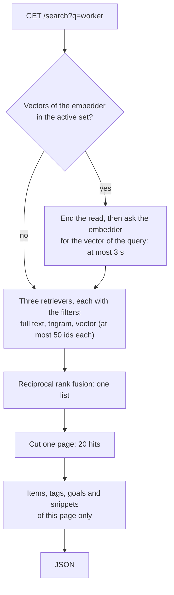

# 38. The search API

> Pull request: [#99](https://github.com/herman72/unshelve/pull/99) · Code: [`search/hybrid.py`](../../apps/api/src/unshelve/search/hybrid.py), [`search/snippets.py`](../../apps/api/src/unshelve/search/snippets.py), [`api/search_views.py`](../../apps/api/src/unshelve/api/search_views.py) · Tests: [`tests/search/test_hybrid.py`](../../apps/api/tests/search/test_hybrid.py), [`tests/search/test_snippets.py`](../../apps/api/tests/search/test_snippets.py), [`tests/api/test_search.py`](../../apps/api/tests/api/test_search.py)

## In one minute

You search for `worker` in the items of [note 36](36-three-retrievers.md) (item 1 is the job queue, 2 pgvector, 3 Rust). `GET /api/v1/search?q=worker` answers with one list. Here it is, with the fields of each item left out:

```json
{
  "items": [
    {
      "item": { "id": 1, "title": "Postgres as a job queue" },
      "score": 0.0328,
      "ranks": { "fts": 1, "trigram": null, "vector": 1 },
      "snippet": {
        "source": "text",
        "parts": [
          { "text": "worker", "hit": true },
          { "text": " takes a lease on a row. When the ", "hit": false },
          { "text": "worker", "hit": true },
          { "text": " stops, the lease ends", "hit": false }
        ]
      }
    },
    {
      "item": { "id": 2, "title": "How pgvector stores vectors" },
      "score": 0.0161,
      "ranks": { "fts": null, "trigram": null, "vector": 2 },
      "snippet": { "source": "passage", "parts": [{ "text": "piece 1 of item 2", "hit": false }] }
    },
    {
      "item": { "id": 3, "title": "Ownership in Rust explained" },
      "score": 0.0159,
      "ranks": { "fts": null, "trigram": null, "vector": 3 },
      "snippet": null
    }
  ],
  "next_cursor": null,
  "vector_search": "used"
}
```

Each hit has four fields:

| Field | What it tells | Item 1 |
|---|---|---|
| `item` | The item, as in the list of items | the job queue |
| `score` | The score of [reciprocal rank fusion](37-fusion-and-metrics.md) | 1/61 + 1/61 = 0.0328 |
| `ranks` | The place in the list of each retriever, before fusion. `null`: not in that list | first in full text and in vector |
| `snippet` | Why search found the item | the word "worker", two times in its text |

`vector_search` tells whether the search compared meanings too. The rest of this note follows one request from the top.

## 1. One request, step by step



[`hybrid.search`](../../apps/api/src/unshelve/search/hybrid.py) does the steps from B to E. It gives the fused list, and for each hit its place in each list. The API view ([`search_views.py`](../../apps/api/src/unshelve/api/search_views.py)) cuts the page and adds the rest. The command `unshelve search retrievers` calls the same function, so it prints the same fused list.

A page reads the texts of its items only. A snippet reads a whole text, so this keeps the cost of a page small.

## 2. Filters act inside each query

A search can have filters: `status`, `kind`, `tag` and `goal_id`. Each retriever puts them into its SQL `WHERE`. The filter acts before the list is cut at 50, not after.

An example from the tests. The best match for "postgres" is the job queue, and you archived it. You want the items of your inbox, one of them:

| | Filter after the cut | Filter inside the query (ours) |
|---|---|---|
| Full text gives | the job queue (the best one) | pgvector (the best one of the inbox) |
| The filter "inbox" leaves | nothing | pgvector |

The first way gives an empty page, although the inbox has a match.

**A comparison from daily life:** you ask a shop for its 10 cheapest shirts, and then you keep the blue ones. Perhaps none is left. Ask for the 10 cheapest blue shirts, and you get 10.

The rules of the filters:

| Filter | Keeps an item that |
|---|---|
| `status=inbox&status=reading` | has one of these statuses |
| `kind=article` | has one of these kinds |
| `tag=databases&tag=queues` | has each of these tags: both |
| `goal_id=4` | helps the goal: a score of 2 or 3 after your verdict, with the rule of the digest ([note 34](34-choosing-a-digest.md)): a rejected score turns |

A goal or a tag that does not exist finds no item. It is no error.

## 3. When the embedder fails

The vector of the query comes from Voyage, over the internet. A call over the internet can be slow, and it can fail. Two rules keep the search safe.

**No transaction stays open during the call.** `hybrid.search` reads the active set, ends the read, and only then asks the embedder. A transaction holds one connection of the pool of the API. The pool has 15 connections (SQLAlchemy's default: 5, and 10 more when needed). If each search kept its connection during a slow call, 15 slow searches would hold all of them, and each other request would wait. A test checks the rule: during the call, the session has no transaction.

**The search waits 3 seconds at most.** After that, or after an error of Voyage, the search goes on with the words alone: full text and trigram. The answer says so:

| `vector_search` | Meaning |
|---|---|
| `used` | The search compared meanings too. |
| `no_vectors` | The active set of vectors was not made by this embedder, or no set exists yet. The embedder is not asked. |
| `failed` | The embedder did not answer in time, or it answered with an error. The words still answered. |

The log gets the line `search.no_query_vector` with the kind of the error. It does not get the query: your search words can be private.

## 4. Snippets: why an item was found

A snippet comes from the first source that has something:

| Query | Item | Source | The snippet |
|---|---|---|---|
| worker | the job queue | `text` | "**worker** takes a lease on a row. When the **worker** stops, the lease ends": the words of the query in the saved text |
| skip locked | the job queue | `summary` | "How **SKIP** **LOCKED** lets workers share one table of jobs": the text has neither word, the summary has both |
| worker | pgvector | `passage` | No word of the query, but one piece of its text is close in meaning: that piece |
| worker | Rust | none | Its closest vector is its card, so its summary already tells why |

An item that only trigram found has no snippet either: trigram reads only the title, and the title is in the answer.

**The marks come from PostgreSQL.** `ts_headline` reads the text with the same rules as full text search, so a search for "keep" marks "keeps". It puts a mark before and after each hit, and it picks at most two pieces of at most 20 words. It drops a short word (3 letters or fewer) at the start and at the end of a piece. For example, the saved text starts with "A worker takes", and the snippet starts with "worker".

**A snippet is never HTML.** The saved text comes from the internet. If the API sent `<b>worker</b>`, the web app would have to show HTML from a strange page, and a `<script>` in that page could run. So the API sends plain text in parts, and each part says `"hit": true` or `false`. The web app shows each part as text and marks the hits itself.

**A saved page cannot fake a mark.** `ts_headline` marks a hit with two characters of the *private use area* of Unicode (U+E000 and U+E001). The code removes these two characters from the saved text first. So each mark in the answer of `ts_headline` comes from `ts_headline`. A test saves a text with these characters and checks that they mark nothing.

## 5. Pages

The answer has at most 20 hits by default (`limit`, up to 50). `next_cursor` opens the next page:

```text
/api/v1/search?q=postgres&limit=3                    → 3 hits, next_cursor "WyJzZWFyY2gi..."
/api/v1/search?q=postgres&limit=3&cursor=WyJzZWFyY2gi... → the next hits, next_cursor null
```

Each page runs the search again. The cursor holds the position where the next page starts, and a short fingerprint of the words and the filters. A cursor of other words or other filters would point into a different list, so the answer is 422: "the cursor belongs to another search".

## A choice that we made

**The shape of a snippet:**

| | Parts with `hit` (ours) | HTML from `ts_headline` (`<b>…</b>`) | One string with marks |
|---|---|---|---|
| The web app must | show each part as text | trust HTML from the internet | split the string at the marks |
| A saved page can | do nothing | add tags and scripts | add marks of its own |

**When the embedder fails, the search answers with the words** and says `failed`. The other way is an error 503: the page would then show nothing, although full text and trigram work. A search with two of its three retrievers is still a useful search.

**The cursor is a position, not the last score.** The item list uses the last item as its cursor ([note 9](09-walking-skeleton.md)). In search, a score depends on the places in three lists, and one new item moves the places of the items under it. A position is as stable, and simpler. The fused list has at most 150 hits, so each page can run the search again.

## What a senior engineer checks here

- **No transaction across a network call.** A test asks the session during the call of the embedder: no transaction is open.
- **A failure must be visible.** `vector_search` tells the web app, and the log tells you. The log has no search words.
- **Filters before the cut.** A filter after `LIMIT` can give an empty page although matches exist. The tests archive the best match and ask for one hit.
- **No HTML from the internet.** Snippets are parts of plain text, and a saved page cannot add a mark.
- **The cost of a snippet.** `ts_headline` reads the whole document, and the PostgreSQL documentation warns that it can be slow. So it reads only the hits of the page, and only the source that wins (a `CASE`). It reads only the first 100,000 characters of a text, as the index does.
- **Can the tests fail?** I put 43 typical mistakes into the code, one at a time. The first run showed two gaps:
  - "The summary comes before the text" passed. The order was written two times: in the SQL and in the Python loop, so a change of one place changed nothing. Now the order is written one time, in the `WHEN` clauses of one `CASE`, and the mistake fails a test.
  - "A passage from each set of vectors" passed. I had marked it as harmless, but it is not. After a change of model, an item has pieces in two sets. A new test puts a piece of the old set closer to the query, and the passage must still come from the active set.

  Now 40 of the 43 mistakes fail at least one test. No test can see the 3 other ones, and the code keeps each of them for a reason:
  - The owner of a tag: an item has only tags of its owner. The condition lets the unique index `(owner_id, slug)` serve the lookup.
  - The cut at 100,000 characters: the texts of the tests are short. The cut limits the cost, and it keeps the snippet in the part of the text that the index reads.
  - The owner of the items of a page: their ids come from the retrievers of the owner. The condition is a second wall.
- **What is not done:**
  - No distance limit for the vector retriever: each search gets the nearest items, also when they are not near. M4-5 measures a limit.
  - Each page asks the embedder again. A cache can come when the logs show that it matters.
  - A Persian word typed with Arabic letters in a saved text is found, but not marked. The index reads the text after `u_norm`, and `ts_headline` reads the text as it was saved.
  - The search page of the web app is M4-6.

## Try it yourself

1. After the pull request is merged, run `git pull`, and then `make up`.
2. Sign in on the web app as usual. In the same browser, open `http://localhost:3000/api/v1/search?q=postgres`. The browser shows the answer of this note for your own items.
3. See the three lists and the fused list side by side:

```bash
docker compose exec api unshelve search retrievers "postgres"
```

Each search sends its words to Voyage one time, for the vector of the query. A query of a few words costs far less than one cent.

## Exercise (10 minutes)

1. Open `apps/api/src/unshelve/search/hybrid.py`, and go to `search`.
2. Delete the line `await session.commit()` under `searchable_set`.
3. Run the tests of hybrid search in `apps/api`:

```bash
uv run pytest tests/search/test_hybrid.py -q
```

Which test fails? The search still gives the right hits. Why is that test there?

<details>
<summary>The answer</summary>

```text
FAILED tests/search/test_hybrid.py::test_no_transaction_is_open_while_the_embedder_works
1 failed, 6 passed
```

Without the commit, the read transaction of `searchable_set` stays open while the embedder works. The results are the same, so a test of the results cannot see it.

The cost shows only under load. An open transaction holds one of the 15 connections of the pool. Voyage can be slow: 3 seconds for each call. Then 15 searches at the same moment hold all the connections. Every other request of the API waits, also a request that does not search. The test asks the session during the call of the embedder, so it sees the rule itself, not its result.

</details>

## Words used in this note

| Word | Meaning |
|---|---|
| Hybrid search | One search with several retrievers, joined into one list |
| Filter inside the query | A condition in the SQL `WHERE`, before the `LIMIT` cuts the list |
| Snippet | A short passage of an item that shows why search found it |
| `ts_headline` | The PostgreSQL function that picks the pieces of a text around the words of a query and marks them |
| Private use area | Unicode characters with no meaning of their own; a program can use them as marks |
| Cursor | A token that tells where the next page starts |
| Fingerprint | A short hash of the words and the filters of a search |
| Connection pool | A fixed set of open database connections that requests share |

## To read more

- [Highlighting Results](https://www.postgresql.org/docs/current/textsearch-controls.html#TEXTSEARCH-HEADLINE), PostgreSQL documentation. Read the options `StartSel`, `MaxWords`, `MaxFragments` and `ShortWord`, and the warning that `ts_headline` reads the whole document.
- [Filtering](https://github.com/pgvector/pgvector#filtering), the pgvector README. Read why a filter comes after the scan of an approximate index. When a filter keeps 10% of the rows, a scan of 40 rows leaves about 4. Our vector search is exact, so the filter is inside the query.

Previous: [37. Fusion and metrics](37-fusion-and-metrics.md) · Back to the [list of notes](README.md)
