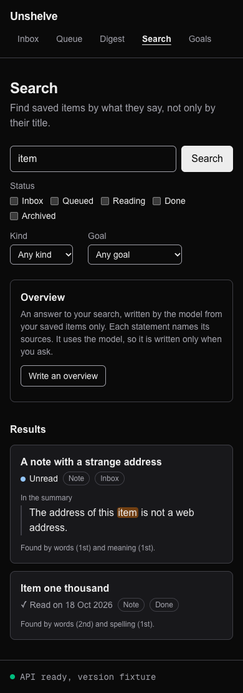
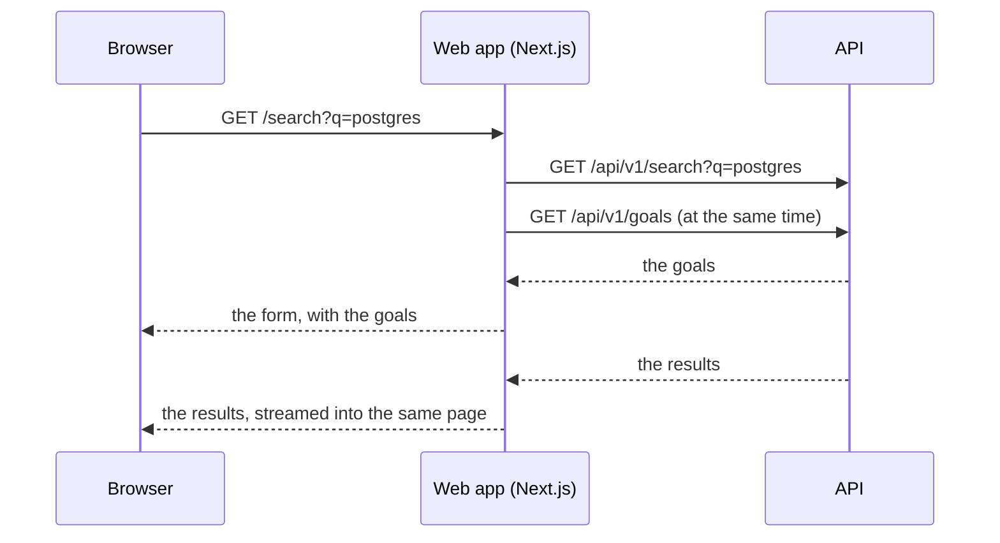
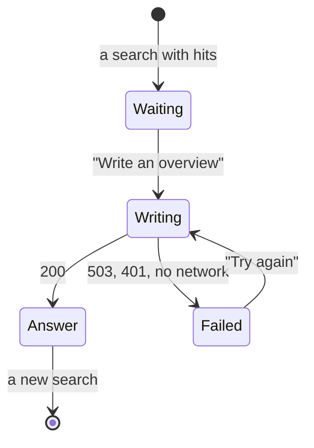

# 41. The search page

> Pull request: [#103](https://github.com/herman72/unshelve/pull/103) · Code: [`app/search/page.tsx`](../../apps/web/src/app/search/page.tsx), [`lib/search.ts`](../../apps/web/src/lib/search.ts), [`components/search-form.tsx`](../../apps/web/src/components/search-form.tsx), [`components/search-hit.tsx`](../../apps/web/src/components/search-hit.tsx), [`components/overview-panel.tsx`](../../apps/web/src/components/overview-panel.tsx) · Tests: [`apps/web/e2e/search.spec.ts`](../../apps/web/e2e/search.spec.ts)

## In one minute

Before, the search page showed the cards that the API found, and nothing more. It had no filters, it did not say why an item was found, and it had no overview.

Now each hit says why search found it, and whether you read it. The filters are part of the address, and an overview answers the search from your items, with numbered sources. These are made-up items of the tests:

![The search page on a desktop: the search box with the filters Status, Kind and Goal; an overview with the numbers [1] and [2] and its sources with their quotes; two results with the word "Postgres" marked](images/41-search.png)



## 1. The search is the address of the page

A search for "postgres", only in the inbox, only PDFs, only for the goal "Database internals", has this address:

```text
/search?q=postgres&status=inbox&kind=pdf&goal_id=1
```

The form sends its fields with GET, so the browser writes them into the address. Back, a bookmark and a reload show the same search. The form also works without JavaScript.

| In the address | In the form | To the API |
|---|---|---|
| `q=postgres` | the search box | `q=postgres` |
| `status=inbox` (one for each ticked box) | the boxes under "Status" | `status=inbox` |
| `kind=pdf` | "Kind" | `kind=pdf` |
| `goal_id=1` | "Goal" | `goal_id=1` |
| `cursor=…` | not in the form: the link "More results" adds it | `cursor=…` |

**One reader for both sides.** `parseSearch` reads the address one time. The form shows its values, and `apiQuery` sends the same values to the API. So the form never shows a filter that the API did not use. A value that the API does not know (`status=sleeping`) is left out of both. The form has one kind and one goal, so only the first `kind` and the first `goal_id` of the address count.

**A comparison from daily life:** an order slip in a restaurant. The cook reads the slip, not the memory of the waiter. Anyone with the same slip gets the same dish.

## 2. Two requests at the same time

The page needs two answers from the API: your goals for the form, and the results. The search can wait up to 3 seconds for the embedder ([note 38](38-search-api.md)). The goals need one small query.



The code starts the search first, and does not wait for it:

```tsx
const results = search.q ? toApiState(api.GET("/api/v1/search", …)) : null; // starts now
const goals = await toApiState(api.GET("/api/v1/goals", …)); // the form waits only for this
```

`SearchResults` waits for `results` inside its own `<Suspense>`. If the code waited for the search first, the goals would start only after it: a *waterfall*, requests one after the other that could run together.

## 3. Why each item was found

A search for "item" finds two made-up items:

```text
A note with a strange address
● Unread · note · inbox
In the summary
│ The address of this [item] is not a web address.
Found by words (1st) and meaning (1st).

Item one thousand
✓ Read on 18 Oct 2026 · note · done
Found by words (2nd) and spelling (1st).
```

**The snippet.** The API sends a snippet as parts of plain text, each with a flag `hit` ([note 38](38-search-api.md)). The page writes each part as text, and puts a hit inside `<mark>`. Nothing from the item becomes HTML: a saved text with `` in it shows those characters. A test checks that no image appears and that no dialog opens.

| Caption | The source of the snippet |
|---|---|
| In the saved text | the words of the search in the text of the item, marked |
| In the summary | the words in the summary, marked |
| The closest passage in meaning | a piece of the text that only the vector search found: no word is marked |
| (no snippet) | a hit of the title: the page shows the summary |

**"Found by".** Each hit has its place in the list of each retriever, before the fusion (`ranks`). The page names the lists in plain words: *words* is full text search, *spelling* is the trigram search, and *meaning* is the vector search ([note 36](36-three-retrievers.md)). `Intl.PluralRules` of JavaScript gives the English endings: 1st, 2nd, 3rd, 4th, 11th, 21st.

## 4. Read and unread

An item is read when it has a read time (`read_at`). The API writes it when the item becomes "done" ([note 30](30-reading-status.md)), and it keeps it when the item moves on. So an item that you read and then archived is still read.

| `read_at` | The mark |
|---|---|
| `null` | ● Unread |
| `2026-10-18T19:00:00Z` | ✓ Read on 18 Oct 2026 |

The words carry the state; the dot only helps the eye to find unread items. A person who cannot see colours, or who uses a screen reader, gets the same information.

The pretend API of the tests had an item that was "done" without a read time. The real database refuses that state (the check `done_needs_read_at`). The made-up item now has a read time, and the test of its page expects the sentence "Read on 18 October 2026 at 19:00 UTC."

## 5. The overview, on request

An overview costs a call to the model. So the page asks for one only when you press "Write an overview". The same question on the same items costs nothing the second time: the API answers it from its ledger ([note 39](39-overview-with-citations.md)).



**Numbered sources.** The answer comes as segments: text, and the citations of that text. After each statement, the page writes the numbers of its sources, for example [1]. The numbers follow the list of the items that the model read, the best first. So [1] is the same item in each place. A number links to its source below the answer, where the quotes are.

**Plain text only.** The model read saved web pages. So its words are written as text, never as HTML or Markdown. The test of the overview quotes the item with `` in its text.

**When the model cannot answer.** The API answers 503 with the reason, and the panel shows it, for example: "The model gave no answer: the daily budget of $1.00 is used. The results below do not need it."

**Numbers next to Persian text.** A screenshot of the first version showed [2] on the wrong side of the Persian statement, next to [1]. The Unicode rules for the direction of text put digits that follow Persian letters into the right-to-left run of those letters. So the browser drew [2] at the left end of the Persian sentence. Each number now has `dir="ltr"`: the browser places it as one unit, after its statement. A test measures the positions: [2] must stand to the right of the Persian statement.

**Filters.** The API of the overview takes a status filter, but no kind and no goal. When you set one of those, the panel says that only the status applies.

**Focus.** The button disappears with the answer. The focus moves to the answer, so a keyboard or a screen reader goes on from there, not from the top of the page.

## 6. A bug that a test found: two forms

The first run of the filter test failed:

```text
Error: strict mode violation: getByRole('search').getByRole('checkbox', { name: 'Inbox' }) resolved to 2 elements
```

After a search, the page had two forms: the old one and the new one.

**Why the form needs a key.** The fields of the form are *uncontrolled*: the browser keeps their values, and React gives a field its default value only when the field first appears. After Back, the address changes, but a ticked box stays ticked. A new *key* makes React build new fields, with the values of the address.

**The bug.** The first version gave the key to the whole form. The form and the results stood next to each other, with the same key:

```tsx
<SearchForm key={name} … />          // name = "/search?q=postgres"
<Suspense key={name} …>…</Suspense>   // the same name
```

To match the old children with the new ones, React files the old children by key. Two children with the same key take one place, so React forgot the old form. It removed the old results, but it never removed the old form.

| Step | What React has |
|---|---|
| Before the search | form `/search?q=postgres`, results `/search?q=postgres` |
| Its list of old children by key | `/search?q=postgres` → the results (the form was written over) |
| After the search | the old form (forgotten), the new form, the new results |

A development build of React reports this mistake in the console: "Encountered two children with the same key". I saw it with `next dev`. The tests run the production build, which reports nothing. So only the test found the mistake.

**The fix.** The key now stands on the box of the fields, inside the form. The form itself has no key, as the documentation of `Form` asks: "Passing a `key` prop to a string `action` is not supported." Now no two children of one parent have the same key. The test now goes Back, and checks that the page has one form with the filters of the earlier search.

**A comparison from daily life:** a cloakroom that gives two coats the same number. With the ticket you get one coat back, and the other coat stays on its hook forever.

## 7. Tests against a pretend search

The tests run against the pretend API of [note 26](26-item-page.md), which now searches too:

- It finds the words of a search in the titles, the summaries, and three made-up saved texts.
- For "meaning", each item has a short list of words, for example "contention" for the item about leases.
- It fuses the three lists with the formula of the real API, 1 / (60 + place) ([note 37](37-fusion-and-metrics.md)), and chooses the snippet in the same order.
- Two routes change it for one test: `/__search` (the embedder fails, or a page holds 1 hit), and `/__overview` (the model answers 503).

The new file `e2e/search.spec.ts` has 15 tests:

| What the tests check | Tests |
|---|---|
| The page before a search | 1 |
| A hit: the marked words, the read mark, "Found by", the summary of a hit of the title, Persian from right to left, a passage found by meaning | 4 |
| Saved text with markup stays text | 1 |
| The filters reach the API, the form shows them, and Back gives one form with the earlier search | 2 |
| "Found by words only", when the embedder failed or has no vectors | 1 |
| More results, and back to the best results | 1 |
| The overview: numbers, sources, quotes, focus, a new search, the next page; numbers after Persian text; a 503; nothing to read | 5 |

**Can these tests fail?** I put 34 typical mistakes into the new code, one at a time. Some examples: one key for the form and the results, a cursor in the key of the results, a filter that does not reach the API, a snippet written as HTML, a read item marked "Unread", numbers that start at 0, a number without `dir="ltr"`. Each mistake made a named test fail.

## Choices that we made

**The search lives in the address, not in the state of the browser.**

| | The address (ours) | State in the browser |
|---|---|---|
| Back, a bookmark, a reload | the same search | lost, or more code |
| Without JavaScript | works | does not work |
| The results | made on the server, with your session cookie | fetched by the browser |
| An empty choice | the address can show `kind=&goal_id=`: a form sends each named field | clean addresses |

**The overview waits for a click.**

| | On request (ours) | With each search |
|---|---|---|
| Cost | one model call when you ask for an answer | one model call for each search |
| A search with a typo | costs nothing | costs a model call |
| The risk | you can miss that the overview exists | none |

## What a senior engineer checks here

- **Can saved text run code in the page?** No: snippets, answers and quotes are text. Tests with `` check it, and one test fails on a dialog.
- **Does the form always show what the API used?** One reader for both, and a test after Back.
- **Does a fast part wait for a slow one?** No: the goals and the search start together.
- **Are the keys of siblings different?** They were not: the bug of section 6. A production build does not warn about it.
- **Is a state shown only with a colour?** No: "Unread" and "Read on" are words.
- **What is not done:**
  - no filter by tag (the API has one);
  - no filter "unread only" (the API has no filter by read time);
  - no run against the real API: the tests use the pretend API, and the type check compares its made-up answers with the types of the real API ([note 26](26-item-page.md));
  - no real overview: no model call was made for this page.

## Try it yourself

After the merge, run `git pull` and `make up`. Open http://localhost:3000/search, search for a word, tick a status, and press Back.

With `UNSHELVE_PROVIDERS=live`, "Write an overview" asks the model: it costs money the first time for each question.

To run the tests (they need Google Chrome):

```bash
pnpm --filter @unshelve/web test:e2e
```

## Exercise (10 minutes)

1. In `apps/web/src/app/search/page.tsx`, give the form the key of the results:

```tsx
<SearchForm key={searchHref(search)} search={search} goals={…} />
```

2. Run the test of the filters in `apps/web`:

```bash
pnpm exec playwright test search.spec.ts -g "filters"
```

What fails, and why? Then answer: why must a key be different only from the keys of its siblings, and not from each key on the page?

<details>
<summary>The answer</summary>

The test fails after the search: `getByRole('checkbox', { name: 'Inbox' })` finds 2 elements, because the page has two forms. The form and the results are siblings, and now they have one key. React files the old children by key, the results take the place of the form, and React never removes the old form (section 6).

React matches the children of each parent apart from the children of other parents: it compares the old and the new children of one parent at a time. So two children of different parents can have the same key with no problem. The documentation of React says the same in "Rules of keys": keys must be unique among siblings, not globally.

</details>

## Words used in this note

| Word | Meaning |
|---|---|
| Query string | The part of an address after "?": `q=postgres&status=inbox` |
| GET form | A form that writes its fields into the address, as a link would |
| Waterfall | Requests that run one after the other, although they could run together |
| Snippet | A short passage that shows why search found an item |
| Uncontrolled field | A field whose value the browser keeps; React sets it only when the field first appears |
| Key | The name that React uses to match an old child with a new one |
| Live region | A part of the page that a screen reader reads aloud when it changes (`role="status"`) |
| Bidirectional text | Text with right-to-left and left-to-right parts; the Unicode rules decide their order on the screen |

## To read more

- [Rendering lists](https://react.dev/learn/rendering-lists#rules-of-keys), React documentation. Read "Rules of keys": why a key must be unique among its siblings, and why it must not change.
- [Preserving and resetting state](https://react.dev/learn/preserving-and-resetting-state), React documentation. Read "Option 2: Resetting state with a key" and "Resetting a form with a key": the way the form of this page starts again.
- [Form](https://nextjs.org/docs/app/api-reference/components/form), Next.js documentation. Read "Reference" (an address as the action gives a GET form that navigates) and "Caveats" (the key).

Previous: [40. Measuring search](40-measuring-search.md) · Back to the [list of notes](README.md)
