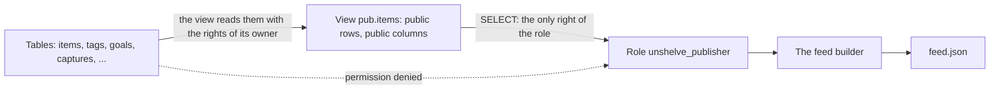

# 42. The public feed

> Pull request: [#109](https://github.com/herman72/unshelve/pull/109) · Code: [`publish/feed.py`](../../apps/api/src/unshelve/publish/feed.py), [`publish/targets.py`](../../apps/api/src/unshelve/publish/targets.py), [`pipeline/publish.py`](../../apps/api/src/unshelve/pipeline/publish.py) · Decision: [ADR 0004](../adr/0004-public-data-is-a-pushed-static-subset.md) · Tests: [`tests/publish/`](../../apps/api/tests/publish/), [`tests/db/test_public_boundary.py`](../../apps/api/tests/db/test_public_boundary.py)

## In one minute

You save hundreds of items, and a few of them are worth sharing. Unshelve publishes those few as one file, `feed.json`, which your site reads and searches in the browser. There is no public API.

`unshelve publish show` prints the feed. This is the feed of the made-up items of the tests:

```json
{
  "version": 1,
  "items": [
    {
      "id": "queues-fa",
      "kind": "article",
      "title": "صف کارها در پستگرس",
      "url": null,
      "author": null,
      "site": null,
      "lang": "fa",
      "summary": "یک صف کار روی یک جدول Postgres.",
      "key_points": [],
      "est_minutes": null,
      "note": null,
      "published_at": "2026-10-22T07:00:00Z",
      "tags": []
    },
    {
      "id": "leases-for-job-queues",
      "kind": "article",
      "title": "Leases for Job Queues in Postgres",
      "url": "https://example.com/leases",
      "author": "A. Made-up",
      "site": "example.com",
      "lang": "en",
      "summary": "A job queue on one Postgres table, made safe with leases.",
      "key_points": [
        "A lease ends when its worker stops"
      ],
      "est_minutes": 14,
      "note": "Worth a read before the design review.",
      "published_at": "2026-10-21T07:00:00Z",
      "tags": [
        "databases"
      ]
    }
  ]
}
```

The made-up world also has a private note, a private tag, a goal, a saved text, an item of another owner and more, each with a marker such as `LEAK-private-note`. None of them is in the feed. This note is about the wall that keeps them out, also when the code has a mistake.

## 1. One view, one role

The wall has two parts, both in the database since migration `0001`:



- **The view** `pub.items` lists each column by name, and it keeps only items that are public and no copy. Its subquery of tags keeps only public tags. A new column of `items` is private until someone adds it to the view.
- **The role** `unshelve_publisher` has one right: `SELECT` on that view. It has no right on any table.

How can the role read a view of tables that it cannot read? A view reads its tables with the rights of the owner of the view, not of the reader. So the role gets exactly the rows and columns of the view, and nothing else.

| The view lets through | Stays private |
|---|---|
| a public item that is no copy | a private item, also one that was public before |
| title, link, author, site, language, summary, key points, minutes, public note, time of publication | the private note, the extra links, the status, the scores |
| public tags | private tags, goals, saved texts, messages, events |

## 2. The publisher becomes the role for one transaction

The feed builder does not log in as the role. It switches to it inside one transaction:

```python
async with sessions() as session, session.begin():
    await session.execute(sa.text("SET LOCAL ROLE unshelve_publisher"))
    rows = await session.execute(query_on_pub_items)  # each check runs as the role
# the transaction ends here, and the role ends with it
```

**Why `LOCAL`.** The connection goes back to a pool after the transaction, and the next request takes it. `SET ROLE` would stay on the connection, and the next request would run as the publisher. `SET LOCAL ROLE` ends with the transaction, also when it ends in an error. A test proves it with a pool of one connection: after the feed, and after a failure inside the transaction, the next session is the normal user again.

**A comparison from daily life:** a visitor badge that opens one room. You give it back at the exit of the building, also when you leave in a hurry.

## 3. Two lists decide what is public

The view decides what CAN be public. The list `FIELDS` in `publish/feed.py` decides what IS published:

```python
FIELDS = (
    "id",
    "kind",
    "title",
    "url",
    "author",
    "site",
    "lang",
    "summary",
    "key_points",
    "est_minutes",
    "note",
    "published_at",
    "tags",
)
```

The view has one more column, `owner_id`, for the filter below. It is an internal number, so it is not in `FIELDS`. A new column of the view stays out of the feed until it is added to `FIELDS` too.

**The filter of the owner is the one rule that the role cannot keep.** The view holds the public items of every owner: the role may read all of them. Only the query keeps the items of one owner (`WHERE owner_id = ...`). A test with a public item of a second owner checks that rule.

## 4. The bytes of the feed

- The items come newest first: by the time of publication, then by their id.
- One field on each line (`indent=2`), so that a change of one item is a small diff.
- UTF-8 with no `\u` escapes: Persian text stays readable.
- `version: 1` says the shape, so that a site can refuse a shape that it does not know.
- No time of writing: **the same records always give the same bytes**. So a target can see that nothing changed, and write nothing.

## 5. The file target

`UNSHELVE_PUBLISH_TARGET=file` writes the feed to `UNSHELVE_PUBLISH_FILE`:

1. If the file holds the same bytes, nothing is written ("no change").
2. Otherwise, the bytes go to a temporary file in the same folder, and then the file gets its name in one step. A reader never sees half a feed; a test makes the rename fail and checks that the old feed is still whole.
3. The file can be read by other users (mode 644), such as the user of a web server.

A target is a protocol of the contracts, as the fetcher and the embedder are. Each target must pass one conformance suite: a fake in memory and the file target pass it, and so do the git target ([note 43](43-git-target.md)) and the object storage target ([note 44](44-object-storage-target.md)).

## 6. The job and the commands

| | What it does |
|---|---|
| `unshelve publish show` | prints the feed of now; it writes nothing |
| `unshelve publish run` | writes the feed to the target, and says "Published 2 items to …" or "No change: …" |
| the job `publish_feed` | the same as `run`, in the worker. A fault that can pass (a full disk) is tried again after 5 minutes; a fault of the settings (a folder that cannot be written) ends the job |

Nothing queues the job yet. The publish toggle of M5-2 will queue it when you make an item public or private.

## 7. A test with markers in each private place

The acceptance test of #36 puts a unique marker into each private place: 14 places, such as the private note of a public item, a private tag, a goal, a stored message and a public item of another owner. It builds the real feed bytes and checks that no marker is in them. It also checks that the public note is in them, so an empty feed cannot pass.

**Can these tests fail?** I put 37 typical mistakes into the code, one at a time, and each one made a named test fail. Five of them were in the view itself, in migration `0001`:

| A mistake in the view | The test that failed |
|---|---|
| the tags without `AND t.is_public` | the markers: the private tag leaked |
| no `duplicate_of_id IS NULL` | the markers: the public copy leaked |
| `published_at IS NOT NULL` instead of `visibility = 'public'` | the markers: the item that was public before leaked |
| one more column, `i.note AS private_note` | the list of the columns of the view |
| `GRANT SELECT ON items` to the role | the role read a table |

So the tests guard the wall in the database too, not only the code that reads it.

## A choice that we made

**The publisher switches to the role; it does not log in as the role.**

| | `SET LOCAL ROLE` (ours) | A role that logs in with its own password |
|---|---|---|
| A new secret | none | a password in `.env`, and a step that sets it in the database |
| The tests | each test database can use the role | the role is shared by the whole server: a password for it would change the server of your instance |
| A mistake in the query of the feed | refused by the database | refused by the database |
| Code that wants to read private data on purpose | can switch back (`RESET ROLE`) | needs the other password |

Both refuse a mistake, and a mistake is the risk here. Code that wants private data on purpose has the main connection anyway. ADR 0004 now says how the role is used.

## What a senior engineer checks here

- **Does the role end with the transaction?** Yes: a pool of one connection, a feed, and a failure inside a transaction; the next session is the normal user.
- **Can the role write?** No: it has no right but `SELECT` on `pub.items`. A test reads the rights of the role on every table of the schema, also on tables that a later migration adds.
- **Is the filter of the owner tested?** Yes: a public item of a second owner, with a marker.
- **Can the tests fail?** Yes: 37 typical mistakes, one at a time, in the code and in the view; each one made a named test fail.
- **What is not done:**
  - a toggle that queues the job (M5-2);
  - a folder of the stack for the file: in Docker, `UNSHELVE_PUBLISH_FILE` is a path inside the container of the worker.

## Try it yourself

After the merge, run `git pull` and `make up`. You have no public item yet (the toggle comes with M5-2), so the feed is empty:

```bash
docker compose exec api unshelve publish show
```

## Exercise (10 minutes)

1. In `apps/api/src/unshelve/publish/feed.py`, remove the line `.where(_PUB_ITEMS.c.owner_id == owner_id)`.
2. Run the acceptance test in `apps/api`:

```bash
uv run pytest tests/publish/test_feed.py -k no_private_text -q
```

Which marker leaks? Why does the role, which cannot read any table, not stop it?

<details>
<summary>The answer</summary>

The marker of "a public item of another owner" leaks:

```text
AssertionError: assert ['a public it...nother owner'] == []
  Left contains one more item: 'a public item of another owner'
```

The role keeps out private rows and private columns. But the item of the other owner is public, so it is in the view, and the role may read it. Only the filter of the query keeps the items of one owner. So the role and the filter guard different things, and each one needs a test of its own: the markers have one for each.

</details>

## Words used in this note

| Word | Meaning |
|---|---|
| View | A stored query that looks like a table |
| Role | A user of the database, with its own rights |
| `SET LOCAL ROLE` | Act as another role until the end of the transaction |
| Transaction | Statements that end together: all of them are kept, or none |
| Connection pool | Open connections to the database that requests share, one after the other |
| Marker | A unique text in a private place; if the feed holds it, that place leaked |
| Conformance suite | One set of tests that each implementation of a protocol must pass |

## To read more

- [CREATE VIEW](https://www.postgresql.org/docs/current/sql-createview.html), PostgreSQL documentation. Read "Notes": by default, a view reads its tables with the rights of its owner, and `security_invoker` changes that.
- [SET ROLE](https://www.postgresql.org/docs/current/sql-set-role.html), PostgreSQL documentation. Read the description: after `SET ROLE`, each check runs as the named role.

Previous: [41. The search page](41-search-page.md) · Next: [43. Publishing to a git repository](43-git-target.md) · Back to the [list of notes](README.md)
