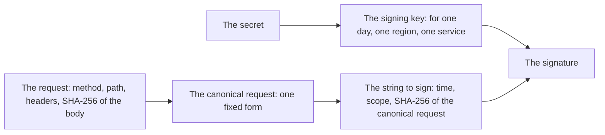

# 44. Publishing to object storage

> Pull request: [#111](https://github.com/herman72/unshelve/pull/111) · Code: [`publish/s3.py`](../../apps/api/src/unshelve/publish/s3.py), [`net/sigv4.py`](../../apps/api/src/unshelve/net/sigv4.py), [`net/service.py`](../../apps/api/src/unshelve/net/service.py) · Tests: [`tests/publish/test_s3_target.py`](../../apps/api/tests/publish/test_s3_target.py), [`tests/net/test_sigv4.py`](../../apps/api/tests/net/test_sigv4.py)

## In one minute

An object storage keeps files, called *objects*, in folders called *buckets*, and serves them over https. Cloudflare R2 and Amazon S3 are two of them. Both speak the same language: the S3 API.

With `UNSHELVE_PUBLISH_TARGET=s3`, the worker puts the feed as one object into your bucket. Your site, or a CDN in front of the bucket, reads it from there.

A test published the feed into a pretend bucket `feeds`. These are the two requests that the target sent (the key is made up, and the signature is shortened):

```text
GET https://account.r2.example/feeds/public/feed.json  -> 404 NoSuchKey
    x-amz-date: 20261022T193631Z
    x-amz-content-sha256: e3b0c442...b855  (the SHA-256 of no bytes)
    authorization: AWS4-HMAC-SHA256 Credential=AKIDEXAMPLE/20261022/auto/s3/aws4_request,
                   SignedHeaders=host;x-amz-content-sha256;x-amz-date, Signature=50199da7...

PUT https://account.r2.example/feeds/public/feed.json  -> 200
    content-type: application/json
    cache-control: public, max-age=300
    x-amz-date: 20261022T193631Z
    x-amz-content-sha256: da6fa0fb...70f8  (the SHA-256 of the feed)
    authorization: AWS4-HMAC-SHA256 Credential=AKIDEXAMPLE/20261022/auto/s3/aws4_request,
                   SignedHeaders=cache-control;content-type;host;x-amz-content-sha256;x-amz-date,
                   Signature=9f1dd993...
```

The first request asks for the object, and the answer is "no such object yet". The second request writes the feed. A second publish with the same items sends only the first request.

## 1. One object, written in one step

Each publish runs these steps:

1. `GET` the object. If it holds the same bytes as the new feed, stop: nothing changed.
2. Otherwise, `PUT` the new feed. The service keeps the old object until the new one is complete.

So a reader gets the old feed or the new one, never a part of it. The object has the type `application/json`, and `cache-control: public, max-age=300`: a reader, such as a CDN, may keep it for 5 minutes before it asks again.

**A comparison from daily life:** a notice board behind glass. You do not write on the old sheet. You take it out, and you put the new sheet in, in one move.

## 2. A signature instead of a password

Each request carries a *signature*: a number that only the owner of the secret key can make for this request. The secret itself never goes over the network.



The service has the same secret. It makes the same signature from the request that it gets, and it compares the two. If one header or one byte of the body changed on the way, the two signatures differ, and the service refuses the request.

**A comparison from daily life:** two friends know the same password. One sends a message and a check number that only the password can make for that message. The other makes the check number again from the message and the password, and compares. The password is never written down in the message.

**Why a "canonical" form.** Both sides must make exactly the same text before they sign it. So each side writes the header names in lowercase, sorts them, and removes extra spaces in the values. An example from the test suite of AWS: the header `My-Header2: "a   b   c"` becomes the line `my-header2:"a b c"`.

**The time is part of the signature.** The signing key is valid for one day, one region and one service. AWS also refuses a request that arrives too late: "in most cases, a request must reach AWS within five minutes of the time stamp". So an old request that someone copied stops working, and a computer with a wrong clock gets the answer `RequestTimeTooSkewed`.

## 3. How we know that the signature is right

A signature is right only if it is exactly the one that the service makes. We check this in four ways:

| Check | What it proves |
|---|---|
| 7 cases of the test suite of AWS for Signature Version 4, and the 2 S3 examples (GET and PUT) of the AWS documentation | Our canonical request and our signature are the same, character for character, as the answers that AWS publishes |
| A pretend S3 in the tests, which checks each request as S3 does: the key ID, the region, the SHA-256 of the body, and the signature | The target sends exactly what it signed: the host, the path, the headers and the body |
| Property tests | The case and the order of the header names do not change the signature; each byte of the body does; the secret is in no header |
| A live test, only with `-m live` | Your real bucket accepts the requests (see "Try it yourself") |

## 4. The settings, and what goes wrong

| Setting | Cloudflare R2 | Amazon S3 |
|---|---|---|
| `UNSHELVE_PUBLISH_S3_ENDPOINT` | `https://<account>.r2.cloudflarestorage.com` | `https://s3.<region>.amazonaws.com` |
| `UNSHELVE_PUBLISH_S3_REGION` | `auto` | the region of the bucket, such as `eu-north-1` |
| `UNSHELVE_PUBLISH_S3_BUCKET` | the name of the bucket | the name of the bucket |
| `UNSHELVE_PUBLISH_S3_OBJECT` | `feed.json` (the default) or `public/feed.json` | the same |
| `UNSHELVE_PUBLISH_S3_ACCESS_KEY_ID`, `UNSHELVE_PUBLISH_S3_SECRET_ACCESS_KEY` | an API token with "Object Read & Write" for this one bucket | a key of a user that may only read and write this object |

The bucket is in the path of each address: `https://<endpoint>/<bucket>/<object>`. This is the "path style", and each service with the S3 API that we know answers there.

| What is wrong | What happens |
|---|---|
| A setting is missing, or has a wrong form | Each publish fails, and the message names the setting |
| A wrong secret | `403 SignatureDoesNotMatch`: a lasting fault, the job ends |
| A wrong region | `400 AuthorizationHeaderMalformed`: a lasting fault |
| A bucket that does not exist | `404 NoSuchBucket`: a lasting fault |
| A busy service (`503 SlowDown`), a fault of the service (5xx), no connection, a wrong clock | A fault that can pass: the job tries again 5 minutes later |

No message holds the secret. The credentials leave it out of their representation, and a password in the address of the endpoint shows as `***@`.

## 5. What the bucket needs from you

The worker writes the object. Three things are settings of the bucket, and you make them once, in the console of your provider:

- **Public read.** Your site must be able to read the object. On R2, connect a custom domain to the bucket, or allow the `r2.dev` address. On S3, use a bucket policy or a CDN.
- **CORS.** If the site reads the feed in the browser, from a different address than the bucket, the bucket needs a CORS rule that allows the address of your site.
- **The smallest rights.** The key of the worker should write this one bucket, and nothing else. If it leaks, an attacker can change the feed, and nothing more.

## A choice that we made

**Our own signature (80 lines of code) and the client for fixed services, not the AWS SDK.**

| | Our own signature (this branch) | `boto3` | `aiobotocore` |
|---|---|---|---|
| New packages | none | 4: `boto3`, `botocore`, `s3transfer`, `jmespath`. The wheel of `botocore` alone is 16.1 MB: it holds the API models of all AWS services | 5, with `botocore`; and it accepts only `botocore` 1.43.101 to 1.43.106, while the newest is 1.43.118 (on 2026-10-22) |
| The rule "only `unshelve.net` opens a connection" ([ADR 0010](../adr/0010-one-guarded-way-to-the-internet.md)) | kept | needs an exception: it has its own HTTP client | needs an exception |
| Async | yes | no: each call needs a thread | yes |
| Who answers for the code | we do, checked against the answers of AWS | AWS | the maintainers of aiobotocore |

The same choice was made for Voyage in [ADR 0012](../adr/0012-voyage-vectors-through-a-client-for-fixed-services.md): one request does not need an SDK. Our object storage needs two requests, GET and PUT.

## What a senior engineer checks here

- **Can the secret leak?** Not through the target: it is in no message, in no log and in no representation. The key should have the smallest rights.
- **Can a reader see half a feed?** No: one PUT replaces the object in one step.
- **What does a publish cost?** One GET, and one PUT when the feed changed. R2 and S3 count requests by the thousand, so a few requests each day cost almost nothing.
- **What is not done:**
  - no request to a real bucket: that needs your bucket and your key (the live test is ready);
  - no "virtual-hosted style" (the bucket in the host name), which AWS also documents; the path style works on R2;
  - no upload in parts: S3 takes one PUT of up to 5 GB, and the feed is a few megabytes;
  - the public read and the CORS of the bucket are yours to set.

## Try it yourself

After the merge, run `git pull`. Then put the settings of your bucket into `.env` (see `.env.example`), and run the live test in `apps/api`. It writes an object of its own, `unshelve-live-test.json`, and never the feed:

```bash
set -a; source ../../.env; set +a
uv run pytest -m live -o addopts="" tests/publish/test_s3_live.py
```

When it passes, set `UNSHELVE_PUBLISH_TARGET=s3`, run `make up`, and publish once:

```bash
docker compose exec api unshelve publish run
```

## Exercise (10 minutes)

1. In `apps/api/src/unshelve/net/sigv4.py`, in `_canonical_headers`, change `name.strip().lower()` to `name.strip()`.
2. Run the tests of the signature and of the target in `apps/api`:

```bash
uv run pytest tests/net/test_sigv4.py tests/publish/test_s3_target.py -q
```

How many tests fail? Why do the two S3 examples of AWS, and all tests of the target, still pass?

<details>
<summary>The answer</summary>

Nine tests fail: the seven cases of the test suite of AWS, the test of the string to sign, and the property test "the case and the order of the names do not change the signature". The 70 others pass.

The suite writes `Host` and `X-Amz-Date` with capital letters, so the canonical request keeps them, and the signature changes. The two S3 examples and the target give their header names in lowercase already, so the mistake changes nothing for them.

The lesson: a test whose inputs are always in one form cannot see a mistake in the step that makes that form. The test suite of AWS has the other forms on purpose.

</details>

## Words used in this note

| Word | Meaning |
|---|---|
| Object storage | A service that keeps files (objects) in buckets and serves them over https |
| Bucket | A named container of objects, with its own rules of access |
| Endpoint | The address of the service, here without the bucket |
| Signature (Signature Version 4) | A number made from the request and a secret key, which proves who sent the request and that it did not change |
| Canonical request | The one fixed form of a request that both sides make before they sign it |
| CORS | The rule that tells a browser which other sites may read a file |

## To read more

- [AWS Signature Version 4 for API requests](https://docs.aws.amazon.com/IAM/latest/UserGuide/reference_sigv.html), AWS documentation. Read "How Signature Version 4 works", and the part about replay attacks.
- [S3 API compatibility](https://developers.cloudflare.com/r2/api/s3/api/), Cloudflare R2 documentation. Read "Bucket region": the region of R2 is `auto`.
- [The test suite of Signature Version 4](https://github.com/awslabs/aws-c-auth/tree/main/tests/aws-signing-test-suite/v4), in awslabs/aws-c-auth: the cases that our tests use, each with its canonical request and signature.

Previous: [43. Publishing to a git repository](43-git-target.md) · Back to the [list of notes](README.md)
