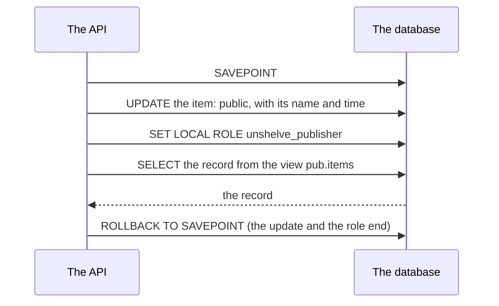
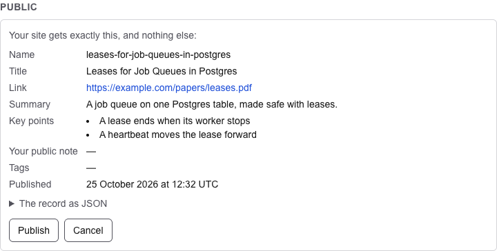
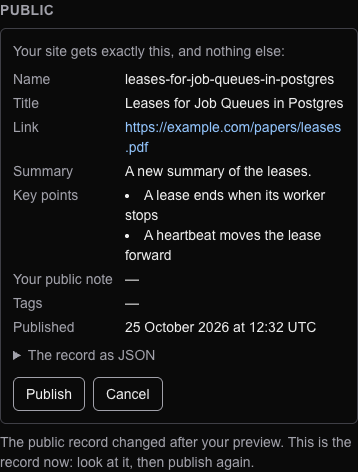

# 45. Publishing an item, with its preview

> Pull requests: [#112](https://github.com/herman72/unshelve/pull/112) (the API), [#113](https://github.com/herman72/unshelve/pull/113) (the web app), [#114](https://github.com/herman72/unshelve/pull/114) (a new publication after the worker) · Code: [`publish/visibility.py`](../../apps/api/src/unshelve/publish/visibility.py), [`api/item_views.py`](../../apps/api/src/unshelve/api/item_views.py), [`publish-panel.tsx`](../../apps/web/src/components/publish-panel.tsx) · Tests: [`tests/api/test_visibility.py`](../../apps/api/tests/api/test_visibility.py), [`tests/publish/test_slug.py`](../../apps/api/tests/publish/test_slug.py), [`e2e/publish.spec.ts`](../../apps/web/e2e/publish.spec.ts)

## In one minute

Before an item becomes public, you see its public record exactly as the feed will hold it. Then you confirm that record, and only that record.

A test asked for the preview of a private item (`GET /api/v1/items/{id}/public-preview`). This is the real answer:

```json
{
  "id": "leases-for-job-queues-in-postgres",
  "kind": "article",
  "title": "Leases for Job Queues in Postgres",
  "url": "https://example.com/leases",
  "author": "A. Made-up",
  "site": "example.com",
  "lang": "en",
  "summary": "A job queue on one Postgres table, made safe with leases.",
  "key_points": ["A lease ends when its worker stops"],
  "est_minutes": 14,
  "note": "Worth a read before the design review.",
  "published_at": "2026-10-25T12:13:57Z",
  "tags": ["databases"]
}
```

The item also has a private note and a private tag. Neither is in the preview, because the preview comes from the public view.

To publish, the client sends this record back: `PUT /api/v1/items/{id}/visibility` with `{"visibility": "public", "record": {...}}`. In the test, the worker wrote a new summary between the preview and the click. The answer was:

```text
409 Conflict: the public record changed after the preview: look at the new preview
```

With a new preview, the same request answered `200`, and the item was public.

## 1. The preview is a publication that is rolled back

The preview does not copy the rules of the public view into Python. It uses the view itself:



A *savepoint* is a mark inside a transaction. A rollback to it removes each change after the mark, and keeps the transaction open. We checked that it also ends the role: after the rollback, `current_user` is `unshelve` again.

So the preview and the feed come from one path, the path of [note 42](42-public-feed.md): the view, the role and `FIELDS`. A second copy of these rules could drift away from them; one path cannot.

**A comparison from daily life:** you try on a coat in the shop. You see the real coat on you, and you take it off before you leave. Nothing is sold until you pay.

## 2. You publish exactly what you saw

The client sends back the record of the preview. The server makes the record again, by the same path, and compares the two as bytes of the feed:

| Time | The owner | The worker |
|---|---|---|
| 1 | asks for the preview: summary A | |
| 2 | | writes summary B (a new enrichment) |
| 3 | clicks "publish" with summary A | |
| 4 | gets 409; nothing is written | |
| 5 | asks again, sees summary B, publishes | |

This is *optimistic concurrency*: do not lock while the person reads, but check at the write that nothing changed. [Note 43](43-git-target.md) has the same idea in git: a push must build on the commit that you fetched.

The same check also keeps the time honest. A preview gives the time of the publication, and a preview that is more than an hour old (or from the future) is a 409: "the preview is more than an hour old: look at a new preview".

## 3. A name and a time, for good

On its first publication, an item gets a public name (`public_slug`) and a time (`published_at`). It keeps both for good: made private and public again, it comes back under the same name and with the first time. So a link to it never moves, and a reader does not see an old item as new.

| Title | Name |
|---|---|
| Leases for Job Queues in Postgres | `leases-for-job-queues-in-postgres` |
| صف کارها در پستگرس | `صف-کارها-در-پستگرس` |
| C++ & Rust: 2026 | `c-rust-2026` |
| `!!!` or no title | `item` |
| the same title as another item | `leases-for-job-queues-in-postgres-2` |

A name is lowercase words of any script, joined by single hyphens, at most 60 characters. A Persian title keeps its letters. A name is unique among all items, also private ones.

The time is the time of the preview, to the second, in UTC, because the feed writes each time in that one form.

## 4. One publish job for a series of changes

Each change of visibility queues one publish job for the owner. The job waits 30 seconds, and while it waits, a new change adds no second job (its *dedupe key* is `feed:<owner>`). So three clicks in a row give one publish, and with the git target, one commit.

The worker can change a public item too. After "Process again", a public item gets a new card: a new summary, new key points, new tags. Its public record changes, so the feed must follow. The embed step is the step that makes an item ready, and in the same transaction it queues the same publish job when the item is public. New vectors alone (from a new embedder) change no field of the record, so they queue nothing.

## 5. The rules of the API

| Request | Answer |
|---|---|
| A preview | 200 with the record; nothing is saved |
| Publish with the record of the preview | 200 with the record; the item, an event and one job are saved together |
| The record changed after the preview | 409, and nothing changes |
| A preview more than an hour old, or from the future | 409 |
| Publish without the record | 422 |
| A copy of another item | 409: "the item is a copy of item 7: publish that one" |
| Make the item private | 200; the name and the time stay; one job |
| The same visibility again (a second click) | 200, and nothing changes |
| Two clicks at the same moment | one of them waits for the lock of the row, then finds the item public: one event |
| An item of another owner | 404 |

## 6. The button in the web app

The page of an item has a section "Public". For a private item, the button "Preview the public record" shows the record, field by field, and the record as JSON:



The private note ("Read before the design review.") and the private tag ("queues") of this item are not in the record, so the page does not show them here. "Publish" sends this record back. When the record changed in between, the panel shows the record of now, and you look again:



A public item shows its name and its time ("Public as leases-for-job-queues-in-postgres since 20 October 2026 at 08:00 UTC") and the button "Make private". A copy shows "A copy is not published. Publish item 1 instead."

## A choice that we made

**The preview by the view itself, in a savepoint.**

| | A savepoint with the view (this branch) | A copy of the rules in Python | A second view for previews |
|---|---|---|---|
| One source of the rules | yes | no: two copies that can drift | no: two views that can drift |
| Private columns can leak by mistake | no: the publisher role reads only the view | yes, if the copy is wrong | no |
| Cost | one UPDATE and one SELECT, rolled back | one SELECT | one SELECT |

**The record in the request, not an ETag.** HTTP has a standard form of the same check: `ETag` and `If-Match`. But the time of a first publication is in the record, and the server must know which time the owner saw. With the record in the request, the server knows it, and it can compare everything.

## What a senior engineer checks here

- **Does a preview write anything?** No: a test checks the item, the events, the jobs and the feed after a preview.
- **Can the role leak out of the preview?** No: the rollback to the savepoint ends it. We checked this in `psql`, and the tests use the same session after a preview.
- **Can a stale preview publish a record that the owner did not see?** No: 409. A planted mistake that removes the comparison makes exactly one test fail, the one with a change in between. The acceptance test alone would not see it.
- **Can the tests fail?** Yes: 29 typical mistakes in the API, and 4 in the new publication after the worker, one at a time; each one made a named test fail.
- **Does the page send exactly the record that it shows?** Yes: an end-to-end test reads what the pretend API got, and another one changes the item between the preview and the click.
- **What is not done:**
  - editing the public note: `PATCH /items/{id}` is still a stub.

## Exercise (10 minutes)

1. In `apps/api/src/unshelve/publish/visibility.py`, in `publish`, change `if feed.feed_bytes([record]) != feed.feed_bytes([seen]):` to `if False:`.
2. Run the tests of the API in `apps/api`:

```bash
uv run pytest tests/api/test_visibility.py -q
```

How many tests fail? Why does the acceptance test still pass?

<details>
<summary>The answer</summary>

One test fails: `test_a_record_that_changed_after_the_preview_is_a_409_and_nothing_changes`. The 21 others pass.

The acceptance test publishes the record of the preview with no change in between, so the comparison does not matter there. The rule "you publish exactly what you saw" matters only when something changes between the two clicks, so it needs a test that makes that change.

</details>

## Words used in this note

| Word | Meaning |
|---|---|
| Savepoint | A mark inside a transaction: a rollback to it removes the changes after it, and keeps the transaction |
| Optimistic concurrency | No lock while a person reads; a check at the write that nothing changed |
| Slug (public name) | The short name of an item in the feed and in links |
| Dedupe key | A key that makes a second waiting job of the same work unnecessary |

## To read more

- [SAVEPOINT](https://www.postgresql.org/docs/current/sql-savepoint.html), PostgreSQL documentation. Read the description and the first example: a rollback to a savepoint removes only the later changes.
- [HTTP conditional requests](https://developer.mozilla.org/en-US/docs/Web/HTTP/Guides/Conditional_requests), MDN. Read "Avoiding the lost update problem with optimistic locking": the same idea with `ETag` and `If-Match`.

Previous: [44. Publishing to object storage](44-object-storage-target.md) · Back to the [list of notes](README.md)
