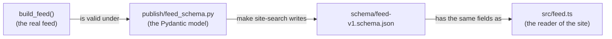
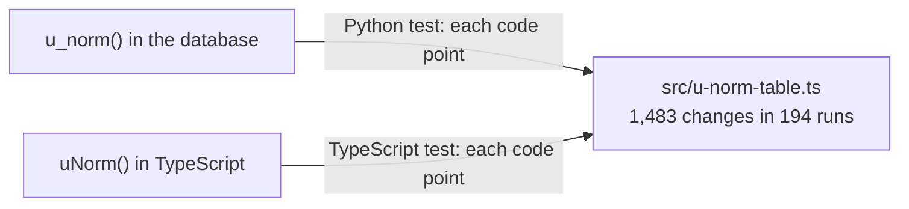
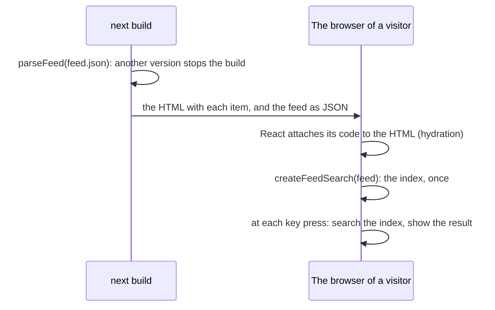
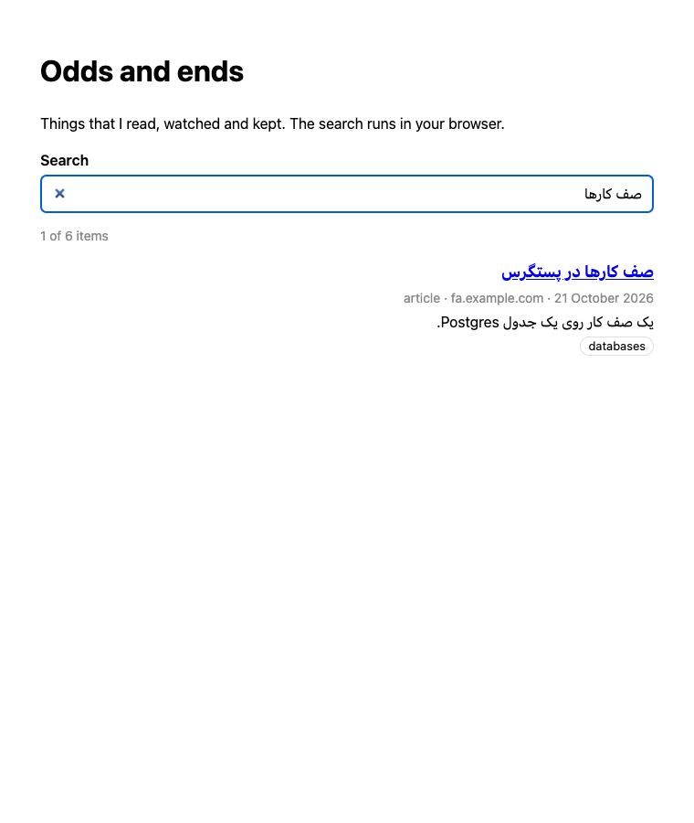
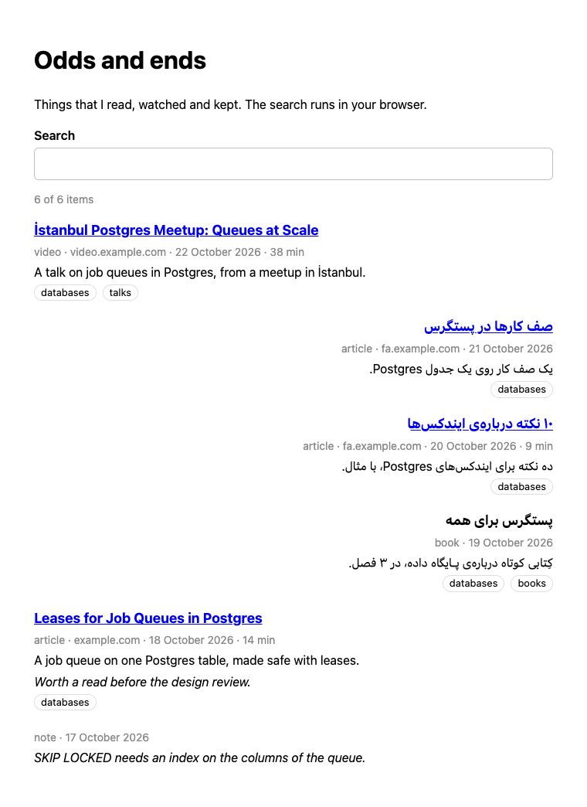

# 46. Searching the feed on the site

> Pull requests: [#115](https://github.com/herman72/unshelve/pull/115) (the schema of the feed, the normalisation and the search), [#116](https://github.com/herman72/unshelve/pull/116) (the component and the example site) · Code: [`publish/feed_schema.py`](../../apps/api/src/unshelve/publish/feed_schema.py), [`packages/site-search/src`](../../packages/site-search/src), [`examples/site`](../../examples/site) · Tests: [`tests/publish/test_site_search.py`](../../apps/api/tests/publish/test_site_search.py), [`packages/site-search/test`](../../packages/site-search/test), [`examples/site/e2e`](../../examples/site/e2e)

## In one minute

A visitor of the site types `صف كارها` on an Arabic keyboard. The title in the feed is `صف کارها در پستگرس`. The two texts look the same, but they are not: the keyboard gives the Arabic kaf (U+0643), and the title has the Persian kaf (U+06A9).

The search in the browser finds the item. Before it compares two texts, it changes both with `uNorm()`, a copy of `u_norm()` of the server ([note 3](03-database-schema.md)):

| Text | `uNorm()` gives | The rule |
|---|---|---|
| `صف كارها`, with the Arabic kaf | `صف کارها`, with the Persian kaf | Arabic letter forms become the Persian forms |
| `İSTANBUL` | `istanbul` | the dotted capital I becomes a plain i |
| `۱۰ نکته` | `10 نکته` | Persian digits become ASCII digits |

The search needs no server. The site reads `feed.json`, and the browser makes the index of the search. This note has five parts: the version of the feed, one normalisation in two languages, the search, the component on a page, and how to add the search to a site.

## 1. The feed has a version and a schema

Each feed starts with its version:

```json
{
  "version": 1,
  "items": [ ... ]
}
```

A *JSON Schema* is a JSON file that describes which JSON is valid. The file [`schema/feed-v1.schema.json`](../../packages/site-search/schema/feed-v1.schema.json) describes version 1: the 13 fields of a record, the type of each field, and the fields that can be null. For example, `published_at` must match `^[0-9]{4}-[0-9]{2}-[0-9]{2}T[0-9]{2}:[0-9]{2}:[0-9]{2}Z$`: a time in UTC, to the second.

The version tells a site whether it can read a feed:

| A change in the feed | The version | Why |
|---|---|---|
| A new field, for example `reading_list` | stays 1 | an old reader ignores the field |
| A new kind of item, for example `podcast` | stays 1 | an old reader shows the kind as text |
| A field is removed, or it gets a new name | 2 | an old reader does not find a field that it needs |
| A field gets another type, for example the minutes as text | 2 | an old reader reads a wrong value |

A reader that ignores the fields that it does not know is a *tolerant reader*. So the schema does not forbid a new field, and `parseFeed()` leaves a new field out. A feed of version 2 stops `parseFeed()` with a clear message:

```text
FeedError: The feed has version 2; this reader knows 1 only.
```

**A comparison from daily life:** the post office prints a new form with one more box. An old clerk ignores the new box and still sends the letter. If the box of the address moves, the old clerk sends the letter to a wrong place. A new box is a new field; a moved box is a new version.

### One source for the schema

Nobody writes the schema by hand. A Pydantic model in `publish/feed_schema.py` makes it, and three tests keep the parts together:



1. A Python test compares the schema file with the model. When the model changes, the test fails until `make site-search` writes the file again.
2. A Python test reads a real feed, written by `build_feed()`, and validates it with the model.
3. A TypeScript test reads the schema file. It compares the fields, their order, and the fields that can be null with the reader.

## 2. One normalisation, in two languages

*Normalisation* changes a text to one form before a comparison. On the server, the SQL function `u_norm()` does it for each search, in three steps:

1. `translate()` changes the Arabic letter forms and the Persian and Arabic-Indic digits, and it changes the zero-width non-joiner to a space.
2. `regexp_replace()` removes the diacritics, the tatweel and the zero-width joiner.
3. `lower()` makes small letters.

The first idea for the browser was `toLowerCase()` of JavaScript, with the first two steps written again. A test with each character showed that `toLowerCase()` is not the same as `lower()` of the database:

| Text | `u_norm()` of the server | `toLowerCase()` of JavaScript |
|---|---|---|
| `İSTANBUL` | `istanbul` | `i̇stanbul`: an i and a dot above it, 9 characters |
| `ΣΑΣ` | `σασ` | `σας`: the last sigma gets its form for the end of a word |
| `Ᲊ` (U+1C89, a letter of a recent Unicode version) | `Ᲊ`: no change | `ᲊ` |

With `toLowerCase()`, a search for `istanbul` does not find `İstanbul`.

### Each character, in one second

`u_norm()` changes one character at a time:

- `translate()` replaces each character alone.
- `regexp_replace()` removes each character of a set alone.
- `lower()` uses the C library (glibc) of the database, and it also changes each character alone. A test checks that the database uses this *libc provider*. The other provider, ICU, looks at a whole word.

So, if two functions give the same result for each character, they give the same result for each text. A *code point* is the number of a character in Unicode, for example U+0643. Postgres can store 1,112,063 code points, and a computer checks all of them in about one second.

`u_norm()` changes 1,483 of them. The file [`src/u-norm-table.ts`](../../packages/site-search/src/u-norm-table.ts) lists these changes as 194 *runs*. A run is a group of characters that change in the same way:

```ts
[0x41, 0x5a, 1, 32],     // A to Z: each code point + 32, so A (0x41) becomes a (0x61)
[0x100, 0x12e, 2, 1],    // Ā ā Ă ă ...: each second code point + 1, so Ā becomes ā
[0x64b, 0x65f, 1, null], // the Arabic diacritics: removed
```

`uNorm()` is only this table. Two tests check the table from its two sides:



Also, 16 shared cases in [`test/u-norm-cases.json`](../../packages/site-search/test/u-norm-cases.json) are checked in the two languages. They show the rules with real words, for example `کِتابُ` becomes `کتاب`.

**A comparison from daily life:** two translators use one dictionary, and they translate word by word. Then they give the same translation of each sentence. The tests check each word of the dictionary, in the two offices.

## 3. The search in the browser

`createFeedSearch(feed)` makes an *index*: a map from each word to the records that have it. The index is made with [MiniSearch](https://lucaong.github.io/minisearch/), a small library with no dependencies.

The steps have the order of the server: first the whole text is normalised, then it is split into words. The order is important for the *zero-width non-joiner* (ZWNJ). A ZWNJ is an invisible character that keeps two Persian letters apart without a space, as in `ایندکس‌ها`. `u_norm()` makes it a space, so `ایندکس‌ها` is two words. A visitor who types `ایندکس ها`, with a space, finds the item.

Each word of the query must be in the record (the rule AND). A word of the query also finds the words that start with it: this is a *prefix search*. So `queu` finds `queue` and `queues`. A word in the title counts two times as much as the same word in another field.

The normalisation is the same as on the server, but the search is not:

| | The search of the app ([note 38](38-search-api.md)) | The search of the site |
|---|---|---|
| Normalisation | `u_norm()` | `uNorm()`, with the same table |
| A word with another ending | the English stemmer: `queues` finds `queue` | the start of a word: `queue` finds `queues`, but `queues` does not find `queue` |
| A word with a typo | trigrams of the title can find it | not found |
| The meaning of a query | vectors | none |
| What is searched | the card and the saved text of an item | the public record only |

[ADR 0004](../adr/0004-public-data-is-a-pushed-static-subset.md) accepted this difference: keyword search over a few hundred items is enough for the site.

## 4. The component on a page

The package has a React component, `<FeedSearch>`. The example site in [`examples/site`](../../examples/site) uses it as mattsh.dev will. This is its page, shortened:

```tsx
import { parseFeed } from "@unshelve/site-search";
import { FeedSearch } from "@unshelve/site-search/react";
import data from "@unshelve/site-search/fixtures/feed.json";

const feed = parseFeed(data);

export default function OddsAndEnds() {
  return <FeedSearch feed={feed} />;
}
```

The work happens at two times: once when the site is built, and again in the browser of each visitor.



1. When the site is built, the page reads `feed.json` and calls `parseFeed()`. A feed of a version that the site does not know stops the build. So a visitor never sees a page made from a feed that the site cannot read.
2. Next.js writes the page as HTML, with each item. So a visitor without JavaScript sees the list too. Only the search needs JavaScript.
3. In the browser, React attaches its code to that HTML. This step is *hydration*. Then the component makes the index, once.
4. At each key press, the component searches the index and shows the result. No request goes to a server.

A visitor types `صف كارها`, with the Arabic kaf:



Each result shows its title, its facts (kind, site, date, minutes), its summary, the public note and the tags. Three details keep it safe and readable:

- **A link only to a web address.** `safeLink()` gives a link only for an `http` or `https` address. A feed with `javascript:alert(1)` gets a title with no link. The server writes only web links, so this is a second guard, at the place where the link becomes an `<a>`.
- **The direction of each result.** `dir="auto"` lets the browser choose the direction from the first letter: a Persian item reads from right to left, an English one from left to right.
- **The date in UTC.** The component writes each date in UTC, on the server and in the browser. In another time zone, the browser would write another day than the server, and React would report a *hydration mismatch*: the HTML of the server is not what the browser makes. The tests run the browser in the time zone of Honolulu, where 07:00 UTC is 21:00 of the day before, to catch this.

The component has no style of its own. Each class name starts with `unshelve-search`, so the site gives it its own style. The example has 58 lines of CSS for it:



**A comparison from daily life:** a printed catalogue with an index at the back. The shop prints it once. Then each reader looks up a word in the index, and nobody calls the shop.

## 5. How to add the search to a site

The example site does the three steps that a site needs:

1. **Compile the package.** The package exports TypeScript, not JavaScript. So `next.config.ts` has `transpilePackages: ["@unshelve/site-search"]`.
2. **Allow imports with `.ts`.** `tsconfig.json` has `"allowImportingTsExtensions": true`. The files of the package import each other with `.ts`, so that Node can run their tests with no build step. Without this line, `tsc` gives the error TS5097 for each of these imports. TypeScript allows the line only when it writes no JavaScript (`"noEmit": true`), and the `tsconfig.json` of Next.js has that.
3. **Show the feed.** A page imports `feed.json`, calls `parseFeed()`, and shows `<FeedSearch feed={feed} />`. With the git target ([note 43](43-git-target.md)), the worker commits `feed.json` into the repository of the site, and each commit starts a new build of the site.

How the package itself gets into the repository of the site is still open: a copy of `packages/site-search`, or a dependency on this repository. The answer depends on the repository and the hosting of the site.

## A choice that we made

**The table of the database, not `toLowerCase()`.**

| | The table of the database (this branch) | `toLowerCase()` and a list of exceptions | The server changes to the rules of ICU |
|---|---|---|---|
| The same as the server for each character | yes: tested for each one | no: it depends on the Unicode version of the browser (56 different characters in Node 26) | yes, after the change |
| Cost in the browser | 194 runs: 5.8 KB of source | none | none |
| Work | a test writes the table | a list that a person keeps up to date | a migration, new indexes and new tests of the search |

**An example site, not a page of the web app.**

| | `examples/site` (this branch) | A page of the web app |
|---|---|---|
| Like the real site | yes: a Next.js app of its own, with nothing else | no: the web app has its login, its API proxy and its own settings |
| Proves the three steps of part 5 | yes: its build fails without them | no: the web app is set up differently |
| Cost | one more build and one more job in CI | none |

## What a senior engineer checks here

- **Is `u_norm()` really one character at a time?** Yes, with the libc provider. A test fails when the database uses another provider, because then the table is not the whole function.
- **What happens when the Postgres image gets a new C library?** `u_norm()` is declared `IMMUTABLE`, but `lower()` reads the case table of glibc. A newer glibc knows more letters. Then the generated columns and the indexes that use `u_norm()` hold old results. PostgreSQL 15 and later records the version of the C library for each database and warns when it changes, but it does not repair an index. The Python test fails on the first run with the new image: that is the signal to run `REINDEX` and to write the table again.
- **Can a feed put a script into the page?** No. React writes each text as text, and only a web address becomes a link. An end-to-end test shows a feed with a `javascript:` address, a `data:` address and an address on the site itself: only the web address becomes a link.
- **Does the page work without JavaScript?** The list, yes: the HTML of the example holds each of the 6 items, in 11.5 KB. The search, no: it runs in the browser.
- **Does the fixture feed come from the real code?** Yes: `build_feed()` of the server writes [`fixtures/feed.json`](../../packages/site-search/fixtures/feed.json), and a test fails when the file is old.
- **Can the tests fail?** Yes. In the schema, the normalisation and the search: 29 typical mistakes, one at a time. The first run caught 26. The 3 misses were real gaps: minutes that are not whole, a title that is a number, and the weight of the title. Each one has a test now, and each of the 29 makes a named test fail. In the component and the example site: 9 typical mistakes, one at a time. The first run caught 8. The miss was a real gap: the browser of the tests was in Los Angeles, where 07:00 UTC is still the same day in October (summer time). The browser is in Honolulu now, and each of the 9 makes a named test fail.
- **What is not done yet:** the search on mattsh.dev itself. It needs the repository of the site.

## Exercise (10 minutes)

1. In `packages/site-search/src/search.ts`, change `tokenize: words,` to `tokenize: split,` and `processTerm: (word) => word,` to `processTerm: uNorm,`. Now the text is split first, and each word is normalised after.
2. Run the tests of the package:

```bash
pnpm --filter @unshelve/site-search test
```

Which test fails? Why does the test with `درباره‌ی` in the query still pass?

<details>
<summary>The answer</summary>

One test fails: "a query with a space finds two words joined by a zero-width non-joiner". The splitter of MiniSearch does not split at a ZWNJ, so `ایندکس‌ها` stays one word, and `uNorm()` makes it the one word `ایندکس ها`, with a space inside. The query `ایندکس ها` has two words, and the second word, `ها`, is not the start of any word of the item.

The test with `درباره‌ی` still passes, because the query and the text both keep `درباره‌ی` as one word. Only a query with a space, against a text with a ZWNJ, shows the difference. So a test must type what a visitor types, not a copy of the text.

</details>

## Words used in this note

| Word | Meaning |
|---|---|
| JSON Schema | A JSON file that describes which JSON is valid |
| Tolerant reader | A reader that ignores the fields that it does not know |
| Normalisation | A change of a text to one form, before a comparison |
| Code point | The number of a character in Unicode, for example U+0643 |
| Run (of the table) | A group of characters that change in the same way |
| Zero-width non-joiner (ZWNJ) | An invisible character that keeps two Persian letters apart without a space |
| Index (of a search) | A map from each word to the records that have it |
| Prefix search | A word of the query also finds the words that start with it |
| Hydration | React attaches its code to the HTML that the server made |
| Hydration mismatch | The HTML of the server is not what the browser makes from the same data |

## To read more

- [Tolerant Reader](https://martinfowler.com/bliki/TolerantReader.html), Martin Fowler. Read the whole page: it is short. It says why a reader takes only what it needs from a message.
- [Locale data changes](https://wiki.postgresql.org/wiki/Locale_data_changes), PostgreSQL wiki. Read the first part: an update of glibc changed the sort order of text and made indexes wrong. Our case is the case table of `lower()`, not the sort order, but the danger is the same.
- [MiniSearch](https://lucaong.github.io/minisearch/), the documentation. Read "Tokenization" and "Term processing": the two places where this package puts `uNorm()`.
- [hydrateRoot](https://react.dev/reference/react-dom/client/hydrateRoot), React documentation. Read the pitfall in "Hydrating server-rendered HTML": the browser must make the same output as the server.

Previous: [45. Publishing an item, with its preview](45-publishing-an-item.md) · Back to the [list of notes](README.md)
