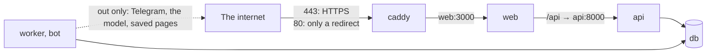

# 47. Running Unshelve on a server

> Pull request: [#117](https://github.com/herman72/unshelve/pull/117) · Guide: [`docs/quickstart.md`](../quickstart.md) · Code: [`compose.prod.yaml`](../../compose.prod.yaml), [`deploy/compose.prod.yaml`](../../deploy/compose.prod.yaml), [`deploy/Caddyfile`](../../deploy/Caddyfile), [`deploy/check-instance.sh`](../../deploy/check-instance.sh) · Tests: [`tests/deploy/test_production_compose.py`](../../apps/api/tests/deploy/test_production_compose.py), the CI jobs `quickstart-local` and `quickstart-server`

## In one minute

On a server, the [quickstart](../quickstart.md) needs four steps after `git clone`, and then this check passes:

```text
$ deploy/check-instance.sh https://unshelve.example.com
ok: https://unshelve.example.com/api/v1/readyz answers
ok: a sign-in link gives a session
ok: the session cookie is Secure
ok: a browser keeps to HTTPS for this name (HSTS)
ok: http://unshelve.example.com/ sends the browser to https://unshelve.example.com/
```

CI runs each step of the guide on a fresh clone, as written, with `localhost` as the domain. The first local run of these steps found a bug that was 10 days old: the example settings in `.env.example` stopped the stack at its first start (part 4).

The stack on a server has one open door:



Only Caddy has a published port. The database, the API and the web app have none, also not on `127.0.0.1`. The bot and the worker only make connections out ([ADR 0008](../adr/0008-long-polling-and-bot-issued-login-links.md)).

## 1. One stack, with a short list of changes

The stack of [`deploy/compose.yaml`](../../deploy/compose.yaml) runs on a laptop. For a server, [`deploy/compose.prod.yaml`](../../deploy/compose.prod.yaml) lists only what is different, and the file `compose.prod.yaml` at the root joins the two:

```yaml
include:
  - path:
      - deploy/compose.yaml
      - deploy/compose.prod.yaml
```

The second file changes three things. Two of them are in these lines:

```yaml
x-required:
  - ${UNSHELVE_DB_PASSWORD:?set UNSHELVE_DB_PASSWORD in .env, see docs/quickstart.md}

services:
  db:
    ports: !reset []
```

1. **No port.** Compose adds the lists of two files together, so a second file cannot remove a port in the normal way. The tag `!reset []` empties the list of the first file.
2. **No default password, and no default domain.** `${NAME:?message}` stops Compose when the value is missing or empty, with the message. No service uses the field `x-required`, but Compose fills it in too, so it stops there. The services get the password from `deploy/compose.yaml`, whose default `unshelve` never applies on a server. The domain has the same check where the services use it. Without a domain, `docker compose up` prints this, and starts nothing:

   ```text
   error while interpolating services.api.environment.UNSHELVE_WEB_BASE_URL: required variable UNSHELVE_DOMAIN is missing a value: set UNSHELVE_DOMAIN in .env, see docs/quickstart.md
   ```

3. **The `https://` address.** `UNSHELVE_WEB_BASE_URL` is `https://` and the domain. The sign-in links point there, and the API gives the session cookie the *Secure* flag: a browser sends such a cookie only over HTTPS, never over plain HTTP.

`COMPOSE_FILE=compose.prod.yaml` in `.env` makes each `docker compose` command in the folder use this stack. So the commands on the server are the same as on a laptop.

**A comparison from daily life:** a house has one plan. For the rental version, the owner writes a short list of changes ("a lock on the cellar door"), not a second plan. A second plan would drift away from the first one.

## 2. Caddy: one door, with HTTPS by itself

A *reverse proxy* is a server that takes each request from outside and passes it to the right service inside. Caddy is the reverse proxy here, and its [`Caddyfile`](../../deploy/Caddyfile) has one site:

```text
{$UNSHELVE_DOMAIN} {
	encode zstd gzip
	header { Strict-Transport-Security "max-age=31536000" ... }
	reverse_proxy web:3000
}
```

For a public name, Caddy gets a certificate by itself:

1. It asks Let's Encrypt for a certificate, with *ACME*: the protocol that lets a program get a certificate with no person in the loop.
2. Let's Encrypt asks for proof that the server controls the name: a file on port 80, or a special answer on port 443.
3. Caddy keeps the certificate in the volume `caddy-data`, and renews it before it ends.

Keep that volume. Let's Encrypt gives at most 5 certificates for the same names in 7 days. A stack that lost its certificates at each restart would soon get none.

Port 80 is open only for the proof and for a redirect: Caddy answers each plain HTTP request with `308` and the same address with `https://`. The header *HSTS* (`Strict-Transport-Security`) tells a browser to use only HTTPS for this name, for a year.

For `localhost`, no public authority can give a certificate. So Caddy makes one with its own local authority. CI uses this: it reads the root certificate of that authority from the container, and `curl` trusts it, as the browser of the owner would.

**A comparison from daily life:** a hotel has one reception. A guest does not walk from the street to a room. The reception checks each guest and shows the way. The rooms (the database, the API) have no door to the street.

## 3. A guide that CI runs

A guide that nobody runs breaks without a sound. A setting changes, a step goes missing, and the next person on a new server finds it.

So the guide marks each step that a person runs:

````markdown
```bash quickstart-server
docker compose up -d --build --wait
```
````

GitHub shows such a block as normal bash. [`deploy/quickstart-steps.sh`](../../deploy/quickstart-steps.sh) prints the blocks of one mark, in their order, and removes the indentation of a block in a list, as GitHub does. The two quickstart jobs of CI run them on the fresh checkout:

| Job | Steps | Then it checks |
|---|---|---|
| `quickstart-local` | A of the guide: settings, start, a sign-in link | `check-instance.sh http://localhost:3000` |
| `quickstart-server` | B of the guide, with the domain `localhost` | `check-instance.sh https://localhost`, with the local authority of Caddy; and that the ports 3000, 8000 and 54329 are closed |

[`deploy/check-instance.sh`](../../deploy/check-instance.sh) uses the instance as a person does: it asks for a sign-in link, signs in with it, and reads `/api/v1/me` with the session. A person can run it too, after the steps.

**A comparison from daily life:** a cook tests a recipe each week, exactly as it is written on the card. When a step does not work, the card changes, not only the cook's memory.

## 4. The bug that the guide found

The first local run of the steps of B stopped at the service `migrate`:

```text
ValidationError: 1 validation error for Settings
embed_dim
  Input should be 256, 512, 1024 or 2048 [type=literal_error, input_value='1024', input_type=str]
```

The quickstart copies `.env.example` to `.env`, and `.env.example` sets `UNSHELVE_EMBED_DIM=1024` since 2026-10-15. An environment variable is always text. The setting is a choice of four numbers (`Literal[256, 512, 1024, 2048]`), and for such a choice pydantic compares the input with each number, but it does not change the text `"1024"` into the number `1024`. So each fresh clone stopped at its first start. CI did not see it, because the old stack job started without a `.env`. The instance of the owner did not see it either: its `.env` is older than that line.

The fix changes text of digits into its number before the choice (`_number_from_text` in `config.py`). Two new tests keep it: a vector size from the environment, and the example settings as valid settings.

## 5. Fast tests and slow tests

| | [`tests/deploy/test_production_compose.py`](../../apps/api/tests/deploy/test_production_compose.py) | The quickstart jobs of CI |
|---|---|---|
| What runs | `docker compose config`: the files after Compose joined and filled them | the real stack: images, containers, Caddy, a sign-in |
| Time | less than 1 second for 7 tests | a few minutes |
| What it finds | a port, a missing password check, a wrong address, a log without rotation | each step that does not work on a fresh machine |

The fast tests copy the Compose files to a new folder first, so Compose reads no `.env` of the checkout, and no secret of the developer reaches a test.

## A choice that we made

**Caddy in front of the web app.**

| | Caddy (this branch) | nginx and certbot | Traefik |
|---|---|---|---|
| Certificates | gets and renews them by itself | a second program and a timer | gets and renews them by itself |
| The configuration here | one site, 15 lines | a site, a renewal job and a reload | labels on each container |
| Redirect from HTTP to HTTPS | by default | written by hand | written as labels |

The hosting itself (which server, which provider) is a later decision record: #42.

## What a senior engineer checks here

- **Which ports are open?** Only 80 and 443, of Caddy. A fast test checks the resolved stack, and the CI job tries ports 3000, 8000 and 54329 on the runner.
- **Can a server start with a weak setting?** No: without a domain or a database password, Compose stops before it starts anything.
- **Does a secret scanner see a password?** GitGuardian saw two in the first version of this pull request: the check of the password, with its message, was inside the address of the database and in `POSTGRES_PASSWORD`. The scanner took the message for a password. These were false findings, but each false finding costs a person time, and too many of them teach people to ignore the scanner. Now the check is in the field `x-required`, in no password position, and the services get exactly the same values as before.
- **Where are the secrets?** In `.env` on the server, and step 3 lets only the owner read it (`chmod 600 .env`). The password is in the database address, so it has letters and digits only (`openssl rand -hex 24`).
- **What does Postgres do with a new password?** Nothing: it reads `POSTGRES_PASSWORD` only for a new volume. The guide shows how to change it in the database and in `.env`.
- **Can the logs fill the disk?** No: Docker keeps 5 files of 10 MB for each service.
- **What is not done yet:** backups and a restore drill (#40), logs and costs as numbers (#41), and the decision about the hosting (#42). Until #40, the data lives only in the volumes of one server.

## Exercise (10 minutes)

1. In `deploy/compose.prod.yaml`, remove the line `ports: !reset []` of the service `db`.
2. Run the fast tests in `apps/api`:

```bash
uv run pytest tests/deploy -q
```

Which test fails, and which port does it show? Why is a second file not enough to remove a port without `!reset`?

<details>
<summary>The answer</summary>

`test_only_caddy_has_a_port_and_it_has_80_and_443` fails: the database publishes `127.0.0.1:54329` again. Compose merges two files, and for a list such as `ports` it adds the entries of the second file to the entries of the first one. An empty list in the second file adds nothing. Only `!reset []` empties the list.

</details>

## Words used in this note

| Word | Meaning |
|---|---|
| Reverse proxy | A server that takes each request from outside and passes it to the right service inside |
| ACME | The protocol that lets a program get a certificate from an authority, such as Let's Encrypt, with no person in the loop |
| HSTS | A header that tells a browser to use only HTTPS for a name, for a time |
| Secure cookie | A cookie that a browser sends only over HTTPS |
| Override file | A second Compose file that lists only the changes to the first one |
| Interpolation | Compose puts the values of variables into the files, for example `${UNSHELVE_DOMAIN}` |

## To read more

- [Merge Compose files](https://docs.docker.com/reference/compose-file/merge/), Docker documentation. Read "Reset value": how `!reset` empties a list of the first file.
- [Automatic HTTPS](https://caddyserver.com/docs/automatic-https), Caddy documentation. Read the first part: when Caddy uses Let's Encrypt, and when its local authority.
- [Rate limits](https://letsencrypt.org/docs/rate-limits/), Let's Encrypt. Read the limit for the same set of names: why the volume `caddy-data` must stay.

Previous: [46. Searching the feed on the site](46-site-search.md) · Back to the [list of notes](README.md)
