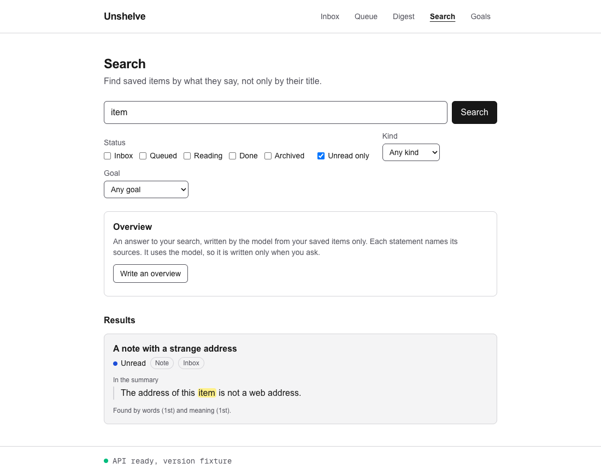
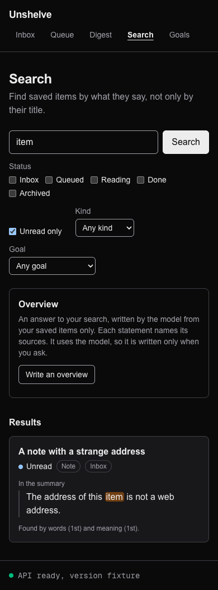
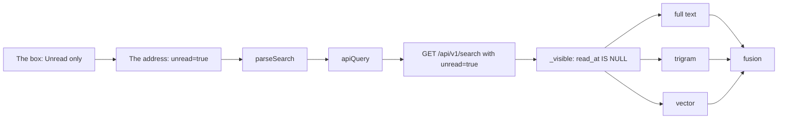

# 48. Unread only

> Pull request: [#118](https://github.com/herman72/unshelve/pull/118) · Code: [`search/retrievers.py`](../../apps/api/src/unshelve/search/retrievers.py), [`api/search_views.py`](../../apps/api/src/unshelve/api/search_views.py), [`lib/search.ts`](../../apps/web/src/lib/search.ts), [`components/search-form.tsx`](../../apps/web/src/components/search-form.tsx) · Tests: [`tests/search/test_retrievers.py`](../../apps/api/tests/search/test_retrievers.py), [`tests/api/test_search.py`](../../apps/api/tests/api/test_search.py), [`tests/api/test_overview.py`](../../apps/api/tests/api/test_overview.py), [`e2e/search.spec.ts`](../../apps/web/e2e/search.spec.ts)

## In one minute

Before, each hit of the search page had a read mark ("● Unread" or "✓ Read on …"). But the page also showed the items that you read. When you read many items about one topic, they pushed the unread items down.

Now the form has a box "Unread only". The made-up items of the tests show it. A search for "item" finds item 5, which you never read, and item 1000, which you read on 18 October 2026:

```text
/search?q=item              → A note with a strange address   ● Unread
                              Item one thousand               ✓ Read on 18 Oct 2026

/search?q=item&unread=true  → A note with a strange address   ● Unread
```





## 1. Read is a time, not a status

An item is read when it has a read time (`read_at`). The API writes the time when the item moves to "done" ([note 30](30-reading-status.md)). It keeps the time when the item moves on.

An API test moves the job queue of the made-up items through three steps:

| Step | `status` | `read_at` |
|---|---|---|
| You save it | `inbox` | `null` |
| You read it | `done` | the time of the move |
| You queue it, to read it again | `queued` | the same time |

After the last step, a search for "postgres" with `unread=true` does not find the job queue, but a search with `status=queued` finds it. So "unread" is not "each status except done". An item that you archived without reading it is unread too.

**A comparison from daily life:** a stamp in a passport. The stamp says that you were in a country. It stays when you go home: it tells where you were, not where you are now.

## 2. One condition for the three retrievers

Each retriever puts the same function `_visible` into its SQL `WHERE` ([note 38](38-search-api.md)). The new filter is one condition there:

```python
if filters.unread:
    conditions.append(Item.read_at.is_(None))
```

In SQL, this is `AND items.read_at IS NULL`. The test must be `IS NULL`, because `read_at = NULL` is never true: a comparison with a null value gives null.



The condition is inside each query, so it acts before the list is cut at 50 (part 2 of [note 38](38-search-api.md)).

## 3. The cursor knows the filter

The cursor of the next page holds a position and a fingerprint of the words and the filters (part 5 of [note 38](38-search-api.md)). The fingerprint now holds `unread` too. The made-up items show why. Here is a search for "postgres", with one hit on each page:

| Search | The fused list | Page 1 | The cursor | Page 2 |
|---|---|---|---|---|
| Without the box | queue, pgvector, Rust, text only | queue | position 1 | pgvector |
| With the box (you read the queue) | pgvector, Rust, text only | pgvector | position 1 | Rust |

Suppose that you take the cursor of the first search to the second search. The next page starts at position 1 of the second list, which is Rust. Nobody sees pgvector on the first page of that search, and nobody sees it on the second page. So the API refuses that cursor: 422 "the cursor belongs to another search".

## 4. The box, the address and the overview

The form sends the box as `unread=true`. `parseSearch` reads only that value, so the form and the API still read one source ([note 41](41-search-page.md)):

| In the address | In the form | To the API |
|---|---|---|
| `unread=true` | the box is ticked | `unread=true` |
| `unread=false`, `unread=on` or nothing | the box is not ticked | nothing |

A box without a `value` sends `on`. The box of the form has `value="true"`, so the address says what it means.

The link "More results" keeps the box. A new search from the form keeps it too, because the box is a field of the form. Back shows the search before, with the box as it was.

**The overview reads the same items.** The panel sends `"unread": true` with the question, so the model does not read the items that you read.

## 5. The type check found the client

`openapi-typescript` writes the types of the web app from `openapi.json` ([note 6](06-api-contract-and-web-shell.md)). In the type of a request body, a field with a default becomes a required field. So the new field of the overview, `unread: bool = False`, became `unread: boolean` in the type of the body. Then `pnpm typecheck` failed:

```text
src/components/overview-panel.tsx(136,9): error TS2322: … Property 'unread' is missing …
```

This was useful: the compiler found the one client that had to decide about the new filter. The commit of the API sends `unread: false`, and the commit of the web app sends the value of the box. A query parameter stays optional (`unread?: boolean`), because the rule does not apply to parameters.

## A choice that we made

**A flag `unread=true`, not a field with three values.**

| | `unread=true` (ours) | `read=true` or `read=false` |
|---|---|---|
| The address of the box | `unread=true`: it says what it means | `read=false`: you must think twice |
| "Only the items that I read" | not possible | `read=true` |
| What `false` means | no filter | only the unread items |

Nobody asked for "only the items that I read". A field with three values can come when someone needs it, and `unread` can then stay as it is.

## What a senior engineer checks here

- **Does the filter read the time, not the status?** Yes. A test queues an item that you read, and it archives an item that you never read. A filter on the status fails that test.
- **Does each retriever use the filter?** Yes: one condition in `_visible`. A planted mistake took the filter out of one retriever at a time, and each time a test failed.
- **Does the cursor refuse a search with another value of the box?** Yes, a test checks it. This has one effect on the running instance: a cursor from before this change has the old fingerprint, so its next page is refused one time. A new search works. A cursor lives as long as a tab, so this is acceptable.
- **Do the results and the overview read the same items?** Yes. The panel sends the box, and an end-to-end test reads what the pretend API got.
- **Does the database need an index for the filter?** No. The condition only removes rows that the search found already.
- **Can the tests fail?** Yes. I put 22 typical mistakes into the new code, one at a time: 13 in the API and 9 in the web app. Each one made a named test fail. Before the run, I read each mistake against the tests, and three checks were missing: a filter that is on when nobody asks for it (in the retrievers, and in the overview), and the value `unread=false` in the address. I added them first.
- **What is not done:**
  - no filter for "only the items that I read";
  - the tags of a hit as filters: [note 49](49-tag-filters.md).

## Exercise (10 minutes)

1. In `apps/api/src/unshelve/search/retrievers.py`, in `_visible`, change `Item.read_at.is_(None)` to `Item.status != ItemStatus.DONE`.
2. Run the two tests of the filter in `apps/api`:

```bash
uv run pytest tests/search/test_retrievers.py -q -k unread
```

Which test fails? Why does the other test pass?

<details>
<summary>The answer</summary>

`test_unread_only_reads_the_read_time_and_not_the_status` fails. In that test, the job queue is "queued", and you read it before. The rule of the status keeps it, but the rule of the time does not.

`test_unread_only_keeps_the_items_without_a_read_time` passes. Its read items are "done", and for a done item the two rules give the same answer. The difference shows only for an item that left "done", and only the second test makes one.

</details>

## Words used in this note

| Word | Meaning |
|---|---|
| Read time (`read_at`) | The time when you last moved the item to "done". It stays when the item moves on |
| Flag | A field that is on or off |
| `IS NULL` | The SQL test for a missing value. `= NULL` is never true |
| Fingerprint | A short hash of the words and the filters of a search |
| Request body | The JSON that a client sends with a POST request |
| Default | The value of a field when the request leaves the field out |

## To read more

- [Comparison functions and operators](https://www.postgresql.org/docs/current/functions-comparison.html), PostgreSQL documentation. Read why `7 = NULL` gives null, and read the predicate `IS NULL`.
- [`<input type="checkbox">`](https://developer.mozilla.org/en-US/docs/Web/HTML/Reference/Elements/input/checkbox), MDN. Read "Value": a box without a `value` sends `on`, and a box that is not ticked sends nothing.
- [CLI](https://openapi-ts.dev/cli), openapi-typescript documentation. Read the flag `--default-non-nullable`: a field with a default is required in a request body, but not in the parameters.

Previous: [47. Running Unshelve on a server](47-running-on-a-server.md) · Next: [49. Tags as filters](49-tag-filters.md) · Back to the [list of notes](README.md)
