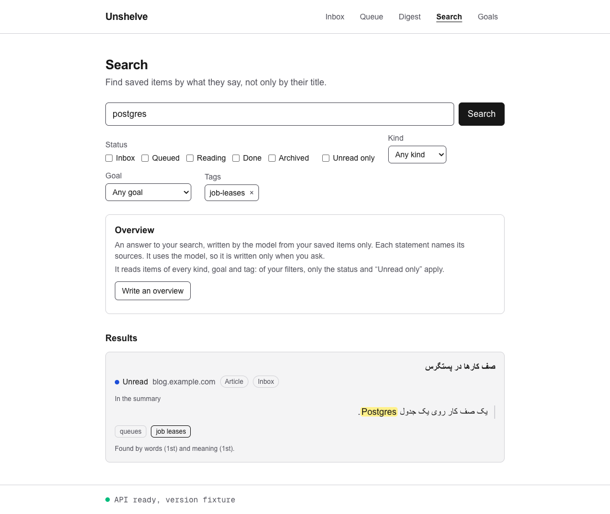
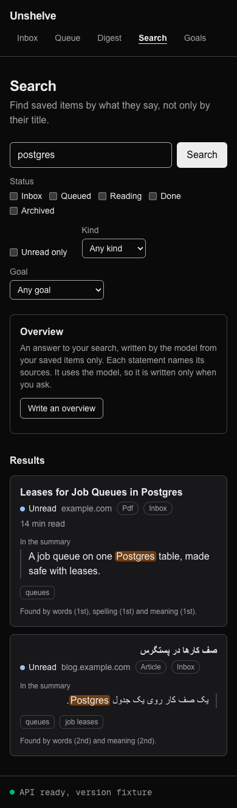

# 49. Tags as filters

> Pull request: [#119](https://github.com/herman72/unshelve/pull/119) · Code: [`lib/search.ts`](../../apps/web/src/lib/search.ts), [`components/search-hit.tsx`](../../apps/web/src/components/search-hit.tsx), [`components/search-form.tsx`](../../apps/web/src/components/search-form.tsx) · Tests: [`e2e/search.spec.ts`](../../apps/web/e2e/search.spec.ts)

## In one minute

The search API could filter by tag before this change: `tag=queues`, one time for each tag ([note 38](38-search-api.md)). But the search page had no way to set that filter.

Now each tag of a hit is a link. A click narrows the search to the items with that tag. The form shows each tag filter, and the "×" next to it removes it.

The made-up items of the tests show it. A search for "postgres" finds item 1, with the tag "queues", and item 2, with the tags "queues" and "job leases":

| You click | The address | The hits |
|---|---|---|
| (nothing yet) | `/search?q=postgres` | item 1, item 2 |
| "job leases" on item 2 | `/search?q=postgres&tag=job-leases` | item 2 |
| "queues" on item 2 | `/search?q=postgres&tag=job-leases&tag=queues` | item 2 |
| "×" next to `job-leases`, in the form | `/search?q=postgres&tag=queues` | item 1, item 2 |





## 1. A tag link is the same search with one more tag

`withTag` makes a new search from the search of the page: the same words, the same filters, and one more tag. `searchHref` writes its address. An item must have each tag of the address, so each tag narrows the search more.

```ts
export function withTag(search: Search, slug: string): Search {
  const tags = search.tags.includes(slug) ? search.tags : [...search.tags, slug];
  return { ...search, tags, cursor: null };
}
```

**The name and the slug.** The hit shows the name of a tag ("job leases"). The link carries its slug ("job-leases"), because the API filters by the slug. A link with the name would give `tag=job+leases`. That value is no slug, so `parseSearch` leaves it out (part 4), and the click would not narrow the search.

**From the first page.** The new search has no cursor. A cursor belongs to one search (part 3 of [note 48](48-unread-only.md)). So a click on a tag on page 2 opens page 1 of the narrowed search.

**The overview** reads the same items as the results: the panel sends the tags with the other filters (part 1 of [note 39](39-overview-with-citations.md)).

**A tag that is a filter already** is no link, because a click would give the same search. The page marks it with a stronger border, and a screen reader reads "(a filter of this search)".

**A comparison from daily life:** the catalogue of a library. Under each book, its subjects are links. You click "Job queues", and the catalogue shows only the books with that subject, still for the words that you searched.

## 2. The form keeps the tags as hidden fields

The form must keep the tag filters when you search with other words, as it keeps the status and the kind. But a tag has no box and no list in the form. So each tag is a *hidden field*: a field that the page does not show, but that the form sends.

```html
<li>
  <input type="hidden" name="tag" value="queues">
  queues
  <a href="/search?q=postgres" aria-label="Remove the tag filter queues">×</a>
</li>
```

An example from the tests: the address is `/search?q=postgres&tag=queues`. You type "lease" and press Enter. The new address is `/search?q=lease&kind=&goal_id=&tag=queues`. The form sent the hidden field after its other fields.

## 3. A link removes a tag, not a button

The issue asked for "a button that removes it". But the form sends its fields with GET ([note 41](41-search-page.md)), and a button of the form sends all the fields, also the hidden field of the tag. A button cannot leave one field out without JavaScript, and the form works without JavaScript.

A link can do it. Its address is the search without that tag (`withoutTag`). It takes one click, it needs no JavaScript, and Back works as for any other search.

The patterns of WAI-ARIA say the same: a link is a reference to a resource, and a button does an action. A search without one tag is another resource, with its own address.

## 4. The page does not trust a tag

`parseSearch` keeps a tag of the address only when it has the form of a slug of the API: words of lowercase letters and digits, with one hyphen between two words, at most 80 characters. The API refuses the whole search for any other value (422), so one bad value in a bookmark would break the page. Each tag counts one time.

| In the address | The form and the API get |
|---|---|
| `tag=queues&tag=queues` | `queues`, one time |
| `tag=Not+a+slug` | nothing |
| `tag=job-leases` | `job-leases` |

The tags of a hit come from the API, and the worker makes each slug with this rule. But the contract does not promise it: `TagRef.slug` is a plain string. So a tag with another slug is shown, but it is no link. The pretend API has one such tag on item 5, which also has a saved address that is no web address.

## A choice that we made

**How the form removes a tag:**

| | A link "×" (ours) | A ticked box for each tag |
|---|---|---|
| Clicks | one | two: untick it, then press Search |
| Without JavaScript | works | works |
| A screen reader says | "link, Remove the tag filter queues" | "checkbox, queues, checked" |

A box for each tag would look like the boxes of the statuses. But the statuses are always there, and a tag filter is there only after a click. One click to add a tag, and one click to remove it, is easier to learn.

## What a senior engineer checks here

- **Does the page send only values that the API accepts?** Yes. `parseSearch` checks the form of each tag, and a test gives a value that is no slug.
- **Does a tag link keep the other filters, and leave out the cursor?** Yes, a test checks each.
- **Does a new search keep the tags?** Yes: they are hidden fields, and a test types other words.
- **Name or slug?** The link carries the slug. The made-up item 2 has a tag whose name is not its slug, so a link with the name fails a test.
- **Can the tests fail?** Yes. I put 17 typical mistakes into the new code, one at a time, and each one made a named test fail.
- **What is not done:**
  - the form shows the slug of a tag filter, not its name: the address has only the slug, and `GET /api/v1/tags` is not built yet.

## Exercise (10 minutes)

1. In `apps/web/src/components/search-hit.tsx`, change `withTag(search, tag.slug)` to `withTag(search, tag.name)`.
2. Run the tests of the tags in `apps/web`. They build the app first:

```bash
pnpm exec playwright test search.spec.ts -g "tag"
```

Which test fails? Why does the link of "queues" still work?

<details>
<summary>The answer</summary>

One test fails: "a tag of a hit narrows the search, and the form removes it again". After the click on "job leases", the address is `/search?q=postgres&tag=job+leases`, not `tag=job-leases`: the link carries the name, with its space. `parseSearch` leaves that value out, because a slug has no space, so the search is not narrowed.

The link of "queues" still works, because the name and the slug of that tag are the same word. So only a tag whose name is not its slug can find this mistake. That is why the made-up item 2 has the tag "job leases".

</details>

## Words used in this note

| Word | Meaning |
|---|---|
| Tag | A topic of an item, such as "queues". The worker gives an item up to six |
| Slug | The form of a name for addresses: lowercase words joined by hyphens, such as `job-leases` |
| Hidden field | A field of a form that the page does not show, but that the form sends |
| `aria-label` | The name that a screen reader reads for an element, in place of its text |

## To read more

- [`<input type="hidden">`](https://developer.mozilla.org/en-US/docs/Web/HTML/Reference/Elements/input/hidden), MDN. Read the first paragraph: a hidden field is not on the page, but the form sends it as any other field.
- [Link pattern](https://www.w3.org/WAI/ARIA/apg/patterns/link/) and [Button pattern](https://www.w3.org/WAI/ARIA/apg/patterns/button/), WAI-ARIA Authoring Practices. Read "About This Pattern" in each: a link is a reference to a resource, and a button triggers an action.

Previous: [48. Unread only](48-unread-only.md) · Back to the [list of notes](README.md)
