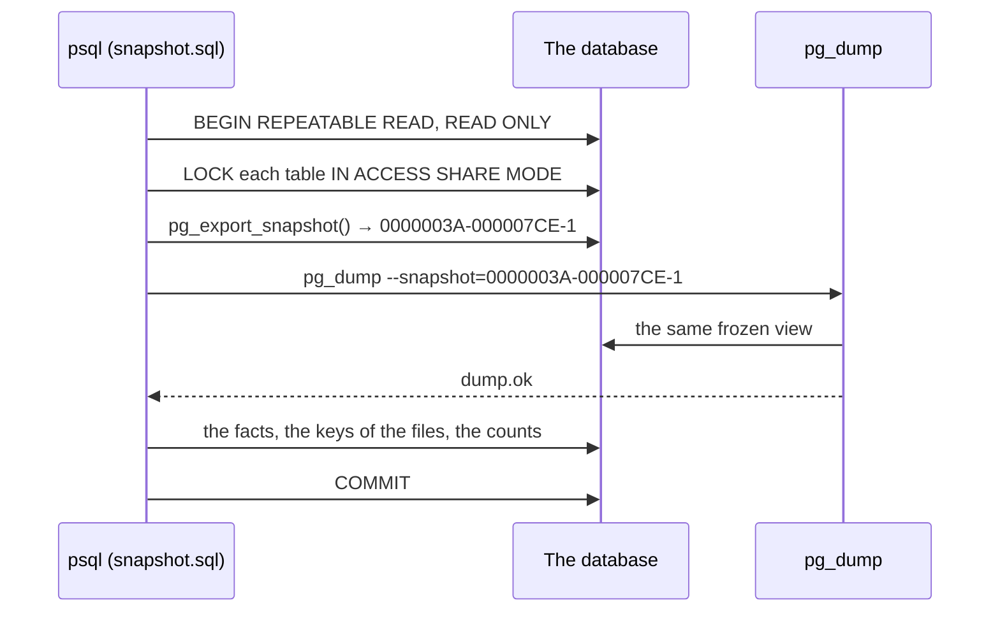

# 50. Backups of the database and of the files

> Pull request: [#PR_A](https://github.com/herman72/unshelve/pull/PR_A) (the backups) · Decision: [ADR 0015](../adr/0015-backups-a-logical-dump-and-a-mirror-of-the-files.md) · Code: [`deploy/backup/`](../../deploy/backup), the service `backup` in [`deploy/compose.yaml`](../../deploy/compose.yaml) · Tests: [`tests/deploy/test_backup.py`](../../apps/api/tests/deploy/test_backup.py), [`test_backup_compose.py`](../../apps/api/tests/deploy/test_backup_compose.py), [`test_backup_scripts.py`](../../apps/api/tests/deploy/test_backup_scripts.py)

## In one minute

A new service, `backup`, runs in the stack. It makes a backup when the newest one is older than a day. This is the state after the first backup of a small test database: two items, one stored file, and one capture that names a file that the store lost (`make backup-status`):

```text
backups: 1 in /backups/db
newest: 20261027T012358Z, 108K
  server	17.11 (Debian 17.11-1.pgdg12+2)
  revision	0006
  extension	pg_trgm	1.6
  extension	vector	0.8.7
  items	2
  assets	1
  llm_calls	0
  dump	pg_dump (PostgreSQL) 17.11 (Debian 17.11-1.pgdg12+2)
  blobs	2
  missing-blobs	1
files in the mirror: 1
last success: 2026-10-27 01:23 UTC, 0 hours ago
last failure: none
health: ok
```

The backup is a folder, `backups/db/20261027T012358Z/`. It holds the dump of the database and the facts that a restore must give back. The file that the owner sent is in a mirror, `backups/blobs/04/28/0428a7e3…`, and its name is the SHA-256 of its bytes. The rows name two files (`blobs 2`), and the store had only one of them: the backup notes the lost one (`missing-blobs 1`) and does not invent it.

The backups are in a folder of the computer, not in a Docker volume. So `docker compose down --volumes` deletes the data of the stack, but not its backups.

## 1. What a backup holds

| In the backup | Why |
|---|---|
| The whole database, as one dump of `pg_dump` | each table, also `jobs` (work that waits) and `llm_calls` (answers of the model that cost money); and the parts that the ORM does not model: `vector`, `pg_trgm`, `u_norm()`, the trigger of `events`, the view `pub.items` and its rights |
| The facts of the database (`manifest.tsv`) | for each table: the number of rows and one fingerprint of all of them; the indexes, constraints, triggers, functions and the view. The restore of the next pull request will check that it gives back the same facts |
| The keys of the files that the rows name (`blob-keys.txt`) | the files that a restore needs |
| The files themselves, in one mirror | the photos and documents that the owner sent |
| Versions and counts (`info.txt`), and a checksum of each file (`SHA256SUMS`) | the restore will check them before it changes anything |

| Not in the backup | Why |
|---|---|
| `.env` | it holds the keys: the bot token, the model keys, and the deploy key that can push to the repository of the site. Keep `.env` in a password manager |
| The certificates of Caddy | Caddy gets a new one; no private key of TLS lies in a backup |
| The clone of the publish target, the feed | the worker makes them again |

## 2. One snapshot for the facts and the dump

The app writes while a backup runs. If the facts came from one moment and the dump from another, a restore could never match them. So both come from one *snapshot*: a frozen view of the whole database, which Postgres gives each transaction of the level REPEATABLE READ.



1. The ACCESS SHARE locks stop only a change of a table (a migration), not the writes of the app. So no migration can change a table between the dump and the facts.
2. `pg_export_snapshot()` comes after the locks. It is the first query of the transaction, so the snapshot starts there, and it gets a name that a second program can use.
3. `pg_dump --snapshot` reads the database as the transaction of psql sees it. It starts right after the snapshot, because it takes its own locks too. A migration that waits for a table could get in front of them, and `--lock-wait-timeout=60s` then makes it a failure, not a wait without end.
4. The facts come after the dump, in the same transaction, so they see the same snapshot. `dump.ok` exists only when pg_dump ended without an error.

### Why the locks come before the snapshot

The first version took the snapshot first and the locks second. A review found a silent failure in that order, and reproduced it. A table held 500 captures. A second session ran a migration that rewrites the table (`ALTER TABLE captures ALTER COLUMN raw TYPE json`) and waited 8 seconds before its commit. A backup started during those 8 seconds:

| Order | The LOCK | The backup |
|---|---|---|
| Snapshot, then locks | waits for the commit of the migration | says `ok`; the table has 0 rows in the dump and in the facts |
| Locks, then snapshot | waits for the commit of the migration | says `ok`; the table has 500 rows |

A rewrite puts each row into a new file of the table, as a new row version. The new versions are newer than a snapshot from before the commit, so that snapshot sees no row at all. The facts came from the same snapshot, so they agreed with the empty dump, and no check would find it. The fix is the order: `LOCK` takes no snapshot, so the snapshot starts only after the lock got the table. A test, `test_a_table_that_a_migration_rewrites_is_whole_in_the_backup`, does this race again.

One part is not in a snapshot: a *sequence*, the counter that gives the next id. Its value moves at once, also in a transaction that later rolls back. So the facts leave sequences out, and the check of the restore will compare each one with the dump instead.

**A comparison from daily life:** a photographer takes a group photo and writes the names of the people on the back of the same print. A list of names from the next day would not match the photo. And the photographer closes the door first: a photo taken while the group walks in through the door shows an empty room.

## 3. A mirror of the files that only grows

The name of each file in the store is the SHA-256 of its bytes. So a file never changes, and the app never deletes one. This makes the copy simple: the backup copies only the files that the mirror does not have yet, and each backup shares the mirror.

A copy gets its name only after its own SHA-256 equals the name. A file whose bytes do not match its name stops the backup with a message: the mirror never holds a wrong file under a right name.

A key that a row names, but that the store lost before the backup, goes into `missing-blobs.txt`. The backup does not invent the file, and it does not stop: the app already accepts such a key.

## 4. The schedule, and how you see a failure

| Question | Answer |
|---|---|
| When? | The service checks every 5 minutes. When the newest backup is older than 24 hours, it makes one. A computer that slept makes it when it wakes; a computer that is off makes none |
| How many stay? | The 7 newest backups, and the newest one of each of the last 6 calendar weeks (Monday to Sunday). The oldest backup is 29 to 35 days old: a month of history |
| What if one fails? | It tries again after 60 minutes. The failed run removes its unfinished folder `.part-<time>`, so a lasting failure does not fill the disk with one dump for each try |
| How do you see it? | `docker compose ps` shows `backup` as `unhealthy` when the last run failed, when no backup worked for 2 days (one hour after a start of the service, also after a restart), or when a backup has a name in the future (a clock that was wrong). `make backup-status` says why. `docker compose logs backup` has one JSON line for each run of the service; `make backup` writes its line in the terminal |
| Is there room? | Before the dump, the backup checks the free space: two dumps of the last size, the new files, and 100 MB. When the room is too small, it stops with the numbers |

A backup that you start (`make backup`) and the schedule never run at the same time: a lock keeps the second one waiting. The lock lies on the Docker volume `backup-status`, not in the folder of the backups. On a shared folder of Docker Desktop, a lock taken by the call that made the file keeps nobody out.

A name is a second. A backup in a taken second waits for the next free one. Any other failure of `mkdir`, for example a disk that became read-only, stops the backup with the message of `mkdir`. (An earlier version waited in that case too, without end and without a message.)

## A choice that we made

| | A logical dump and a mirror (this branch) | A copy of the volume | Archiving the write-ahead log |
|---|---|---|---|
| Consistent while the app writes | yes: one snapshot | only with a stopped database | yes |
| A restore into another major version of Postgres | yes | no | no |
| Restore to any second | no: to the last backup | no | yes |
| New parts | none: the image of the database | none | a second program and its storage |

## What a senior engineer checks here

- **Is the restore tested?** Not yet in this pull request: the next one will add the restore, its data check, and a drill that CI runs. A backup that is never restored is only a hope.
- **Where are the backups?** On the same disk as the data, so a lost or broken computer takes both. The guide shows a tar that you encrypt with `age` and copy to a second place.
- **Does a backup hold a secret?** No: no `.env`, no key of TLS, no role password. But it holds private data (notes, saved messages, the answers of the model). The folder and its files are readable only for their owner (`umask 077`). The service runs as root, so after each backup it gives the new files to the owner of the folder.
- **Can half a backup look whole?** No. A backup is written as `.part-<time>`, then `sync` puts its bytes on the disk, and only then a rename gives it its name. A rename is one step, and a crash before the `sync` leaves a part, not a name with lost bytes.
- **Does a failed step stop the backup?** Yes, and this needs care in bash: `set -e` is ignored inside the condition of an `if`, also inside each function that it calls. So the schedule starts each backup as a new process of the script, which has its own `set -e`.
- **Does the retention keep a month?** Only with calendar weeks, and only with enough of them. A rule of "weeks counted back from the newest backup" gives each week a new newest backup each day, and it removes yesterday's: after a few days, nothing older than two weeks is left. With calendar weeks, week 0 is the week of the newest backup, so 4 weeks keep only 15 to 21 days; 6 weeks keep 29 to 35. A test runs 70 days of backups, with a prune after each one, and checks the oldest backup each day.

## Exercise (10 minutes)

1. In `deploy/backup/backup.sh`, in `mirror_blobs`, remove the five lines of the `if` that compares `sha256sum` with the key.
2. Run the tests of the backup in `apps/api`:

```bash
uv run pytest tests/deploy/test_backup.py -q
```

Which tests fail? What would the mirror hold after that mistake, and when would you find out?

<details>
<summary>The answer</summary>

Two tests fail. `test_a_file_with_other_bytes_than_its_name_stops_the_backup` fails: the backup succeeds, and the mirror holds the wrong bytes under the name of the right file. `test_a_failed_backup_leaves_no_part_behind` fails too, because its backup should fail and does not. Nobody would see it until a restore, months later, when the file is needed. A check at the time of the copy costs one `sha256sum`; a wrong file found during a restore costs the file.

</details>

## Words used in this note

| Word | Meaning |
|---|---|
| Logical dump | A copy of the database as the statements and rows that make it again, not as the files of the disk |
| Snapshot | A frozen view of the whole database at one moment, which a transaction sees |
| Sequence | The counter of Postgres that gives the next id; its value is not part of a snapshot |
| Content-addressed | The name of a file is the hash of its bytes, so the same bytes always have the same name |
| Retention | The rule about which old backups stay |

## To read more

- [pg_dump](https://www.postgresql.org/docs/17/app-pgdump.html), PostgreSQL documentation. Read the option `--snapshot` and the notes about consistency.
- [pg_export_snapshot](https://www.postgresql.org/docs/17/functions-admin.html#FUNCTIONS-SNAPSHOT-SYNCHRONIZATION), PostgreSQL documentation. Read "Snapshot Synchronization Functions": how two sessions share one snapshot.

Previous: [49. Tags as filters](49-tag-filters.md) · Next: [51. Logs, job stats and the cost of each task](51-logs-and-stats.md) · Back to the [list of notes](README.md)
