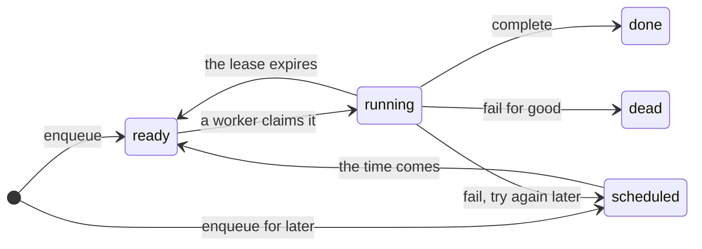
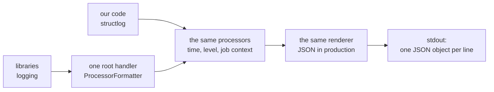

# 51. Logs, job stats and the cost of each task

> Pull request: [#121](https://github.com/herman72/unshelve/pull/121) · Code: [`api/stats_views.py`](../../apps/api/src/unshelve/api/stats_views.py), [`log.py`](../../apps/api/src/unshelve/log.py), [`queue/worker.py`](../../apps/api/src/unshelve/queue/worker.py), [`providers/ledger.py`](../../apps/api/src/unshelve/providers/ledger.py) · Tests: [`tests/api/test_stats.py`](../../apps/api/tests/api/test_stats.py), [`tests/test_log.py`](../../apps/api/tests/test_log.py), [`tests/queue/test_worker.py`](../../apps/api/tests/queue/test_worker.py)

## In one minute

You import 40 links at 15:20 in Helsinki. At 16:00, 20 items have a card, but 16 items have no card yet. Why?

Before this change, you had to read the tables with `psql`. Now one request gives the answer: `GET /api/v1/stats`. These are numbers from its answer for that afternoon. The rows are made up, but the code counted them:

| Part of the answer | Value | What it tells you |
|---|---|---|
| `queue.by_kind` → `enrich_item` → `scheduled`, `retrying` | 16, 16 | 16 cards failed one attempt and wait for a later try |
| `llm.spent_today_usd`, `llm.daily_budget_usd` | 1.0103, 1.0 | The daily budget is used, so the model gets no new question today |
| `queue.by_kind` → `fetch_item` → `dead` | 2 | 2 links failed for good. No worker tries them again |
| `queue.oldest_ready_seconds` | 95.0 | One job has waited 95 seconds for a worker |
| `queue.depth` | 18 | 18 jobs are still to do: the 16 cards, 1 vector job that runs and 1 that waits |

So the 16 cards come after midnight in Helsinki, when the budget starts again. The last error of each of these jobs says the same: "model: the daily budget of $1.00 is used".

The logs changed too. Before, the lines of the libraries were plain text, also with `UNSHELVE_LOG_JSON=true`. This is a real line of the API before the change:

```text
INFO:     127.0.0.1:58436 - "GET /api/v1/healthz HTTP/1.1" 200 OK
```

Now each line is one JSON object, and a log tool can read every line:

```json
{"event": "127.0.0.1:53878 - \"GET /api/v1/healthz HTTP/1.1\" 200", "level": "info", "timestamp": "2026-10-26T21:52:33.550651Z", "logger": "uvicorn.access"}
```

## 1. The queue depth is the work that is still to do

A job row has one of four states: `pending`, `running`, `done` and `dead` ([note 4](04-job-queue.md)). The stats divide `pending` in two, by the time `run_after` of the job:

- **ready**: the time of the job has come. A worker can take it now.
- **scheduled**: the time of the job is later. This is a retry that waits after a failed attempt, or a job that starts later.



The *queue depth* is the number of jobs that the workers still have to do: ready + scheduled + running, of every kind. In the example: 16 scheduled card jobs, 1 ready vector job and 1 running vector job give 18.

**A dead job is not in the depth.** No worker takes it again, so it is no work for the workers. A depth with the dead jobs would not come back to 0 after one permanent failure. The dead jobs have their own number next to the depth: `dead`, for each kind and in total.

Amazon SQS does the same with a second queue, the *dead-letter queue*. A message that fails too many times moves into it, and a person looks at it. Our `dead` is the depth of that second queue.

**A comparison from daily life:** a post office. The people with a ticket are ready. The people who must come back at 14:00 are scheduled. The person at the counter is running. A letter that cannot be delivered goes into a box for a clerk: it is dead. Nobody counts that box as part of the line.

**The oldest wait.** `oldest_ready_seconds` is how long the oldest ready job has waited for a worker. It is the best single alarm. When all workers stop, the depth can stay small, but this number grows each second. SQS has the same measure: `ApproximateAgeOfOldestMessage`.

## 2. Failures: dead, retrying, and the last 24 hours

The stats show a failure in four numbers for each kind:

| Number | Which jobs |
|---|---|
| `dead` | Every dead job, also an old one |
| `dead_last_24_hours` | The jobs that became dead in the last 24 hours. A new failure shows here |
| `retrying` | Pending jobs with a `last_error`: they failed an attempt and wait for the next one. They are also in ready or scheduled |
| `done_last_24_hours` | The jobs that ended well in the last 24 hours |

`retrying` is the early warning. It goes up before the attempts are used up, for example when the API key of the model is wrong or the budget is used.

**A failure is not done.** A dead job also has a `finished_at`. A count of "finished in the last 24 hours" without the state would count each failure as done. The test `test_a_failed_job_is_not_counted_as_done` has both kinds:

| Job | Finished | In `done_last_24_hours` | In `dead_last_24_hours` |
|---|---|---|---|
| done | 1 hour ago | yes | |
| done | 23 hours ago | yes | |
| done | 25 hours ago | | |
| dead | 2 hours ago | | yes |
| dead | 30 hours ago | | |

The result is 2 done and 1 dead in the last 24 hours, and 2 dead in total.

## 3. The cost of each task

Each row of the ledger `llm_calls` is one paid answer of the model, with its task, its tokens and its price ([note 17](17-model-card.md)). A stored answer of the same question is free, so it has no new row. The stats add the rows of each task for the last 30 days, the most expensive task first. The test `test_the_cost_is_summed_for_each_task` gives:

| Task | Calls | Input tokens | Output tokens | Dollars |
|---|---|---|---|---|
| `enrich_item` | 2 | 2,500 | 500 | 0.30 |
| `score_item` | 1 | 800 | 50 | 0.05 |
| `overview` | 1 | 0 | 0 | 0.03 |
| `read_image` | 2 | 0 | 0 | 0.03 |

Two tasks cost the same. Then the name decides, so the order is the same in each answer.

**Today is the day of the budget.** `spent_today_usd` starts at midnight in `UNSHELVE_TIMEZONE`, and it leaves out the answers of a batch: you accepted the price of a batch by hand ([note 29](29-cards-in-a-batch.md)). That is exactly the sum that the daily budget compares. One function in `ledger.py`, `budget_spent`, gives the sum to the budget and to the stats. So the stats cannot show $0.95 while the budget has stopped at $1.00.

An example with Helsinki, from a test. A call at 23:00 UTC on 25 October is at 01:00 on 26 October in Helsinki: today. In UTC, the same call is yesterday.

`spent_last_30_days_usd` starts at midnight 30 days before today, as `unshelve llm costs` does. It includes the batches.

## 4. Each log line is one JSON object

Two kinds of loggers write to stdout. Our code logs with structlog. The libraries (uvicorn, httpx, SQLAlchemy, aiogram, Alembic) log with `logging` of the standard library.

A *structured log* has named fields in each line, not only a sentence. A log tool can then select lines by a field, for example each line with `"level": "error"`.

Before, structlog wrote JSON, but `logging` used its own text format. And uvicorn had its own handlers, so its lines were text in any case. Now one handler on the root logger renders the records of the libraries with structlog's `ProcessorFormatter`:



A *processor* is a small function that adds or changes one field of a line, for example the time. `foreign_pre_chain` is the list of processors that run only for the records of the libraries.

`unshelve api` now starts uvicorn with `log_config=None`. Then uvicorn adds no handlers of its own, and its loggers send each record up to the root logger, to our handler.

**The secrets stay hidden.** The bot hides its token with a filter on each handler of the root logger. The worker hides the token in the addresses that httpx logs, with a filter on the logger `httpx` ([note 25](25-files-you-send.md)). Both filters run before the formatter, so the JSON line has the hidden text. Two tests log a made-up token and read the JSON line.

## 5. Each line of a job names the job

While the worker runs a job, it binds three values: `job_id`, `kind` and `attempt`. Each line that is logged during the job then has them: the lines of the handler, of the libraries, and the line `llm.call` of the ledger with its cost. So a log tool can show all lines of one job, with what it cost.

The values are *context variables*. A context variable is a value that belongs to the running task. The handler runs in its own asyncio task, and a new task gets a copy of the context of the code that starts it. When the job ends, `bound_contextvars` removes the values again.

The test `test_each_line_that_a_job_logs_names_the_job` runs a job that fails its first attempt and then succeeds:

| Line | `job_id` | `kind` | `attempt` |
|---|---|---|---|
| `fetch.try` | 1 | `fetch_item` | 1 |
| `job.finished` | 1 | `fetch_item` | 1 |
| `fetch.try` | 1 | `fetch_item` | 2 |
| `job.finished` | 1 | `fetch_item` | 2 |
| `worker.idle` | (none) | (none) | (none) |

**A comparison from daily life:** the name badge at a conference. Each person that you talk to sees your name. At the exit, you give the badge back.

## A choice that we made

**Dead jobs: next to the depth, or in it?**

| | Next to the depth (ours) | In the depth |
|---|---|---|
| After one permanent failure | the depth goes back to 0 | the depth stays at 1 until a person acts |
| An alarm "the depth is over 0 for one hour" | means "the workers are behind" | also rings for one old failure |
| Where you see a failure | `dead` and `dead_last_24_hours`, by kind | mixed with the work that waits |

Some tools count each job that is not done in the depth. But here a person, not a worker, ends a dead job. So the dead jobs are a second number, as in a dead-letter queue.

## What a senior engineer checks here

- **Do the stats show the number that the budget uses?** Yes. `budget_spent` gives it to both.
- **Is a failure counted as done?** No. A test has dead jobs with a recent `finished_at`.
- **The edges.** A job whose `run_after` is exactly now is ready, as `claim` takes it (`<=`). The 7 days, the 24 hours and the 30 days each have a test at the edge.
- **Which clock?** All numbers use one moment, `as_of`: the clock of the database, which the queue also uses for its leases.
- **How fast is it with a big table?** The done jobs are never deleted, and the query reads the whole table. Measured on this Mac, with one call for each 10 jobs: 10,000 jobs take 8 ms, 100,000 jobs 25 ms, and 1,000,000 jobs about 140 ms. The time grows with the rows. If the table comes near a million jobs, delete the old done jobs.
- **Do the filters of the secrets still work?** Yes, two tests log a token.
- **Can the tests fail?** Yes. I put 45 typical mistakes into the new code, one at a time, and each one made a named test fail. Examples: the cost of all tasks on each task, a failed job counted as done, a dead job left out of the dead total, a dead job in the depth, and midnight in UTC.
- **What is not done:**
  - no page of the web app shows the stats yet. Open `/api/v1/stats` in the browser after you sign in;
  - a dead job cannot go back into the queue yet: `GET /admin/jobs` and `POST /admin/jobs/{id}/retry` are still stubs;
  - no history: the numbers are of one moment. A metrics system such as Prometheus would keep each value over time;
  - the request line of uvicorn is one sentence in `event`, with the query of the address (for example the words of a search). A request log of our own, with fields, would be better;
  - each number comes from its own query, so two numbers can see the queue a few milliseconds apart.

## Try it yourself

1. Get the new code and start the stack: `git pull`, then `make up`.
2. Sign in to the web app, and open `http://localhost:3000/api/v1/stats`. The web app sends the request to the API with your session.
3. Read the log of the worker: `docker compose logs worker --tail 5`. Each line is one JSON object, and the lines of a job have its `job_id`.

## Exercise (10 minutes)

1. In `apps/api/src/unshelve/cli.py`, remove the line `log_config=None,`.
2. In `apps/api`, run the tests of the logs:

```bash
uv run pytest tests/test_log.py
```

3. Start the API with JSON logs, and send each line of stdout to a JSON reader:

```bash
UNSHELVE_LOG_JSON=true uv run unshelve api --port 8123 | python3 -m json.tool --json-lines
```

4. In a second terminal, ask the API: `curl http://127.0.0.1:8123/api/v1/healthz`. This route does not use the database.

Which test fails? What does the first terminal show? Stop the API with Ctrl+C, and put the line back.

<details>
<summary>The answer</summary>

One test fails: `test_the_api_gives_uvicorn_no_log_configuration`. `uvicorn.run` gets its default log configuration, not `None`.

The first terminal shows four lines of plain text, such as `INFO:     Started server process [53410]`. uvicorn's own handler writes them to stderr, so they do not go through the JSON reader. After the `curl`, the reader stops with `Expecting value: line 1 column 1 (char 0)`. The request line of uvicorn went to stdout as plain text, and plain text is not JSON.

With the line back, the reader shows each line as an object, also the request line, with `"logger": "uvicorn.access"`.

</details>

## Words used in this note

| Word | Meaning |
|---|---|
| Queue depth | The number of jobs that the workers still have to do: ready, scheduled and running |
| Ready job | A pending job whose time has come. A worker can take it now |
| Scheduled job | A pending job whose time is later |
| Dead job | A job that failed for good. No worker takes it again |
| Dead-letter queue | A second queue for the messages that failed too often. A person looks at them |
| Structured log | A log whose lines have named fields, such as `level` and `job_id` |
| Processor | In structlog, a function that adds or changes one field of a log line |
| Context variable | A value that belongs to the running task. A new asyncio task gets a copy |
| Ledger | The table `llm_calls`: one row for each paid answer of the model |
| Median | The middle value of a sorted list. One very old item does not move it much |

## To read more

- [Standard Library Logging](https://www.structlog.org/en/stable/standard-library.html), structlog. Read the part "Rendering using structlog-based formatters within logging": `foreign_pre_chain` runs only for the records of the standard library.
- [Using dead-letter queues in Amazon SQS](https://docs.aws.amazon.com/AWSSimpleQueueService/latest/SQSDeveloperGuide/sqs-dead-letter-queues.html), AWS. Read the first paragraph and "Using policies for dead-letter queues": `maxReceiveCount` is our `max_attempts`.
- [`asyncio.create_task`](https://docs.python.org/3/library/asyncio-task.html#asyncio.create_task), Python. Read the paragraph about `context`: a new task gets a copy of the current context.

Previous: [49. Tags as filters](49-tag-filters.md) · Back to the [list of notes](README.md)
