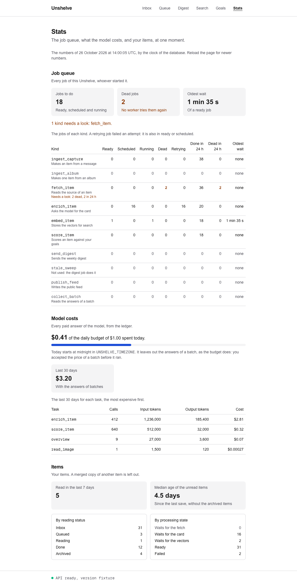
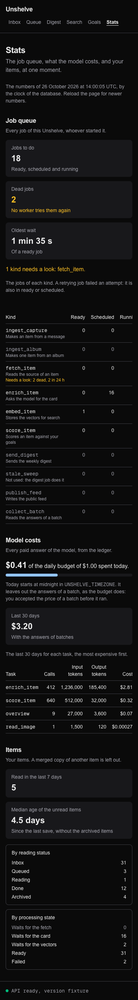

# 52. A page for the stats

> Pull request: [#122](https://github.com/herman72/unshelve/pull/122) · Code: [`app/stats/page.tsx`](../../apps/web/src/app/stats/page.tsx), [`components/stats-view.tsx`](../../apps/web/src/components/stats-view.tsx), [`lib/stats.ts`](../../apps/web/src/lib/stats.ts) · Tests: [`e2e/stats.spec.ts`](../../apps/web/e2e/stats.spec.ts), [`e2e/fixture-api.mjs`](../../apps/web/e2e/fixture-api.mjs)

## In one minute

Before this change, you read the stats as JSON at `http://localhost:3000/api/v1/stats` ([note 51](51-logs-and-stats.md)). Now the page `/stats` shows the same answer, and "Stats" is a link in the navigation.

The pretend API of the tests answers with a busy afternoon. These are numbers from its answer, and what the page shows for each one:

| In the answer | Value | On the page |
|---|---|---|
| `as_of` | `2026-10-26T14:00:05.250000Z` | "The numbers of 26 October 2026 at 14:00:05 UTC" |
| `queue.depth` | 18 | "Jobs to do: 18" |
| `queue.by_kind` → `fetch_item` → `dead`, `dead_last_24_hours` | 2, 2 | The row says "Needs a look: 2 dead, 2 in 24 h". Above the table: "1 kind needs a look: fetch_item." |
| `queue.oldest_ready_seconds` | 95.0 | "Oldest wait: 1 min 35 s", with no mark |
| `llm.spent_today_usd`, `llm.daily_budget_usd` | 0.4113, 1.0 | "$0.41 of the daily budget of $1.00 spent today." |
| `llm.by_task` → `read_image` → `cost_usd` | 0.00027 | "$0.00027", not "$0.00" |
| `items.median_unread_age_days` | 4.5 | "Median age of the unread items: 4.5 days" |





## 1. One request, one moment

The page is a server component. A *server component* is a React component that runs only on the server: the browser gets its HTML, but not its JavaScript. `StatsPanel` calls the API with your session cookie, and gives the answer to `StatsView`.

The call waits inside `<Suspense>`. The header of the page shows at once, and "Counting…" shows until the answer comes. The queue page and the digest page do the same.

The time at the top is `as_of`: the clock of the database at the moment of the numbers. It is not the clock of the web app. So the page does not say "now". It says when the numbers were true. To see newer numbers, reload the page.

**A comparison from daily life:** a bank statement. It says "the balance on 26 October at 14:00". One hour later, the balance can be different, but the statement is still correct for its moment.

## 2. What needs a look: a dead job, or a long wait

A kind of job needs a look when one of two things is true:

| Sign | Rule | Why |
|---|---|---|
| Dead jobs | `dead` is more than 0 | No worker tries a dead job again. Only a person can end it |
| A long wait | `oldest_ready_seconds` is more than 300 (5 minutes) | A ready job waits for a worker. A long wait means that no worker takes jobs |

**An old dead job still needs a look.** `dead` can be 2 while `dead_last_24_hours` is 0: the jobs failed two days ago. Nobody ended them, so the page marks them. The test "an old dead job is still marked" has this case.

**One answer cannot show that a wait grows.** The request for this page asked to mark "a growing wait". But the page has one answer: one number for one moment. So the page uses a limit, `LONG_WAIT_SECONDS`, of 5 minutes:

- An idle worker looks for a job each second (`poll_interval` in `queue/worker.py`).
- A busy worker takes the next job when its job ends. A handler stops after 120 seconds at most.
- So 5 minutes is more than two jobs that each use all their time.

| The oldest wait | Marked? |
|---|---|
| 95 s ("1 min 35 s") | No |
| 300 s ("5 min") | No: the limit itself is not over the limit |
| 750 s ("12 min 30 s") | Yes: "Over 5 min: is a worker running?" |

**A comparison from daily life:** a thermometer. One measurement cannot show that a fever grows. So a doctor uses a limit: a temperature over 38 °C is a fever.

**The mark is words, not only a colour.** The row says "Needs a look: waits long", in the colour of a warning. Some people cannot see the difference between two colours, and a screen reader does not read a colour. WCAG calls this rule "Use of Color": colour must not be the only sign.

## 3. The daily budget: the same test as the ledger

The ledger stops a model call when today's spend is *at least* the budget: `>=` in `_check_budget` ([note 51](51-logs-and-stats.md)). The page uses the same test:

```ts
export function budgetUsed(llm: LlmCosts): boolean {
  return llm.spent_today_usd >= llm.daily_budget_usd;
}
```

A spend of exactly $1.00 against a budget of $1.00 shows two sentences: "The daily budget is used." and "New model calls wait for midnight in `UNSHELVE_TIMEZONE`, when the budget starts again." With `>`, the page would show no warning, but the ledger would already stop each call. The test "a spend equal to the daily budget says that new calls wait for midnight" has this edge.

A budget of $0 is always used, because 0 >= 0. Then the bar is full, and the page never divides by 0.

**The page names a variable, not a time zone.** The answer of the API does not contain the time zone, and the web app does not read `UNSHELVE_TIMEZONE`. So the page tells you where midnight is set, not which zone it is.

**Today and the 30 days count differently.** Today leaves out the answers of a batch, as the budget does. The 30 days include them. The page says this under the bar, so that the two numbers do not seem to disagree.

## 4. Small amounts and wide tables

**Two decimals can hide a cost.** One read of an image cost $0.00027. With two decimals, the page would show "$0.00", and the task would seem free. So `dollars` uses two significant digits below one cent. A *significant digit* is a digit that carries information: in 0.00027, the 2 and the 7.

| Amount | Format | On the page |
|---|---|---|
| 2.8104 | cents | $2.81 |
| 0.0705 | cents | $0.07 |
| 0.00027 | two significant digits | $0.00027 |
| 0 | cents | $0.00 |

**A table of 9 columns does not fit on a phone.** On a phone 390 pixels wide, the table of jobs needs 680 pixels, but its box has 358. WCAG "[Reflow](https://www.w3.org/WAI/WCAG22/Understanding/reflow.html)" lets a data table scroll sideways, but the page itself must not. So the table is in a box with `overflow-x: auto`: the box scrolls, and the page does not.

A person without a mouse must also scroll the box. So the box has `tabindex="0"`: the Tab key reaches it, and then the arrow keys scroll it. The caption gives the box its name, so a screen reader says what the box holds.

The caption is a paragraph above the box, not a `<caption>` element. A `<caption>` is as wide as its table. The first screenshot of the phone showed the problem: the caption ended at the edge of the box, in the middle of a sentence.

**Six links in the navigation.** On the first screenshot of the phone, the link "Stats" did not fit next to the other five links: it went to a line of its own. Less padding at the sides of each link was not enough. The six links then needed 347 pixels, and a phone of 375 pixels has 343 for them. With no gap between the links, they need 327 pixels. Now they fit on one line from 360 pixels.

**The test of the phone found a surprise.** I removed `tabindex`, and the test still passed. From version 132, Chrome focuses a box that scrolls by itself, when the box has nothing else to focus. Other browsers do not promise this. So the test now also checks the attribute, and the mistake fails it.

## A choice that we made

**How to find a wait that grows:**

| | A limit (ours) | Compare with the last answer | A history |
|---|---|---|---|
| What it needs | one constant | the last answer, kept in the browser | a metrics system, such as Prometheus |
| The first visit | works | has nothing to compare | works |
| A false alarm | a big import can wait more than 5 minutes | a wait of 2 s that becomes 4 s "grows" | few |
| Work | small | medium | large |

A limit works on the first visit, and it needs no storage. A history is the real answer, so it is in "What is not done".

## What a senior engineer checks here

- **Does the page use the same rule as the API?** Yes. `budgetUsed` uses `>=`, as `_check_budget` does, and a test has a spend equal to the budget.
- **The edges of the limit.** The page does not mark a wait of exactly 5 minutes, but it marks a wait of 12 min 30 s. A test has both.
- **Does an old failure stay visible?** Yes. A test has dead jobs with none in the last 24 hours.
- **Is colour the only sign?** No. Each mark is also words.
- **Does the page fit a phone?** The page does not scroll sideways, the box of the table does, and the keyboard reaches the box. A test measures this at 375 pixels. A second test keeps the six links of the navigation on one line at 360 pixels, so a seventh link needs a decision.
- **Under `next dev`?** `/stats` is in the list of `e2e-dev/pages.spec.ts`. That check fails for a page without an entry, so nobody can forget a new page.
- **Can the tests fail?** Yes. I put 4 typical mistakes into the new code, one at a time: `>` for the budget, `>=` for the limit, a mark only for the dead jobs of the last 24 hours, and no `tabindex`. Each of the first three made a named test fail. The fourth passed (part 4), so I added the check of the attribute. Then it failed too.
- **What is not done:**
  - no history: the page shows a wait that grows only when it is over the limit;
  - the page does not refresh by itself: reload it;
  - the page does not name the time zone of midnight, because the API does not send it;
  - a dead job cannot go back into the queue from the page: `POST /admin/jobs/{id}/retry` is still a stub.

## Try it yourself

1. Get the new code and start the stack: `git pull`, then `make up`.
2. Sign in to the web app, and click "Stats" in the navigation.
3. Open `http://localhost:3000/api/v1/stats` in a second tab. Find each number of the page in the JSON.

## Exercise (10 minutes)

1. In `apps/web/src/lib/stats.ts`, change `>=` to `>` in `budgetUsed`.
2. In `apps/web`, run the tests of the stats. They build the app first:

```bash
pnpm exec playwright test stats.spec.ts
```

Which test fails? If this mistake gets to your stack, what does the page show at a spend of exactly $1.00? What do the card jobs do at the same time?

<details>
<summary>The answer</summary>

One test fails: "a spend equal to the daily budget says that new calls wait for midnight". The page shows "$1.00 of the daily budget of $1.00 spent today.", but no warning.

The ledger uses `>=`, so it already stops each new call. Each card job fails its attempt with "model: the daily budget of $1.00 is used", and waits for midnight. The page shows no reason for it, so you look for the reason in the wrong place. The two rules must be the same, and the test keeps them the same.

Put `>=` back.

</details>

## Words used in this note

| Word | Meaning |
|---|---|
| Server component | A React component that runs only on the server. The browser gets its HTML, but not its JavaScript |
| `<Suspense>` | A React boundary. It shows a fallback, such as "Counting…", until the data inside it is ready |
| Limit | A fixed value. A number over it starts a warning. Another name is *threshold* |
| Significant digit | A digit that carries information. In 0.00027, the 2 and the 7 |
| Scroll box | An element with `overflow: auto`. It scrolls its content inside itself |
| `tabindex="0"` | An attribute that puts an element in the order of the Tab key |

## To read more

- [Data Tables](https://inclusive-components.design/data-tables/), Inclusive Components (Heydon Pickering). Read the part about the container of the table. A box that scrolls gets `tabindex="0"`, a role, and the caption as its name.
- [Understanding SC 1.4.1: Use of Color](https://www.w3.org/WAI/WCAG22/Understanding/use-of-color.html), W3C. Read "In Brief": use text or a shape in addition to colour.
- [Keyboard focusable scrollers](https://developer.chrome.com/blog/keyboard-focusable-scrollers), Chrome for Developers. Read the first paragraph. From Chrome 132, a box that scrolls takes the focus without `tabindex`, when it has nothing else to focus.

Previous: [51. Logs, job stats and the cost of each task](51-logs-and-stats.md) · Back to the [list of notes](README.md)
