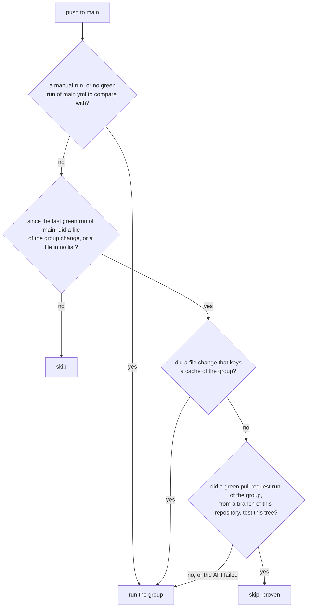

# 53. Fewer minutes of CI

> Pull requests: [#125](https://github.com/herman72/unshelve/pull/125), [#126](https://github.com/herman72/unshelve/pull/126) · Code: [`main.yml`](../../.github/workflows/main.yml), [`ci_gate.py`](../../.github/scripts/ci_gate.py), [`api.yml`](../../.github/workflows/api.yml), [`web.yml`](../../.github/workflows/web.yml), [`site.yml`](../../.github/workflows/site.yml), [`stack.yml`](../../.github/workflows/stack.yml) · Tests: [`test_ci_gate.py`](../../apps/api/tests/deploy/test_ci_gate.py), [`test_ci_workflows.py`](../../apps/api/tests/deploy/test_ci_workflows.py) · Decisions: [ADR 0016](../adr/0016-ci-runs-by-the-files-of-a-change-and-main-trusts-a-proof-by-tree.md), [ADR 0017](../adr/0017-ci-a-lockfile-runs-the-groups-of-its-cache-and-a-file-in-no-list-runs-each-group.md)

## In one minute

GitHub gives the private repositories of an account 2,000 minutes of CI each month. In October 2026, Unshelve used 1,687 minutes, a second project of the owner used 1,848, and a third used 54. Together that is 3,589, and CI stopped at the limit.

Most of the 1,687 minutes did work that was done already:

- A pull request ran all eight jobs on each push, also when it changed only a note.
- After each merge, main ran all eight jobs again on files that the pull request had tested.

This change gives CI four groups, each with its own list of files. A push to main runs a group only when no green run of a pull request tested the same files. A replay of the October runs with the new rules gives these numbers:

| | October, as it ran | October, with the new rules (my estimate) |
|---|---|---|
| Pull request runs (122) | 1,048 min | 777 min |
| Pushes to main (70) | 639 min | 96 min, and 70 min for the gate |
| Total | 1,687 min | 943 min (44% less) |

The replay uses the real files of each run, the real time of each job, and the real result of each job. The new lint step of the API job took 4 s in the first run on main, and the replay counts those 4 s. It is still an estimate: a stacked pull request has a smaller diff on GitHub than in the replay, so the true saving is a little larger.

**Added on 2026-11-02:** the repository is public now. GitHub bills no minutes for standard runners in a public repository, so the monthly limit no longer stops CI. The groups and the gate stay: a pull request gets its answer sooner, and the minutes stay low if the repository becomes private again ([ADR 0016](../adr/0016-ci-runs-by-the-files-of-a-change-and-main-trusts-a-proof-by-tree.md)).

## 1. A minute is the smallest unit

GitHub rounds the time of each job up to a whole minute. So many short jobs cost more than one long job.

Run 38907263776 of October is an example:

| Job | Time | Billed |
|---|---|---|
| API (lint, types, tests) | 126 s | 3 min |
| API contract is up to date | 42 s | 1 min |
| Both as one job | 168 s | 3 min |

The contract check now runs at the end of the API job, and `next dev` runs at the end of the end-to-end job. In October, the first merge saved one minute in 50 of 189 runs, and the second in 6 of 46 runs.

The steps of the second check run also after a failed first check (`if: !cancelled() && steps.sync.outcome == 'success'`). So one run still reports both failures, as two jobs did.

**A comparison from daily life:** a taxi that starts a new fare for each stop. Two short rides cost two minimum fares. One ride with a stop costs one.

## 2. A pull request runs only the groups of its files

Each group has its own workflow file, and its trigger names the files that its jobs read:

| Group | File | A change of this file starts it, for example |
|---|---|---|
| API | `api.yml` | `apps/api/**`, `deploy/**`, `docs/quickstart.md`, `.github/**` |
| Web | `web.yml` | `apps/web/**`, `packages/**`, `examples/**` |
| Example site | `site.yml` | `examples/**`, `packages/site-search/**` |
| Stack | `stack.yml` | `apps/api/**`, `apps/web/**`, `deploy/**`, `docs/quickstart.md` |

All four also name `package.json`, `pnpm-lock.yaml` and `pnpm-workspace.yaml`. GitHub compares the files of the pull request with each list. A group that no changed file selects starts no run, and costs nothing.

Some real changes, and the groups that they start:

| Changed file | Groups |
|---|---|
| `docs/learn/52-stats-page.md` | none |
| `apps/web/src/app/stats/page.tsx` | Web, Stack |
| `docs/quickstart.md` | API, Stack (CI runs the marked blocks of the guide) |
| `apps/api/uv.lock` | API, Stack |

**The danger is a file that a job reads, but that no list names.** Then a pull request can break the job, and no run shows it. `test_ci_workflows.py` names the files outside each app that the jobs read, and fails when a list does not select one of them. When a test starts to read a new file, add the file to that test and to the list.

A tool can read a file too, not only a test. Ruff skips each file that the `.gitignore` of the root names, so the list of the API names `.gitignore`. A second test checks that each file of the repository is in a list, or in `NOT_READ_BY_CI`: the files that no job reads, such as the notes and the README.

A list uses only two forms: a file (`docs/quickstart.md`), or a folder and `/**` (`deploy/**`). The gate of main (section 4) matches the same lists, and with only these two forms its match is the same as the match of GitHub. A test refuses other wildcards.

## 3. The same tree, tested two times

A *tree* in git is the snapshot of all the files of a commit. Its id is a hash of the content, so the same files always give the same tree id.

The owner merges a pull request by rebase. A rebase makes new commits on main, with new ids. But when the branch already contains main, the files do not change:

```text
$ git rev-parse '95627c5^{tree}'   # the head of pull request #124
625a011bfd49ee1014f736486118f947b985005e
$ git rev-parse '9b55560^{tree}'   # main after the merge of #124
625a011bfd49ee1014f736486118f947b985005e
```

The run of the pull request had tested exactly the files of main. In October, this was true for 61 of the 70 pushes to main. Those 61 pushes ran CI again: 565 minutes in all.

**A comparison from daily life:** a sealed box with a checksum on its label. The box gets a new delivery number at the next depot. If the checksum on the label is the same, nobody opens the box again.

## 4. The gate of main

`main.yml` runs on each push to main. Its first job, the gate, runs `.github/scripts/ci_gate.py`, and decides for each group:



Four details:

- **The gate compares with the last green run of main, not with the push before.** A run on main waits for the run before it. A pending run can give its place to a newer push, and the newer run then tests the changes of both pushes.
- **A change of a file that keys a cache runs the groups with that cache.** The files of uv (`uv.lock`, `pyproject.toml`, `.python-version`) key the cache of `setup-uv`, and `pnpm-lock.yaml` keys the pnpm cache of `setup-node`. Both actions save a cache only in a run, and a new pull request restores the cache of main. Without a run on main, each new pull request would install everything from the start. A change of `uv.lock` runs only the API group, because the pnpm cache of Web does not depend on it. The stack builds images and restores no cache of GitHub, so its proof still counts.
- **The gate writes its reasons.** The summary of each run of Main has a table: the group, "yes" or "no", and why. For example: "pull request run 41 passed on this tree".
- **Only runs of this repository count.** In a public repository, anyone can open a pull request from a fork, and GitHub lists its runs with the runs of the repository. The fork controls what its run does: it can change a workflow, fill a cache of its own pull request, or start a test again until a flaky test passes. So a green run of a fork proves nothing for main. The gate accepts a proof only when `head_repository` of the run is this repository, and it takes the base of the diff only from a `push` run of `main.yml`. A pull request from a fork can add a trigger to `main.yml`, and its branch can be named `main` too.

## 5. A doubt runs the group

The gate skips a group only when it is sure. Each of these doubts runs the group:

- a manual run (Actions → Main → Run workflow): it runs each group;
- no green run of main.yml yet, or a green commit that the clone does not have;
- a failed call of the GitHub API;
- a failed gate: its outputs are empty, and the condition `!= 'false'` is true for an empty value;
- a changed file that no list selects and that `NOT_READ_BY_CI` does not name, for example a new `.npmrc`, which pnpm reads in each install. A group without a proof on the tree runs. A pull request with only such a file runs no group, so the run on main is the first run that sees it.

This is called *fail open*: when the check itself fails, the safe action happens. Here the safe action costs minutes, and a skip could hide a failure. `test_ci_gate.py` has one test for each doubt.

**A comparison from daily life:** a smoke detector with a weak battery beeps. It does not go quiet.

## A choice that we made

We kept a run on main, with a gate. We did not remove the push trigger.

| Option | October minutes on main | What it costs |
|---|---|---|
| Run all on main (before) | 639 | Most of the minutes tested files that were tested already |
| The gate (this change) | about 168 | Small. A test that fails only on the second try is seen less often |
| No run on main | 0 | 9 trees on main in October were never tested by a pull request run. With no branch protection, nothing would test them |

A self-hosted runner on the laptop also costs no minutes. But the stack jobs run `docker compose down --volumes` for the project `unshelve`. On a computer that also runs the real stack, CI would delete the real database. ADR 0016 keeps the hosted runners.

## What a senior engineer checks here

- **What can the skip hide?** Each skip rule needs a sentence that starts with "it misses". Here: drift between the run of the pull request and the merge (a new runner image, a new version of an action), and a flaky test that gets one chance less. A manual run of Main checks the drift.
- **Is each list complete?** A list kept by hand gets old. The test that names the read files is the guard, and its comment says what to do.
- **What happens when the check fails?** A gate that fails closed would stop CI on main. A gate that fails open costs minutes. Choose by the cost of a miss.
- **Measure before and after.** The first version of this change kept `.github/**` in the rule that always runs. The replay showed that it cost 40 minutes and protected nothing that a pull request run did not test already. So the replay changed the design.
- **Audit the lists by what the tools read, not only by what the tests read.** An audit after the merge found two files that a job reads and no list named: the `.gitignore` of the root (ruff, and the build of the package) and `exports/README.md` (the drill copies into `exports/`). A file that does not exist yet cannot be in a list, so main treats a file in no list as a doubt.
- **Test a rule with a change of two groups at once.** The first gate ran each group with a cache after any lockfile change: a change of `pyproject.toml` also ran Web and the example site. Each test changed one group at a time, so no test saw it. A run of the gate with the real API, after the merge, showed it.

## Try it yourself

Run the tests of the gate. Each test makes a small git history, and a pretend `gh` answers the calls of the gate:

```bash
cd apps/api
uv run pytest tests/deploy/test_ci_gate.py -v
```

After the next merge, open Actions → Main → the run → Summary on GitHub, and read the table of the gate.

## Exercise (10 minutes)

1. In `.github/scripts/ci_gate.py`, change `if file in group.cache_keys` to `if file in UV_KEYS + PNPM_KEYS`.
2. Run `uv run pytest tests/deploy/test_ci_gate.py` in `apps/api`.

Which tests fail? After a change of `apps/api/uv.lock` that a pull request proved, which groups would run on main with the mistake? How many minutes does that cost each time?

<details>
<summary>The answer</summary>

Four tests fail. For example, the test "the lockfile of uv" expects `["api"]`, and it gets `["api", "stack"]`.

With the mistake, the stack runs on main after each change of the lockfile of uv. The two quickstart jobs each took about 2 minutes 15 seconds in October (median 137 s and 132 s), so each such push bills about 6 minutes more. The stack restores no cache of GitHub, so the run gives nothing back: its images are built from the start each time. Put `group.cache_keys` back.

</details>

## Words used in this note

| Word | Meaning |
|---|---|
| Billed minute | The unit of the price of CI. GitHub rounds each job up to a whole minute |
| Group | A workflow file with one or more jobs and its own list of files |
| Path filter | The list of files in the trigger of a workflow. A change of no listed file starts no run |
| Tree | The snapshot of all the files of a commit. The same files give the same tree id |
| Proof | A green pull request run of a group on the same tree as the push |
| Fail open | When the check itself fails, the safe action happens. Here: the group runs |
| Called workflow | A workflow that another workflow starts with `uses:`, through its trigger `workflow_call` |

## To read more

- [Workflow syntax: `on.<push|pull_request>.paths`](https://docs.github.com/en/actions/reference/workflows-and-actions/workflow-syntax#onpushpull_requestpull_request_targetpathspaths-ignore), GitHub Docs. Read the patterns, and "Git diff comparisons" for the limits: a diff of more than 3,000 files can skip a run.
- [Reuse workflows](https://docs.github.com/en/actions/how-tos/reuse-automations/reuse-workflows), GitHub Docs. Read "Calling a reusable workflow" and the part about outputs.
- [Actions runner pricing](https://docs.github.com/en/billing/reference/actions-runner-pricing), GitHub Docs. Read "Points to note about rates for runners": each job is rounded up to a whole minute.

Previous: [52. A page for the stats](52-stats-page.md) · Back to the [list of notes](README.md)
