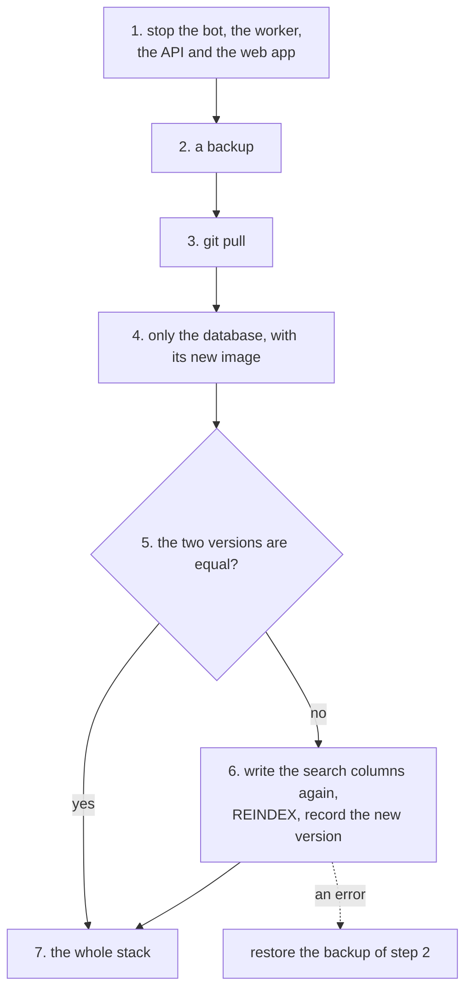
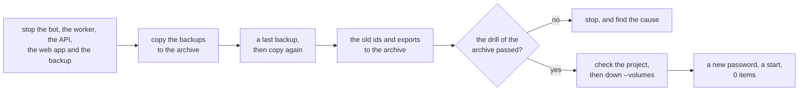

# 54. Compose from the root, an update and a new start

> Pull request: [#153](https://github.com/herman72/unshelve/pull/153) · Guide: [`docs/quickstart.md`](../quickstart.md), the sections [Update](../quickstart.md#update) and [Start again with an empty instance](../quickstart.md#start-again-with-an-empty-instance) · Code: [`compose.yaml`](../../compose.yaml), [`compose.prod.yaml`](../../compose.prod.yaml), [`deploy/compose.yaml`](../../deploy/compose.yaml), [`deploy/backup/drill.sh`](../../deploy/backup/drill.sh)

## In one minute

One clone is in the folder `clone-b`. Its `.env` has these three lines:

```text
UNSHELVE_DB_PASSWORD=second
COMPOSE_FILE=compose.prod.yaml
UNSHELVE_DOMAIN=unshelve.example.com
```

`docker compose config` shows the stack that a command in a folder would use. I ran it in three folders of the clone, with Compose 5.7.1:

| Folder | Project | Password in the address of the database | Caddy | Port of the database |
|---|---|---|---|---|
| the root | `clone-b` | `second` | yes | none |
| `apps/api` | `clone-b` | `second` | no | `127.0.0.1:54329` |
| `deploy/` | `unshelve` | `unshelve`, the default | no | `127.0.0.1:54329` |

Only the root gives the stack that `.env` asks for. In `apps/api`, a server gets the stack of a laptop. In `deploy/`, the API gets a wrong password, and the project gets the name `unshelve`. A real stack can run from a folder named `unshelve`, without `COMPOSE_PROJECT_NAME`. Then `docker compose down --volumes` in `deploy/` deletes the volumes of that real stack.

(In the measurement, the copy of `deploy/compose.yaml` had another `name:`, so that no command could reach a real project. In `deploy/`, the project takes the value of `name:`, and the file of the repository says `unshelve`.)

The rule: **run Compose in the root of the clone.**

This note also explains two procedures of the [quickstart](../quickstart.md) that depend on the rule. [Update](../quickstart.md#update) makes a backup first and checks the C library of the database. [Start again with an empty instance](../quickstart.md#start-again-with-an-empty-instance) deletes the data, with a tested way back.

## 1. Compose looks for its file upward

In `apps/api`, there is no Compose file. Compose looks in the folder above, then in the folder above that one, and it finds `compose.yaml` in the root. In `deploy/`, Compose finds `deploy/compose.yaml` at once, and it stops there.

The folder of the file that Compose finds is the *project folder*. Compose reads `.env` from the project folder. For `deploy/`, that is `deploy/.env`, and that file does not exist.

`COMPOSE_FILE` is different. In `apps/api`, Compose read the password and the project name from the root `.env`. But it did not use `COMPOSE_FILE`, so the stack had no Caddy. Only the root gives each setting of `.env`.

**A comparison from daily life:** a large house has a main door and a side door to the kitchen. The list of house rules hangs at the main door. A guest who comes in through the kitchen does not see the list.

## 2. Two ways for `.env` to reach a container

These lines of [`deploy/compose.yaml`](../../deploy/compose.yaml) give the settings to the services `migrate`, `api`, `worker` and `bot`:

```yaml
x-app: &app
  env_file:
    - path: ../.env
      required: false
  environment:
    UNSHELVE_DATABASE_URL: postgresql+psycopg://unshelve:${UNSHELVE_DB_PASSWORD:-unshelve}@db:5432/unshelve
```

1. **`env_file`** gives each line of `.env` to the container. The path `../.env` counts from `deploy/`, so it finds the root `.env` from each folder. In `deploy/`, the bot still got the token of `.env` in the measurement.
2. **Interpolation** puts a value into the Compose file before anything starts. `${UNSHELVE_DB_PASSWORD:-unshelve}` takes its value from the shell or from the `.env` of the project folder. In `deploy/`, there is no such `.env`, so the default `unshelve` applies.

**`environment` wins over `env_file`.** In `deploy/`, the bot got `UNSHELVE_DB_PASSWORD=second` from `env_file`. But the password in its database address was `unshelve`.

So in `deploy/`, a container of the app gets the real keys of `.env` and a wrong address of the database. The service `db` has no `env_file`, and its `POSTGRES_PASSWORD` is the default `unshelve` too. The service `backup` takes `UNSHELVE_DB_PASSWORD` by name from the shell or from the `.env` of the project folder, so it gets no password. Each other `${...}` of the file also takes its default, for example `UNSHELVE_KEYS_DIR` and `UNSHELVE_BACKUP_DIR`. In `deploy/`, the stack uses `keys/` and `backups/` of the clone.

## 3. The project name chooses the volumes

The same measurement, with and without the line `COMPOSE_PROJECT_NAME=example-live` in `.env`, gave these names:

| Folder | `COMPOSE_PROJECT_NAME` in `.env` | Project | Volume of the database |
|---|---|---|---|
| the root of `clone-b` | none | `clone-b` | `clone-b_db-data` |
| the root of `clone-b` | `example-live` | `example-live` | `example-live_db-data` |
| `deploy/` of any clone | any value | `unshelve` | `unshelve_db-data` |

A *Compose project* is the group of containers, networks and volumes of one stack. Each name starts with the name of the project, for example the volume `clone-b_db-data`.

Compose takes the name from the first of these that it finds ([Docker documentation](https://docs.docker.com/compose/how-tos/project-name/)):

1. the option `-p`;
2. `COMPOSE_PROJECT_NAME`, from the shell or from `.env`;
3. `name:` at the top of the Compose file;
4. the name of the project folder.

The root file `compose.yaml` only includes `deploy/compose.yaml`. The `name:` of an included file does not count, so the root takes the name of its folder.

Two results follow. Two clones in two folders named `unshelve` are one project. The `deploy/` folder of each clone is the project `unshelve` too. So a command in one place can stop or delete the stack of another place.

`COMPOSE_PROJECT_NAME` in `.env` gives a real instance a name of its own. It brings one new danger: a copy of that `.env` in a worktree or a second clone sends each command there to the same project. Do not copy such a `.env`. Remove the line from the copy, or give the copy another name.

## 4. An update with a way back

The local instance gave these two values on 2026-11-23, with a read-only query:

```text
$ docker compose exec -T db psql -U unshelve -d unshelve -Atc "SELECT datcollversion, pg_database_collation_actual_version(oid) FROM pg_database WHERE datname = current_database()"
2.36|2.36
```

A *collation* is the set of rules that sorts and compares text. This database uses the libc provider with `en_US.utf8`, so Postgres takes these rules from the C library of the image: glibc. The first value is the version of glibc that the database recorded. The second value is the version in the running image: PostgreSQL 17.11 on Debian 12. The two values are equal, so the indexes of text agree with the library.

A new image can bring a new C library, for example a build for a new Debian release. Then the sort order can change, and `lower()` can give other small letters for some characters. The indexes of text and the stored search columns keep the old results ([note 46](46-site-search.md)). Postgres prints a warning, but it repairs nothing.

[Update](../quickstart.md#update) checks this before the app writes:



- The bot, the worker, the API and the web app stop before the backup. So no post and no job comes in after the backup, and a restore of it loses no post.
- Only the database starts with the new image. The check comes before the app writes again.
- The rebuild runs only when the two versions are different.

`REINDEX` builds each index again from the rows. But a *generated column*, such as `items.fts`, is a stored value: Postgres computes it only when it writes the row. So step 6 also runs `UPDATE items SET title = title`, which writes each row again.

I tested step 6 in a throwaway database with the schema of the migrations, two items and two contents. I set the recorded version to 2.35. I also changed `u_norm()` so that it gives other results, as a new C library can:

| | Before step 6 | After step 6 |
|---|---|---|
| The check of step 5 | `2.35\|2.36`, and the warning `database "unshelve" has a collation version mismatch` | `2.36\|2.36` |
| Rows with an old search column | 2 of 2 items, 2 of 2 contents | 0 and 0 |
| A search for a word in its new form | 0 hits | 1 hit |
| Rows in the two tables | 2 and 2 | 2 and 2 |

Step 6 also records the new version for `template1` and `postgres`. `CREATE DATABASE` copies `template1`, and Postgres refuses a template with an old version. In a throwaway Postgres, I set the recorded version of `template1` to `0.0`. Then `CREATE DATABASE` stopped with `template database "template1" has a collation version mismatch`. After `ALTER DATABASE template1 REFRESH COLLATION VERSION`, it worked.

**A comparison from daily life:** a library sorts its cards by the alphabet. A new edition of the alphabet puts some letters in other places. The old boxes then have cards in wrong places, and a search misses them. The librarian sorts each box again before the readers come in.

## 5. A new start with a tested way back

[Start again with an empty instance](../quickstart.md#start-again-with-an-empty-instance) deletes the data of an instance. I ran its steps in a scratch clone with its own project name and ports, two test items and two backups. The archive after step 5:

```text
unshelve-archive-20261123T223623Z/      mode 700
  backups/db/20261123T223542Z/           the first backup of the stack
  backups/db/20261123T223608Z/           the backup with the two items
  backups/db/20261123T223637Z/           the last backup, from step 4
  backups/blobs/
  exports/ChatExport_2026-10-13/
  old-ids.env                            mode 600
```

The drill of step 6 ended with `the data check passed: the database and the files equal the backup 20261123T223637Z`. After step 10, the database had 0 items and the revision `0006`. In step 11, `unshelve publish show` printed an empty list of items. The folder of the backups held one backup: the first backup of the new instance.



Four details:

- **The first copy comes before any new backup.** Each backup removes old backups. It keeps the 7 newest, and the newest one of each of the last 6 calendar weeks. So the last backup of step 4 can remove the oldest backup, and only the first copy keeps it.
- **Postgres reads the password once.** The image of Postgres uses `POSTGRES_PASSWORD` only when its data folder is empty. In the scratch clone, a new password in `.env` without `down --volumes` stopped `docker compose up --wait`: the service `migrate` wrote `FATAL: password authentication failed for user "unshelve"`. After `down --volumes`, the same kind of new line works.
- **The ids start at 1 again.** Each button of the bot names an item by its id, for example "Done". In the new database, that id belongs to another item. So the guide clears the chat with the bot, if the same bot stays.
- **The site keeps the old feed.** The worker publishes only after a change of a public item, so step 11 writes the empty feed. A new item gets the first free public name of the new database, so an old public address can come back with another item.

## A choice that we made

**Copy the old backups to an archive, then remove them from the folder of the backups.**

| | Copy to an archive (the guide) | Keep them in the folder of the backups | Delete them |
|---|---|---|---|
| Can the old data come back? | yes, from the archive | yes, until a prune removes them | no |
| Old and new private files in one mirror | no | yes: the mirror only grows ([note 50](50-backup-and-restore.md)) | no |
| `restore list` of the new instance | only new backups | old and new backups together | only new backups |

**After a new C library, a rebuild in place, not a restore.**

| | SQL in place (step 6 of Update) | A restore of the backup of step 2 |
|---|---|---|
| What it deletes | nothing | the volumes; on a server, also the certificates |
| Tested by CI | no: only in a throwaway database | yes: CI restores on each run of the stack |
| When to use it | first | when step 6 stops with an error |

## What a senior engineer checks here

- **Which project does a destructive command touch?** Read the name first: `docker compose config | sed -n 1p` and `docker compose ls --all`. The name comes from the folder, so two folders with the same name are one project.
- **Is there a tested way back before the delete?** The drill of the archive runs before `down --volumes`, not after it.
- **Does a secret reach the terminal?** `docker compose config` prints each value of `.env`. The guide prints only its first line. The measurements of this note used a copy with made-up values. The new password goes from `openssl` into `.env` directly.
- **Can a copied `.env` point at the real stack?** Yes, when it sets `COMPOSE_PROJECT_NAME`. A worktree without that line takes the name of its folder.
- **Do old messages still act on new data?** Yes: the buttons name items by their ids (`done:<id>` in [`bot/cards.py`](../../apps/api/src/unshelve/bot/cards.py)).
- **Which steps does CI run?** Only the marked steps of the guide. Update and Start again have no marked step, so a change of the stack can break them without a red run. The checks of this note ran by hand.
- **What does a new image of the database bring?** The version of the server shows the Debian release, for example `17.11-1.pgdg12+2`. There, `pgdg12` is Debian 12. A new Debian release brings a new glibc. Then an instance needs step 6 of Update.

## Try it yourself

Run the measurement of this note. It uses a copy of the four Compose files and a `.env` with made-up values, so it shows no secret. `config` only reads the files: it starts nothing and deletes nothing. In the root of the clone:

```bash
scratch=$(mktemp -d)/clone-b
mkdir -p "$scratch/deploy" "$scratch/apps/api"
cp compose.yaml compose.prod.yaml "$scratch/"
cp deploy/compose.yaml deploy/compose.prod.yaml "$scratch/deploy/"
printf 'UNSHELVE_DB_PASSWORD=second\nCOMPOSE_FILE=compose.prod.yaml\nUNSHELVE_DOMAIN=unshelve.example.com\n' > "$scratch/.env"
for folder in . apps/api deploy; do
  echo "== $folder"
  (cd "$scratch/$folder" && docker compose config | grep -E '^name:|^  caddy:|UNSHELVE_DATABASE_URL' | sed 's/^ *//' | LC_ALL=C sort -u)
done
```

`LC_ALL=C` gives the same order of the lines in each terminal.

```text
== .
UNSHELVE_DATABASE_URL: postgresql+psycopg://unshelve:second@db:5432/unshelve
caddy:
name: clone-b
== apps/api
UNSHELVE_DATABASE_URL: postgresql+psycopg://unshelve:second@db:5432/unshelve
name: clone-b
== deploy
UNSHELVE_DATABASE_URL: postgresql+psycopg://unshelve:unshelve@db:5432/unshelve
name: unshelve
```

## Exercise (10 minutes)

1. In the same shell, add a project name to the `.env` of the copy:

   ```bash
   echo 'COMPOSE_PROJECT_NAME=example-live' >> "$scratch/.env"
   ```

2. Print the name of the project in each folder:

   ```bash
   for folder in . apps/api deploy; do (cd "$scratch/$folder" && echo "$folder: $(docker compose config | sed -n 1p)"); done
   ```

Which folders show `example-live`? Which folder still shows `unshelve`? A real stack runs from a folder named `unshelve`, without `COMPOSE_PROJECT_NAME`. What would `docker compose down --volumes` delete in each folder of the copy?

<details>
<summary>The answer</summary>

```text
.: name: example-live
apps/api: name: example-live
deploy: name: unshelve
```

The root and `apps/api` read `COMPOSE_PROJECT_NAME` from the root `.env`. `deploy/` reads no `.env`, so its project is the `name:` of `deploy/compose.yaml`.

In the root and in `apps/api`, the command would delete the volumes of `example-live`, and no such volume exists. In `deploy/`, it would delete `unshelve_db-data`, `unshelve_blobs` and `unshelve_backup-status`: the volumes of the real stack. Three defences work together. The first is Compose in the root. The second is a `COMPOSE_PROJECT_NAME` of its own for the real instance. The third is a look at the name of the project before each delete.

</details>

## Words used in this note

| Word | Meaning |
|---|---|
| Compose project | The group of containers, networks and volumes of one stack. Each of their names starts with the name of the project |
| Project folder | The folder of the Compose file that Compose found. Compose reads `.env` there |
| Interpolation | Compose puts the values of variables into its own file, for example `${UNSHELVE_DB_PASSWORD:-unshelve}` |
| `env_file` | A setting of a service: each line of the file becomes a variable in the container |
| Volume | A store of data that Docker keeps outside the container, for example `unshelve_db-data` |
| Collation | The set of rules that sorts and compares text |
| C library (glibc) | The basic library of the operating system. With the libc provider, Postgres takes the collation and the small letters from it |
| Generated column | A column that Postgres computes from other columns, and stores, when it writes the row |
| `REINDEX` | A command that builds an index again from the rows |
| Drill | A restore of a backup into a second, empty stack, to test the backup |

## To read more

- [Specify a project name](https://docs.docker.com/compose/how-tos/project-name/), Docker documentation. Read the order of precedence: why `deploy/` gets the name `unshelve`.
- [ALTER COLLATION](https://www.postgresql.org/docs/17/sql-altercollation.html), PostgreSQL documentation. Read "Notes": the warning about a version mismatch, and what to rebuild before the command records the new version.
- [postgres](https://hub.docker.com/_/postgres), the official image on Docker Hub. Read the warning under "Environment Variables": the variables have an effect only with an empty data directory.

Previous: [53. Fewer minutes of CI](53-fewer-minutes-of-ci.md) · Back to the [list of notes](README.md)
